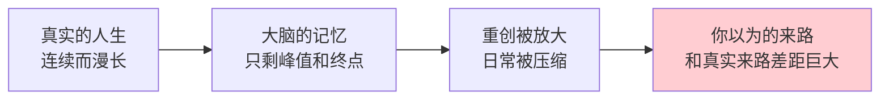
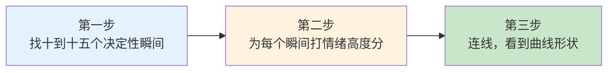
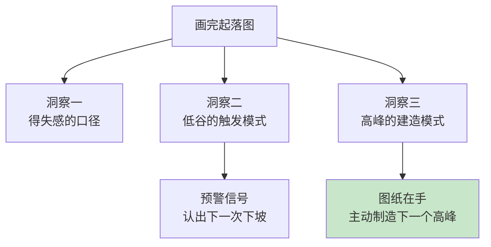
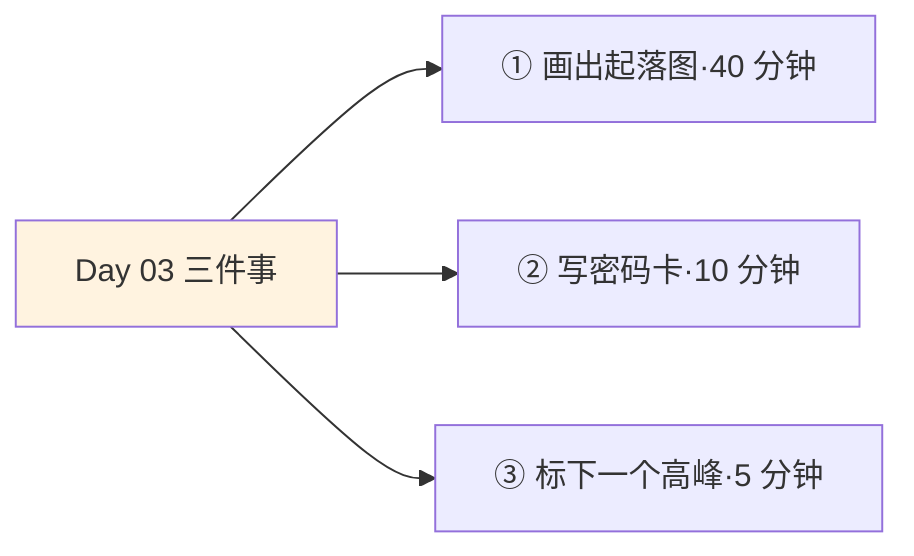

## Day 03·人生起落图谱：你的曲线就是你的密码

- [01.看一个真实案例](#01看一个真实案例)
- [02.什么是人生起落图](#02什么是人生起落图)
- [03.记忆的两个偏差](#03记忆的两个偏差)
- [04.画图三步骤](#04画图三步骤)
- [05.停滞期：没有点的年份](#05停滞期没有点的年份)
- [06.看什么：四个方向](#06看什么四个方向)
- [07.洞察一：得失感的口径](#07洞察一得失感的口径)
- [08.洞察二：低谷模式](#08洞察二低谷模式)
- [09.洞察三：高峰模式](#09洞察三高峰模式)
- [10.今天要做的三件事](#10今天要做的三件事)
- [11.总结回顾本章节](#11总结回顾本章节)
- [12.后来发生的改变](#12后来发生的改变)
- [13.今天起改变三点](#13今天起改变三点)
- [14.课后作业思考下](#14课后作业思考下)

---

## 01.看一个真实案例

去年我请一位三十岁的读者做一件事：把她出生到现在的人生画成一条曲线。

她的第一反应是抗拒。她说我的人生很平，没什么好画的，读书、毕业、工作、跳槽，普通得不能再普通。我说没关系，你就当帮个忙，画完发我看看。

三天后她发来一张照片。A4 纸上，一条歪歪扭扭的曲线从左画到右，上面标了十一个点。她附了一段话，大意是：画到第三个点的时候她哭了，画完之后她在桌子前坐了半个小时没动。

那条曲线上有一个很深的谷，落在她二十四岁那年，她标的事件是被动离职。曲线往上最陡的一段在二十七岁，她标的事件是自学转行成功。再往前，十八岁有一个小高峰，她标的是考上大学；二十二岁有一个中等深度的谷，她标的是毕业即迷茫。

发来的那段话里有一句我印象最深。她说：**我第一次看见，我所有的低谷都是别人替我做的决定，我所有的高峰都是我自己学的本事。**

这句话就是这一篇要讲的东西。你不需要马上明白它，画完你自己的图，你会得到你自己的版本。

## 02.什么是人生起落图

人生起落图是一张很简单的图。横轴是年龄，从零岁到你现在的年龄；纵轴是情绪高度，从负十到正十；然后在你的人生里标出十到十五个点，每一个点是一次你觉得"自己变了"的决定性瞬间。把这些点连起来，就是你的人生曲线。

它是终极判断法的第一半，用来回顾前半生、瞄定重大事件。Day 02 我们用极限情景向前看，看到生命的终点；今天我们把镜头转过来向后看，看出发的来路。一前一后，你才知道自己此刻站在整个人生的哪个位置。

为什么这件事值得单独用一天来做？因为**你的记忆不可信**——这不是修辞性的说法，是认知心理学的定论。你对前半生的印象，是经过了两个系统性偏差过滤之后的产物，而画图，是把过滤器的输出还原成原始数据。

那两个偏差，值得单独用一节讲清楚。

## 03.记忆的两个偏差

**第一个偏差，叫峰终定律。**心理学家卡尼曼（对，就是 Day 02 损失厌恶的那位）在实验里反复验证：人们对一段经历的记忆，几乎完全由**体验最强烈的时刻**和**结束时的感受**决定，过程中的漫长平淡会被压缩到忽略不计。做过胃肠镜的患者，记住的是最疼的那几秒和结束时疼不疼——中间二十分钟的不适，事后大脑直接删除。

**第二个偏差，叫消极偏差。**坏事的记忆强度大约是好事的三倍。一次重创会在记忆里占据远超其实际比重的位置，而十次顺利会互相抵消成一句"还行"。进化给的设置——记住危险才能活命——放在和平年代，就成了每个人记忆库里挥之不去的放大器。

这两个效应叠加的结果是：**你记忆里的人生，不是你真实的人生**。你以为自己总是倒霉，可能只是低谷被记忆放大了；你以为自己一事无成，可能是因为日常的积累根本没有被存档。

举一个更直观的例子。你写日记的时候，是不是大部分时候写的都是烦心事？开心的日子总觉得没什么可写的，一天的顺利压缩成一句"今天挺好的"，而一天的糟心能写满一页。十年之后翻回去看，你会得出"我这些年过得真差"的结论，而真实的十年里，顺利的天数可能远多于糟糕的天数。**日记放大了谷，抹平了原野。**

人生起落图做的事，就是把记忆里的点强制摊开在一张纸上，让连续的、漫长的人生重新变得可见。它和日记的区别在于：日记是顺着时间记的，一段一段，看不到整体；起落图是站在终点回头看，一眼看到全部。它的价值不在画的过程，而在画完之后你看见的那个形状。**形状里藏着日记永远给不了的东西：模式。**

## 04.画图三步骤

现在拿出一张 A4 纸，或者翻开附录 B 的起落图模板，我们分三步来画。整个过程大约需要四十分钟，建议找一个不被打扰的时段，手机放在另一个房间。

第一步，从出生到现在，找出十到十五个决定性瞬间。判断标准只有一条：**那一刻之后，你变得不一样了。**它可以是一件大事，比如升学、失恋、离职、亲人离世；也可以是一件小事，比如某天下午你读到一句话，从那以后你看问题的角度变了。找的时候不要追求全面，脑子里最先冒出来的那些，往往就是最重要的。如果超过十五个，就砍掉那些"发生了但没有改变我"的，留下"发生之后我变了"的。

第二步，为每个瞬间打一个情绪高度分，范围从负十到正十。正十分是狂喜，比如拿到梦寐以求的录取通知；负十分是至暗，比如至亲离开。打分的依据不是事件在别人眼里的大小，而是它在你心里的重量。同一场失恋，有人打负三，有人打负九，都对，因为这是你的图，不是标准答案的图。

第三步，把这些点按年龄顺序放在坐标系里，连成一条线。连线的时候你会经历一种奇怪的感受：有些年份曲线很高，有些年份一整个区间都趴在零线以下，那些你以为自己"也就那样"的时期，在图上呈现出漫长的低谷形状，一目了然。

画完之后，在曲线上标出你现在的位置：你的年龄，你此刻的情绪高度，你正处在曲线的哪一段。**一定要标记出你目前所在的位置**，这是整张图最重要的一个点，因为它决定了下一段曲线的方向。

## 05.停滞期：没有点的年份

三步画完，几乎每个人都会撞见同一个发现，它值得单独一节：**两次相邻的决定性瞬间之间，可能隔着五六年。**

比如二十二岁毕业那年是谷，二十九岁转行那年是峰，中间整整七年，你能想起来的点一个都没有。这七年去哪了？不是没有生活——那七年里你上过班、旅过游、谈过恋爱、过过生日——是那段生活里没有任何一件事让你"变了"。

**这种长长的平直区间，起落图会诚实地标出来，它有一个名字：停滞期。**

很多人画完图最震惊的不是低谷有多深，而是停滞期有多长。因为低谷至少是个事件——有故事、有情绪、有得可讲；停滞期什么都没有，它是纯粹的时间流逝。低谷好歹进入了你的记忆库，停滞期连被记住的资格都没混上。

关于停滞期，有三句话要讲清楚。

**第一，它不等于安稳。**安稳是"我不想变"，是选择；停滞是"我没变"，是默认。图上分不出这两者的区别，你自己分得出：回看那段平直区间，你当时是安心地待着，还是隐隐觉得哪里不对但没动？前者叫扎根，后者才是停滞。

**第二，它是低谷的慢性版本。**负十的谷一次只伤一阵子；一条趴在零线的十年平线，伤的是整个十年。**很多人以为自己的问题是"那年那件事"，画完图才发现，真正的问题是"那些什么都没发生的年份"。**

**第三，也是最有用的：从今天起，你有机会决定下一个点是今天。**停滞期的成因是"没有变化被记录"，那么打破它的方法简单到可笑——制造一个决定性瞬间。不需要惊天动地：开始学一样东西、开始一张记录、开始这本书的三十天，都算。**今天这个点，画下去就是了。**

## 06.看什么：四个方向

图画完了，接下来是看。看四个东西。

第一，什么事曾让你狂喜。找到曲线上最高的两三个点，看看它们分别是什么事件。这些事件藏着一个问题的答案：什么东西能真正点燃你。注意区分"事件的荣耀"和"事件本身"——比如考上大学是荣耀，但你狂喜的可能不是那所学校，而是"我的努力被证明了"这件事本身。

第二，什么事让你愤怒和悲伤。找到曲线上最低的两三个点，看看它们分别是什么事件。这里藏着你真正的软肋和你在意的东西。你因为什么跌落，说明你把什么看得最重。

第三，哪些决定改变了后来的轨迹。在每个点上问一句：这件事是我选的，还是发生在我身上的？开篇那位读者看见的规律，就是这一问照出来的。**主动的选择和被动的事故，在曲线上是两种完全不同的能量。**主动选择带来的低谷，往往是转机的前奏：你选了一条难的路，痛是学费；被动事故带来的低谷，往往需要更长的恢复期：伤是别人给的，账却要你来还。分清这两种谷，你就知道自己的低谷属于哪一种，该用什么方式走出来。

第四，你现在在哪个位置。你此刻站在曲线的什么高度，正处在上升段、下坡段，还是长长的平台期？你的情绪和时期，起落图会让你对当下有更清晰的全新理解。很多人画到这里会愣住：原来我已经在同一个高度上待了五年了。这个愣住，就是改变的起点。

看这四个东西的时候，有一个心法要带上：**只看，不判**。看到了低谷，不要急着骂当年的自己；看到了停滞，不要急着焦虑。评判会把看的过程提前打断，很多人画到一半就开始情绪上头，然后整张图就画不下去了。前两天我们说过那条原则，这里同样适用：**自责让人放弃，看见让人改变。**画图和看图，都只是看见。

## 07.洞察一：得失感的口径

如果只是看了四个东西就收起来，这张图的价值只发挥了三成。真正的价值在三个洞察上，它们需要在看完之后的安静里浮现。每个洞察一节。

**第一个洞察：你的得失感取决于什么。**

每个人的坐标系刻度不一样。有人一次考试失利就是负八，有人创业失败也只打负四。回看你打过的所有分，你会发现你的分数是有口径的：**你习惯用什么衡量得失——是别人的认可，是物质的增减，还是自我评价的升降。**

看一个对照就明白口径的力量。同样是被上司当众批评：口径是"别人认可"的人，打负七，难受一星期；口径是"自我评价"的人，可能打负二，当晚就琢磨出了下次怎么回。事件一样，分数天差地别——**伤害你的从来不是事件本身，是事件撞上你的口径。**

看清自己的口径有两个用处。其一，情绪预报：知道自己的口径，就知道什么事件会让你大起大落，下次它们来的时候，你至少知道自己为什么反应这么大。其二，口径修订：如果发现自己的口径常年把命脉交给别人（比如一切以他人认可计分），你有机会慢慢换一个内稳的口径——这不是一天的事，但**看见口径，是换掉口径的第一步**。

## 08.洞察二：低谷模式

**第二个洞察：你的低谷模式。**

把所有负分事件排成一列，看它们的触发点有什么共性。是都在关系破裂之后？是都在换了环境之后？是都在付出没有被看见之后？**低谷不是随机分布的，它们有你的专属模式。**

几种常见的模式，对照看看。开篇那位读者的模式是"被动接受安排"——她的每次大跌都发生在别人替她做了决定、而她没有反抗的时候。另一位读者的模式是"用力过猛后的塌陷"——他的每次大跌都发生在一阵高强度冲刺之后，透支把下一段拖成了深谷。还有一种常见的模式是"验证焦虑"——每次大跌都在等待一个重要结果的时候，等 offer、等成绩、等对方的答复，情绪命脉常年挂在别人手里。

**看清触发点，你就拿到了下次的预警信号：当同样的情境再次出现，你会认出它。**

认出它的意义不是避免——低谷无法避免，低谷甚至是必需的：你的每次大涨，几乎都长在某个大跌的恢复期里，没有那个谷，就没有后来的坡。认出的意义是让你**在下坡路上知道自己在下坡，而不是下到谷底了还不知道发生了什么。**这两种状态的心理体验完全不同：前者是清醒地经历，后者是被淹没。

一个实操建议：给你的低谷模式起个名字。"又来了，我的'被动接受'时刻"——命名即降伏，一个有名字的下坡，比一个无名的深渊好走得多。

## 09.洞察三：高峰模式

**第三个洞察：你的高峰模式。**

把所有正分事件排成一列，看它们的共性。是都在学会新东西之后？是都在被信任委以重任之后？是都在帮到别人之后？**高峰同样不是随机分布的。**

开篇那位读者的模式是"通过学习重获主动权"——她的每次大涨都发生在自学了一样东西并且用上了的时候，和她的低谷模式（被动接受）恰好互为镜像：**她的人生密码，一句话就写完了——被动就跌，主动就涨。**另一位做销售出身的朋友，他的高峰全部长在"赢下硬仗"上，越是别人不看好的单子，拿下来之后他的情绪越高。还有一位老师朋友，她的高峰全部指向"被学生记住"的时刻，那些时刻在别人看来微不足道，在她图上全是正八正九。

**看清高峰模式，你就拿到了造高峰的图纸：你知道往哪个方向使力，自己会涨。**

图纸的用法有一个铁律：**每个人的图纸不一样，别人的图纸对你无效。**靠学习涨的人硬逼自己去社交，靠硬仗涨的人守着安稳度日，靠被记住涨的人去追财富数字——都会事倍功半，而且越努力越挫败，因为他们在用别人的图纸盖自己的房子。起落图最重要的产出，就是这张只属于你的图纸。

这三个洞察加起来，就是那句话：**你的曲线，就是你的密码。**密码的意思是，它解释了你的过去为什么是这个形状，也提示了你的未来可以是什么形状。

## 10.今天要做的三件事

说了这么多，到了今天真正要做的事。三个动作，加起来约一小时——今晚的核心任务，就是把图画出来。

动作一，画出你的起落图。四十分钟，一张 A4 纸或附录 B 的模板：十到十五个决定性瞬间，每个打一个情绪高度分，连成线，标出你此刻的位置。不追求好看，只追求诚实——打分的时候问心里的重量，不问别人眼里的大小。如果中途情绪上头，允许停下来，明天接着画，但**今晚至少画完前五个点**。

动作二，写你的密码卡。拿一张便签，写下三行字：**我的得失感取决于什么；我的低谷都被什么触发；我的高峰都由什么建成。**写完贴在起落图旁边——这张便签以后有一个专属用途，见下一节。

动作三，标出你想制造的下一个高峰。在曲线的延长线上，在你现在位置的前方，画一个虚线的点，标上你想在一年内抵达的高度和它可能对应的事件。注意，这个事件应该长在你的高峰模式上，而不是别人的模式上：靠学习涨的人，标一门想学会的硬本领；靠硬仗涨的人，标一场想赢下的挑战；靠被记住涨的人，标一件想留给别人的东西。**不用现在就知道怎么到达，先把它标出来，虚线的点会自己开始拉动你。**

## 11.总结回顾本章节

人生起落图是终极判断法的第一半，用一张横轴年龄、纵轴情绪高度的曲线，回望前半生的决定性瞬间。它对抗的是记忆的两个偏差：峰终定律让你只记得峰值和终点，消极偏差让坏事占据三倍的记忆比重——所以你以为的来路，不是真实的来路。画图三步：找十到十五个决定性瞬间，为每个瞬间打情绪高度分，连线看到形状；顺手会撞见停滞期——那些没有点的年份，是低谷的慢性版本。看完四个方向：狂喜的事、悲伤的事、改变轨迹的决定、此刻的位置。最后沉淀三个洞察：得失感的口径、低谷的触发模式、高峰的建造模式——低谷模式给你预警，高峰模式给你图纸。

一句话总结：看清楚了自己怎么走到这里，才知道下一步该往哪走。**你的曲线，就是你的密码。**

## 12.后来发生的改变

回到开头那位三十岁的读者，说说她后来怎么样了。

画完图的那一周，她做了两件事。第一件，她把那张 A4 纸拍下来设成了手机壁纸，锁屏一亮就是那条曲线。她说每次想点开招聘软件又犹豫的时候，看一眼二十四岁那个深谷，就不犹豫了。第二件，她给自己报了一个一直想学但拖着没学的数据分析课。理由很简单：她看见了自己所有的上涨都始于"学一样新东西"，那么下一次上涨的起点，也应该是一个。

四个月后她发来消息，说课程学完了，她在公司内部转了岗，做上了和数据分析相关的活。她说面试那天她特别平静，因为她知道这次不是"被动接受安排"，是她自己挑的。她还说了一个细节：转岗后的第一个月特别难，好几次想退回去，每次都是锁屏上那条曲线把她拽住的。她指着二十四岁那个谷对自己说，退回去就是回到这个点旁边，我不想再画一个一样的谷。

还有一个小细节她后来才告诉我。画完图那天晚上，她把十一个点里唯一一个她标了正九、却一直不敢承认的事重新圈了出来：大学时她给校刊写了两年稿，那是她整个学生时代情绪最高的持续期。她现在又开始写了，每周一篇，发在自己的公众号上，没什么人看，但她说是写给曲线上的那个点看的。

她说：**以前我觉得我的人生是散的，一件事和一件事没关系。现在我看它是一条线，每个点都踩在点上。**

## 13.今天起改变三点

第一，密码卡进重大决定。从今天起，每次面对重大选择（换工作、搬家、开始或结束一段关系），先把密码卡拿出来过一遍：**这个选项，落在我的高峰模式上，还是低谷模式上？**很多当时看起来两难的选项，放到模式上一比就分出了高下——因为它问的不是"哪个更好"，是"哪个更像会让我涨起来的那种事"。

第二，曲线设成壁纸。把你画的起落图拍照设成锁屏——你每天点亮几十次屏幕，就免费做几十次坐标校准：**我在哪，我下一个点想在哪。**那位读者用这个方法扛住了转岗第一个月的所有动摇。

第三，每年年底重画一次。把这十二个月的新点补上去——今年有没有新点？它落在什么高度？连续几年下来，你拥有的就不只是一张回顾图，而是**一部自己的实时曲线**：它在告诉你，你此刻正活在上升段还是又一个停滞期里。图是活的，每年长一岁。

最后说一句给今天晚上的你。画这张图可能会勾起一些你压了很久的情绪，有人会在某个点上停下来很久，有人会画到一半哭出来，这些都正常，也都值得。给这些情绪一点时间，不要急着用娱乐把它盖掉——Day 22 我们会专门聊聊情绪和无聊的去处。今天只需要记住：**你能坐下来画完这张图，本身就已经是曲线上的一个决定性瞬间了。**二十年后回看，今天可能就是那个点。

## 14.课后作业思考下

第一，对照你的起落图，找出那个情绪高度最低的点，写一段一百字的复盘：这件事里，哪些部分是我可以影响的，哪些不是？如果重来一次，我会在哪个环节做出不同的选择？

第二，统计你图上主动选择和被动事故的比例。主动选择带来的结果里，正分和负分各占多少？被动事故带来的结果里，正分和负分又各占多少？这个统计会让你对自己"该多主动还是该多谨慎"有一个数据化的答案。

第三，量一量你的最长停滞期：曲线趴在同一个高度上最久的那一段有几年？是什么让你在那个高度停了下来——是环境不需要你变了，还是你自己不敢变了？再回答一问：从停滞期的成因看，今天的你正在制造下一个点，还是正在进入下一段停滞？

第四，把你的起落图讲给一位熟悉你的人听，请他指出你没画上去的、但他记得的你的决定性瞬间。别人的记忆会补上你的盲区，通常至少能补上两三个你自己完全忘了、但对别人影响很深的点。讲的过程还有一个额外的好处：当你把曲线说出口，你会听到自己如何评价那些点和分——很多人是在讲述里第一次意识到，自己对某段经历的态度已经变了。

这四道题不必今晚做完。图是今晚画的，题是留给这一周的。

---

**明日预告 · Day 04 追悼会策划书。** 回望完毕，明天我们把镜头拉到最远处。如果给你的人生写一份追悼会策划书，谁会来？谁上台？你的墓志铭是什么？听起来沉重，做起来清醒。前半生的曲线已经画完，后半生的答案，明天揭晓。
