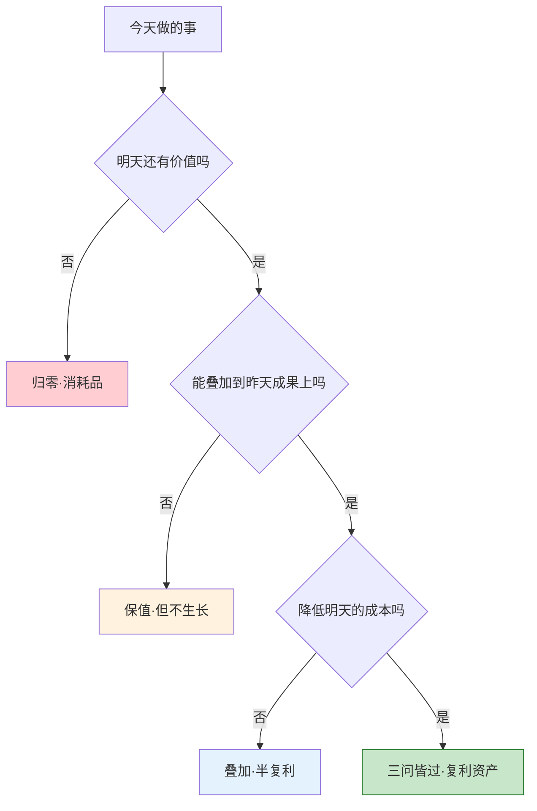
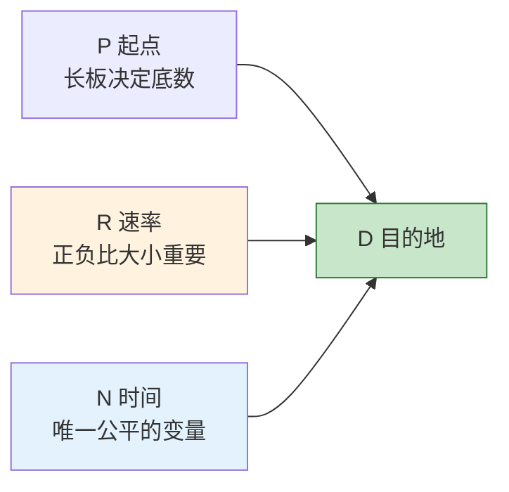
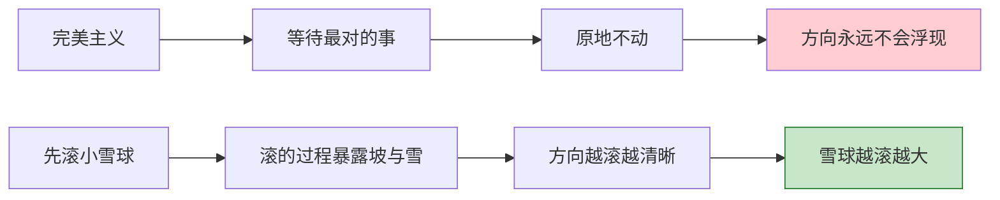
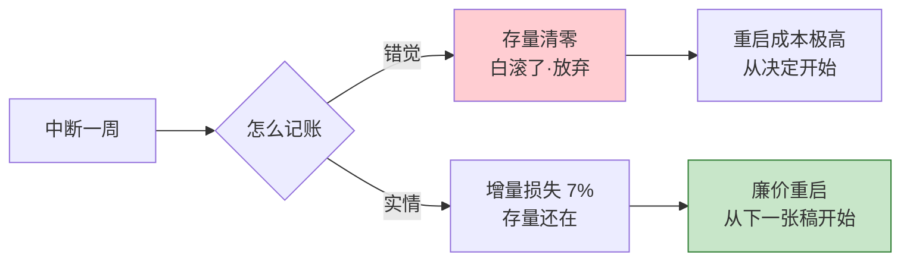
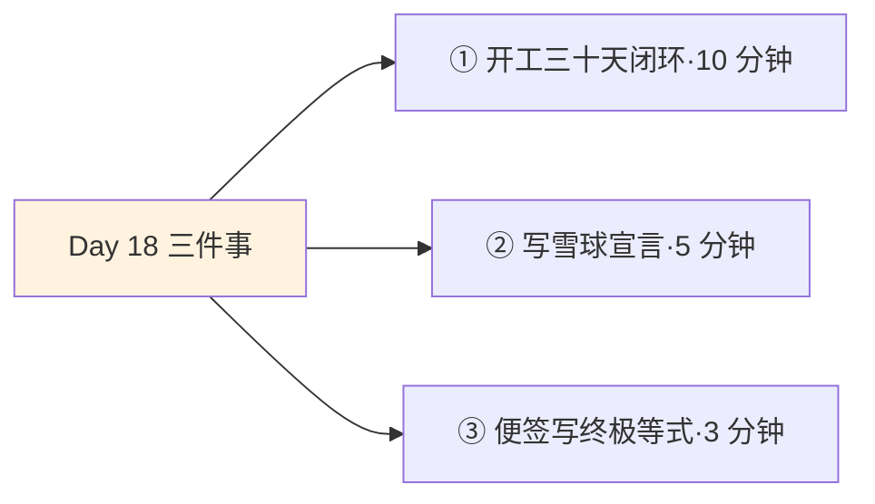
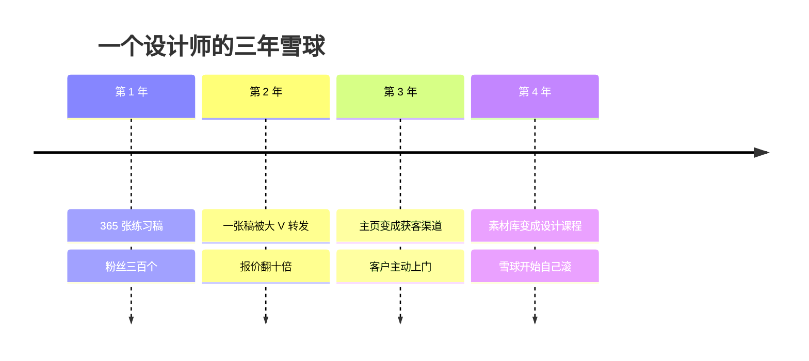

## Day 18·复利属性：让雪球先滚起来

- [01.看一个真实案例](#01看一个真实案例)
- [02.复利属性的三个判断](#02复利属性的三个判断)
- [03.终极等式](#03终极等式)
- [04.三个变量的展开](#04三个变量的展开)
- [05.五种复利资产](#05五种复利资产)
- [06.三种伪复利陷阱](#06三种伪复利陷阱)
- [07.让雪球滚起来的两个信念](#07让雪球滚起来的两个信念)
- [08.中断的数学](#08中断的数学)
- [09.三十天复利闭环](#09三十天复利闭环)
- [10.今天要做的三件事](#10今天要做的三件事)
- [11.总结回顾本章节](#11总结回顾本章节)
- [12.后来发生的改变](#12后来发生的改变)
- [13.今天起改变三点](#13今天起改变三点)
- [14.课后作业思考下](#14课后作业思考下)

---

## 01.看一个真实案例

先讲一位设计师读者的故事，她叫小雪，今年三十岁，在一家互联网公司做 UI 设计。

二〇二二年秋天，她做了一件同事都觉得没必要的事：每天下班后做一张练习稿，发到一个公开的设计平台上。不是作品集，不是接单，就是每天一张，海报、图标、界面临摹加原创，发完就睡。第一年她发了三百六十多张稿子，粉丝三百多个，其中一半是同事。有同事好心劝她：这年头谁还看帖子啊，涨不了粉的。

第二年春天，一张稿子被一位行业大 V 转发，一夜之间来了几千个关注。第三年，开始有客户拿着她主页上的历史作品来谈合作，她的报价从一张两百块涨到一张两千块。到今年，她那个发了一千多张稿子的主页，同时是她的作品集、她的获客渠道和她的个人品牌，公司招人的时候，主管指着她说：我们要的就是她主页这种东西。

她跟我说过一句我记到现在的话：**"我不是哪一天突然变厉害的，我是把变厉害的过程，全部晒在了外面。"**

同样是一万小时，有的人滚成了雪球，有的人只是化了的水。小雪和她的同事能力差距并没有那么大，差距在于：她的每一天都叠在了前一天上面，而同事的每一天都是从零开始。这就是今天要讲的东西，复利属性。

## 02.复利属性的三个判断

赚钱时间最核心的一个要素，就是你有没有沿着核心竞争力，做着能产生复利效应的事。问题是，怎么判断一件事有没有复利属性？

不需要玄学，三个问题依次往下问，像过筛子一样。

**第一问：今天做的事，明天还有价值吗？**这叫保值。刷两个小时短视频，明天它就归零了；写一篇两百字的复盘，明天它还在。归零的事不是不能做，人总要有归零的快乐，但你得知道自己每天有多少时间投给了归零。

**第二问：今天做的事，能不能叠加到昨天的成果上？**这叫叠加。小雪的第一千张稿子，是从第一张长出来的；而你今天开的第二个会，不会让昨天的会更有效率。能叠加的事做一年，是一百层楼；不能叠加的事做一年，是一百块砖平铺在地上。

**第三问：今天做的事，有没有让明天变得更便宜？**这叫降本。你花一个月整理一套自己的设计规范，以后每个项目都快三天；你花一周学会一个快捷键系统，以后每天省二十分钟。**边际成本下降，是复利最硬的表现：同样的产出，明天比今天更省力。**

拿日常活动过一遍这个筛子，你会看得非常清楚。

| 活动 | 明天有价值吗 | 能叠加吗 | 降本吗 | 判定 |
|:---|:--:|:--:|:--:|:---|
| 刷两小时短视频 | ✗ | ✗ | ✗ | 归零 |
| 开一个没结论的会 | ✗ | ✗ | ✗ | 归零 |
| 写一篇工作复盘 | ✓ | ✓ | ✓ | 复利 |
| 认真维护一位客户 | ✓ | ✓ | ✓ | 复利 |
| 健身一小时 | ✓ | ✓ | ✓ | 复利 |
| 焦虑地刷新招聘软件 | ✗ | ✗ | ✗ | 归零 |

注意最后一行的措辞：焦虑地。同样是查招聘信息，带着清单去研究岗位要求是保值，漫无目的地反复刷新是归零。**复利属性不取决于活动本身，取决于你做它的方式。**

## 03.终极等式

原稿里藏着一个硬核人生终极等式，今天完整拆开。先看式子：

**D = P × (1 + R) ^ N**

D 是目的地，是你最终想抵达的那个地方，你的梦想清单上写的那些事。P 是你的起点，此刻手里的核心竞争力。R 是你每天的进步速率。N 是时间，以年为单位。这个式子的意思很朴素：**你最终能到哪，由你从哪出发、每天走多快、走了多少年，三个数一起决定。**

在逐个拆变量之前，先看这个式子作为整体的三个性质——它们比任何单个变量都重要。

**性质一：它是乘法，不是加法。**加法世界里，一天做一件小事，一年三百六十五件，堆在一起；乘法世界里，每一天都站在前一天的肩膀上。小雪和同事的差距不在努力总量——同事可能更努力——在运算结构。**加法的人生再勤奋，也只是很高的一摞砖；乘法的人生哪怕每天很小，也在长成楼。**

**性质二：它的曲线是指数的，前半段平得让人绝望。**这是复利最反直觉的地方：第一年到第三年，两条线几乎分不出彼此；第五年开始拉开，第八年断崖式分离。**多数人死在第三年——不是因为不信复利，是因为前三年复利根本不给你看脸。**小雪第一年三百个粉丝，就是那条平得让人绝望的前半段。

**性质三：它对方向错误有惩罚，对晚出发有仁慈。**方向错了（R 为负），N 越大，离 D 越远；方向对了，哪怕三十五岁才出发，N 往后算二十年，账面依然惊人。所以这个式子真正的用法是：**先用尽一切办法确认 R 是正的，然后什么都不用做，交给 N。**

## 04.三个变量的展开

现在逐个变量拆开说，每个变量都有一个最常见的误读。

**P 的误读：把技能清单当 P。**很多人把自己的技能清单当 P——会一点 Excel、会一点 PS、会一点写作，每一样都在平均水平上下。但式子对 P 的要求是乘法的底数：**底数是一，后面乘得再久还是一。**这就是 Day 07 讲过的长板逻辑在这里的回声——先找到那块真正超出平均的长板，P 才成立。P 不是"我会什么"，是"我比平均水平长出来的那一块"。

**R 的误读：把它当冲刺速度。**最大的误区是高估 R：年初办卡健身十次，年中一次不去，R 从正零点五直接跳到零，甚至因为受伤变成负数。注意，**R 的正负比 R 的大小重要得多**：每天进步百分之一，一年是三十七倍；每天退步百分之一，一年只剩百分之三。时间不分辨方向，它只放大方向。R 要的不是快，是**可持续的正**——一个你十年后还做得到的速率，才配叫 R。

**N 的误读：以为它站在你这边。**N 是唯一公平的变量：对每个人流速一样，只往一个方向流，谁也不能充值。多数人失败的姿势不是"没时间"，是把 N 记在了别人的账上——替老板加班的 N 长老板的复利，刷平台的 N 长平台的复利。**你对 N 唯一的自由，是决定今天这二十四小时，替谁的式子积分。**

一句话收拢这一节：**P 用 Day 07 的方法找，R 用 Day 12 的原则定（踮踮脚、可持续），N 从今天开始记。**三个变量，前两个你都已经学过工具了——这个等式其实是前十七章的一次总装。

## 05.五种复利资产

过了三问筛子的事，最后都会凝结成五种资产。逐一看。

**第一种，认知资产。**你学到的东西。注意"学到"和"经历"的区别：上了一年班，是经历；把踩过的坑写成十条清单，是资产。**经历只在你身上发生，资产能被反复调用。**认知资产的关键动作是写下来，不写下来的一切思考，明天就还给大脑了。

**第二种，作品资产。**文章、视频、代码、设计稿、课程、一个小产品。这是五种资产里最适合普通人起步的一种，因为它只依赖你自己：不需要本钱，不需要人脉，不需要许可，一台电脑就能开工。小雪的一千张稿子就是标准的作品资产。

**第三种，关系资产。**信任和圈子。关系资产的复利是最被低估的：一个信任你的人，会把你介绍给下一个信任你的人，信任沿着关系网自动流动。它的规则和作品一样，**先给予，后积累，不能透支。**

**第四种，品牌资产。**认知和作品的外部记账本。前三样资产存在你身上，品牌资产存在别人脑子里：一提到某个领域，人们就想起你。它的好处是杠杆极大，坏处是积累最慢、最怕透支——品牌是别人替你保管的复利，你砸一次，别人替你记一辈子。

**第五种，资本资产。**钱和股权。唯一一种别人替你值夜班的资产：你睡觉的时候，它也在工作。但把它放在最后讲是有意的：**资本资产本身不产生方向，它只是前面四种资产的兑换凭证。**没有前面四种，钱只是等着被消耗的燃料。

| 资产 | 复利方式 | 起步动作 | 适合谁 |
|:---|:---|:---|:---|
| 认知 | 写下来，可反复调用 | 每天一条复盘 | 所有人 |
| 作品 | 长期公开，自动叠加 | 每天生产十五分钟 | 内容、技术、创意行业 |
| 关系 | 信任沿网络流动 | 每周帮一个人一件事 | 所有行业 |
| 品牌 | 存在别人脑子里 | 持续输出同一主题 | 有长期方向的人 |
| 资本 | 别人替你值夜班 | 每月固定比例储蓄 | 有现金流的人 |

我的建议：普通人从作品资产起步，因为它的门槛最低、验证最快，而且作品会顺带生产认知、吸引关系、长出品牌——**五种资产里，作品是那个能带动其他四种的母资产。**

## 06.三种伪复利陷阱

复利这个词现在很热，热到什么都能往里装。三种最常见的伪复利，今天点名。

**第一种，打卡型。**只在意天数，不在意质量。打卡五百天，点开一看，是同一道菜的照片、同一段"今天也加油"的废话。打卡本身没有错，错在把打卡当成了资产。识别信号很简单：**你在喂养打卡，还是喂养资产？**打卡停了就归零的，是打卡；停了也还在的，才是资产。

**第二种，焦虑型。**为了复利而复利。什么都想积累：英语、编程、剪辑、写作、健身，每个都学一个月。这种人往往资产列表比作品列表长。焦虑型复利的本质是把"我在积累"当成止痛药，用形式上的勤奋，掩盖方向上的缺席。解药只有一个：**砍到一件事。**你不需要五种资产，你需要一种资产滚五年。

**第三种，假勤奋。**低质量重复。写了三年日记，三年都是流水账；做了十年 PPT，第十年和第一年的水平可以互换。假勤奋最隐蔽，因为它满足叠加的表象，时间在堆，东西没在长。识别方法：**把第二年的成果和第一年的放在一起，如果可以互换，那就不是复利，是复读。**

| 陷阱 | 典型表现 | 识别信号 | 解药 |
|:---|:---|:---|:---|
| 打卡型 | 五百天同质打卡 | 停了就归零 | 打卡为资产服务 |
| 焦虑型 | 什么都想积累 | 资产列表比作品长 | 砍到一件事 |
| 假勤奋 | 低质量重复 | 第二年=第一年 | 提高单次质量 |

伪复利最贵的地方，不是浪费了时间，而是**它让你以为自己一直在复利，从而放弃了真正的选择。**

## 07.让雪球滚起来的两个信念

讲完了判断和陷阱，接着是两个信念。方法论解决不了启动问题，信念才可以。

**信念一：只要不间断地在尝试和思考中了解自己，热情和方向会渐渐浮现。**这是原稿里最温和也最有力的一句话。它说的是：你不需要现在就想清楚这辈子做什么，P 和 D 都不是想出来的，是在不间断的尝试和思考里长出来的。Day 15 的小念头本就是干这个的：你今天记下的每一个"我想试试"，都是未来那个清晰方向的早期数据。不用急，方向是后到的客人，你只要一直开着灯。

**信念二：先行动起来，让自己作为雪球先滚动起来。**对抗的是完美主义。很多人的卡点是：等我找到那个最对的事再全力投入。这个逻辑反了。**雪球不是找到的，是滚出来的。**一捧雪再湿，摊在原地就是一摊水；先攥一个拳头大的小雪球推起来，滚着滚着，你会知道哪条坡长，哪条坡雪厚。路是滚出来的情报。

两个信念合起来读：**方向负责让你滚对，行动负责让你滚起来。前者可以慢慢来，后者必须今天开始。**

只要雪球继续滚下去，终有一天会串起点滴。

## 08.中断的数学

两个信念讲完"启动"，这一节讲"持续"——具体讲，讲中断的账怎么算。因为每个开始滚雪球的人，都很快会遇到第一次中断：出差三天、生病一周、崩溃半个月——然后心里冒出那个熟悉的念头："断都断了，前面白滚了，算了吧。"

**算了吧这三个字，是复利最大的杀手。而它建立在一次错误的记账上。**来把账算清楚。

先算损失。每天进步百分之一，坚持三百六十五天，是三十七倍。如果中途断了一周呢？不是退回七天前的水平——**技能和资产不会因为你休息一周就清零，清零的只是"连续天数"这个数字。**断一周的真实损失，是少滚了七天的增量，大约是百分之七——跟"白滚了"之间差着三十倍的距离。**中断的真实代价是增量损失，不是存量清零——把增量损失感觉成存量清零，是大脑在骗你放弃。**

再算一种更贵的账：重启成本。中断真正的代价不在中断期间，在重启那一刻——重新说服自己"我还接着滚"的心理开销，往往比中断本身大十倍。很多人的雪球不是死在中断里，是死在"断完之后的那次重新决定"上。所以比"不断"更重要的能力是**廉价重启**：给重启定的门槛越低，中断的杀伤力越小。

三条实操纪律，把中断的数学用起来。**第一，给连续性换定义**：不看"连续天数"，看"本月完成率"——本月做满六成即合格，断一周不破功。**第二，预设中断条款**：开工前就写好"出差周的最小维持量"（哪怕每天只滚五分钟），中断当天先问最小量，不问全量。**第三，重启动作写死**：中断后的第一次，永远从一个五分钟的固定动作开始——打开文档读上一段，就是重启。

一句话记住这一节：**断掉的不是雪球，是记分牌；雪球还在，捡起来接着滚就是。**

## 09.三十天复利闭环

最后一节，把这一章压缩成一个可以立刻执行的实验——**三十天复利闭环**。它的目的不是三十天见效（复利前半段本来就平），而是**让你亲眼看见一次完整的循环**：投入、中断、重启、盘点——第一圈滚完，你才知道自己的雪球长什么样。

设计规则五条。

**第一，选一种主资产，只选一种。**按第五节的建议，从作品资产起步最好——它最快能留下痕迹。写作、画画、代码、笔记、手账照片，都算。

**第二，定义每日最小产量。**记住是最小产量，不是理想产量：十五分钟，一件小成品。一张小稿、一节笔记、一段十行代码、两百字。标准是"再累的深夜也做得完"——因为这一关要测的是连续性，不是爆发力。

**第三，公开或半公开。**放在一个别人看得见的地方——平台、群、朋友圈、或至少发给一位见证人。公开的作用不是求赞，是让叠加可见：**第三十天回头看那一列，是你第一圈雪球的照片。**

**第四，用中断的数学记账。**用"本月完成率"，不用"连续天数"；出差日用最小维持量；断掉的第二天，用写死的重启动作回来。三十天里允许最多五天空窗，六成完成率即实验成功。

**第五，第三十一天盘点。**三个问题：这三十件小成品摆在一起，有没有哪一件自己想接着做？过程中哪几天最想放弃，当时是什么救回来的？——以及最重要的一问：**如果这个月重复十二次，一年后那列东西是什么样？**

为什么是三十天？因为它故意短：短到不需要意志力革命，长到能穿过至少一次"想断掉"的时刻。**这个实验真正要测的，不是你能生产多少，是你中断之后的重启成本有多低**——那个数字，才是你未来几十年复利成败的真实预言。

Day 30 的终章会请你回看这个闭环。到那时你会发现，三十天里最值得庆祝的不是三十个成品，是那两三次断掉之后的捡起来。

## 10.今天要做的三件事

理论到此为止，今天的功课只有三个动作，把复利从概念变成日程。

动作一，今晚启动三十天闭环。按第九节的五条规则：定主资产、定每日最小产量、定公开位置，然后**今晚就产出第一件**——不等明天，第一天从今晚开始，落日条款（Day 23 还会再见到它）。

动作二，写下你的雪球宣言，就三行：我的主资产是什么，我每天十五分钟的生产动作是什么，我准备滚几年。写完签上名字和日期——**它是你和时间签的第一份合同。**

动作三，把终极等式写在便签上，贴在书桌前。P 写你现在的长板，N 写今年，R 空着。R 不用填数字，它是留给每一天填的——**式子的意思不是让你算，是让你记得：你正在为哪一项积分。**

## 11.总结回顾本章节

复利属性是赚钱时间最核心的要素。判断它有三个问题：明天还有价值吗，能叠加吗，能降低明天的成本吗，三问皆过才是复利资产。终极等式 D = P × (1+R) 的 N 次方：乘法不是加法，前半段平得让人绝望，对方向错误有惩罚、对晚出发有仁慈；P 是长板不是技能清单，R 要可持续的正不要冲刺，N 的自由在于替谁的式子积分。五种资产里，作品是母资产。三种伪复利：打卡型、焦虑型、假勤奋。两个信念：方向会在尝试中浮现，雪球要先滚起来。中断的数学：断的是记分牌不是雪球，重启成本才是真杀手。三十天复利闭环：最小产量、公开可见、六成即胜。

到这里，第四章收官。回看这四天：Day 15 讲捕捉信号，Day 16 讲相信时间，Day 17 讲选对曲线，Day 18 讲找到雪球。信号、相信、曲线、雪球，战略篇的四件套配齐了。**战略解决往哪里走，接下来的第五章，解决每天怎么走。**

## 12.后来发生的改变

回到开篇的小雪，告诉你她今年在做什么。

她今年做了个决定：把三年来所有的练习稿、复盘笔记和客户项目整理成一门面向初级设计师的课程。素材现成，案例现成，学生来源就是她主页的粉丝。用她的话说：**"课程不是我做的，是我三年的雪球自己长出来的。我只是弯腰捡了一下。"**

值得补一个没人问过她的问题：三年里断过吗？断过，而且不止一次。最长的一次是第二年冬天，搬家加项目崩溃，整整三周没发一张稿。我问她那三周慌不慌，她说慌，但想起一个朴素的道理："我的稿子又不会因为三周不发就消失，**断的是更新，不是能力。**"第四十天她重新发了一张，标题就叫"回来"——那条的评论是三年来最多的。

还有一个反向的案例。一位叫老纪的读者，产品经理，学完这章之后用三个问题检视自己的日程，发现自己每晚三小时的学习安排里：英语为了跳槽、编程因为焦虑、写作听说有用——三个项目没有一个是叠在别人上面的。他砍掉两个，只留写产品复盘这一件事，每周一篇发在内网。十一个月后，他成了公司内部产品方法论的指定分享人，年终晋升答辩的主线，就是那五十篇复盘。

他复盘时说了句很冷静的话：**"我以前是把一百块砖平铺在地上，然后抱怨自己没有房子。"**

## 13.今天起改变三点

第一，从今天起，做事前过一遍三问筛子。不用改日程，先只做标记：今天做的事，哪些明天归零，哪些能叠加。标记一周，你会自己想动日程——**看见归零，是戒掉归零的第一步。**

第二，用中断的数学管理你的闭环。完成率看月不看天：每月六成即合格；断掉的第二天，用固定重启动作回来。**盯记分牌的人会放弃，盯雪球的人会回来。**

第三，每月最后一天，给雪球拍一张照。列一张当月成果清单：写了几篇、做了几张、认识了几个人、学会了什么。清单越长不出来，说明这个月的复利在空转——**可见的成果比感觉可靠，盘点是防止假勤奋的月度审计。**

## 14.课后作业思考下

第一，用三问筛子过滤你昨天一整天的时间记录，算出归零时间和复利时间的比例。这个比例，就是你目前人生的复利率。

第二，盘点你的五种资产现状：认知资产有多少是写下来的？作品资产最近一次更新是什么时候？关系资产里，有多少是只在过年群发的？诚实的盘点比增量更重要。

第三，做一次中断史复盘：回想你过去放弃的三件"长期的事"，各断在哪一步？是断掉本身杀死了它们，还是断掉之后的"算了吧"杀死了它们？写下那次重启本来可以多廉价——**这个数字就是你下一次的救命钱。**

第四，写下你的雪球宣言（如果今天的三件事里还没写），就三行：主资产、每日最小产量、准备滚几年。写完设一个三十天后的日历提醒——Day 30 见分晓。

---

**明日预告 · Day 19 做会发光金子。** 战略篇结束，从明天起进入第五章落地篇。理想不是一种感觉，是可以论证的命题：热爱、擅长、市场需求、社会价值，四要素缺一条，金子都会黯淡。还会讲一次创业式的七个追问。明天见。
