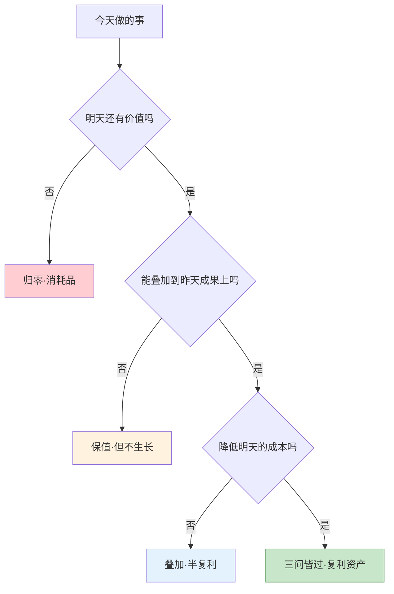
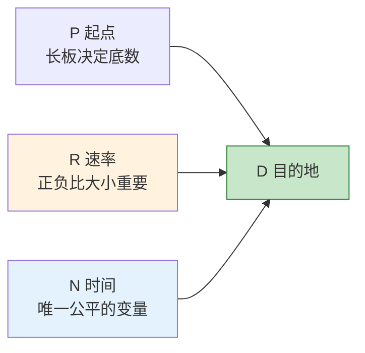
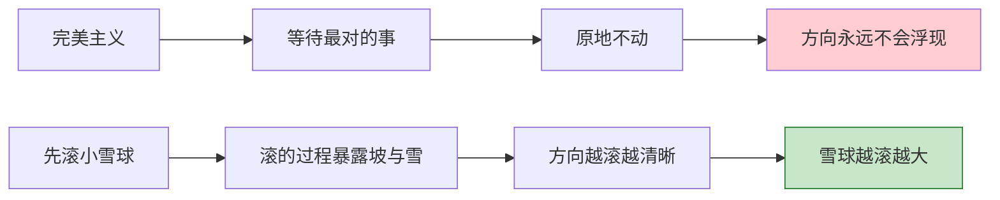
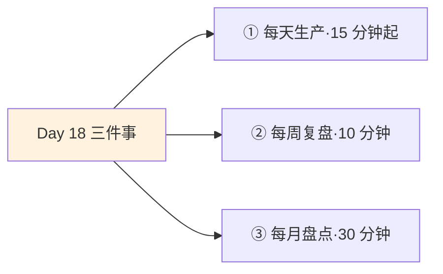
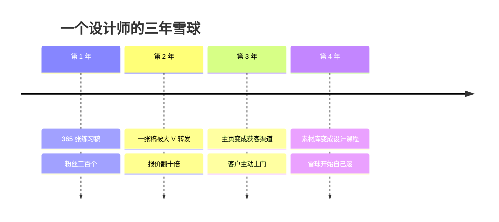

## Day 18·复利属性：让雪球先滚起来

- [01.看一个真实案例](#01看一个真实案例)
- [02.复利属性的三个判断](#02复利属性的三个判断)
- [03.终极等式拆解](#03终极等式拆解)
- [04.五种复利资产](#04五种复利资产)
- [05.三种伪复利陷阱](#05三种伪复利陷阱)
- [06.让雪球滚起来的两个信念](#06让雪球滚起来的两个信念)
- [07.今天要做的三件事](#07今天要做的三件事)
- [08.总结回顾本章节](#08总结回顾本章节)
- [09.后来发生的改变](#09后来发生的改变)
- [10.今天起改变三点](#10今天起改变三点)
- [11.课后作业思考下](#11课后作业思考下)

---

## 01.看一个真实案例

先讲一位设计师读者的故事，她叫小雪，今年三十岁，在一家互联网公司做 UI 设计。

二〇二二年秋天，她做了一件同事都觉得没必要的事：每天下班后做一张练习稿，发到一个公开的设计平台上。不是作品集，不是接单，就是每天一张，海报、图标、界面临摹加原创，发完就睡。第一年她发了三百六十多张稿子，粉丝三百多个，其中一半是同事。有同事好心劝她：这年头谁还看帖子啊，涨不了粉的。

第二年春天，一张稿子被一位行业大 V 转发，一夜之间来了几千个关注。第三年，开始有客户拿着她主页上的历史作品来谈合作，她的报价从一张两百块涨到一张两千块。到今年，她那个发了一千多张稿子的主页，同时是她的作品集、她的获客渠道和她的个人品牌，公司招人的时候，主管指着她说：我们要的就是她主页这种东西。

她跟我说过一句我记到现在的话：**"我不是哪一天突然变厉害的，我是把变厉害的过程，全部晒在了外面。"**

同样是一万小时，有的人滚成了雪球，有的人只是化了的水。小雪和她的同事能力差距并没有那么大，差距在于：她的每一天都叠在了前一天上面，而同事的每一天都是从零开始。这就是今天要讲的东西，复利属性。

## 02.复利属性的三个判断

赚钱时间最核心的一个要素，就是你有没有沿着核心竞争力，做着能产生复利效应的事。问题是，怎么判断一件事有没有复利属性？

不需要玄学，三个问题依次往下问，像过筛子一样。

**第一问：今天做的事，明天还有价值吗？**这叫保值。刷两个小时短视频，明天它就归零了；写一篇两百字的复盘，明天它还在。归零的事不是不能做，人总要有归零的快乐，但你得知道自己每天有多少时间投给了归零。

**第二问：今天做的事，能不能叠加到昨天的成果上？**这叫叠加。小雪的第一千张稿子，是从第一张长出来的；而你今天开的第二个会，不会让昨天的会更有效率。能叠加的事做一年，是一百层楼；不能叠加的事做一年，是一百块砖平铺在地上。

**第三问：今天做的事，有没有让明天变得更便宜？**这叫降本。你花一个月整理一套自己的设计规范，以后每个项目都快三天；你花一周学会一个快捷键系统，以后每天省二十分钟。**边际成本下降，是复利最硬的表现：同样的产出，明天比今天更省力。**

拿日常活动过一遍这个筛子，你会看得非常清楚。

| 活动 | 明天有价值吗 | 能叠加吗 | 降本吗 | 判定 |
|:---|:--:|:--:|:--:|:--|
| 刷两小时短视频 | ✗ | ✗ | ✗ | 归零 |
| 开一个没结论的会 | ✗ | ✗ | ✗ | 归零 |
| 写一篇工作复盘 | ✓ | ✓ | ✓ | 复利 |
| 认真维护一位客户 | ✓ | ✓ | ✓ | 复利 |
| 健身一小时 | ✓ | ✓ | ✓ | 复利 |
| 焦虑地刷新招聘软件 | ✗ | ✗ | ✗ | 归零 |

注意最后一行的措辞：焦虑地。同样是查招聘信息，带着清单去研究岗位要求是保值，漫无目的地反复刷新是归零。**复利属性不取决于活动本身，取决于你做它的方式。**

## 03.终极等式拆解

原稿里藏着一个硬核人生终极等式，今天完整拆开。先看式子：

**D = P × (1 + R) ^ N**

D 是目的地，是你最终想抵达的那个地方，你的梦想清单上写的那些事。P 是你的起点，此刻手里的核心竞争力。R 是你每天的进步速率。N 是时间，以年为单位。这个式子的意思很朴素：**你最终能到哪，由你从哪出发、每天走多快、走了多少年，三个数一起决定。**

逐个变量说。

**P 不是"我会什么"，是"我比平均水平长出来的那一块"。**很多人把自己的技能清单当 P，会一点 Excel、会一点 PS、会一点写作，每一样都在平均水平上下。但式子对 P 的要求是乘法的底数：底数是一，后面乘得再久还是一。这就是 Day 07 讲过的长板逻辑在这里的回声——先找到那块真正超出的长板，P 才成立。

**R 不是冲刺速度，是可持续速度。**最大的误区是高估 R：年初办卡健身十次，年中一次不去，R 从正零点五直接跳到零，甚至因为受伤变成负数。注意，**R 的正负比 R 的大小重要得多**：每天进步百分之一，一年是三十七倍；每天退步百分之一，一年只剩百分之三。时间不分辨方向，它只放大方向。

**N 是唯一公平的变量。**它对每个人流速一样，只往一个方向流，谁也不能充值。你对 N 唯一的自由，是决定它从今天算起，还是从"等我准备好了"算起。后者的问题在于，"准备好"那一天永远不会来，N 一直在流，只是记在了别人的账上。

这个式子还有一层安慰人的含义：**它对晚出发的人是友好的。**你三十五岁才开始积累自己的 P，只要 R 是正的，N 往后算十年、二十年，账面依然是惊人的。怕的从来不是晚，是 R 一直是零，或者干脆是负的。

## 04.五种复利资产

过了三问筛子的事，最后都会凝结成五种资产。逐一看。

**第一种，认知资产。**你学到的东西。注意"学到"和"经历"的区别：上了一年班，是经历；把踩过的坑写成十条 checklist，是资产。**经历只在你身上发生，资产能被反复调用。**认知资产的关键动作是写下来，不写下来的一切思考，明天就还给大脑了。

**第二种，作品资产。**文章、视频、代码、设计稿、课程、一个小产品。这是五种资产里最适合普通人起步的一种，因为它只依赖你自己：不需要本钱，不需要人脉，不需要许可，一台电脑就能开工。小雪的一千张稿子就是标准的作品资产。

**第三种，关系资产。**信任和圈子。关系资产的复利是最被低估的：一个信任你的人，会把你介绍给下一个信任你的人，信任沿着关系网自动流动。它的规则和作品一样，**先给予，后积累，不能透支。**

**第四种，品牌资产。**认知和作品的外部记账本。前三样资产存在你身上，品牌资产存在别人脑子里：一提到某个领域，人们就想起你。它的好处是杠杆极大，坏处是积累最慢、最怕透支——品牌是别人替你保管的复利，你砸一次，别人替你记一辈子。

**第五种，资本资产。**钱和股权。唯一一种别人替你值夜班的资产：你睡觉的时候，它也在工作。但把它放在最后讲是有意的：**资本资产本身不产生方向，它只是前面四种资产的兑换凭证。**没有前面四种，钱只是等着被消耗的燃料。

| 资产 | 复利方式 | 起步动作 | 适合谁 |
|:---|:---|:---|:---|
| 认知 | 写下来，可反复调用 | 每天一条复盘 | 所有人 |
| 作品 | 长期公开，自动叠加 | 每天生产十五分钟 | 内容、技术、创意行业 |
| 关系 | 信任沿网络流动 | 每周帮一个人一件事 | 所有行业 |
| 品牌 | 存在别人脑子里 | 持续输出同一主题 | 有长期方向的人 |
| 资本 | 别人替你值夜班 | 每月固定比例储蓄 | 有现金流的人 |

我的建议：普通人从作品资产起步，因为它的门槛最低、验证最快，而且作品会顺带生产认知、吸引关系、长出品牌，**五种资产里，作品是那个能带动其他四种的母资产。**

## 05.三种伪复利陷阱

复利这个词现在很热，热到什么都能往里装。三种最常见的伪复利，今天点名。

**第一种，打卡型。**只在意天数，不在意质量。打卡五百天，点开一看，是同一道菜的照片、同一段"今天也加油"的废话。打卡本身没有错，错在把打卡当成了资产。识别信号很简单：**你在喂养打卡，还是喂养资产？**打卡停了就归零的，是打卡；停了也还在的，才是资产。

**第二种，焦虑型。**为了复利而复利。什么都想积累：英语、Python、剪辑、写作、健身，每个都学一个月。这种人往往资产列表比作品列表长。焦虑型复利的本质是把"我在积累"当成止痛药，用形式上的勤奋，掩盖方向上的缺席。解药只有一个：**砍到一件事。**你不需要五种资产，你需要一种资产滚五年。

**第三种，假勤奋。**低质量重复。写了三年日记，三年都是流水账；做了十年 PPT，第十年和第一年的水平可以互换。假勤奋最隐蔽，因为它满足叠加的表象，时间在堆，东西没在长。识别方法：**把第二年的成果和第一年的放在一起，如果可以互换，那就不是复利，是复读。**

| 陷阱 | 典型表现 | 识别信号 | 解药 |
|:---|:---|:---|:---|
| 打卡型 | 五百天同质打卡 | 停了就归零 | 打卡为资产服务 |
| 焦虑型 | 什么都想积累 | 资产列表比作品长 | 砍到一件事 |
| 假勤奋 | 低质量重复 | 第二年=第一年 | 提高单次质量 |

伪复利最贵的地方，不是浪费了时间，而是**它让你以为自己一直在复利，从而放弃了真正的选择。**

## 06.让雪球滚起来的两个信念

讲完了判断和陷阱，最后是两个信念。方法论解决不了启动问题，信念才可以。

**信念一：只要不间断地在尝试和思考中了解自己，热情和方向会渐渐浮现。**这是原稿里最温和也最有力的一句话。它说的是：你不需要现在就想清楚这辈子做什么，P 和 D 都不是想出来的，是在不间断的尝试和思考里长出来的。Day 15 的小念头本就是干这个的：你今天记下的每一个"我想试试"，都是未来那个清晰方向的早期数据。不用急，方向是后到的客人，你只要一直开着灯。

**信念二：先行动起来，让自己作为雪球先滚动起来。**对抗的是完美主义。很多人的卡点是：等我找到那个最对的事再全力投入。这个逻辑反了。**雪球不是找到的，是滚出来的。**一捧雪再湿，摊在原地就是一摊水；先攥一个拳头大的小雪球推起来，滚着滚着，你会知道哪条坡长，哪条坡雪厚。路是滚出来的情报。

两个信念合起来读：**方向负责让你滚对，行动负责让你滚起来。前者可以慢慢来，后者必须今天开始。**

只要雪球继续滚下去，终有一天会串起点滴。

## 07.今天要做的三件事

理论到此为止，今天的功课只有三个动作，把复利从概念变成日程。

**动作一，每天生产，不只是消费。**看别人的文章是消费，写一段自己的是生产；听课是消费，做一页笔记是生产。从今天起，每天留十五分钟做生产动作：写一段、画一张、录一分钟、整理一页笔记。十五分钟很小，但它是 R 的正号——**只要今天是正的，复利就在路上。**

**动作二，每周复盘，复利意识。**周日晚十分钟，问自己一个问题：这周我往雪球上添了什么？一个问题就够了，它的作用是让你在"这周好忙"的迷雾里，看见资产有没有真的变厚。连续问四周，你会自动开始调整下一周的日程，因为没有人愿意连续四周回答"什么都没添"。

**动作三，每月盘点，可见的成果。**每月最后一天，列一张当月成果清单：写了几篇、做了几张、认识了几个人、学会了什么。**可见的成果比感觉可靠**，盘点是防止假勤奋的月度审计——清单越长不出来，说明这个月的复利在空转。

## 08.总结回顾本章节

复利属性是赚钱时间最核心的要素。判断它有三个问题：明天还有价值吗，能叠加吗，能降低明天的成本吗，三问皆过才是复利资产。终极等式 D = P × (1+R) 的 N 次方告诉你：长板决定底数，可持续的正速率比大小重要，时间对每个人公平，唯一的自由是让它从今天算起。五种资产里，作品资产是普通人最好的起点。小心三种伪复利：打卡型、焦虑型、假勤奋。两个信念托底：方向会在不间断的尝试中浮现，雪球要先滚起来。

到这里，第四章收官。回看这四天：Day 15 讲捕捉信号，Day 16 讲相信时间，Day 17 讲选对曲线，Day 18 讲找到雪球。信号、相信、曲线、雪球，战略篇的四件套配齐了。**战略解决往哪里走，接下来的第五章，解决每天怎么走。**

## 09.后来发生的改变

回到开篇的小雪，告诉你她今年在做什么。

她今年做了个决定：把三年来所有的练习稿、复盘笔记和客户项目整理成一门面向 junior 设计师的课程。素材现成，案例现成，学生来源就是她主页的粉丝。用她的话说：**"课程不是我做的，是我三年的雪球自己长出来的。我只是弯腰捡了一下。"**

还有一个反向的案例。一位叫老纪的读者，产品经理，学完这章之后用三个问题检视自己的日程，发现自己每晚三小时的学习安排里：英语为了跳槽、Python 因为焦虑、写作听说有用。三个项目没有一个是叠在别人上面的。他砍掉两个，只留写产品复盘这一件事，每周一篇发在内网。十一个月后，他成了公司内部产品方法论的指定分享人，年终晋升答辩的主线，就是那五十篇复盘。

他复盘时说了句很冷静的话：**"我以前是把一百块砖平铺在地上，然后抱怨自己没有房子。"**

## 10.今天起改变三点

第一，从今天起，做事前过一遍三问筛子。不用改日程，先只做标记：今天做的事，哪些明天归零，哪些能叠加。标记一周，你会自己想动日程——**看见归零，是戒掉归零的第一步。**

第二，选定一种主资产，做三十天投喂计划。建议从作品资产起步：定一个每天十五分钟的生产动作，写进 Day 01 建立的记录本里。三十天后再看这一条，你会拥有三十个"今天添了"的凭据。

第三，把终极等式写在便签上，贴在书桌前。P 写你现在的长板，N 写今年，R 空着。R 不用填数字，它是留给每一天填的——**式子的意思不是让你算，是让你记得：你正在为哪一项积分。**

## 11.课后作业思考下

第一，用三问筛子过滤你昨天一整天的时间记录，算出归零时间和复利时间的比例。这个比例，就是你目前人生的复利率。

第二，盘点你的五种资产现状：认知资产有多少是写下来的？作品资产最近一次更新是什么时候？关系资产里，有多少是只在过年群发的？诚实的盘点比增量更重要。

第三，检查你是否踩着伪复利陷阱：你的坚持里，有没有停了就归零的打卡？有没有第二年和第一年可以互换的重复？各写一个例子，并写下解药。

第四，写下你的雪球宣言，就三行：我的主资产是什么，我每天十五分钟的生产动作是什么，我准备滚几年。写完签上名字和日期，它是你和时间签的第一份合同。

---

**明日预告 · Day 19 做会发光金子。** 战略篇结束，从明天起进入第五章落地篇。理想不是一种感觉，是可以论证的命题：热爱、擅长、市场需求、社会价值，四要素缺一条，金子都会黯淡。还会讲一次创业式的七个追问。明天见。
