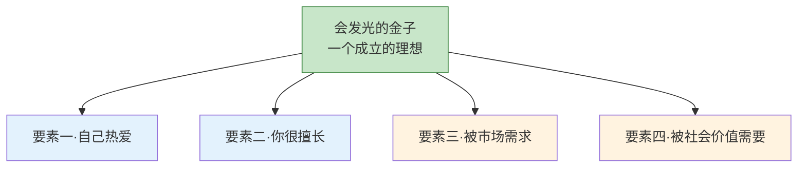
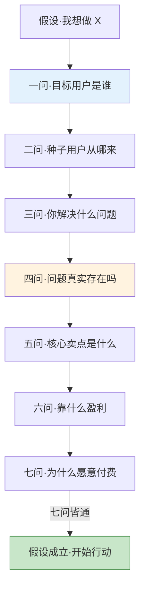
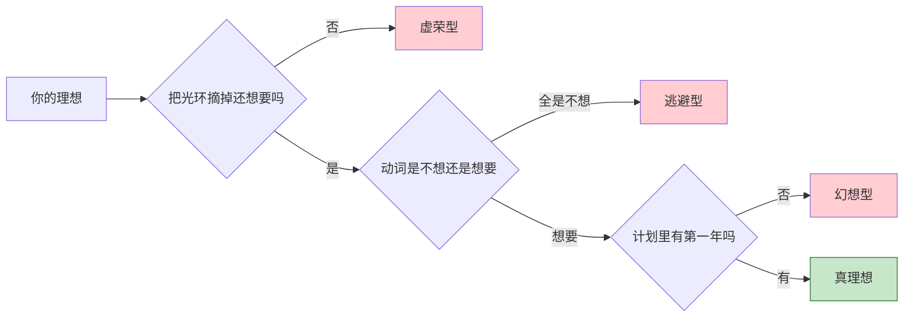
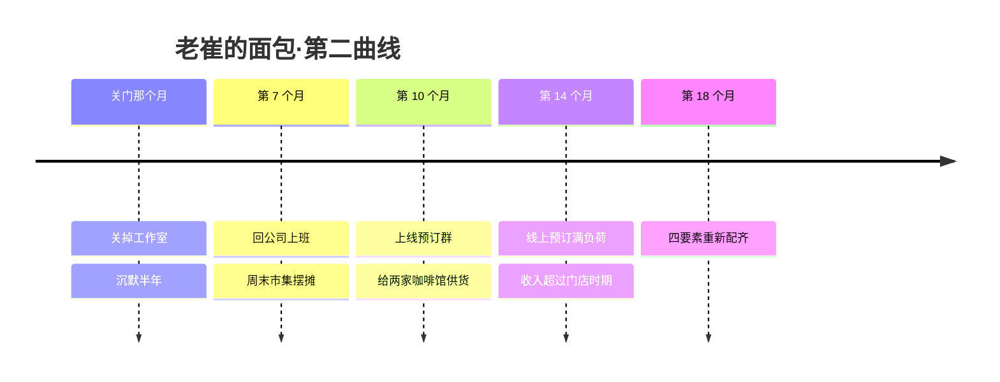

## Day 19·会发光的金子：理想的四要素

- [01.看一个真实案例](#01看一个真实案例)
- [02.理想的四要素](#02理想的四要素)
- [03.四要素缺一的感觉](#03四要素缺一的感觉)
- [04.假设与论证七问](#04假设与论证七问)
- [05.理想的三种误区](#05理想的三种误区)
- [06.接受自己的探索期](#06接受自己的探索期)
- [07.总结回顾本章节](#07总结回顾本章节)
- [08.后来发生的改变](#08后来发生的改变)
- [09.今天起改变三点](#09今天起改变三点)
- [10.课后作业思考下](#10课后作业思考下)

---

## 01.看一个真实案例

从今天起，我们进入第五章：落地篇。前三章给了你地图、训练方法和战略，这一章回答一个最现实的问题：**我到底该把命押在哪件事上？**

先讲一个失败的故事。老崔，三十四岁，原来在公司做行政。他有个出了名的爱好：做面包。周末在家烤，烤完分给同事，人人夸好吃，他自己也上瘾——凌晨四点起来给面团做三次折叠，他都不觉得苦。二〇二二年他辞职，在文创园开了一家面包工作室，所有人都说好：热爱、手艺、勇气，齐了。

两年后，工作室关门了。

复盘的时候，四个要素里他其实中了三个：热爱是真的，凌晨四点起来揉面眼睛都是亮的；擅长是真的，回头客说那是全市最好吃的碱水包；社会价值也勉强算真的，做面包给人快乐。**卡死在第三个：市场需求。**工作室开在文创园，客流只有周末；他坚持的慢发酵工艺，成本压不下来，客单价撑不起房租；他热爱的"每天现烤、卖完即止"，和外卖平台的"三十分钟送达、满减凑单"，根本是两个世界。热爱让他的产品很好，但市场没有为"很好"付够钱的理由。

他关门那天在朋友圈发了一句：**"我以为热爱是燃料，够猛就行。现在才知道，热爱能让你开工，但只有市场能让你开工到第三年。"**

这个故事不是劝你别追理想。恰恰相反——是因为理想值得追，才要在出发前，先给它做一次体检。今天就是体检日。

## 02.理想的四要素

一个理想要成立，需要同时满足四个条件。它们像一块金子的四个切面，缺一个面，光就反射不出来。

**要素一，自己热爱。**这是小念头长大之后的样子。判断标准不是"我喜不喜欢"，而是身体反应：想到它会不会热血涌上心头；做它的时候会不会进入沉浸、孜孜不倦、废寝忘食的状态。喜欢看烘焙视频是一回事，凌晨四点起来折叠面团是另一回事——**热爱是用时间投票的，不是用嘴巴投票的。**

**要素二，你很擅长。**注意措辞：不是"你会"，是"高于平均水平"。这是 Day 07 长板逻辑的又一次出现：你的理想必须建在你超出平均的那块板上，否则你只是用爱好对抗别人的专业。擅长是热爱的市场护栏——光有热爱没有擅长，你会在一次次比较中耗尽热爱。

**要素三，被市场需求。**有人愿意为它付费，真金白银的那种。点赞不是需求，夸奖不是需求，**只有付费是需求**，因为付费是这个世界最诚实的投票。老崔的同事人人夸他的面包，但没有一个人愿意为此支付覆盖房租的价格。

**要素四，被社会价值所需要。**你的事要对世界有意义，哪怕很小。它和你赚钱并不冲突，而是两种不同的回路：市场为你的效率付钱，社会价值为你的意义背书。只有市场没有社会价值的事也能赚快钱，但会越做越虚；四个要素齐的事，会越做越笃定。

这四个要素的交集地带，就是你的理想座位。**不是每个热爱都该被做成职业，也不是每个擅长都值得燃烧，判断的依据从来不是感觉，是四个要素的交集。**

## 03.四要素缺一的感觉

四个要素缺一个，人生是四种不同的难受。对号入座一下。

| 缺什么 | 状态 | 典型画面 | 那种感觉 |
|:---|:---|:---|:---|
| 缺热爱 | 稳定但空虚 | 待遇好但每周日晚上都胃疼 | "我什么都有了，除了想上班的理由" |
| 缺擅长 | 热情但无成就 | 每样都爱，每样都坚持不过三个月 | "为什么我这么努力还没结果" |
| 缺市场 | 有意义但饿肚子 | 产品很好，账上没钱 | 老崔的碱水包 |
| 缺社会价值 | 赚钱但内耗 | 把流量密码玩得很好，凌晨三点睡不着 | "我在制造什么" |

**缺热爱的人，问题出现在每个周日的晚上。**工作日靠惯性，周末靠娱乐，一旦安静下来，会听到一个声音问：就这样了吗。这种人最危险的动作是加薪——待遇每好一分，离开的成本就高一分，空虚的复利也在涨。

**缺擅长的人，最容易误解为"我不够努力"。**他们往往什么都想学，什么都三分钟热度。其实不是不努力，是入场券拿错了：拿着平均水平的板，去打别人的长板。解药不是更努力，是换到自己的长板赛道上再去努力。

**缺市场的人，是四个里最悲壮的。**因为另外三个要素都真的，只有市场不认，所以他们是"被辜负的好人"。他们的解药最残酷也最简单：**去问市场，而不是问朋友。**朋友给你点赞，市场只给你订单，从今天起只统计后者。

**缺社会价值的人，最难被说服。**因为账面是好看的。但内耗不会出现在报表上，它出现在凌晨三点的天花板上：我做的这些，除了钱还剩什么。这一类的感觉最隐蔽，也最难自欺。

四个都齐的感觉，反过来描述就一句：**你会在做这件事的时候，同时感到笃定和被需要。**笃定来自擅长和热爱，被需要来自市场和社会价值。如果你从没体验过这两种感觉同时出现，说明你的金子还有切面没磨。

## 04.假设与论证七问

四要素是体检报告，但体检完怎么治？方法是原稿里的六个字：**先假设，再论证。**

假设：沿着你的现状、你的热爱和擅长的方向，构思一个对应的产品或事业。然后，把自己想象成一家创业公司，用七个问题拷问这个假设。

**一问，目标用户是谁？**不说"所有人"。所有人的意思是没有人的意思，答案必须具体到能想象出一张脸：三十岁左右、通勤、会为什么事半夜睡不着。

**二问，第一批种子用户从哪来？**你想不到第一批十个人从哪来，这件事就还不成立。种子用户不需要多，但必须想得出路径。

**三问，你解决他们什么问题？**问题描述要让人脸红才算合格，比如"他们的生活里缺一点美"就不是问题，"他们想给客户留下专业印象但不会搭配"才是问题。

**四问，这个问题真实存在吗？**检验方法只有一个：去找到三个这样的人，问他们现在怎么解决。**用户的行为里全是答案，用户的客套里全是陷阱。**

**五问，核心卖点是什么？**一句话说清，为什么是你而不是别人。如果你给出的答案是"我更用心"，回去重答——用心不可验证，可验证的只有差异。

**六问，靠什么盈利？**谁付钱、付多少、多久付一次。收不到钱的模式，写下来就是给梦想记账。

**七问，他们为什么愿意付费？**或者反过来，为什么不愿意。这一问是照妖镜：前面六问都可以自我感动，第七问只能诚实。

拿老崔的面包做个示范复盘：目标用户其实是"愿意为好面包专程跑一趟的人"，但他把店开在了路过的客流里，错位从这里就开始了。**七问的价值不是给你答案，是让你在投入三年之前，先看见错位。**

## 05.理想的三种误区

四要素之外，还有三种常见病，它们的共同点是：**你以为自己在追理想，其实你在追别的东西。**

**第一种，虚荣型。**想要的不是那件事，是那件事的光环。想开书店的人，多数想要的是"开书店的人"这个形象，而不是每天理库存、盯房租的日常。识别方法很简单：**把光环摘掉，你还想要吗？**想象一下这家书店永远不盈利、永远没人知道是你开的，你还开吗？书店会亏钱、作家会被退稿、主厨会烫伤手，光环下的这些部分，才是那件事的实体。

**第二种，逃避型。**想离开现在的痛苦，而不是去往热爱的方向。两者在脑子里长得几乎一样，区分只有一个土办法：**听自己的动词。**你描述那个理想的时候，说的是"我不想再开会了、不想再看老板脸色了"，还是"我想做出什么"？全是"不想"的，换到哪里都会发现行李跟着自己——因为痛苦的原因不是那个岗位，是没被处理的自己。

**第三种，幻想型。**想要一步登天，跳过论证和积累。这种理想的特点是计划里没有"第一年"，只有"成功之后"。问具体的第一步怎么走，他会说"等我攒够钱""等时机成熟"。检验幻想型的试金石就一个问题：**你的计划里，明天早上几点起床之后做什么，写出来了吗？**

三种误区不可耻，几乎每个人都全得过一遍。**误区的作用是帮你想清楚"我到底在要什么"，从这个意义上说，走错的路也在给对的路画地图。**

## 06.接受自己的探索期

最后说一个可能让你松一口气的事：四要素一次全齐的人，是极少数。大多数人的理想，是在探索期里一个要素一个要素配齐的。

所以允许自己不断探索、不断转换轨道——这是对年轻人的正常预期，三十五岁之前，换轨道不叫背叛，叫测量。但探索期有一个前提，也是它和漂着的唯一区别：**探索要带回数据。**

每试一件事，回来更新一次四要素清单：这件事里我热爱吗、擅长吗、市场认吗、有意义吗。三次试错之后，你手里的清单会画出你的形状——哪几个要素总是齐的，哪几个总是缺的，缺的那几个就是你要补的方向。Day 17 讲过切换轨道的三个原则，这里加一条探索版的：**允许自己换路，但不允许自己空手换路。**每次换路，手里都要比上一次多一张纸。

探索期还需要一种心态，叫终点思维。意思是：允许现在换路，但每一次换路，都朝着"最终不再需要换"的方向去。没有终点思维的探索是漂流，有终点思维的探索是测绘。**区别不在动没动，在有没有带回地图。**

原稿里有句话我特别想放在这里收束本章：**接受自己不断探索、不断转换轨道的样子。**那个样子不狼狈，那是一个人在给自己的金子一个切面一个切面地磨。

## 07.总结回顾本章节

一个成立的理想，要同时满足四个条件：自己热爱、你很擅长、被市场需求、被社会价值所需要，四要素是金子的四个切面，缺一个都不反光。缺热爱的人空虚在周日晚上，缺擅长的人误以为是自己不努力，缺市场的人是最悲壮的好人，缺社会价值的人内耗在凌晨三点。验证理想的方法是先假设再论证，七个问题从目标用户一路问到付费意愿，用户的行为里全是答案。警惕三种误区：虚荣型在追光环，逃避型在追出口，幻想型在跳过第一年。最后，接受自己的探索期，但每一次换路都要带回数据。

落到行动上，就是原稿那三步：**了解你所处行业的位置，拆分成具体的细分目标，然后去执行——每天专注两到三小时。**体检今天做完，剩下的交给日程。

## 08.后来发生的改变

老崔的故事，还没完。

关店之后他沉默了半年，然后在公司附近找了份行政工作。但他没有放弃面包，只是把"开店"这个形式放下了。第七个月，他开始在每个周末的市集摆摊，摊位费一天八十，不用付房租；第十个月，老客户把他拉进了一个预订群，每周三下单、周六取货；后来，市集上认识的两家咖啡馆开始向他订碱水包，量不大，但稳定。

到第十八个月，他的面包收入超过了当年门店时期，而他不再需要每天守在店里。更重要的是四要素重新配齐了：热爱没丢，手艺还在，市场换成了**愿意为慢发酵面包提前三天下单、专程来取的人**，社会价值也回来了——两家咖啡馆的老板管他叫"我们街区的面包师"。

他后来跟我说了段话，我觉得是这一章最好的注脚：**"我以前以为理想是一块金子，找到了就要死死抱住，掉进水里也不撒手。现在我知道理想是金子，但抱它的姿势可以换。门店是我的姿势，不是金子本身。姿势换对了，金子才浮起来。"**

理想四要素是永恒的，实现理想的形式是可以更换的。分清这两者，你会既不死磕，也不轻易放弃。

## 09.今天起改变三点

第一，今天就用四要素给你的现有目标做一次体检。一张纸画四个格，每个格写证据不写感觉：热爱格写你为它付出过的最具体的时间，擅长格写你高出平均的证据，市场格写有没有人为它付过费，社会价值格写它让谁变好了什么。**哪一格写不出来，那一格就是接下来的功课。**

第二，完成七问论证，写在纸上而不是脑子里。脑子里过一遍永远会觉得成立，纸上一问一问写下来，第七问会替你挡掉大部分自我感动。写完贴在书桌前，它是你理想的审计报告。

第三，从明天起，为通过体检的方向每天投两到三小时。不用辞职，不用等准备好，就在现有日程里挤。具体的挤法，明天的 Day 20 会专门讲——那一篇的标题就叫"没时间怎么办"。

## 10.课后作业思考下

第一，给你正在追的那个目标做四要素打分，每项满分十分。低于六分的那一项，写下你现在能做的最小补强动作，要小到本周就能完成。

第二，完成七问，特别注意第四问：去找三个你想象中的目标用户，问他们现在怎么解决这个问题。把他们说的话原样记下来，那是最贵的市场调研。

第三，检查你的理想是不是误区驱动：摘掉光环你还想要吗？你的动词是"不想"多还是"想要"多？你的计划里有"明天早上几点起床之后做什么"吗？三问三答，写在探索期清单的第一页。

第四，如果你正处在换轨道的间隙，写下上一条路留给你的三样东西——可以是能力、认知、人脉，也可以只是一句教训。空手换路不算数，这是你和下一次出发之间的约定。

---

**明日预告 · Day 20 没时间怎么办。** 体检做完了，方向定了，明天回答全书最高频的那个问题：我真的没时间。二孩妈妈怎么从一天里找回四十七分钟，五步破局法怎么走，还有那句话——蜗牛一般地行走，也终能到达。明天见。
