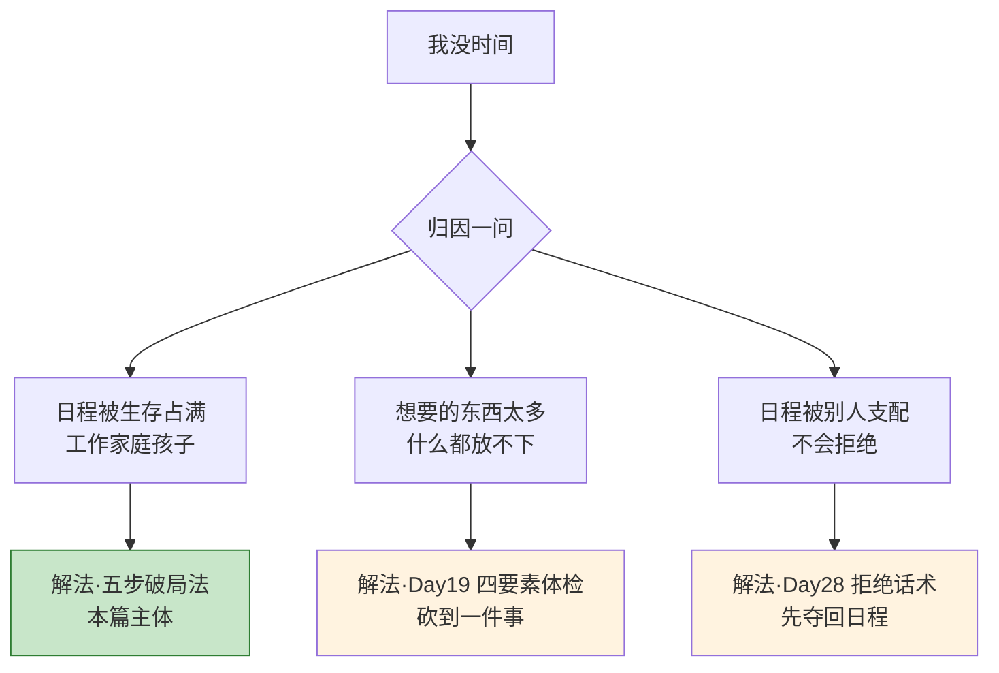
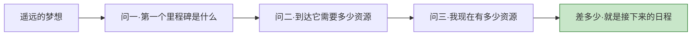
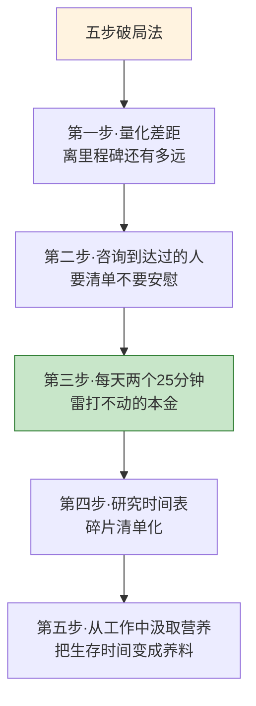
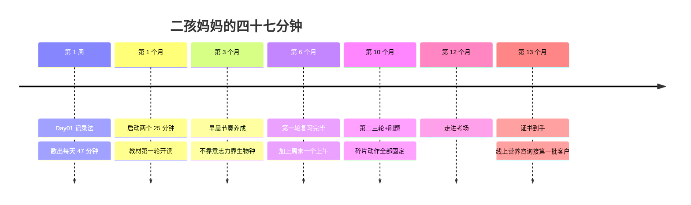

## Day 20·"没时间"怎么办：五步破局

- [01.看一个真实案例](#01看一个真实案例)
- [02.先分析现状](#02先分析现状)
- [03.细化目标倒推梦想](#03细化目标倒推梦想)
- [04.咨询的原则](#04咨询的原则)
- [05.五步破局法](#05五步破局法)
- [06.在梦想还能燃烧的时候](#06在梦想还能燃烧的时候)
- [07.总结回顾本章节](#07总结回顾本章节)
- [08.后来发生的改变](#08后来发生的改变)
- [09.今天起改变三点](#09今天起改变三点)
- [10.课后作业思考下](#10课后作业思考下)

---

## 01.看一个真实案例

在所有读者反馈里，出现频率最高的一句话是：**"道理我都懂，但我真的没时间。"**

今天就用一整篇正面回答这句话。先讲阿慧的故事。

阿慧，三十六岁，两个孩子的妈妈，在一家小公司做兼职财务。她想考注册营养师，转行做营养咨询——这是她从小的兴趣，也是 Day 19 体检完的四要素方向。但她跟我说这句话的时候，是带着一点自嘲的：你也知道，我有两个孩子，我的一天从早上六点开始，到晚上十点孩子睡着结束，中间没有一分钟是我的。

我只让她做了一件事，你猜到了，Day 01 的记录法。每两小时记一行，记一周，不评判。

一周之后她把记录发给我，我们一起数。她以为自己的可支配时间是零，数出来是**每天四十七分钟**：早上六点二十到七点之间，孩子还没醒的那四十分钟，她躺在床上刷手机；晚上孩子睡着后，她有半小时到一小时，在看剧和刷新闻里过去。四十七分钟，这是记录给她的答案——**不是零，也远远不是够用，但它是真实的本金。**

她说了一句我印象很深的话："我不是没有时间，**我是把仅有的时间，全部用来奖励辛苦的自己了。**"

一年之后，她考下了证书。用的就是每天那四十七分钟，加上周末一个完整的上午。这一篇讲的就是她的方法：没时间的人，怎么破局。

## 02.先分析现状

破局的第一步，不是挤时间，是搞清楚你的时间到底被谁拿走了。"没时间"是一种感觉，感觉背后有三种完全不同的病因，解法也完全不同。

**第一种归因：日程真的被生存占满了。**双职工带娃、通勤三小时、加班常态化——这是客观的被动生存时间，不是你的错。这种情况下，需要的是本篇后面的五步破局法：不硬挤，而是重新丈量、重新设计。

**第二种归因：想要的东西太多了。**又想考证，又想健身，又想做副业，又想学英语。这种"没时间"其实是"没方向"的伪装——**当你什么都想要的时候，每一样都在替其他所有样制造没时间的感觉。**解法不在时间管理，在 Day 19 的四要素体检：砍到一件事，时间会自己浮现出来。

**第三种归因：日程被别人支配了。**同事的顺手求助、亲戚的不速之约、群里的"就差你了"——你不是没时间，你是把时间的签字权交了出去。这一种的完整解药（怎么拒绝、拒绝的话术）放在 Day 28 讲，今天先记住一个原则：**拿回签字权之前，先停止无条件签字。**

阿慧属于第一种和第三种的混合：生存占了大头，晚上那一小时又习惯性地"送给辛苦了一天的自己"。分清归因很重要，因为**用错药方的努力，本身就是一种新的没时间。**

## 03.细化目标倒推梦想

归因之后，第二个动作是把那个模糊的"我想要"倒推成可以丈量的距离。三个问题，依次回答。

**第一问：你的第一个里程碑是什么？**注意是第一个，不是最终的。阿慧的最终梦想是开一间营养咨询工作室，但第一个里程碑只有一个：考下注册营养师证书。第一问的作用是把远处的灯塔换成了眼前的码头——**灯塔用来校准方向，码头才用来出发。**

**第二问：到达它需要多少精力和时间？**要算出具体数字：考试有几科、教材多少页、通常需要几轮复习、每轮每天要多少分钟。阿慧算出来的答案是：三轮复习，每天平均五十分钟，走十到十二个月。这个数字让她安心了——她有四十七分钟的本金，周末再补一块，够。

**第三问：你现在没时间，到底没到什么程度？**这一问最容易被跳过，也最关键。多数人从没量化过自己的"没时间"，它就永远是一团情绪。用 Day 01 的记录法数一周，把答案变成数字：**每天多少分钟碎片、每周有没有完整时段、被谁占用、能否置换。**

三问连起来，"没时间"这个情绪就变成了一个工程问题：**缺口 = 所需 - 现有。**工程问题是可以排计划的，情绪问题只能内耗。这就是倒推的全部意义：把梦想翻译成日程表能听懂的语言。

## 04.咨询的原则

丈量完自己，该去问路了。这里有一条铁律，原稿里写得斩钉截铁：**永远去咨询你要成为的那种人——已经克服过同类困难的那种人，已经取得过你向往成绩和生活状态的那种人。**

这条铁律的反面同样重要：**不要征询观望者。**观望者最擅长告诉你不可能、太晚了、风险大——不是因为他们坏，是因为他们需要你的不出发，来证明自己的不出发是合理的。你要转行去问没转过行的同事，得到的永远是风险清单；你要考证去问考了三次没过的人，得到的永远是劝退指南。**他们的经验是真的，只是他们的经验是关于"如何不做成"的。**

Day 11 讲过好教练的三条标准：行业前辈、向上寻找、全面了解。这里补一个落地版：你要找的不一定是行业顶尖的人，而是**"比你早走了三步"的人**——刚考完证的、刚转完行的、刚带娃减下肥的。顶尖的人讲的是顶层设计，早走三步的人记得每一个坑的具体位置。他们是你这个阶段性价比最高的教练。

阿慧的教练就是这么找到的：一位同样二孩、比她早两年考下证的营养师博主。她翻完了对方两年里所有的帖子，整理出一页问题清单，然后付费约了一次咨询。那次咨询给她的最大收获不是学习方法，是一句"我当时也是每天一小时，考了十一个月"——**同路人的一句"我当时也是"，顶得住旁观者的十句"没必要"。**

## 05.五步破局法

现在讲方法主体。五步，一步一步走。

**第一步，弄清楚自己距离第一个里程碑差多远。**把任务量和工作量算出来：几本书、几轮复习、多少道题、多少个小时。量化不是为了精确执行，是为了让"差多远"从一种心虚变成一个数字。数字不会吓人，模糊才会。

**第二步，咨询曾经到过第一个里程碑的人。**拿着第一步算出的数字去问：这个量对吗？哪里可以省？什么是你不做也行的，什么是必须做足的？**去要清单，不要去要安慰。**安慰咨询完就蒸发了，清单会留在你的日程里。

**第三步，每天挤出两个二十五分钟。**这是原稿里我最喜欢的一条，因为它对所有人的要求都一样低：**每个人都能在一天中找到两个二十五分钟**，早晨一个，午间或晚上一个。两个二十五分钟不多，但它们是"必须拿出来的时间"——不是有多少用多少，而是每天保底五十分钟，雷打不动。阿慧的四十七分钟，就是她的保底。**保底的全部意义在于：它让进度不取决于心情。**

**第四步，仔细研究自己一天的时间表，微小积累。**回到 Day 01 的记录，把所有碎片按场合清点：通勤的、排队的、孩子兴趣班等待的、会议间隙的。给每一段碎片分配一个"碎片动作"——听一节课、刷二十道题、读十页书。**碎片时间不是用来"等事情发生"的，它是提前分配好的弹药。**蜗牛一般地行走，也终能到达——前提是蜗牛每天真的在走。

**第五步，重新观察你的工作，从里面汲取技能和营养。**这一步最反直觉：你最想逃离的这份工作，恰恰是你现在最大的免费训练场。阿慧是财务出身，她后来做营养咨询时，给客户做饮食记录和体重数据的分析表格，用得全是财务的本事——同批转行的人里，只有她的客户档案做得像财报一样清楚，这就是她的差异化。**生命中的时间毕竟都是你自己的：把生存时间里的技能带着走，它就从成本变成了行囊。**

五步的底层逻辑其实只有一句话：**不靠意志力，靠结构。**意志力是易耗品，结构才是复利品。

## 06.在梦想还能燃烧的时候

最后讲一个心态，也是原稿里最恳切的一段：**在梦想还能燃烧的时候，一定要让自己启动起来。**

年轻的时候，是一生精力的巅峰，也是对未来渴望的巅峰——这两样东西不会同时再来一次。精力还在而渴望熄灭了，是空转；渴望还在而精力不济了，是干烧。**二者叠加的那段窗口，就是人的潜力期。**阿慧三十六岁，她说自己每想一次"是不是太晚了"，就想起咨询时教练那句"我比你开始的时候还大两岁"。

但我必须把话说得更完整，因为读这本书的人不都是二十几岁。原稿这句话容易被误读成"过了年龄就没戏了"，不是的。**渴望的巅峰不在年龄里，在距离梦想最近的那一刻。**有人二十岁心就冷了，有人五十岁因为一场大病重新想活——燃料不一样，但烧起来的温度是一样的。真正的分界线从来不是身份证上的年份，是"还烧不烧得起来"。

所以这一节的重点不是催你抓紧年轻，是提醒你别辜负此刻的火苗：**不要等到柴火湿了再生火。**湿了的柴也能烧，但要先花很长的时间烘干——那些被搁置了十年、二十年的梦想，重启的成本里最大的那部分，从来不是学习，是重新相信。

明天开始，两个二十五分钟。就这么多。

## 07.总结回顾本章节

"没时间"通常是一种感觉，先归因再开药：日程被生存占满的用五步破局法，想要的太多的回 Day 19 砍到一件事，日程被别人支配的等 Day 28 拿回签字权。然后三个问题倒推梦想：第一个里程碑是什么，需要多少资源，我现在有多少。问路的铁律是永远咨询你要成为的那种人，尤其是比你早走三步的人——要清单，不要安慰。五步破局法：量化差距、咨询到达过的人、每天两个二十五分钟、碎片清单化、从工作中带走技能。最后，在梦想还能燃烧的时候启动起来，因为精力与渴望叠加的窗口不会永远敞开。

一句话收束：**"没时间"的意思，从来不是时间不存在，是时间没有站在你想要的方向上。**五步走完，你会亲眼看着它掉头。

## 08.后来发生的改变

阿慧的时间线，完整给你。

一年后的今天，她在一家健康管理机构做兼职营养咨询，财务的工作保留着——她说要感谢那份财务，是它给了她别人没有的数据功夫。她给我发过三条消息，我原样记下。

第一条，考完试当晚："今天提前四十分钟交卷走出考场的时候，我在门口站了一会儿。我突然意识到，这一年我没有任何一天是'疯了'的，我每天就是五十分钟，走了一年。"

第二条，拿到证书那天："最感谢的不是考过了，是我不再对自己说'等我有了时间就'。**我发现这句话真正的意思是：等我死了就算了。**"

第三条，上个月："我女儿昨天问我，妈妈你的证书是干什么用的。我说，妈妈想做的事，妈妈自己排时间做完了。她似懂非懂。但我想她会记住的，**不是记住这句话，是记住每天早上六点二十，客厅里那个看书的背影。**

四十七分钟。一个二孩妈妈，没有辞职，没有奇迹，没有早起四点的悲壮。蜗牛一般地行走，也终能到达——阿慧就是那个走到的蜗牛。

## 09.今天起改变三点

第一，写下你的第一个里程碑。今天，一页纸，三行以内：里程碑是什么，截止日期是哪天，从现在算还剩多少天。**必须是可验证的**——拿到证书、发布作品、跑完比赛，"变得更好"不算里程碑，它算愿望。

第二，明早就排两个二十五分钟。打开日历，把明天的一个二十五分钟和后天的另一个二十五分钟，像会议一样写进去。选一天中最不会被打破的时段，早晨最好——**早上的时间是预付款，晚上的时间是余额，余额总是先被生活的账单划走。**

第三，本周发出第一条请教消息。找到那位"比你早走三步"的人，可以是博主、同事、校友，整理三个具体问题，发出去。注意是请教不是求助：**请教带问题清单，求助只带情绪。**发出第一条的难度，永远大于后面所有条加起来。

## 10.课后作业思考下

第一，用记录法数一周你的"没时间"，给出三个数字：每天碎片分钟总数、每周完整时段个数、其中被浪费的占比。写完再回答：你是三种归因里的哪一种，或哪几种的混合？

第二，完成倒推三问，把答案写成一页"差距说明书"：第一个里程碑、所需资源、现有资源、缺口。这一页纸是你接下来十二个月的作战地图。

第三，检查你的咨询清单：过去一年，你重大决定问过哪些人？把他们按"你要成为的那种人"和"观望者"分成两栏。看看比例，再想想那句"他们的经验是关于如何不做成"的。

第四，列出你工作里三项可以带走的技能——那些在下一个赛道依然值钱的东西。如果你一项都列不出来，这周的功课加一条：每天留意一项，一周后凑齐三件行囊。

---

**明日预告 · Day 21 内外都要兼修。** 方向有了，时间有了，明天回到自己的身体上：运动、睡眠、饮食、心流四根内修支柱，修饰、护理两根外法支柱，合成一个词——生命力工程。内外兼修不是外表功夫，是命运的底色。明天见。
