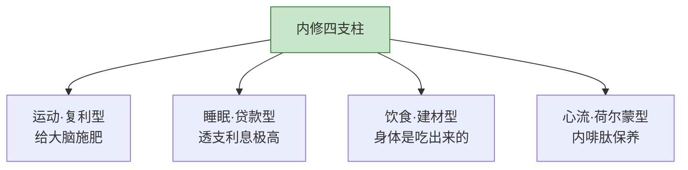
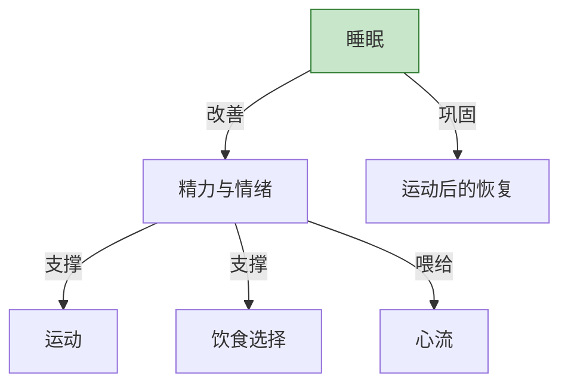

## Day 21·内外都要兼修：生命力工程

- [01.看一个真实案例](#01看一个真实案例)
- [02.内修四支柱](#02内修四支柱)
- [03.先睡好：启动顺序](#03先睡好启动顺序)
- [04.外法两支柱](#04外法两支柱)
- [05.内外的相互作用](#05内外的相互作用)
- [06.一周内外修计划](#06一周内外修计划)
- [07.三个常见误区](#07三个常见误区)
- [08.总结回顾本章节](#08总结回顾本章节)
- [09.后来发生的改变](#09后来发生的改变)
- [10.今天起改变三点](#10今天起改变三点)
- [11.课后作业思考下](#11课后作业思考下)

---

## 01.看一个真实案例

先讲两位走极端的读者。

第一位叫小蔓，二十八岁，外法派。她的梳妆台是同龄人的朝圣地：精华按功效分层摆得像实验室，贵妇面霜、美容仪、导入仪，一样不缺。问她清单能列两页，问她昨晚几点睡的——凌晨一点半，刷手机刷的；问她中午吃的什么——外卖，奶茶配炸鸡。她的状态越补越差：皮肤暗沉靠粉底，脸色靠腮红，头发靠发际线粉。她花在脸上的钱逐年上涨，镜子里的自己逐年下行。她跟我说过一句话："**我保养得像个反例。**每年的体检报告，是我唯一不敢拆的信。"

第二位叫老康，三十五岁，内修派。坚持晨跑六年，体脂率优秀，体检报告全科绿灯。但他一件像样的衬衫都没有，头发自己用推子推的，牙七年没洗过——上次洗牙还是公司团购的白给名额，他嫌麻烦没去。他能力很强，但晋升答辩、客户面谈这类需要"出场"的场合，永远轮不到他。

轮不到他的那天，他记得很清楚。去年一次重要客户的汇报，部门选人，主管在名单上划掉了他的名字，补了个能力不如他的同事。他去问原因，主管说得很委婉，翻译过来就是一句：**客户会觉得我们不重视。**他跟我复述这句话的时候，语气里有种被冒犯的清高："明明拼的是能力，为什么最后输给了穿得体面的人。"

这两个人各拿着一半答案。小蔓在给一栋地基不稳的房子刷漆，老康在给一栋好房子挂上"谢绝参观"的牌子。**今天这一章，就是把两个一半拼成一个整体：内外兼修。**

Day 08 讲好看时间的时候，我们种下了这颗种子；今天它要长成一套系统工程——我把它叫**生命力工程**。先说清楚它和"变美"的区别：变美是结果，生命力是系统；变美盯着镜子，生命力盯着镜子、体检报告和十年后的你。

## 02.内修四支柱

内修，是一切让身体变健康、让内在生命力提升的事。四根支柱。

**支柱一，运动。**运动健身是保持身材匀称有力最有效的方法，也是调节内分泌激素、延缓衰老、改善各种慢性疾病的有力武器——而且它罕见地兼备短期与长期效益：短期给你多巴胺和睡眠质量，长期给你骨密度和代谢率。神经精神病学家瑞迪在《运动改造大脑》里给出的研究结论更进一步：**运动时大脑分泌的 BDNF（脑源性神经营养因子），相当于给神经元施肥**——运动不只是练身体，是直接给大脑的硬件升级。Day 08 给过起步方案：每天十五分钟，不追强度追持续。这里补一句系统观：**运动是六支柱里唯一一根"复利型"支柱**——今天的深蹲会存在六十岁的膝盖里，这就是 Day 18 讲的复利资产在身体上的开户。

**支柱二，睡眠。**睡眠有个特殊身份：它同时属于生存时间和好看时间。八小时优质睡眠是最便宜的抗衰项目——这个说法在睡眠科学里基本是共识。反过来，睡眠不足的代价有精确的测量：加州大学伯克利分校的神经科学家马修·沃克（《我们为什么要睡觉》的作者）反复警告过一个数字——**连续清醒十九个小时之后，人的反应速度约等于血液酒精浓度百分之零点五的状态。**百分之零点五是酒驾标准。也就是说，**熬夜到凌晨的你，第二天是"醉着"在开人生这辆车的**——醉着开会、醉着决策、醉着对孩子说话。反过来，睡眠不足会导致激素分泌紊乱，皮质醇升高，然后是你熟悉的连锁反应：想吃高糖的、皮肤出油、情绪不稳、效率下降。**熬夜是在用明天的状态贷款**，而且这笔贷款的利息，比任何消费贷都黑。原则只有六个字：如无必要，不熬夜。

**支柱三，饮食。**You are what you eat，这句话的老实版本是：你的皮肤状态、精力水平、下午三点会不会犯困，都写在过去一周的餐单里。最值得改的一顿是早餐——认真吃早餐能及时补充晚间流失的营养，而不吃早餐会诱发脱发和低血糖。不需要精致，需要规律：**一个规律的普通早餐，胜过一个不规律的高级轻食。**

**支柱四，心流。**这是四支柱里最容易被漏掉的一根：当人处于心流状态时，体内会大量分泌内啡肽——它被称为快感荷尔蒙、年轻荷尔蒙。这不是玄学，是对心流的生理学描述：**深度沉浸本身就是一场身体内部的保养。**心流作为支柱的完整讲法在第六章，今天先记住它在身体账上的位置：它是唯一一根"练脑子顺带养身体"的支柱。

Day 08 和这里的分工是：那边讲"怎么启动"，这边讲"如何成系统"——四根支柱不是四个待办事项，是四个互相咬合的齿轮：运动改善睡眠，睡眠稳住食欲，饮食支撑精力，精力喂给心流，心流的平静反过来让你睡得更好。**单点努力是加法，系统运转是乘法。**

## 03.先睡好：启动顺序

四根支柱都讲完了，一个现实问题立刻出现：**六件事，从哪根开始？**

我的答案在开头就剧透过：今晚，先从睡眠启动。理由需要单独一节说清楚，因为它违反直觉——大多数人的直觉是先运动（"办张卡"是最常见的新起点仪式），但运动是四根支柱里启动成本最高的一根：要装备、要场地、要体力、要克服最多的惰性。而睡眠启动的成本是零：不需要意志力，只需要把手机在十一点半之前挪出卧室。

更重要的是杠杆位置。看这张依赖图：

**睡眠是唯一一根同时给其他三根支柱供血的支柱。**睡好了，你才有精力和情绪去运动，才不会靠糖和油炸物回血，才有一整块清醒的脑子喂给心流。反过来，睡不好时强推其他三根——累到瘫还要去跑步、用意志力对抗食欲、灌着咖啡强行专注——全是在漏水的池子里抽水。沃克书里有个更扎心的统计结论：**睡眠不足的人，第二天的自控力、情绪稳定度、疼痛耐受力全线下降**——你以为你这一天状态差是运气，其实是昨晚的欠账。

所以启动顺序是：**第一周只改睡眠，别的不动。**一周后你多出来的那点精力和情绪，会自己推着你走向下一根支柱——很多人是在睡好之后的第十天，自己想去跑步的，不是被励志视频推去的。**生命力工程的正确开工方式，不是往生活里加东西，是先把地基的水泥养护好。**

## 04.外法两支柱

外法，是把内在状态翻译给世界看的部分。两根支柱。

**支柱一，修饰。**通过学习和练习，逐渐摸索出最适合自己的五官、身材和气质的风格。修饰的最优状态有个词，叫**精良**。精良的定义要说明白，因为它最容易被误解成"贵"：不贵，但合身、干净、有自己的调性。一件三百块的合身衬衫，胜过一件三千块但尺码差半号的 logo 衫；一双擦干净的旧皮鞋，胜过一双落灰的新潮鞋。**精良是"被人认真对待过"的样子，而不是"很有钱"的样子。**判断修饰到位的信号也给你一个：别人说不出你穿了什么，只觉得你状态很好。

**支柱二，护理。**主要指皮肤、毛发、牙齿这些显性位置的保养。它们的特点是：**投入小、回报慢、错过贵。**一年两次洗牙，每天防晒，指甲修干净——这些事的共同点是便宜，和不做的代价不对称地昂贵。护理的核心不是技术，是节奏：像给设备做定期保养一样，按日、按周、按季度循环，而不是等到出了问题再抢救。

外法两支柱排在内修四支柱之后，顺序本身就是态度：**外法是锦上添花，内修是先把锦织出来。**顺序错了，就是小蔓；只有锦没有花，就是老康。

## 05.内外的相互作用

内修和外法不是并列的两件事，它们互相咬合。

**内修让外法有底子。**皮肤的真实状态、精神的饱满程度、体态的挺拔与否，都来自四根内修支柱。外法是放大器：底子好，修饰一分就有十分的效果；底子差，修饰十分只有一分的效果——还带着一点吃力。**化妆品的作用上限，是你的气血。**

**外法让内修有反馈。**这是被严重低估的一环。内修的回报周期太长：运动的反馈以月计，睡眠的反馈以年计，人很难在没有反馈的跑道上坚持。外法恰好补上了这个缺口：别人一句"你最近状态真好"，镜子里的一个小变化，都是即时的正向反馈。Day 08 讲过记录对照的驱动力，外法就是内修的**可视化仪表盘**——它让身体里看不见的进步，变成看得见的信号。

单向发展的失衡画像，上午你已经见过小蔓和老康，这里再总结成一张对照表：

| | 只做外法 | 只做内修 |
|:---|:---|:---|
| 状态 | 短暂光鲜，越维持越吃力 | 健康扎实，但无人看见 |
| 代价 | 烧钱，且掩盖问题 | 错过本该属于你的机会 |
| 一句话 | 在给地基不稳的房子刷漆 | 给好房子挂"谢绝参观"的牌子 |
| 补救 | 从今晚起补内修 | 从这周起做外法 |

原稿里那句话是结论：**内修加外法，等于生命力。你的外表和能力，共同决定了你的命运。**

## 06.一周内外修计划

理论到位，给模板。把六根支柱铺进一周的日程里，参考下面这张表。

| 时段 | 归属 | 动作 | 时长 |
|:---|:---:|:---|:---:|
| 早晨 6:40–7:00 | 内修·运动 | 十五分钟拉伸或快走 | 20 分钟 |
| 早晨 7:00–7:20 | 内修·饮食 | 规律早餐，不看手机 | 20 分钟 |
| 白天工作 | 内修·心流 | 用 Day 26 将讲的方法保护专注时段 | — |
| 白天出门前 | 外法·修饰 | 合身、干净、调性，出门前照一次镜子 | 5 分钟 |
| 傍晚 | 内修·饮食 | 晚餐七分饱，睡前四小时不进食 | — |
| 晚间 21:30–22:00 | 外法·护理 | 洗漱、护肤、牙线，按日循环 | 30 分钟 |
| 晚间 23:00 前 | 内修·睡眠 | 上床，手机留客厅 | — |
| 周六上午 | 内修·运动 | 一次加长版运动，一小时 | 60 分钟 |
| 周日下午 | 外法·护理 | 洗牙季度制、理发月度制、修剪指甲 | 1 小时 |

四条使用说明。

第一，这张表是骨架不是圣旨，时段按你的作息平移，但**结构别动**：内修动作尽量放早晨和傍晚的固定位置，外法动作附着在出门和睡前这两个已有仪式上。**新习惯要挂在旧习惯上，这是它们能存活的关键**——后面 Day 26 讲心流仪式时，你会看到同一条原理再次出现。

第二，总量不必贪多。按这张表执行，每天新增投入不超过四十分钟——记住 Day 08 的原则：一个能坚持三十天的普通计划，永远胜过一个只能坚持三天的完美计划。

第三，启动顺序遵循第三节：睡眠先行一到两周，再依次加运动、饮食，外法随时。

第四，打印出来或抄进 Day 01 的记录本，每周日晚复盘时过一遍：哪几项稳定在执行，哪几项总落空。落空的项不是意志力问题，是时段选错了，平移它。一位执行了整月计划的读者跟我反馈过一个细节：她原表"晚间护理三十分钟"连续三周落空，复盘发现她晚上十点后才到家，护理一动就拖延——把这项平移到早饭后，立刻就稳了。**落空不是失败，落空是数据。**

## 07.三个常见误区

**误区一，只外法不内修：短暂光鲜。**小蔓是标本。这个误区最隐蔽的地方在于它有即时反馈撑腰——护肤品买回来当天就有开箱的快乐，而运动的回报在六周之后。**所有让你舒服的捷径，都在拿你的长期做抵押。**纠偏动作：把外法预算的一半转投内修，一份晨跑鞋加一份体检，胜过两瓶贵妇面霜。

**误区二，只内修不外法：错过表达。**老康是标本。这个误区常包裹着清高："能力才是硬道理。"但世界的运行规则是：**在你证明能力之前，别人只能通过你的状态估算你的能力**——这不公平，但它是默认协议。你不必喜欢这个协议，你需要学会使用它。纠偏动作：本周做一次外法审计，理一次发、洗一次牙、买一件合身的衬衫，三件事一个下午就能完成。

**误区三，追求完美，不如追求持续。**最大的坑不是不做，是每次做都要做全套：运动要专业装备、饮食要称重配比、护肤要十步流程——然后第三天崩盘。内外兼修是六根支柱的长期工程，**工程不靠冲刺靠周转**：今天十五分钟就算数，今天早睡一小时就算数。允许降级，不允许断线，这句话在 Day 01 讲记录时说过，在身体这件事上同样成立。差别只在于：记录断了可以补，身体断了，没有补记这个选项。

## 08.总结回顾本章节

Day 08 的好看时间，今天升级成了生命力工程：内修四支柱——运动、睡眠、饮食、心流；外法两支柱——修饰、护理。运动是给大脑施肥的复利型支柱，熬夜是醉着开人生这辆车的贷款型支柱。启动顺序是睡眠先行——它是唯一同时给其他三根支柱供血的杠杆点，第一周只改睡眠。内修是底子，外法是放大器；内修让外法有事可放大，外法让内修的回报看得见。修饰的最优状态叫精良，不贵，但合身、干净、有调性。一周计划模板拿去就用，记住四条：结构别动、总量克制、先睡后动、每周复盘。三个误区各有解药：只外法的把预算转投内修，只内修的这周就做外法审计，追求完美的请先追求持续。

第五章到这里还剩最后一站。前面我们解决了方向、时间、身体，明天要面对一个更安静的问题：**那些无所事事的无聊时刻，到底是什么？**先剧透一句：那可能不是生活出了故障，那是生活在换挡。

## 09.后来发生的改变

小蔓和老康，后来都改了。

小蔓的转折点是她自己算的一笔账：一年护肤品加美容仪花了两万八，体检报告却多了两个向上的箭头。她把护肤流程从十步砍到三步，省下的钱办了张游泳卡，把"凌晨一点睡"改成"十一点半手机出卧室"。头两周最难，她形容像"戒断"——躺下之后手还是习惯性摸向床头柜，摸了个空，只能睁眼看天花板。第三周开始，变化先出现在早上：**"以前是被闹钟拖起来的，现在是有事要起来的。"**三个月后，梳妆台上的瓶瓶罐罐少了一半，她说终于明白自己以前是在给焦虑付费，不是在给皮肤付费。最近的一条消息她写的是："体检报告我拆了。两个箭头，一个回到正常，一个在好转的路上。**这是我第一次觉得，护肤品的钱和健康的钱，原来是同一笔钱。**"

老康的转折来得更直接：输掉那次客户汇报之后，他花了半天消化情绪，然后约了发型师、牙医和一位穿搭顾问，一个周末全部办完。他跟我说，做完这三件事花了一千出头，用时八小时，**"性价比高到我觉得自己以前是在跟自己赌气。"**后来的那次重要客户汇报，他穿上了第一件真正合身的衬衫。他说上台前照镜子那几秒，突然理解了什么叫外法：**"我不是变成了另一个人，我只是在说：今天这件事，我认真。"**那个项目，他们拿下了。他现在带着组里两个年轻工程师，每年拉他们去体检和洗牙，理由是："我三十五岁才懂的事，你们没道理再等七年。"

## 10.今天起改变三点

第一，今晚就从睡眠启动。十一点半前上床，手机放在卧室之外——就这一条，别的同时都别动。它是六根支柱里投入最小、回报最快的一根，而且它会自动改善你的食欲、情绪和第二天的一切。改完这一条，明天的你替你感谢今晚的你。

第二，本周完成一次外法审计。理发、洗牙、一件合身的衬衫，三件事一个下午。不需要变成时髦的人，只需要达到精良：**被人认真对待过的样子。**如果你不知道什么叫合身，买的时候带一个眼光可靠的朋友，比自己琢磨快十倍。

第三，把一周计划抄进记录本，每周日过一遍。允许降级，不允许断线。四周之后对照第一周，你会看到那个仪表盘开始转——镜子里的信号，会替你的身体向你汇报。

## 11.课后作业思考下

第一，给你的六根支柱逐一体检：运动每周几分钟、睡眠平均几点、早餐一周几天、最近一次心流是什么时候、衣柜里有几件精良、上一次洗牙在哪年。六项写完，你的生命力工程现状就出报表了。

第二，算一笔小蔓式的账：过去一年，你在脸和身体上花的钱各是多少？在内修上花的时间和在外法上的时间各是多少？两个比例，就是你当前的倾斜方向。

第三，诚实评估你的睡眠债务：过去一周有几天在十一点半后入睡？熬夜换来的那些小时，第二天以什么方式还掉的（效率、情绪、食欲、对家人的耐心）？把还账的明细写下来。

第四，用"挂在旧习惯上"的原则，为最容易落空的两根支柱各找一个挂靠点：比如"刷完牙就拉伸两分钟""出门前照镜子五秒"。写下你的两个挂靠句式。

---

**明日预告 · Day 22 哲学性的无聊。** 第五章收官。为什么安排好了一切还是会空虚？叔本华的钟摆、无聊让人更有创造力的实验证据、牛顿那个被苹果砸中的无聊下午——还有热闹与丰富的区别：热闹让你觉得活着，丰富让你真的活着。明天见。
