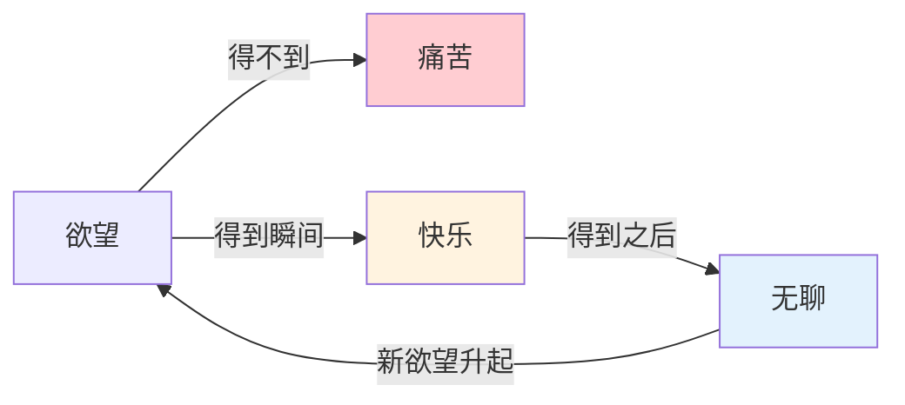
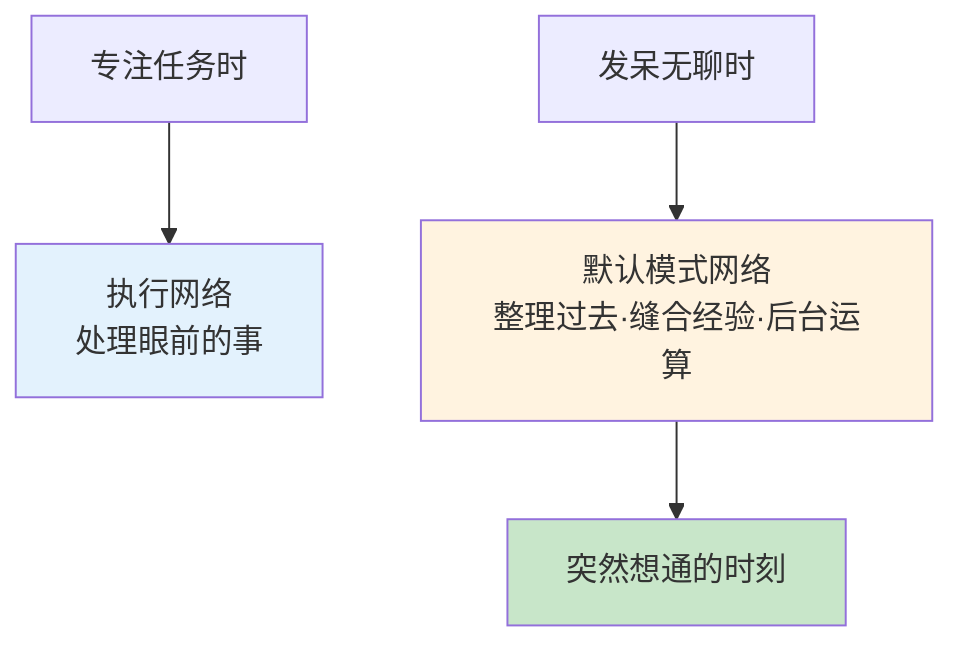
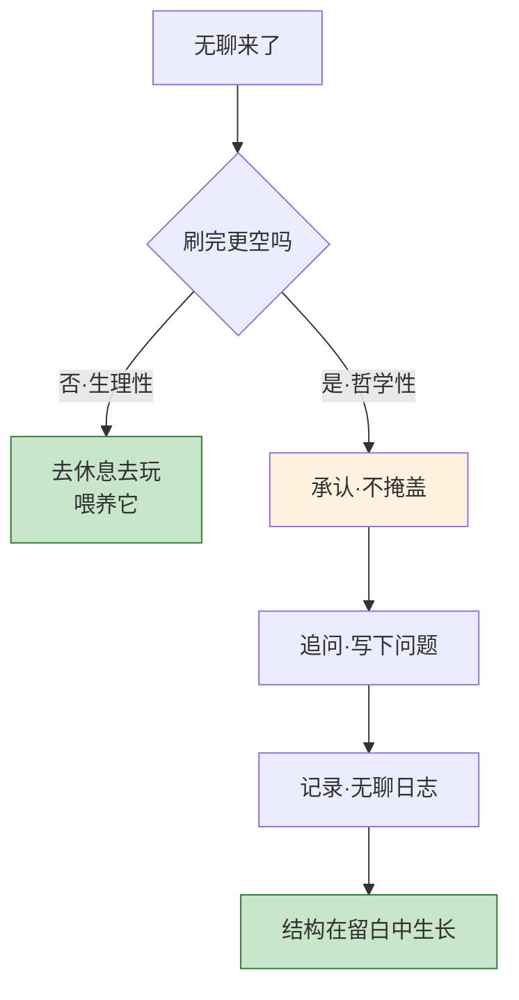
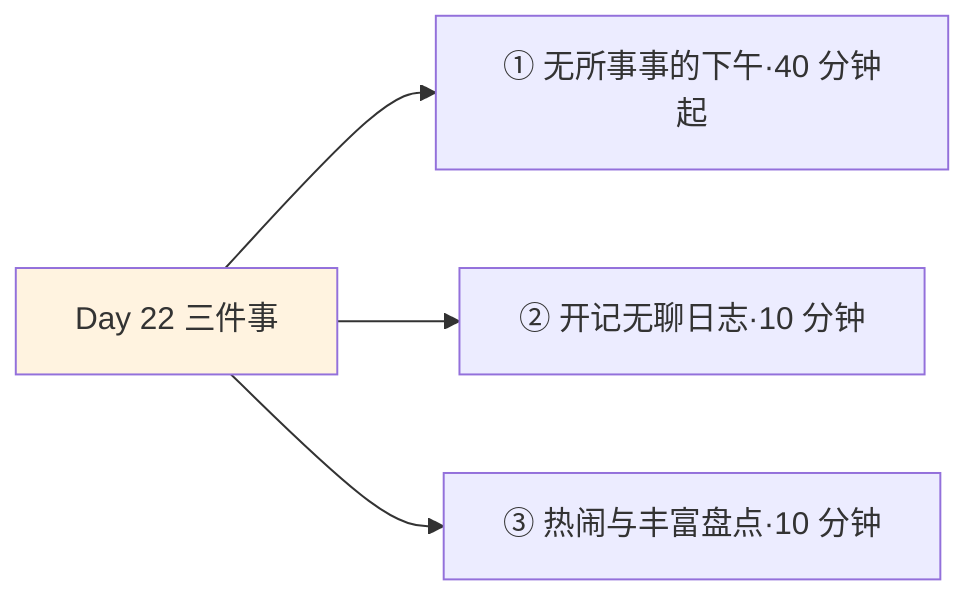
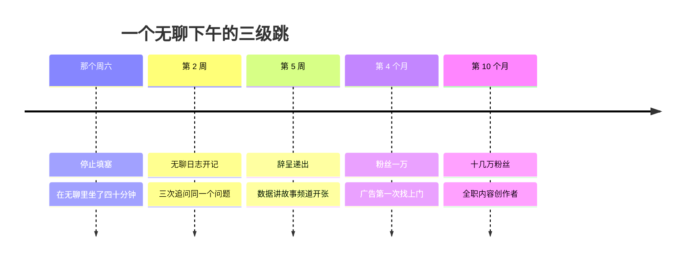

## Day 22·哲学性的无聊：钟摆之间

- [01.看一个真实案例](#01看一个真实案例)
- [02.钟摆理论](#02钟摆理论)
- [03.无聊的两种类型](#03无聊的两种类型)
- [04.无聊是成长的时刻](#04无聊是成长的时刻)
- [05.无聊里的大脑](#05无聊里的大脑)
- [06.如何面对哲学性无聊](#06如何面对哲学性无聊)
- [07.区分热闹与丰富](#07区分热闹与丰富)
- [08.留白不是搁浅](#08留白不是搁浅)
- [09.无聊与抑郁的分界](#09无聊与抑郁的分界)
- [10.今天要做的三件事](#10今天要做的三件事)
- [11.总结回顾本章节](#11总结回顾本章节)
- [12.后来发生的改变](#12后来发生的改变)
- [13.今天起改变三点](#13今天起改变三点)
- [14.课后作业思考下](#14课后作业思考下)

---

## 01.看一个真实案例

先讲一位读者，小裴，二十九岁，游戏行业运营。

一个周六的下午，她躺在沙发上，什么都不想干。不是累——她周五睡足了十小时；不是忙——这周末没有任何安排。就是那种空：阳光斜斜地铺进来，猫在脚边睡觉，楼下有人在修自行车，时间在走，而她感到一阵说不出来由的难受。她形容那个感觉像"耳鸣"，不疼，但一直在。**还有个细节她记得很清楚：那天下午她甚至试着读了会儿书，读了三行，每个字都认识，连成句子就是不进脑子。**

她的第一反应和你我一样：把空填上。打开一部剧，两倍速看完——她特别强调了两倍速这个细节，"我已经不耐烦到连正常速度的剧都配不上我的时间了"；刷一遍所有社交软件，刷到没有新内容；点了个外卖，吃的时候继续刷。傍晚六点，她做了今天全部的"活动"，却比下午两点更空了。她跟我说：**"那种感觉是，我填得越满，漏得越快。"**

后来她学会了另一件事：无聊来的时候，什么都不干，就在无聊里坐一会儿。就在某一个这样的下午，她坐在阳台上什么都不做，四十分钟后，一个拖了她两年的问题突然有了答案——她终于知道自己想离开的不是这家公司，是"每天做活动数据报表"这件事本身；她真正想做的，是把数据讲故事的能力用在自己的账号上。那个下午之后，她开始做自己的内容频道，现在是十几万粉丝的博主。

那个下午什么都没发生。**又可以说，一切都发生在了那个下午。**这就是今天的主题——无聊，尤其是那种填不满的无聊。

先说好，这一章不是劝你多刷手机少焦虑。恰恰相反，它可能要求你做一件现在最不习惯的事：**什么都不做。**

## 02.钟摆理论

十九世纪，叔本华写下了一段至今没有被推翻的观察，后人叫它钟摆理论。

**人生就在痛苦与无聊之间，像钟摆一样来回摆动。**欲望得不到满足，是痛苦；得到的那一瞬间，是快乐——短暂得几乎来不及标记；得到之后，是无聊。然后新的欲望升起，钟摆荡回去。想要而不可得，痛苦；得偿所愿之后，无聊。叔本华的刻薄在于，他把快乐放在了两个刻度之间——**它不是钟摆的停点，只是摆动经过的中间位置。**

验证一下这个理论是不是在说你。双十一之前研究攻略、比价、加购物车，是期待；付完款的瞬间，快乐；包裹拆完的当晚，那批东西就开始变得可有可无——然后你打开了下一个平台的种草页面。升职之前焦灼，拿到通知的那天晚上请客吃饭，三个月后这份工作变得和原来那份一样难以忍受。**钟摆不评判你，钟摆只是描述你。**

注意一个细节：小裴的两倍速，就是钟摆加速的信号。**当一个人连娱乐都要快进，说明钟摆的两极他已经都不耐烦了**——得不到的等不了，得到的留不住。这几乎是现代人的集体肖像。

那怎么办？叔本华给的答案是悲观版的：人生无解，钟摆永恒。但原稿在这一步拐了个弯，这个弯今天要仔细讲：**钟摆确实摆个不停，但钟摆经过中间时，你不必站在轨道上——你可以站到旁边去看它。**观察钟摆的那个人，就是后来小裴坐在阳台上的那个人。

看钟摆的意思是：无聊来了，不急着用娱乐把它打掉，先看看它。

## 03.无聊的两种类型

但"先看看它"有个前提：分清你面对的是哪种无聊。无聊有两种，解法完全相反，用错了会互相伤害。

**第一种，生理性无聊。**累了、闷了、身体缺乏刺激。它的信号很具体：坐立不安、想吃东西、想出门。这种无聊是身体的正常诉求，解法就是字面意思——**补觉、出门、运动、见人，或者就是好好玩一场**。它是生理信号，不是人生问题，别上纲上线。

**第二种，哲学性无聊。**它有个独特标志：**会引发终极追问。**"我到底在干什么？""我每天这样上班下班，是为了什么？"——注意，这种无聊不累也不闷，它是一种意义感的缺口。生理性无聊问你"要不要出去玩"，哲学性无聊问你"我是为了什么在活着"。

区分信号有三个。

| 信号 | 生理性无聊 | 哲学性无聊 |
|:---|:---|:---|
| 刷完手机后 | 缓解了一些 | 更空了 |
| 出去玩一场后 | 满血复活 | 回家路上更沉重 |
| 问题的形状 | "好无聊啊干嘛呢" | "这样下去，图什么呢" |

第三行是最准的试纸：**你的无聊在问什么，它就是什么。**问"干嘛呢"的，去玩就好；问"图什么"的，玩解决不了，玩完还会带着一点羞耻感回来——因为你在用止痛药处理一个骨折。

小裴那个下午是标准的哲学性无聊：睡足了、不忙、什么都提不起劲，刷剧只会更空。**生理性无聊需要喂养，哲学性无聊需要倾听。**用喂养去对付倾听型的问题，就是那个下午漏得更快的原因。

## 04.无聊是成长的时刻

现在讲这一章最重要的论断，原稿里的这段话，值得整段重读：

**一个人的结构，一般生长于两种时刻。第一种，是人生遇到巨大困难的时候——你会觉得自己加速成长了，你解决那个困难的办法，就沉淀为你结构的一部分。第二种，就是无聊时刻。你会因为发现了它而开始思考。**

困难让人成长，这个我们都信，因为困难的经验是明确的：考砸、失恋、失业，熬过去就长本事。但无聊也让人成长，这个反直觉。所以先上证据，再上解释。

英国中央兰开夏大学的心理学家桑迪·曼恩做过一个实验，把受试者分成两组：一组先抄写电话簿上的号码——教科书级无聊的任务——然后让他们完成创造性测试（列举塑料杯的尽可能多的用途）；另一组直接做创造性测试。结果抄号码那组的创意产出明显更高。**先经历无聊的大脑，随后明显更有创造力。**曼恩的结论后来被反复引用：无聊不是认知的停摆，是认知的换挡——它把注意力从外部收回来，转向内部开始漫游、组合、酝酿。

案例不用现编，科学史上最著名的那个下午就是。一六六五年，伦敦大瘟疫，剑桥停课，二十三岁的牛顿回乡下老家，一待快两年。没有实验室、没有课业、没有社交——以今天的眼光看，这是一个巨大的无所事事期。**被苹果砸到之前，牛顿正处在无聊里。**微积分、光的分解、万有引力的雏形，全部诞生在那个"什么都没干"的乡居时间里。历史学家叫它奇迹年，奇迹年的另一个名字，叫留白。

所以原稿那句话的后半段同样重要：**如果没有那些我们经历过的漫长空虚和那些无所事事，很多后面的事情其实都不会发生。**

## 05.无聊里的大脑

上一节的实验说了"会更有创造力"，这一节回答那个悬着的问题：**为什么？无聊的时候，大脑里到底在发生什么？**

神经科学给出的答案是：你的大脑根本没有休息，它只是在换台。当你不做任何具体任务时，一个叫**默认模式网络**的系统开始接管——它恰好在你发呆、走神、无所事事的时候最活跃，干的活包括：整理白天的记忆、把不相干的经验缝在一起、预演没有发生的场景、给悬而未决的问题做后台运算。

理解了这个机制，很多现象会突然说得通。**为什么好点子总在洗澡时来？**——洗澡是标准的默认模式网络时段：身体在自动干活，脑子在自由漫游。**为什么散步能解开想不通的事？**——不是走路给了你答案，是走路腾出了让后台运算跑完的时间。**为什么放下问题睡一觉，第二天就清楚了？**—— sleep 和发呆一样，是后台的加班时段。**你所有"灵光一现"的时刻——洗澡时、散步时、躺床上时——没有一个是发生在专注工作里的，全部发生在留白里。**这不是巧合，是两种网络分工的结果：执行网络负责眼前，默认模式网络负责远方。

这也解释了现代人一个奇怪的困境：**我们消灭了所有无聊的缝隙，等于关掉了大脑的后台。**排队时刷手机、电梯里刷手机、等菜的三十秒也刷手机——每一次"填充无聊"，都是一次对默认模式网络的强制中断。一年下来，你后台运算的总时长趋近于零，然后抱怨自己"没有想法"。**不是你没有想法，是你的想法从来没有机会算完。**

所以小裴阳台上的四十分钟，用神经科学的语言重新描述就是：她给了大脑一次难得的、不被打断的后台运算窗口——那个拖了两年的问题，算了两年的后台程序，终于在这四十分钟里跑完了。

## 06.如何面对哲学性无聊

具体怎么做？三个动作：承认它、追问它、记录它。

**第一，承认它——不用娱乐掩盖。**无聊来的时候，第一反应是逃离：掏手机、开剧、约饭。这个动作把一个有价值的信号当成了故障警报。试着改一个字：把"好无聊，玩点什么"改成"好无聊，**让我看看它**"。不评判地待在里面十分钟，像坐在河边看水。你会不舒服，这种不舒服叫戒断——不是你出了问题，是你的多巴胺基线在复位。小裴补充过一个细节：最难熬的是第三到第五分钟，"手指头会自己去找手机，得像按住一只不听话的猫一样按住它"——第六分钟之后，水面开始平静。

**第二，追问它——问那个终极问题。**哲学性无聊是唯一会问"我到底想要什么"的时刻，别浪费这个提问。具体做法是接住它：无聊升起时，拿出纸笔，把那个念头完整写下来——"我到底在干什么""我觉得生活少了点什么""如果明年还是这样我受得了吗"。不用回答，**先把问题接住**。问题被写下来之后，大脑的默认模式网络会自动开始后台运算，答案什么时候来不定，但它一定在来的路上。小裴的那个答案，就是四十分钟"什么都不干"里被后台运算出来的。

**第三，记录它——无聊日志。**准备一页纸或一个备忘录，每次哲学性无聊出现，记三行：日期、当时的情况、脑子里闪过的念头。记一个月你会发现规律：它总在什么时候出现？周六下午？项目结束后的第一周？每次它想说的其实是同一件事吗？**无聊是你价值观的信使，它反复敲门，是因为你反复不开门。**

## 07.区分热闹与丰富

最后，讲这一章真正的落点。为什么无聊这么值得认真对待？因为它是一块试金石，试出你过的是哪种生活：**热闹的，还是丰富的。**

**热闹是向外的填塞**：日程满、局多、消息不断、笑声密集。热闹的计量单位是场次。它的问题在于，填塞物一旦撤走——假期结束、聚会散场、刷完最后一个视频——空立刻回来，而且比原来更大声。**热闹让你觉得活着。**

**丰富是向内的深耕**：几件长期能沉浸的事、少数几段深的关系、一个接一个的创造。丰富的计量单位是深度。它的特征是，独处时不慌，安静时有序，无聊来了也有处安放。**丰富让你真的活着。**

| | 热闹 | 丰富 |
|:---|:---|:---|
| 方向 | 向外填塞 | 向内深耕 |
| 计量 | 场次、频次 | 深度、跨度 |
| 撤走之后 | 更大的空 | 安静的秩序 |
| 对无聊的态度 | 逃离它 | 借用它 |
| 一句话 | 让你觉得活着 | 让你真的活着 |

两者的关系不是敌人。热闹不是罪，人当然需要热闹——**问题只在于，当热闹成为唯一的生活形态，它就从佐餐酒变成了主食**，而主食空热量太高。丰富的人照样赴局、照样大笑，只是他回来之后，家里有东西在等他：一本写了半截的书、一段练了一半的曲子、一个在长的雪球。

判断自己属于哪种，一个信号就够：**周六下午，一个人在家，两个小时。你感受到的是休息，还是恐慌？**感受到恐慌的，说明你的生活只有外向这一条腿——热闹是它唯一的供血来源。

## 08.留白不是搁浅

这一章的两组工具——面对无聊的三动作、热闹与丰富的分野——都容易被听歪，这一节把边界画清楚。

我见过有人把这一章用歪了：用"我在面对哲学性无聊"包装长期躺平，用"我在思考人生"包装什么都不想干，把每一次该行动的时刻都翻译成"留白"。**留白是画的一部分，但一幅全是留白的画，不是画。**区分的标尺就一条：无聊之后，有没有结构生长出来。小裴的无聊之后长出了频道——那是留白变作品；如果三个月过去，你的"留白"既没长出问题清单，也没长出任何动作，那不是留白，是搁浅。

两条自检线送给你。**第一条：留白要有出口。**每次允许自己无所事事，顺手把浮现的念头记进无聊日志——留白和日志是一对，只有留白没有日志，等于只洗澡不搓背。**第二条：留白要有配额。**哲学性无聊值得善待，但它是调味不是主食——一周一个下午的留白是营养，一周五天的留白是荒废。如果你发现自己越来越擅长"待着"，行动的肌肉在萎缩，那就不是在倾听无聊，是在无聊里躲雨。

最后给一张最小动作表，防止留白变成搁浅：

| 无聊中冒出的念头 | 最小正确版本 |
|:---|:---|
| "我在浪费生命" | 写下三个"不算浪费"的瞬间，本周各复刻一次 |
| "我想离开现在的生活" | 写下想离开的具体三样、想奔向的具体一样，约一次请教 |
| "我不知道想要什么" | 翻 Day 15 的小念头本，圈出出现三次以上的那条 |
| "一切都没意思" | 先排除生理原因：睡够一周，再回来重读这一节 |

## 09.无聊与抑郁的分界

还有一件更严肃的事，必须单独一节说在明处。**哲学性无聊和抑郁，普通人容易混淆，但性质完全不同。**

给你三条参考线。

**第一条，时长。**无聊是阵发性的：来了，坐一会儿，走了，该干嘛干嘛。抑郁的空是持续的——数周、数月不散，而且是"每天都一样"的持续。**一条线：超过两周不散的空，就别再用"无聊"解释它了。**

**第二条，范围。**无聊指向具体的事：这份工作、这种生活、这段关系——你还能清楚说出"我烦的是什么"。抑郁是全面的兴趣丧失：以前爱的现在也不爱了，连"图什么"都懒得问了，连帮助自己都觉得麻烦。**一条线：还能说出"我烦的是什么"的，多半是无聊；说不出的，要警惕。**

**第三条，身体。**无聊不影响基本功能：该吃吃该睡睡，玩起来照样开心。抑郁会：食欲、睡眠、体力的基线全面下滑，晨重暮轻，做什么都像在水里走。**一条线：身体先塌的，不是情绪问题，是生理问题。**

**如果这三条你条条都对上了，今天这一章帮不了你——请去寻求专业的心理帮助。**那不是意志力问题，就像骨折不是走姿问题；去精神科做一次评估，和去做一次体检一样正常。把这一节写进来，是因为负责任：一本书教你听无聊的信，也得教你分清哪个信使送的是别的病。

顺带说一句给陪伴者的话：如果你身边有人长期陷在那种空里，别劝他"想开点""忙起来就好了"——对抑郁说这些，等于对骨折的人说"站起来走两步"。你能做的最有用的事是陪他去做一次专业评估。

## 10.今天要做的三件事

说了这么多，到了今天真正要做的事。三个动作，加起来不到一个小时——而且第一个动作，要求你什么都不做。

动作一，本周给自己一个无所事事的下午。不看手机、不开剧、不安排任何活动，就待着。难受到想逃的时候，告诉自己：这是戒断，不是故障；最难的是第三到第五分钟，按住那只想找手机的猫。四十分钟起步——**小裴的答案用了四十分钟，你的也许更短，也许更久，但它一直在那。**把这个时段写进日历，标题就叫"留白"。

动作二，开记无聊日志。一页纸或一个备忘录，三行格式：日期、情况、闪过的念头。从今天的留白时段开始记第一条。先记一个月，不追求解读，只追求接住——规律会在第三到第四次之间自己浮现。

动作三，做一次热闹与丰富的盘点。列出过去一个月你所有的娱乐和社交，在旁边再列出让你有"沉浸感"的事——做的时候忘了时间、做完很满足的事。两列的长度对比，就是你当前的生活配方。**如果第二列是空的，别慌：明天的第六章，就是专门解决这个问题的。**

## 11.总结回顾本章节

叔本华的钟摆：得不到就痛苦，得到后就无聊，人生在两极之间摆动；两倍速追剧是钟摆加速的信号。无聊分两种：生理性的去喂养，哲学性的去倾听——刷完更空的、玩完更沉的、问"图什么"的，是后者。无聊是成长的时刻：曼恩的实验证明先无聊后创造，默认模式网络在留白里做后台运算——你消灭了所有无聊缝隙，等于关掉了大脑的后台。面对哲学性无聊的三动作：承认它、追问它、记录它。分清热闹与丰富：热闹向外的填塞，丰富向内的深耕。两条边界：留白要有出口和配额，不然是搁浅；持续数周、全面无趣、身体先塌的空，不是无聊是求助信号。

第五章到此收官。回看这四天：Day 19 给理想做了体检，Day 20 把"没时间"翻译成日程，Day 21 启动了生命力工程，今天安放了意义。从"想"到"做"的最后一公里走完了。**接下来，全书要进入它海拔最高的部分——心流。**

## 12.后来发生的改变

小裴的故事，补完后半段。

最值得讲的是第 2 周。她的无聊日志记到第三次，发现了一个规律：那种"图什么"的感觉，不在周末出现，**全在周一早上做数据报表的时候出现**。她盯着那三行记录看了一会儿，突然明白了自己两年都没想明白的事——她不是讨厌这家公司，她是讨厌"每天给活动做报表"这个具体动作。而她最喜欢的时刻，是每月一次把数据做成故事讲给老板听的十分钟。

同一个岗位，一半让她枯萎，一半让她发光。无聊日志替她做了精准的切除手术：她没有逃离行业，她只是把发光的那十分钟，放大成了频道。

她后来跟我说过三句话。第一句："我以前以为无聊是生活出故障了，得赶紧重启。现在我知道了，**无聊是生活发来的系统通知，通知里写着更新内容。着急刷掉通知的人，就永远看不到那次更新。**"第二句："两倍速看剧那段时间，我现在想明白了——我不是在追剧，我是在逃下午。**可惜人生的进度条，快进是无效的。**"第三句："现在我还是会无聊，但我不怕它了。它像一个老熟人，来了就来了，坐一会儿，放下点东西就走。"

还有个尾声：那个周六下午陪她躺着的猫，现在是频道的常驻出镜嘉宾。"它当年比我先懂，"她说，"**猫从来不解决无聊，猫只是待在里面。**"

## 13.今天起改变三点

第一，给无聊一个永久席位。从这周起，你的日历里每周固定一个"留白"时段——它和你的心流时段同样重要：一个是后台运算，一个是前台输出，缺了哪个，另一个都会慢慢熄火。

第二，把无聊日志续满三个月。一个月找规律，三个月看变化：无聊的出现频率在降还是升？它指向的问题在解决还是换新？**无聊日志连续三个月，你会拥有一份自己价值观的体检报告。**

第三，给娱乐装一个"两倍速检查器"。以后每次发现自己在快进、在跳看、在同时开两个屏幕——停下来问一句：我是在享受，还是在逃？**享受慢得下来，逃亡总是很急。**

## 14.课后作业思考下

第一，用三个信号给自己的最近一次无聊分型：刷完手机后更空吗？出去玩一场后更沉吗？它在问"干嘛呢"还是"图什么"？答案决定你该喂养它还是倾听它。

第二，写下你的无聊高频时刻：无聊总在一周的哪些时段、哪些场景出现？连续观察记录一周，然后回答：它反复想告诉你的，到底是哪一件事？

第三，诚实回答那个试金石问题：周六下午，一个人在家两小时，你感受到的是休息还是恐慌？如果是恐慌，列出你生活里"向内深耕"的候选项——哪怕只有模糊的方向。

第四，把叔本华的钟摆套在自己最近的一个欲望上完整走一遍：渴望期做了什么、得到瞬间的快乐持续了多久、之后的无聊隔了几天到来、然后呢。写完这个循环，你会发现**下一轮钟摆已经在排队了**——这时候你就站到了轨道旁边，成了看钟摆的人。

---

**明日预告 · Day 23 体验创造清单。** 第六章，全书巅峰篇开始。体验是颗粒状的，创造是线性的；体验是燃料，创造是发动机。心流藏在创造里。还有三张清单：三十天的、一年的、一生的，以及清单囤积症的自查。明天见。
