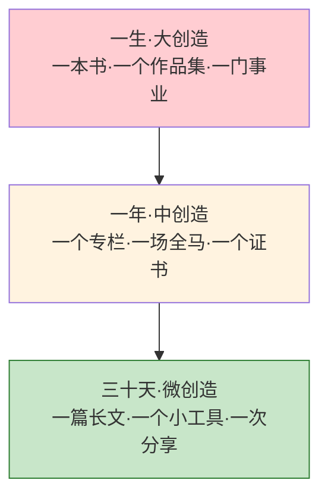
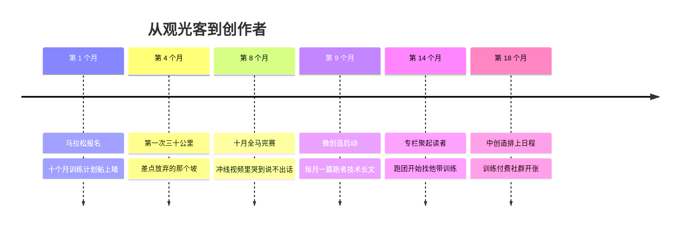

## Day 23·体验创造清单：两张清单

- [01.看一个真实案例](#01看一个真实案例)
- [02.体验清单：颗粒状的多样性](#02体验清单颗粒状的多样性)
- [03.创造清单：线性的成长](#03创造清单线性的成长)
- [04.体验与创造的关系](#04体验与创造的关系)
- [05.好创造清单的三标准](#05好创造清单的三标准)
- [06.创造清单的三个层级](#06创造清单的三个层级)
- [07.一个误区要提前说清](#07一个误区要提前说清)
- [08.总结回顾本章节](#08总结回顾本章节)
- [09.后来发生的改变](#09后来发生的改变)
- [10.今天起改变三点](#10今天起改变三点)
- [11.课后作业思考下](#11课后作业思考下)

---

## 01.看一个真实案例

从今天起，进入第六章：巅峰篇。先用一位读者的故事开场。

老郑，三十七岁，程序员。他是 Day 09 好玩时间的模范生：体验清单做得又长又漂亮——去了十一个国家，吃过三家米其林，看过极光，跳过伞，体验清单上的三十项，划掉了整整三十项。家里有个抽屉专门放这些东西：登机牌存根、各地的冰箱贴、跳伞的视频。他管那个抽屉叫"战利品抽屉"。

去年年底的一个晚上，他把清单翻出来做年终盘点，打算再列一张新的三十项。翻到第三遍的时候，他停住了。他后来跟我描述那个晚上："我盯着那张划满对勾的纸，突然发现一个事——**三十个对勾，我讲不出十个完整的故事。**极光是哪一年？跟谁去的？当时想了什么？一片模糊。我只记得划掉那一勾的时候，挺高兴。"

然后他说了一段让我愣住的话：**"划掉三十项的那个晚上，我特别高兴。但回过头看这一年，我说不出哪一件事还在我身体里。极光很好看，看了十分钟；跳伞很刺激，落地就结束了。我的清单越来越短，我的生活没有任何变化。"**

他停了一下，又说："我像个观光客，每个景点都到了，拍照，走人。**风景都看过了，没有一处是我留下的痕迹。**"

后来他做了一件事：把体验清单换成了创造清单。第一项是跑一场全程马拉松——不是"去东京看马拉松赛道"这种体验，是训练十个月、自己跑完一场的那种。冲线那天他给我发了段视频：四十二公里之后，一个人扶着膝盖，哭得说不出话。他后来说："那一刻我才明白，**我哭的不是累，是我第一次从'经历过'走到了'完成过'。**"

这两张清单的差别，就是今天的全部内容。先说结论，也是原稿那句话：**体验清单是颗粒状的，创造清单是线性的。**

## 02.体验清单：颗粒状的多样性

Day 09 的时候，你已经写过体验清单了：还没去过的地方、没尝试过的东西、没见过的风景、没玩过的一切。今天给它补一个准确的理解：它是**颗粒状**的。

颗粒状是什么意思？三个特征。

**每一项都是独立的点。**去冰岛和去摩洛哥之间，没有任何依赖关系，先后顺序无所谓，去掉一个不影响另一个。它们像一把撒在桌上的豆子，每颗都是完整的。

**完成即结束。**一项划掉就是划掉了，它不会因为你的下一次体验而变深、变大。极光看过了，就是看过了，它不生长。老郑的战利品抽屉是个精确的比喻：**抽屉里的东西只进不出，只增不深。**

**它的价值是多样性本身。**体验清单的意义在于扩充人生的选项池——见没见过的世面、尝没尝过的活法，这些颗粒像采样，帮你勘探自己："原来我喜欢这种""原来那种不适合我"。Day 09 说过，好玩时间里藏着发现未来道路、终生爱好甚至人生伴侣的可能，勘探的载体就是这些颗粒。

所以体验清单没有错，老郑的三十项也不是白划。**问题不在清单本身，在于把它当成了全部。**颗粒有一个先天局限：颗粒不叠加。撒一百颗豆子，桌上还是一百颗孤立的豆子，它们不会自己垒成任何东西。

这就是老郑那句"生活没有任何变化"的数学解释：**三十个点，连不成一条线。**

## 03.创造清单：线性的成长

创造清单是另一种东西。原稿里的定义：你体验到的根本不只是这场马拉松，也不只是手里那张潜水证，而是**整个从无到有的过程。**

马拉松跑完，你带走的不是奖牌，是十个月里每一个清晨五点半的训练、第一次跑到三十公里时差点放弃的那个坡、赛前一夜的紧张、三十七公里撞墙又爬起来的四十分钟。**奖牌只是这个过程的收据。**这本质上是一种精神能力：人永恒去玩的好奇心，和要玩下去的生命力。

线性是什么意思？对照着颗粒的三个特征看。

**它有起点和终点，是完整的线段。**从决定报名那天起，到冲线那天止，中间每一步都长在前一步上。第一周的十公里，第二周的十五公里，都是同一条线上的延伸——**老郑战利品抽屉里的登机牌彼此无关，他十个月里的每张训练截图，都踩在前一张的脚印上。**

**它不能被"划掉"，只能被"走完"。**体验是打卡式的，到场即完成；创造是施工式的，必须从头盖到尾。你没法"打卡"一场马拉松，只能跑完它——**这就是颗粒和线的分水岭：颗粒消费在场，线条兑换付出。**

**它完成后，改变的是你这个人。**划掉三十项体验的老郑还是原来的老郑；跑完一场马拉松的老郑，是一个身体里多了"我能完成一件长事"这个证据的人。**体验改变你的相册，创造改变你的自我概念。**一个是"我去过"，一个是"我做到了"。

后面这半句，心理学有个正式的支撑。斯坦福大学的班杜拉提出过**自我效能**理论：一个人对"我能不能做成"的信念，最强的来源不是鼓励、不是想象，而是**掌握性经验**——亲身完成过一件事的记录。一次真实的"我做到了"，比一百次"你可以的"更能改变你对自己的判断。老郑冲线时的眼泪，就是旧自我概念（三十个对勾但没留下痕迹的人）和新证据（我是能走完一条线的人）接上头的那一刻。

## 04.体验与创造的关系

但请注意，这一章不是要你用创造清单替换体验清单。两张清单的关系，原稿给了一个精准的比喻：**体验是燃料，创造是发动机。**

**体验为创造供给素材和动力。**你见过的好东西，决定你想创造的好东西的上限；你在好玩时间里勘探出的"我喜欢什么"，正是创造清单选题的原料库。老郑选马拉松，是因为体验清单里的某次越野徒步让他发现了这件事；没有那些颗粒，就没有后来这条线的方向。

**创造为体验赋予纵深。**这是被低估的一环。学了一年摄影的人再去看展，和第一次看展的人，看到的不是同一个展；跑过全马的人再去东京观赛，他看的是配速和战术。**创造者的体验，比消费者的体验多一个维度。**

两种活法如果只取一端，代价都很明确。

| | 只体验的人 | 只创造的人 |
|:---|:---|:---|
| 画像 | 观光客 | 苦行僧 |
| 状态 | 什么都经历过，什么都没留下 | 深耕一件事，世界越来越窄 |
| 后果 | 完成即虚无，清单越短越空 | 没有补给，越走越干 |
| 一句话 | 风景都看过了，没一处留下痕迹 | 一直在赶路，忘了为什么出发 |

**只体验的人像观光客，只创造的人像苦行僧。**老郑前十年是前者，也见过太多转型后变成后者的人——砍掉一切娱乐，只许自己"做有用的事"，半年后枯竭反弹。健康的关系是油与机器：**发动机要有燃料才转得动，燃料要有发动机才燃烧出功。**

从今天往后，你的每一次心动都可以先分个类：这件事，我是想"去经历它"，还是想"去完成它"？前者入体验清单，后者入创造清单——**两张清单，两种快乐，缺一不可。**

## 05.好创造清单的三标准

创造清单怎么写才算数？三个标准，逐条过。

**标准一，有明确的输出物。**创造必须有东西被生产出来：一场完赛、一本证书、一篇文章、一个能交付的项目。"变得更好""养成习惯""持续学习"都不算创造——**没有输出物的目标，无法被完成，只能被进行**，而永远"进行中"的事，最后都会不了了之。检验方法：你的这一项，完成那天手里多出来的是什么？说不出实物的，回去重写。

**标准二，有时间跨度，不能一次搞定。**这是线性的前提。看一场演出是颗粒（两小时完成）；学一门乐器、写完一本书、办一次个人画展，这些以月和年计的事才是线性的。**跨度本身不是负担，跨度是复利的容器**——Day 18 讲过，没有 N，式子里其他变量再漂亮也无处发力。

**标准三，有可分享的成果。**完成之后，能拿给别人看、讲给别人听、或至少完整展示给自己看。可分享性有两个作用：一是它强制了质量——能见人的东西做不得太敷衍；二是它接通了创造的社会价值，呼应 Day 19 的第四要素。**独自烂在草稿箱里的不算，要走完"从无到有，再到被看见"的全程。**

拿三个标准扫一遍常见的"假创造"：

| 候选项 | 输出物 | 跨度 | 可分享 | 判定 |
|:---|:--:|:--:|:--:|:--:|
| 每天读书半小时 | ✗ | ✓ | ✗ | 习惯，不是创造 |
| 跑完一场全马 | ✓ | ✓ | ✓ | 创造 |
| 读完一百本书 | ✗ | ✓ | ✗ | 数量堆叠，颗粒感 |
| 写完一本十万字的书 | ✓ | ✓ | ✓ | 创造 |
| 考下一个证书 | ✓ | ✓ | ✓ | 创造 |
| 学会摄影 | ✗ | ✗ | ✗ | 太模糊，重写 |

注意第一行和最后一行的判定不是否定——读书和学摄影都很好，但按原样写进清单，它们落不了地。改造方法：给它们加上输出物和截止日，"读书半小时"改成"写十二篇读书笔记合订成册"，"学摄影"改成"年底办一次三十张照片的家庭摄影展"——**改造完，它们就从愿望变成了工单。**

## 06.创造清单的三个层级

写创造清单的时候，按三个层级写。这个金字塔结构，直接决定了你这份清单会不会死在第三个星期。

**最底层，三十天可完成的微创造。**一篇五千字长文、一个可用的个人主页、一次部门级分享、一个手工做的小物件。这个层级的作用是**供给即时反馈**：大创造遥远，微创造三十天内兑现，让你每月都尝一次"完成"的味道。没有这层的人，会在大创造的半路上饿死。初写清单的人，这一层至少要写三项。

**中间层，一年可完成的中创造。**一个持续更新的专栏、一场全马、一个证书、一个上线的小产品、一次个人画展。这一层是清单的主力，它的作用是**建立身份**——完成一项中创造，你就多了一个"我是做成过事的人"的支点。班杜拉的理论在这里生效：**一次掌握性经验，改写的是你对自己全盘的判断。**

**塔尖，一生想留下的大创造。**一本书、一个作品集、一门事业、一个公益项目。这一层的作用不是执行，是**定向**：它不需要完成日期，只需要真实存在——Day 16 讲三年画像时说过，看得见的远方才拉得动今天。塔尖不设期限，但每个月要看它一眼。

三层之间最好纵向咬合：三十天的长文，可以是一年专栏的一篇；一年的专栏，可以是一本书的雏形。**微创造喂中创造，中创造长大创造——这本身就是一条循环增强曲线，Day 17 画过的那条。**

## 07.一个误区要提前说清

这一节必须单独立在这里，因为它专门防一种高发事故——**清单囤积症。**

写清单这件事本身，会分泌多巴胺。心理学早有研究：**计划带来的愉悦感，几乎和真正获得带来的愉悦感激活同一片脑区**——这就是为什么旅行前做攻略的那一周，常常比旅行本身更快乐；为什么新年第一天列计划时那么兴奋，二月就开始内疚。这个机制用在体验清单上问题不大，用在创造清单上很危险：**你会用"写下三十项"的快感，冒充"完成三项"的成就。**症状很好识别：清单越列越长、越改越漂亮、时不时还要换个新工具重新誊一遍——但每一项都停在"打算开始"。

老郑的第一张创造清单就是这个下场：三层金字塔画得极其精美，工具换了三个 App，两个月后回头一看，启动数是零。他的原话："**我在设计跑鞋上花的钱，够买四双跑鞋。**"

解药就一条规矩，我叫它**落日条款**：当天写下清单，当天必须启动第一项的第一个五分钟。写完三层金字塔的当晚，为最底层的第一项做满五分钟——想标题也好，搜资料也好，画第一笔也好。五分钟不算完成，但它把那张纸的性质换了：**从愿望陈列馆，变成施工进场单。**之后每天看一眼塔尖、动一下底层，其余的不必想。

还有一条反向的规矩：**体验清单禁止改造。**有人听懂了线性更高级，回去把"去海边发呆三天"也硬改成"考一个潜水证"——不必。颗粒有颗粒的用处，你的油箱需要纯粹的油。改造是对创造清单的要求，不是对生活全部的要求。

## 08.总结回顾本章节

体验清单是颗粒状的：独立、完成即结束、价值在于多样性；创造清单是线性的：有始有终、必须走完、改变的是你自己——班杜拉的自我效能理论说明，一次"我做到了"比一百次"你可以的"更能改写自我判断。体验是燃料，创造是发动机，只体验的人像观光客，只创造的人像苦行僧，两种快乐缺一不可。合格创造清单的三个标准：有明确输出物、有时间跨度、有可分享成果。清单分三层：三十天的微创造供给反馈，一年的中创造建立身份，一生的大创造负责定向，三层纵向咬合。最后防住清单囤积症：写清单本身会分泌多巴胺，落日条款——当天写下的清单，当天启动第一项的五分钟。

Day 09 建好了体验清单，今天补上了创造清单。**为什么创造这么重要？因为心流藏在创造里。**明天的 Day 24，就要打开全书最核心的那个概念——心流，幸福的本质，改善生活品质的钥匙。你将知道老郑冲线时那场哭泣的生理学名字。

## 09.后来发生的改变

老郑的后续。

马拉松之后，他做了一个很关键的决定：趁热写一篇一万字的长文，把十个月的训练方法、补给策略、撞墙应对完整复盘，发到了跑步社区。那篇文章成了他第一篇十万加，评论区最热的一条是："看完这篇，我报名了人生第一场半马。"

他跟我说，就是那一刻，他上了瘾——不是跑步的瘾，是**"我的完成带动了别人的开始"**的瘾。后来他把 Day 18 学的复利框架套了上去：每月一篇跑者长文是微创造，一年攒一个"大众跑者训练手册"是中创造，而塔尖那一层他写了六个字：**写给普通人的跑步书。**

上个月见面，他说了三句话。第一句："我以前以为快乐分两种，买来的和玩来的。现在知道还有一种，做出来的。**前两种快乐划掉就没有了，第三种会留下来，还会自己长大。**"第二句："战利品抽屉我留着，但我在旁边新开了一个抽屉，放训练截图和文章打印稿——**左边那个抽屉越满越空，右边这个抽屉，放一张就沉一点。**"第三句，是对还在两张清单之间犹豫的人说的："清单还是那两张，但我终于不再是个游客了。**游客和居民的区别不是住了多久，是有没有一块自己垒起来的砖。**"

## 10.今天起改变三点

第一，今天补齐两张清单。体验清单补到二十项（Day 09 写过的可以沿用），创造清单按三层结构写：微创造至少三项、中创造至少两项、大创造至少一项。**写完第一件事是交叉检查**：你的创造清单里，有没有哪一项的原料来自你的体验清单？把它们连条线。

第二，三十天内启动第一项微创造，执行落日条款。挑最容易的那项，今天定输出物和截止日，写进日历，**今晚睡前为它做满五分钟。**它是整张清单的点火器——老郑的点火器是那篇复盘长文，你的可以是任何三四周内能完成、能示人的东西。

第三，给每个体验项配一个创造型问句。以后再往体验清单上加项时，顺手问一句：这件事，我有没有可能"完成"而不只是"经历"？去日本是体验，"在京都跑完一场全程马拉松"是创造；看画展是体验，"办一次自己的小画展"是创造——**问句不是要你事事都创造，是让创造的选项永远在场。**

## 11.课后作业思考下

第一，翻出你的体验清单（没有的今天建），数一数：过去一年划掉的体验里，有哪一项现在还在你身体里起作用？如果一项都找不出来，写下你对"下一个体验"的期待方式，看它是不是该换个写法了。

第二，用三标准检验你现有目标清单里的每一项，标出哪些是真创造、哪些是习惯、哪些是愿望。习惯和愿望不必删，但请把它们搬到另一页——**创造清单上只留下了能走完的线。**

第三，写下你三层创造清单的完整版，并检查纵向咬合：你的微创造和中创造之间、中创造和大创造之间，有没有上下游关系？如果有孤立的项，考虑把它换掉或接到某条线上。

第四，做一次清单囤积症自查：过去一年，你为"计划"花的时间（挑工具、排格式、做攻略）和为"执行"花的时间各是多少？如果前者超过三成，今晚的落日条款就是你的处方。

---

**明日预告 · Day 24 何为心流时间。** 全书的核心概念终于登场：心流是什么，那种"感觉不到时间流逝，也感觉不到自己"的状态从何而来；契克森米哈赖用寻呼机发现了什么，赌场和游戏公司怎么盗用同一套机制，以及为什么说，没有心流我们只能通过成功追求幸福，有了心流我们得以时时刻刻享受幸福。明天见。
