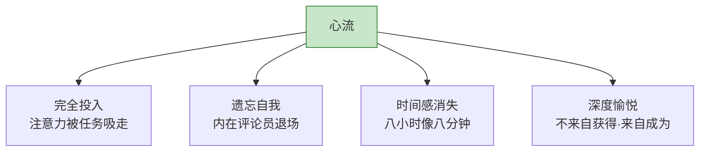
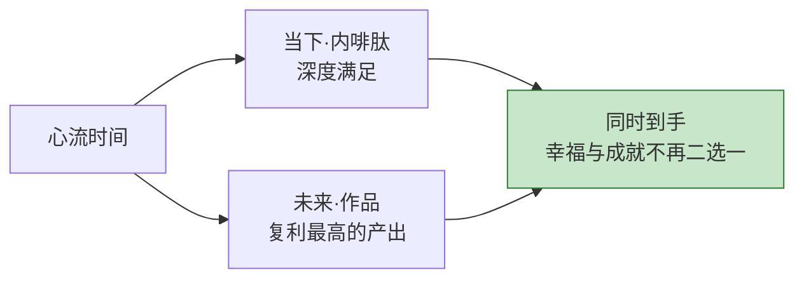
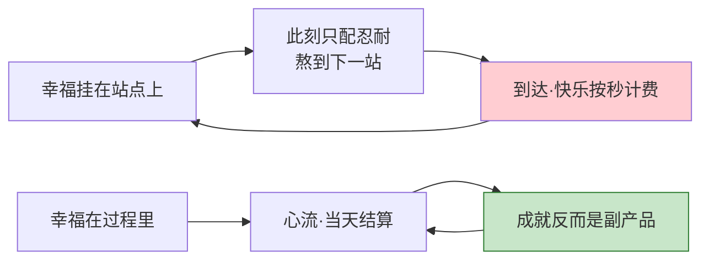
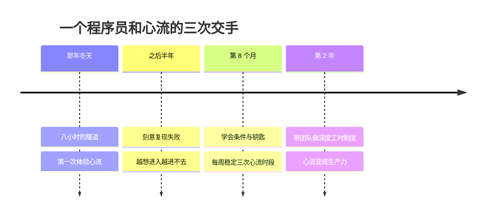

## Day 24·何为心流：颅内巅峰的入口

- [01.看一个真实案例](#01看一个真实案例)
- [02.心流的定义](#02心流的定义)
- [03.心流的物理征兆](#03心流的物理征兆)
- [04.心流带来什么](#04心流带来什么)
- [05.心流不是什么](#05心流不是什么)
- [06.为什么心流是钥匙](#06为什么心流是钥匙)
- [07.总结回顾本章节](#07总结回顾本章节)
- [08.后来发生的改变](#08后来发生的改变)
- [09.今天起改变三点](#09今天起改变三点)
- [10.课后作业思考下](#10课后作业思考下)

---

## 01.看一个真实案例

先听一位程序员读者的描述。他叫大魏，写了一段他人生中某个晚上的经历给我。

那天晚上十一点，他修一个纠缠了团队三天的 Bug。起初还带着点烦躁，改了几处无效的代码之后，他忽然"看见"了问题可能藏在哪里——从那一刻起，事情变了。他的世界里只剩下一个东西：那段代码的执行路径。他沿着一条逻辑链往下走，像在一条隧道里追踪一个声音。中间他没喝水，没看手机，没意识到旁边同事换了班。他记得键盘的声音、屏幕的光，但不记得自己。

等他写下最后一个字符、测试通过，他抬头准备伸个懒腰——**窗外天已经亮了。**他看了眼右下角的时间：八个小时过去了，体感像八分钟。他去洗了把脸，对着镜子愣了很久。他后来跟我说："那八个小时，是我三十岁之前最好的八个小时。**我甚至说不清是我在写代码，还是有什么东西借着我的手在写。**"

大魏不知道的是，他描述的这个状态，心理学有一个正式的名字，已经有半个世纪的研究史，有十几万篇论文讨论它，全世界的顶尖运动员、音乐家、外科医生、科学家都靠它吃饭。它就是从今天起、直到这三十天结束，我们要反复拆解的核心概念——**心流**。

## 02.心流的定义

心流（Flow）这个词，由积极心理学家米哈里·契克森米哈赖提出。他为研究"人在什么情况下最幸福"，追踪访问了几千人——攀岩者、棋手、外科医生、流水线工人、艺术家——把他们的描述汇集比对，发现了同一种状态的反复出现。契克森米哈赖给它起名 Flow，因为它最常被描述成**"像被水流托举着前进"**。

定义一句话：**心流，是一个人对某项有挑战性、有难度的活动，完全投入的状态。**拆开来是四个特征，每一个都对应你我都有的体验。

**特征一，完全投入。**注意力不是被分配到任务上，而是被任务整个吸走。Day 01 讲过"事情堆在脑子里"的背景焦虑——心流是它的完全反面，脑子里没有别的事，一件都没有。

**特征二，遗忘自我。**平时那个絮絮叨叨的"我"——我饿了、我最近怎么样、别人怎么看我——消失了。原稿里描述得很精准：**你完完全全在为这件事本身而努力，就连自身也都因此显得很遥远**，仿佛有一个更厉害的自己，或者什么力量，在长时间的沉浸中降临到身上。大魏那句"有什么东西借着我的手在写"，说的就是这个。

**特征三，时间感消失。**八小时像八分钟。注意这不是比喻，是所有心流报告里一致性最高的描述。时间没有变快也没有变慢——**是你不再计时了**。计时的是那个自我，而自我已经退场。

**特征四，深度愉悦。**事后回味，那种满足不是娱乐的爽，是一种更深的东西：不来自获得什么，而来自**成为什么**的那几个小时。

## 03.心流的物理征兆

除了四个心理特征，心流还有一套身体层面的征兆，报告者们描述得出奇一致。

**身体轻盈、漂浮。**很多人描述"像在水里""脚下踩着云"。这不是文学修辞——在深度专注状态下，大脑对肢体位置感的监控确实会降低，身体感变得模糊而轻盈。

**感觉不到饥饿和疲劳。**饿了几个小时没察觉，站起来才发现腿麻。身体的报警系统被暂时静音了。

**有水流托举感。**这是契克森米哈赖命名的来源：被访者反复使用同一个说法——不是我在用力划水，**是水流在推着我走**。行动一个接一个自动涌现，不需要决策，不需要意志力。

对照一下你自己有没有过这些征兆：打完一场全神贯注的球赛，看表吓一跳；读一本好书，抬头天黑了；写一段代码或画一张图，回过神来杯里的茶凉透了。**你有过的。心流不是少数天才的专利，它是人类神经系统自带的功能——只是大多数人的这个功能，常年处于没有触发条件的闲置状态。**

原稿里有一段对这种状态的描写，我认为是全书文学浓度最高的几行，值得整段放在这里：

**世间唯有沉迷，自我就是宁静，当下就是珍贵，过程就是结果。**

一个人得找到令自己沉迷的事物，这个至关重要，比找到同类还重要，越往后越重要。沉迷里面本身就是审美、自由、爱和幸福，是我们身为灵长类所能体验到的颅内巅峰。至于沉迷的事能不能赚钱、能不能增益他人，都在其次。

## 04.心流带来什么

心流为什么值得专门用一章、用接下来五天来追？因为它同时支付两样东西，而这两样通常被生活劈开：**当下的满足，和未来的成就。**

**先说当下。**心流状态中，体内会大量分泌内啡肽——它被称为快感荷尔蒙、年轻荷尔蒙。Day 21 把心流列为内修四支柱的第四根，依据就在这里：**心流是一场身体内部的保养**，而且是一种奇怪的保养——你越用它，状态越好，没有副作用，不上瘾到伤害生活（除非你把每天十六小时的沉迷你自愿当成伤害）。玩过那次之后你睡得香、情绪稳、看什么都顺眼——那就是内啡肽在结账。

**再说未来。**心流的另一个名字，叫高质量的工作。大魏那八小时，产出超过平时一周。创作者的全部作品、运动员的全部成绩、科学家的全部发现，几乎全部产自心流时间。**浅层努力生产流水，心流时间生产作品。**这就是为什么 Day 18 的复利账本里，心流时间是收益率最高的那一栏。

看清楚这个结构的意义：生活里几乎所有快乐都要预支或延迟——先痛苦后享受，或先享受后账单。**心流是极罕见的"当下结算、未来还能复利"的时间。**这也是为什么五种时间把心流放在塔尖：其他四种时间维持生命，心流时间点亮它。

## 05.心流不是什么

心流经常被混淆成三样东西，必须先做切割，否则后面四天全部白讲。

**心流不是放松。**躺在沙发上看综艺，是放松——放松不需要挑战，神经松弛，挺好，但它不产生心流的"完成"。放松是关机，心流是超频。**两者都需要，但别用放松冒充心流，也别说"我天天挺放松的怎么没变好"。**

**心流不是娱乐。**娱乐的典型形态是被动的：内容流向你，你只负责接收。刷短视频的时候你高度"舒适"，但那是多巴胺的投喂，不是心流的托举——刷完两小时的那种空，和大魏写完代码的那种满，是两种完全相反的东西。**娱乐让你被动，心流让你主动到忘记自己。**

**心流不是麻木。**麻木是心流最阴险的替身：重复劳动到物我两忘——流水线上拧第一万颗螺丝、开了两小时高速的巡航状态。它也有时间感消失，但它不产生成就，也没有深度愉悦，出坑之后只有钝和累。**判断标准就一条：出坑之后，你手里多了什么。**心流出来手里有东西，麻木出来手里什么都没有。

| | 放松 | 娱乐 | 麻木 | 心流 |
|:---|:---|:---|:---|:---|
| 有挑战吗 | 无 | 无（被动接收） | 有但已无意义 | 有且有意义 |
| 需要技能吗 | 否 | 否 | 否（机械重复） | 是 |
| 时间感 | 正常 | 飞快（被动） | 模糊 | 消失（主动） |
| 事后感受 | 平静 | 空虚或一般 | 钝、累 | 深度满足 |
| 事后手里有 | 休息 | 什么都没有 | 什么都没有 | 作品与成长 |

这张表建议你贴在工位上。**现代人真正的困境不是没有放松和娱乐，而是把它们全当成了心流的替代品——然后用加倍的数量，填补质量的空缺。**越填越空，越空越填。

## 06.为什么心流是钥匙

现在回答本篇标题里的问题：为什么说心流是**改善生活品质的钥匙**？

原稿里有一组对仗，是全书我最想让你记住的几句话之一：

**没有心流，我们只能通过成功去追求幸福；有了心流，我们得以时时刻刻去享受幸福。**

拆开看这组对仗里藏着的人生结构。没有心流的人生是什么样：幸福被挂牌在各个"站点"上——考上好学校、拿到 offer、升职、买房、退休。每一个站点之间，是漫长的、以"熬"为单位的路程。这种人生的隐含设定是：**幸福在别处，此刻只配忍耐。**而且残酷的是，抵达站点的快乐按秒计费，钟摆理论（Day 22）早就预告了：新鲜感消退之后，下一段"熬"立刻开工。幸福永远在下一站，追到死也没追上，因为追逐本身就是跑道。

有心流的人生呢：**幸福的结算单位，从"重大成就"被换成了"每一天"。**大魏那八个小时，不需要等升职加薪才成立，当晚就结清了。如果一个人能稳定地、每隔一两天就进入一次心流，他的人生质感就发生了变化——还是那份工作、那份收入、那个住处，但**活着这件事本身的体验变了。**

所以钥匙的意思是：**它不换锁，它换门。**不换你的生活内容，换你和生活之间的关系。这就是为什么说心流是改善生活品质的钥匙——也是为什么接下来的三天，我们要把这把钥匙拆到可以复制的程度。

## 07.总结回顾本章节

心流是完全投入、遗忘自我、时间感消失、深度愉悦的状态，伴随身体轻盈、感觉不到疲劳、水流托举感这些物理征兆。它同时支付当下的满足（内啡肽）和未来的成就（高质量产出），是极罕见的"当下结算、未来复利"的时间。切割三个替身：放松不需要挑战，娱乐让人被动，麻木不产生成就——出坑之后手里有什么，是唯一可靠的判据。最后，心流是钥匙：没有心流，只能通过成功去追求幸福，幸福永远在下一站；有了心流，得以时时刻刻享受幸福。

明天开始拆解机制：心流不是玄学，它有五个触发条件——热爱、技能、挑战、反馈、目标。**从明天起，心流从"神秘的巅峰体验"，变成"可以被设计的日常"。**

## 08.后来发生的改变

大魏后来的事，我挑三件讲。

第一件，是他之后半年的"复现失败"。那次体验太美好了，他开始刻意追求：提前喝咖啡、选最安静的会议室、跟自己说"今晚一定要进去"。结果越用力越进不去——**心流最吊诡的地方是，它不能被直接追求，只能被条件触发。**直接追求心流就像直接追求入睡：你越盯着"我睡着了吗"，越睡不着。这是明天 Day 25 的全部主题。

第二件，是他换了一种问法之后的变化。他不再问"我怎么进入心流"，改问"那晚的条件是什么"。复盘出三条：问题刚好在他的能力边缘、有明确的判定标准（测试过没过）、没有被打断的可能。他照这三条重新设计了自己的工作流——把最难的任务放在晚上十点后、戴耳机、手机锁进抽屉——两周后，那种状态开始定期造访。

第三件发生在去年。他成了小团队负责人，做的第一件事是推行"深度工时"：每天下午两点到四点，全组免会议、免消息，各自守一块完整时间。有人初期不适应，三个月后，这个组的季度产出翻了一倍。他跟组里的人说了句我觉得可以刻在工位上的话：**"我不管你们几点上班几点下班，我只在乎你们一周有几次'抬头天亮了'。"**

## 09.今天起改变三点

第一，写下你的心流档案。今天回忆并写下你人生中的三次心流体验：当时在做什么、身边什么环境、进入前发生了什么、出来之后什么感受。这张档案是未来三天的原始数据——**你自己的触发模式，就藏在这三次的共同点里。**写不出来三次的，写两次、一次也行，大魏在三十岁之前也只有那一次。

第二，做一次"昨天审计"。拿 Day 01 的记录法回看昨天：你有没有哪怕十五分钟的心流时段？没有的话，昨天的放松、娱乐、麻木各占了多少？**不是让你自责，是让你看清配比**——多数人会发现，自己不是不想要心流，是生活里根本没给心流留位置。

第三，选一件"值得沉迷"的事。原稿说，一个人得找到令自己沉迷的事物，这比找到同类还重要。今天圈出你生活里最接近"可以沉迷"的候选——可以是编程、写作、绘画、某种运动、做菜——它就是你这几天练习心流的实验田。**不用确定它就是终生所爱，只需要它比其他事更让你愿意坐下来。**

## 10.课后作业思考下

第一，完成你的心流档案：三次（或几次都行）心流体验的完整记录。然后找共同点——时间、地点、活动类型、独处还是有人、技能与挑战的关系。共同点就是你个人的触发配方雏形。

第二，对照"不是什么"三件套，统计你上周的娱乐时间：其中有多少被你当成了"充实"？用出坑判据复查一遍——手里到底多了什么。

第三，诚实回答：如果幸福只发生在"站点"上，你现在正奔向的是哪个站点？这个站点明确吗？多远？万一推迟三年，你的当下怎么办？写下来的答案，就是你需不需要心流的诊断书。

第四，回答这个本章压轴的问题：**你上一次"抬头天亮了"，是什么时候？**如果超过一年，把这个问题原样发给一个你觉得活得最带劲的朋友，看看他怎么答。

---

**明日预告 · Day 25 心流五个条件。** 心流不能被直接追求，只能被条件触发。热爱、技能、挑战、反馈、目标——五件套逐一拆解：为什么技能不足只会焦虑，挑战超出多少刚好，游戏公司把反馈设计到什么程度，以及那张著名的焦虑、心流、无聊三区图。明天见。
