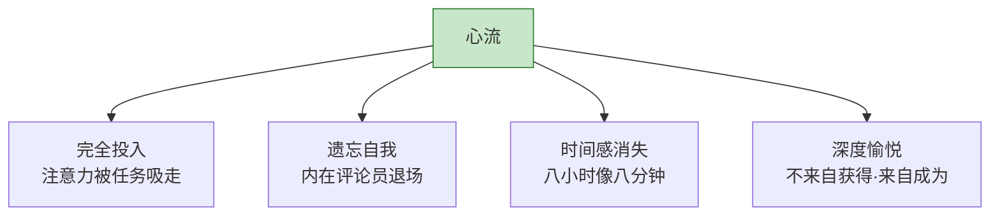
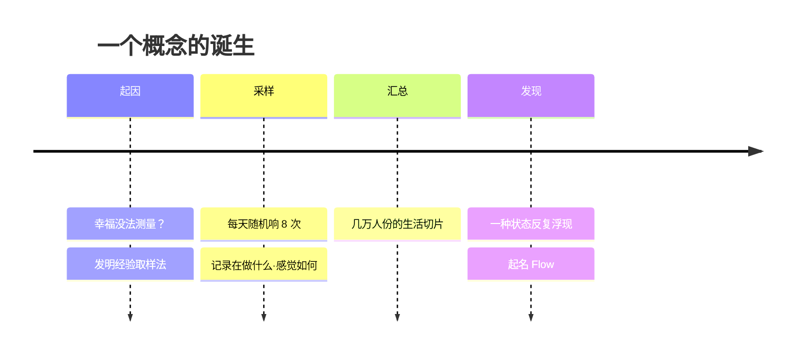
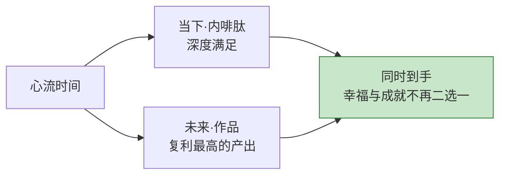
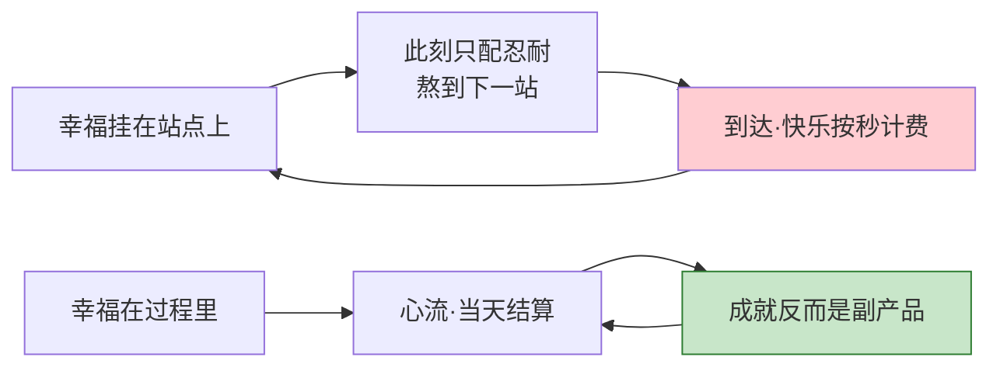
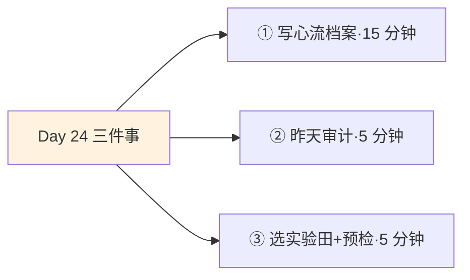
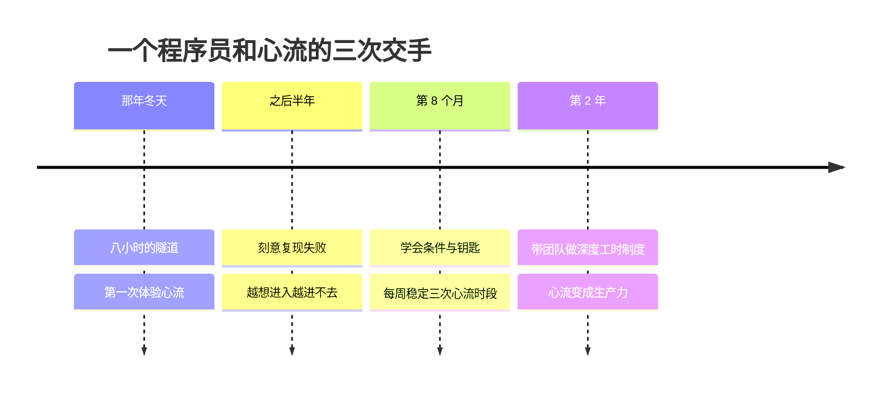

## Day 24·何为心流：颅内巅峰的入口

- [01.看一个真实案例](#01看一个真实案例)
- [02.心流的定义](#02心流的定义)
- [03.发现心流的寻呼机](#03发现心流的寻呼机)
- [04.心流的物理征兆](#04心流的物理征兆)
- [05.心流带来什么](#05心流带来什么)
- [06.心流不是什么](#06心流不是什么)
- [07.为什么心流是钥匙](#07为什么心流是钥匙)
- [08.一个误区要提前说清](#08一个误区要提前说清)
- [09.心流的记账法](#09心流的记账法)
- [10.今天要做的三件事](#10今天要做的三件事)
- [11.总结回顾本章节](#11总结回顾本章节)
- [12.后来发生的改变](#12后来发生的改变)
- [13.今天起改变三点](#13今天起改变三点)
- [14.课后作业思考下](#14课后作业思考下)

---

## 01.看一个真实案例

先听一位程序员读者的描述。他叫大魏，写了一段他人生中某个晚上的经历给我。

那天晚上十一点，团队去睡了，他留下来修一个纠缠了三天的 Bug——一个内存泄漏，藏在几万行代码里，白天人多思路总是断。起初他还带着点烦躁，改了几处无效的代码之后，他忽然"看见"了问题可能藏在哪里——从那一刻起，事情变了。他的世界里只剩下一个东西：那段代码的执行路径。他沿着一条逻辑链往下走，像在一条隧道里追踪一个声音。中间他没喝水，没看手机，没意识到旁边工位的键盘声停了。他记得屏幕的光、记得敲下每一段时的节奏，**但不记得自己。**

等他写下最后一个字符、测试通过，他抬头准备伸个懒腰——**窗外天已经亮了。**他看了眼右下角的时间：八个小时过去了，体感像八分钟。他去洗了把脸，对着镜子愣了很久，然后给我发了那段描述，结尾是这么写的："那八个小时，是我三十岁之前最好的八个小时。**我甚至说不清是我在写代码，还是有什么东西借着我的手在写。**"

大魏不知道的是，他描述的这个状态，心理学有一个正式的名字，已经有半个多世纪的研究史。它怎么被发现的，下一节讲；先给结论：**它是人类神经系统自带的功能，有名字、有定义、有触发条件**——只是大多数人的这个功能，常年处于没有触发条件的闲置状态。

它就是从今天起、直到这三十天结束，我们要反复拆解的核心概念——**心流**。

## 02.心流的定义

定义一句话：**心流，是一个人对某项有挑战性、有难度的活动，完全投入的状态。**拆开来是四个特征，每一个都对应你我都有的体验。

**特征一，完全投入。**注意力不是被分配到任务上，而是被任务整个吸走。Day 01 讲过"事情堆在脑子里"的背景焦虑——心流是它的完全反面，脑子里没有别的事，一件都没有。大魏那八小时里，几万行代码外面的一切，包括他自己，都被关在了门外。

**特征二，遗忘自我。**平时那个絮絮叨叨的"我"——我饿了、我最近怎么样、别人怎么看我——消失了。原稿里描述得很精准：**你完完全全在为这件事本身而努力，就连自身也都因此显得很遥远**，仿佛有一个更厉害的自己，或者什么力量，在长时间的沉浸中降临到身上。大魏那句"有什么东西借着我的手在写"，说的就是这个。

**特征三，时间感消失。**八小时像八分钟。注意这不是比喻，是所有心流报告里一致性最高的描述。时间没有变快也没有变慢——**是你不再计时了**。计时的是那个自我，而自我已经退场。

**特征四，深度愉悦。**事后回味，那种满足不是娱乐的爽，是一种更深的东西：不来自获得什么，而来自**成为什么**的那几个小时。

有个细节值得单独指出：这四个特征里，**只有第四个是"感受"，前三个都是"丧失"**——丧失杂念、丧失自我感、丧失时间感。心流的全部发现可以浓缩成一句话：**幸福的巅峰体验，长得不像"得到什么"，而像"忘掉一切"。**这和我们平时对快乐的理解（获得、奖励、刺激）完全是两个方向，也是心流最反直觉的地方。

## 03.发现心流的寻呼机

这个概念是怎么被发现的？这段研究史值得单独讲，因为它本身就示范了"看见时间"的力量。

上世纪七十年代，匈牙利裔心理学家米哈里·契克森米哈赖在芝加哥大学研究一个别人不愿碰的问题：**人在什么时候最幸福？**这个话题在当时的主流心理学里近乎不科学——幸福没法测量。契克森米哈赖的办法笨拙而天才：他给几百名受试者每人发了一台电子寻呼机，**每天在随机时刻响八次**，响的时候受试者必须立刻在手册上记下三件事：你正在做什么？你在想什么？你现在的感觉如何？

这套方法后来叫**经验取样法**。几周下来，一个人身上能采到五六十个生活切片，几百人就是几万条记录——相当于把普通人的一天拆成碎片，摊在实验室的桌子上看。

几万条记录汇在一起之后，一种状态反复浮出水面。攀岩者说：岩壁上只有我和这条裂缝。棋手说：整盘棋像自己往下走。外科医生说：手术台上感觉不到时间。作曲家说：音符自己涌出来，我只是接住。**职业不同、时代不同、语言习惯不同的人，用几乎相同的词汇描述着几乎相同的时刻**——完全投入、忘记自己、时间消失、事后巨大的满足。

契克森米哈赖给它起名 Flow——因为被试者最常说的一句是，**像被水流托举着前进。**不是我在用力划水，是水在推我。

这段研究史给我们两个启示。第一：**心流不是玄学，是被几万条数据验证过的普遍现象**——它发生在任何人身上，不挑职业天赋。第二：**发现它靠的不是冥想顿悟，是记录。**如果没有那台随机响的寻呼机，这些散落在一天里的巅峰时刻，会和你的大多数时间一样，过得毫无痕迹。你看，这本书从第一天教你做的事情——记录——正是人类发现幸福规律的路径。

## 04.心流的物理征兆

除了四个心理特征，心流还有一套身体层面的征兆，报告者们描述得出奇一致。

**身体轻盈、漂浮。**很多人描述"像在水里""脚下踩着云"。这不是文学修辞——在深度专注状态下，大脑对肢体位置感的监控确实会降低，身体感变得模糊而轻盈。

**感觉不到饥饿和疲劳。**饿了几个小时没察觉，站起来才发现腿麻。身体的报警系统被暂时静音了。大魏那晚没喝水这件事，第二天早上他自己想起来才后怕。

**有水流托举感。**这是契克森米哈赖命名的来源：被访者反复使用同一个说法——不是我在用力划水，**是水流在推着我走**。行动一个接一个自动涌现，不需要决策，不需要意志力。

对照一下你自己有没有过这些征兆：打完一场全神贯注的球赛，看表吓一跳；读一本好书，抬头天黑了；写一段代码或画一张图，回过神来杯里的茶凉透了。**你有过的。**

原稿里有一段对这种状态的描写，我认为是全书文学浓度最高的几行，值得整段放在这里：

**世间唯有沉迷，自我就是宁静，当下就是珍贵，过程就是结果。**

一个人得找到令自己沉迷的事物，这个至关重要，比找到同类还重要，越往后越重要。沉迷里面本身就是审美、自由、爱和幸福，是我们身为灵长类所能体验到的颅内巅峰。至于沉迷的事能不能赚钱、能不能增益他人，都在其次。

## 05.心流带来什么

心流为什么值得专门用一章、用接下来五天来追？因为它同时支付两样东西，而这两样通常被生活劈开：**当下的满足，和未来的成就。**

**先说当下。**心流状态中，体内会大量分泌内啡肽——它被称为快感荷尔蒙、年轻荷尔蒙。Day 21 把心流列为内修四支柱的第四根，依据就在这里：**心流是一场身体内部的保养**，而且是一种奇怪的保养——你越用它，状态越好，没有副作用（除非你把每天十六小时的沉迷你自愿当成伤害）。体验过的人都知道那种"事后余韵"：玩过那次之后你睡得香、情绪稳、看什么都顺眼——那就是内啡肽在结账。

**再说未来。**心流的另一个名字，叫高质量的工作。大魏那八小时，产出超过平时一周。创作者的全部作品、运动员的全部成绩、科学家的全部发现，几乎全部产自心流时间。**浅层努力生产流水，心流时间生产作品。**这就是为什么 Day 18 的复利账本里，心流时间是收益率最高的那一栏。

看清楚这个结构的意义：生活里几乎所有快乐都要预支或延迟——先痛苦后享受，或先享受后账单。**心流是极罕见的"当下结算、未来还能复利"的时间。**这也是为什么五种时间把心流放在塔尖：其他四种时间维持生命，心流时间点亮它。

## 06.心流不是什么

心流经常被混淆成三样东西，必须先做切割，否则后面四天全部白讲。

**心流不是放松。**躺在沙发上看综艺，是放松——放松不需要挑战，神经松弛，挺好，但它不产生心流的"完成"。放松是关机，心流是超频。**两者都需要，但别用放松冒充心流，也别说"我天天挺放松的怎么没变好"。**

**心流不是娱乐。**娱乐的典型形态是被动的：内容流向你，你只负责接收。刷短视频的时候你高度"舒适"，但那是多巴胺的投喂，不是心流的托举——刷完两小时的那种空，和大魏写完代码的那种满，是两种完全相反的东西。**娱乐让你被动，心流让你主动到忘记自己。**

**心流不是麻木。**麻木是心流最阴险的替身：重复劳动到物我两忘——流水线上拧第一万颗螺丝、开了两小时高速的巡航状态。它也有时间感消失，但它不产生成就，也没有深度愉悦，出坑之后只有钝和累。**判断标准就一条：出坑之后，你手里多了什么。**心流出来手里有东西，麻木出来手里什么都没有。

| | 放松 | 娱乐 | 麻木 | 心流 |
|:---|:---|:---|:---|:---|
| 有挑战吗 | 无 | 无（被动接收） | 有但已无意义 | 有且有意义 |
| 需要技能吗 | 否 | 否 | 否（机械重复） | 是 |
| 时间感 | 正常 | 飞快（被动） | 模糊 | 消失（主动） |
| 事后感受 | 平静 | 空虚或一般 | 钝、累 | 深度满足 |
| 事后手里有 | 休息 | 什么都没有 | 什么都没有 | 作品与成长 |

这张表建议你贴在工位上。**现代人真正的困境不是没有放松和娱乐，而是把它们全当成了心流的替代品——然后用加倍的数量，填补质量的空缺。**越填越空，越空越填。

## 07.为什么心流是钥匙

现在回答本篇标题里的问题：为什么说心流是**改善生活品质的钥匙**？

先看契克森米哈赖那个寻呼机研究里，最颠覆的一个发现：**外部条件对幸福的解释力，低得惊人。**收入、地位、环境的变化，对"一天里有多少时刻感觉良好"的预测力很弱——他的数据里，人们在工作中体验到心流的频率，和在休闲中差不多，甚至某些工种更高；而决定一个下午过得好不好的，不是那个下午在哪儿、和谁、多少钱，而是**那个下午有没有几段全然投入的时光**。真正解释力强的变量只有一个：**这个人在多大程度上掌控自己的注意力。**他说过一句被引用了无数遍的话，大意是：幸福不取决于我们身边发生的事，而取决于我们如何处理这些事——掌控了意识的人，才有生活品质可言。

这就是钥匙的出处。原稿里有一组对仗，把这件事说到了尽头：

**没有心流，我们只能通过成功去追求幸福；有了心流，我们得以时时刻刻去享受幸福。**

拆开看这组对仗里藏着的人生结构。没有心流的人生是什么样：幸福被挂牌在各个"站点"上——考上好学校、拿到 offer、升职、买房、退休。每一个站点之间，是漫长的、以"熬"为单位的路程。这种人生的隐含设定是：**幸福在别处，此刻只配忍耐。**而且残酷的是，抵达站点的快乐按秒计费，钟摆理论（Day 22）早就预告了：新鲜感消退之后，下一段"熬"立刻开工。幸福永远在下一站，追到死也没追上，因为追逐本身就是跑道。

有心流的人生呢：**幸福的结算单位，从"重大成就"被换成了"每一天"。**大魏那八个小时，不需要等升职加薪才成立，当晚就结清了。如果一个人能稳定地、每隔一两天就进入一次心流，他的人生质感就发生了变化——还是那份工作、那份收入、那个住处，但**活着这件事本身的体验变了。**

所以钥匙的意思是：**它不换锁，它换门。**不换你的生活内容，换你和生活之间的关系。这也是为什么接下来的三天，我们要把这把钥匙拆到可以复制的程度。

## 08.一个误区要提前说清

这一节必须单独立在这里，因为讲心流的书（包括我以前的文章）几乎都漏了这件事。

还记得心流的四个特征吗：完全投入、忘我、时间消失、深度愉悦。现在注意一个事实：**一个深夜在老虎机前坐了六个小时的赌徒，四个特征全都有。**投入、忘我、时间消失，甚至事后也带着一种亢奋的满足。按特征判断，他"在心流里"。

再看游戏公司。现代大型游戏的制作，背后是成建制的心理学家和行为设计师：难度曲线精确卡在你的技能边缘（挑战），每一刀跳出伤害数字（反馈），段位、任务、赛季目标清清楚楚（目标）——**明天要讲的五件套，游戏行业是最熟练的应用者。**玩家那句"一抬头天亮了"，和大魏的那句，是同一句话。

那区别在哪？为什么不把心流这个词送给赌徒和被设计的玩家？两条判据。

**第一条：出去之后，你手里有什么。**大魏出去，手里有修好的代码和长出来的能力；赌徒出去，手里是空的，口袋比进来时更空。心流的方向性决定它是滋养还是收割——**同样是"忘我"，一个忘了自己是因为给得太多，一个忘了自己是因为被拿走了什么。**

**第二条：触发条件是谁搭的。**大魏的心流条件（问题、目标、反馈）是他自己或工作本身带的；老虎机的心流条件，是被几百名工程师精心设计出来收割你的。**一个是你在使用心流的机制，一个是心流的机制在被用来使用你。**

所以这一章（和这本书）讲的心流，有一个隐含前提要现在挑明：**心流是一种能力，也是一种权力——它服从于你给它的方向。**用在你的创造清单（Day 23）上，它是复利引擎；用在被设计的成瘾循环里，它是收割机。这也是为什么昨天讲创造、今天才讲心流：**先有你的线，再谈流。**明天讲五件套的时候，会请你拆解一次你沉迷的产品，用的就是这一节的判据。

## 09.心流的记账法

最后讲一个把心流接进全书记录体系的方法：**给心流记账。**

从今天起，你的 Day 01 记录本多一种标记：凡是那段时间你进入了全然投入的状态，就在那一行末尾画一个波浪号"~"。不用解释，一个符号就够——**它的作用是把心流从"模糊的美好记忆"变成"可统计的数据"。**

记了一个月之后，这本账能回答四个问题。

**第一，频率：一个月几次？**多数人第一次数会吓一跳——不是太少，是比以为的多。那些十五分钟的沉浸、一小时的忘我，平时根本不会被记起。**看见自己已有的心流，是追逐更多心流的第一步。**

**第二，场景：都发生在做什么的时候？**写东西？打球？做饭？开会走神的那段白日梦不算，但整理数据表格的忘我算。场景清单会暴露你的天然心流场。

**第三，条件：每次进入前发生了什么？**前一晚睡得好？当天没有会？一个人在书房？——把几次记录的"进入前"对一遍，你的触发配方雏形就出来了。这张配方，明天讲五件套时是原始数据。

**第四，方向：那些时段，出去时手里有什么？**用上一节的判据复查一遍：全是滋养型的，恭喜；混着被设计型的（比如刷某平台的"忘我"），也标出来——**记账不只记好的，也记被收割的。**

一位记录了三个月的读者跟我反馈过这方法的效果："数完第一个月我发现，我的心流八成发生在给家人做饭的时候。我原来一直以为自己该培养的爱好是写作，试了一年没成。后来我把'认真做一顿饭'正式写进了创造清单的微创造——**那之后我的周日晚上，成了全家一周里最好的时段。**心流记账替我纠正了一个追了一年的错误方向。"

## 10.今天要做的三件事

说了这么多，到了今天真正要做的事。三个动作，加起来不到半小时。

动作一，写你的心流档案。回忆并写下你人生中的三次心流体验：当时在做什么、身边什么环境、进入前发生了什么、出来之后什么感受。写不出来三次的，写两次、一次也行，大魏在三十岁之前也只有那一次。**你自己的触发模式，就藏在这几次的共同点里**——这是明天讲五件套的原始数据。

动作二，做一次"昨天审计"。拿 Day 01 的记录回看昨天：有没有哪怕十五分钟的心流时段？没有的话，昨天的放松、娱乐、麻木各占了多少？**不是自责，是看配比**——多数人会发现，自己不是不想要心流，是生活里根本没给心流留位置。从今天起，记录本里加上波浪号标记，心流正式入账。

动作三，选一件"值得沉迷"的事，并用方向性预检它。圈出你生活里最接近"可以沉迷"的候选——编程、写作、绘画、运动、做菜——然后用第八节的两条判据过一遍：**触发条件是谁搭的？出去之后你手里会有什么？**两个答案都过关的，才是你这几天练习心流的实验田。

## 11.总结回顾本章节

心流是完全投入、遗忘自我、时间感消失、深度愉悦的状态——四个特征里三个是"丧失"：幸福的巅峰长得不像得到，像忘掉一切。它由契克森米哈赖用寻呼机和经验取样法从几万条生活切片里发现，是有数据背书的普遍现象；发现它的路径，正是这本书从第一天教你的记录。它伴随身体轻盈、感觉不到疲劳、水流托举感，同时支付当下的满足（内啡肽）和未来的成就（高质量产出），是极罕见的"当下结算、未来复利"的时间。切割三个替身：放松不需要挑战，娱乐让人被动，麻木不产生成就——出坑之后手里有什么，是唯一可靠的判据。它是钥匙，因为掌控注意力对外部条件几乎免疫：没有心流，幸福永远在下一站；有了心流，得以时时刻刻享受幸福。最后记住方向性：赌场和游戏公司也懂这套机制——谁搭的触发条件、出去手里有什么，分清滋养和收割。

明天开始拆解机制：心流不是玄学，它有五个触发条件——热爱、技能、挑战、反馈、目标。**从明天起，心流从"神秘的巅峰体验"，变成"可以被设计的日常"——也要防它变成"被人设计的成瘾"。**

## 12.后来发生的改变

大魏后来的事，我挑三件讲。

第一件，是他之后半年的"复现失败"。那次体验太美好了，他开始刻意追求：提前喝咖啡、选最安静的会议室、跟自己说"今晚一定要进去"。结果越用力越进不去——**心流最吊诡的地方是，它不能被直接追求，只能被条件触发。**直接追求心流就像直接追求入睡：你越盯着"我睡着了吗"，越睡不着。这是明天 Day 25 的全部主题。

第二件，是他换了一种问法之后的变化。他不再问"我怎么进入心流"，改问"那晚的条件是什么"。复盘出三条：问题刚好在他的能力边缘、有明确的判定标准（测试过没过）、没有被打断的可能。他照这三条重新设计了自己的工作流——把最难的任务放在晚上十点后、戴耳机、手机锁进抽屉——两周后，那种状态开始定期造访。

第三件发生在去年。他成了小团队负责人，做的第一件事是推行"深度工时"：每天下午两点到四点，全组免会议、免消息，各自守一块完整时间。有人初期不适应，三个月后，这个组的季度产出翻了一倍。推行前有个组员问他：这不就是让大家别摸鱼吗？他答：不，**摸鱼是被设计的心流失败之后的事。**人先试过专注而不得，才会退回娱乐。我给你们把专注的路修好，娱乐自然回到娱乐的位置。他跟组里的人还说过一句我觉得可以刻在工位上的话：**"我不管你们几点上班几点下班，我只在乎你们一周有几次'抬头天亮了'。"**

## 13.今天起改变三点

第一，心流入账，成为你记录体系的常驻项。从今天的波浪号开始，你的记录本从此有了一个幸福仪表盘：每月数一次频率、看一次场景、对一次条件。**看不见的东西无法增加——心流先入账，才能逐月变多。**

第二，把"专注而不得才退回娱乐"写进你的自我理解。下次刷了两小时手机之后，别急着骂自己堕落——先问一句：我今天试过专注吗？试了而不得，才滑向的娱乐？**多数成瘾的前一步，是一次失败的心流尝试。**找到那一步，你就有地方下手了。

第三，每季度用方向性判据复查一次你的"沉迷清单"。你生活里投入时间最多的前三件事，逐个过两条判据：触发条件谁搭的、出去手里有什么。**过不了关的那件，就是你下季度要重新谈判的对象。**

## 14.课后作业思考下

第一，完成你的心流档案：三次（或几次都行）心流体验的完整记录。然后找共同点——时间、地点、活动类型、独处还是有人、技能与挑战的关系。共同点就是你个人的触发配方雏形。

第二，对照"不是什么"三件套，统计你上周的娱乐时间：其中有多少被你当成了"充实"？用出坑判据复查一遍——手里到底多了什么。

第三，用方向性判据，解剖你上周花时间最多的一个数字产品：它的触发条件是谁搭的？谁是受益者？你出去之后手里有什么？解剖完你会发现，你和它之间的关系，可以被重新谈判。

第四，诚实回答：如果幸福只发生在"站点"上，你现在正奔向的是哪个站点？这个站点明确吗？多远？万一推迟三年，你的当下怎么办？写下来的答案，就是你需不需要心流的诊断书。

---

**明日预告 · Day 25 心流五个条件。** 心流不能被直接追求，只能被条件触发。热爱、技能、挑战、反馈、目标——五件套逐一拆解：为什么技能不足只会焦虑，挑战超出多少刚好，游戏公司把反馈设计到什么程度，以及那张著名的焦虑、心流、无聊三区图。明天见。
