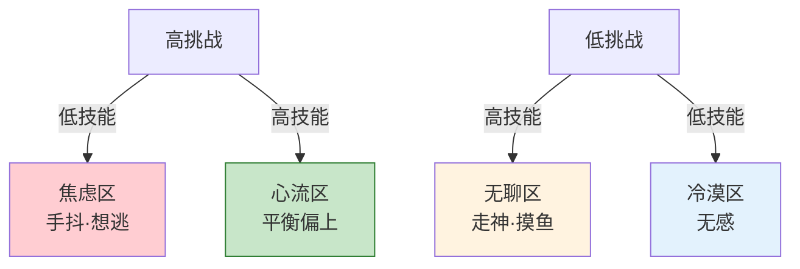
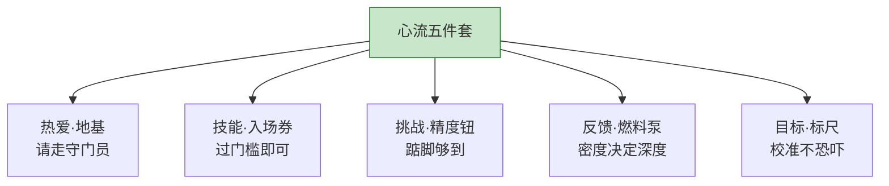
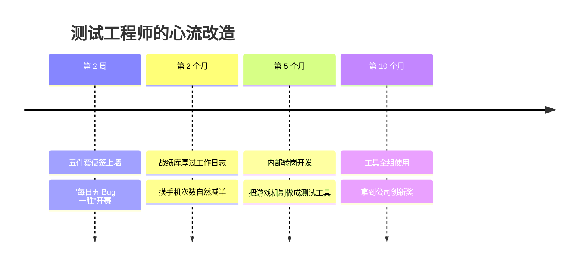

## Day 25·心流的五个条件：五件套

- [01.看一个真实案例](#01看一个真实案例)
- [02.条件一热爱](#02条件一热爱)
- [03.条件二技能](#03条件二技能)
- [04.条件三挑战](#04条件三挑战)
- [05.条件四反馈](#05条件四反馈)
- [06.条件五目标](#06条件五目标)
- [07.五件套装进一个真实项目](#07五件套装进一个真实项目)
- [08.五条件缺失自检表](#08五条件缺失自检表)
- [09.后来发生的改变](#09后来发生的改变)
- [10.今天起改变三点](#10今天起改变三点)
- [11.课后作业思考下](#11课后作业思考下)

---

## 01.看一个真实案例

先讲一位"双面人"读者。小欧，二十七岁，游戏公司测试工程师。

他有一个从没跟同事说过的秘密：**他是重度玩家，也是重度走神者。**玩游戏的时候，他能进入大魏昨天描述的那种状态——一局排位从头到尾，时间塌缩，操作从手指里自己流出来，队友喊他吃饭他都听不见。可一到上班测 Bug，同一个他，十分钟摸三次手机，下午三点开始数着下班。

有天夜里他连输三把排位，气得退出游戏，盯着屏幕忽然被一个念头击中了：**"我为什么天天在游戏里心流，在工作里走神？我上的是同一个班、点的是同一双眼睛、用的是同一个脑子。"**

他没有去找答案——他去拆游戏。拿张纸写：这游戏给了我什么，工作没给我？写了半页，他发现了三样东西：每局胜负清清楚楚（反馈）；段位刚好卡在他努努力能上分的区间（挑战）；每个英雄练一百局肉眼可见地变强（成长可见）。第二天他又补了两样：他确实爱玩（热爱），以及这游戏他玩了七年，有一手（技能）。

他把这五样抄在便签上，贴在工位上，然后做了一件事：**把游戏机制逐条移植到工作里。**给自己设"每日排位"——每天上午十一点前修完五个 Bug，算一胜；把测试脚本按难度分级，从"稳赢局"排到"上分局"；每修一个疑难 Bug 就记进一个文档，攒"战绩库"。两周后他给我发消息："说出来你可能不信，我又开始喜欢写代码了。**不是我变了，是我给代码装上了游戏里那套东西。**"

这五样东西，就是今天的全部内容——心流的五个基础条件。

## 02.条件一热爱

**第一，你要喜欢甚至热爱正在做的事。**这是五件套的地基，没有它，后面四件都是白搭。

原因是结构性的：心流的前提是完全投入，而**没有人能对厌恶的事完全投入**——厌恶本身就是持续的干扰源。你恨着做这件事的每一秒，自我都不会退场，它会一直在旁边喊"什么时候结束"。热爱是唯一能把守门员请出球场的东西。

但"热爱"这个词吓退了太多人，所以必须拆掉两个误解。

**误解一：热爱是找到的，全有或全无。**不是。热爱更像发酵：起头只是"不讨厌"甚至只是"有点意思"，投入之后逐渐变浓。小欧对游戏是热爱，但回头看起点，也只是小时候的一次"还行"。**热爱可以是从"不太讨厌"开始养出来的**，起点低不丢人。

**误解二：不爱现在的事，就该立刻换。**先看数据再决策：你对它是没兴趣，还是从来没在"条件齐备"的状态下做过它？大多数人以为自己不爱编程/写作/运动，其实是**从没体验过这几件事的心流版本**——爱的不是活动本身，爱的至少是"和它的深度关系"。先补条件，再判热爱，顺序不能反。

热爱的勘探工具在 Day 15 早就给了你：小念头本。反复出现的"我想试试"、读的时候想抄下来的段落、为它熬的夜——那些就是热爱的种子。**找不到热爱的时候，别想，回去翻本子。**

## 03.条件二技能

**第二，你具备基础的控制能力。**

心流区有一个残酷的入场券：技能不够，挑战就不再是心流的燃料，而是焦虑的燃料。新手第一次上高速不是心流，是手抖；第一堂拳击课对练不是心流，是恐惧。**技能不足的挑战让人焦虑，这是心流第一定律。**

心理学里那个经典模型，画出来是一张二维图：横轴技能，纵轴挑战。两个轴切出三个区，这就是焦虑、心流、无聊三区图。

这张图的关键信息不是分区，是**通道**：心流区是斜着的一条带。它意味着两件事。第一，技能和挑战必须**大体相当**——菜鸟对菜局，高手对高局，才有的打。第二，**心流是动态的**：技能涨了，原来的挑战就滑进无聊区——这就是为什么一份三年前让你心跳的工作，如今让你摸鱼。**不是你倦了，是你升级了，关卡没跟上。**

关于技能，还必须补一句安慰的话。很多人卡在"我不够好，不配心流"——技能达不到就先练？不完全是。心流研究的结论对普通人友好：**入场券要的不是精通，是"基础控制能力"**——能驾驭基本操作，剩下的靠第三件套补。你不需要先成为高手才配体验心流，你只需要越过门槛。

## 04.条件三挑战

**第三，要具有一定的挑战性。**

三区图已经把逻辑讲了一半：挑战太低，滑向无聊；挑战太高，跌进焦虑。剩下的一半是精度问题：**高多少最好？**

契克森米哈赖的数据给过一个大致的区间，业界常引作经验值：**略高于当前能力百分之十到十五。**通俗版就是原稿那句话：**踮踮脚可以碰到。**

这个"踮踮脚"的精度，恰好和心理学最古老的定律之一对得上。一九〇八年，耶克斯和多德森用小鼠做实验，发现了那条以他们名字命名的曲线：**唤醒水平和表现之间，是倒 U 型关系**——刺激太低，表现松弛；刺激太高，表现崩溃；中间偏上的那一段，表现最好。一个多世纪以来的研究反复确认了它对人类同样成立：考试、演讲、赛场，适度紧张的人发挥最好，完全不紧张和过度紧张的人都掉链子。**心流住在倒 U 的右坡上**——比舒适区高一点，比崩溃区低一点，恰好是"踮踮脚"的位置。

太容易和太难，身体的反应完全不同：

| | 挑战太低 | 挑战刚好 | 挑战太高 |
|:---|:---|:---|:---|
| 身体反应 | 松懈、摸鱼 | 轻度兴奋、微汗 | 手心出汗、心跳过速 |
| 注意力 | 飘走 | 自然锁定 | 被恐惧吸走 |
| 自我对话 | "没意思" | （无对话） | "我不行" |
| 结束后 | 空虚 | 满足 | 虚脱+想逃 |

校准挑战有三个实用动作。**一是拆小**：任务太大就切到"二十分钟能出一个小结果"的颗粒。**二是加限**：给无聊的事制造约束——同一件事，限时完成就变成上分局，不限时就是练习赛。**三是留缝**：排日程别排满，心流需要"接下来没人找我"的心理余量——挑战再对，日程挤成沙丁鱼罐头也白搭。

## 05.条件四反馈

**第四，要有阶段性的反馈，和完成阶段成果的奖励。**

现在讲五件套里最被现代生活辜负的一件。先看一个对照：游戏为什么让人上瘾，工作为什么让人走神？

游戏公司的答案写在每一行代码里：**反馈密度。**你每砍一刀，跳出伤害数字；每推一塔，全屏播报；每打完一局，经验条肉眼可见地涨。反馈的间隔以秒计。而工作呢？你写一封方案，石沉大海两周；你修复一个隐患，没有人知道它没发生。**反馈的间隔以月计，甚至没有。**

注意力系统是等不了月的。这里有个心理学里最硬核的机制：斯金纳的操作性条件反射实验发现，**最牢固的行为模式，来自"变率强化"——奖励不定时、不定量的到来。**老虎机用的就是这一套：不知道哪一下会中，所以每一把都充满期待。现代游戏的爆装备、开宝箱，全是变率强化的直系后代。**小欧不是意志力输给了游戏，是反馈密度输给了游戏。**

所以第四件套的操作思路就一个：**把游戏的反馈机制，移植到你的任务里。**小欧的"每日五 Bug 一胜"是移植；他那个"战绩库"文档也是移植。再给你三个可即用的：

**微反馈**：任务切到十五分钟一个节点，每节点产出一个可见物——一段代码跑通、一页纸写完。**外化反馈**：进度写在纸上或白板上，让眼睛每天看见它涨（Day 01 的记录法在此处复用）。**仪式奖励**：完成一个阶段，给自己一个真实的奖励——一杯好咖啡、一次散步、一局游戏——**注意顺序：先产出，后奖励，反向就变成了逃避。**

还有一个进阶思路：把反馈挂到"人"上。游戏反馈强，一半因为系统，一半因为队友和对手——这是 Day 13 对手、Day 14 赛点在心流里的回声：**有人看着你的进度条，反馈就有了温度。**

## 06.条件五目标

**第五，整个过程需要明确的目标，而不是闲散的游荡。**

五件套的最后一件，也是最容易被"凭感觉"毁掉的一件。**心流需要清晰的靶子。**"我今天要写点东西"不触发心流，"我今天上午写完这一节八百字"才触发。区别在哪？

心流里那个飞速运转的系统需要不停回答一个隐含问题：**"现在这样，行不行？"**这个判断必须有标尺，否则判断本身就耗尽注意力——你一边写一边犹豫"写到哪算完、这样写对不对"，标尺缺失的自我怀疑最耗算力。目标清晰的任务，判断变成瞬时反射：好，继续；差，调整。**目标越清晰，心流越容易触发。**

明确目标的配方，Day 12 讲过，这里原样适用，因为它就是同一条原理：**可量化、可判定、有截止。**"练琴"不算，"这周把副歌弹到连续三遍不错"算；"看书"不算，"今晚读完第三章并写三条笔记"算。目标颗粒度和挑战颗粒度对齐：**踮踮脚的目标，配踮踮脚的任务。**

原稿里还有半句常被漏掉的话，单独强调：**心流的目标是过程性的，不是考核性的。**靶子要清晰，但心态要是"追着这个动作本身"，不是"被这个数字追着"。一旦目标变成悬在头上的考核，恐惧进场，心流退场——**目标负责校准，不负责恐吓。**

## 07.五件套装进一个真实项目

五件套分着讲完了，现在合起来装一次——拿一个你熟悉的项目：Day 20 的阿慧考营养师证书。看五件套怎么在同一件事上各就各位。

| 条件 | 阿慧的装法 | 装上之前她的问题 |
|:---|:---|:---|
| 热爱 | 营养学是从小兴趣，Day 19 体检过四要素 | 考证在她这里从来不是"不得不" |
| 技能 | 财务出身，做表格和记数据是老本行 | 换成纯文科生，先补一个月基础 |
| 挑战 | 三轮复习、每轮难度递增，模考卡在及格线上方 | "一次考过"这种粗目标只会让人焦虑 |
| 反馈 | 每天两个二十五分钟打卡、每周错题率曲线、每月一次模考 | 之前自学最久坚持过三周——没有反馈 |
| 目标 | 第一个里程碑明确：十二个月后走进考场 | "有空就学学"的版本，学了两年没动 |

注意两个细节。**第一，五件套是可以互相代偿的。**阿慧的热爱不算最强烈（她没有小欧对游戏那种沉迷），但她的反馈搭得极密（打卡、错题率、模考三层），反馈补了热爱的位置。这给"我找不到热爱"的读者留了一条活路：**热爱不足的那一格，用反馈和目标的地板撑住天花板**——先运转起来，热爱在运转中继续发酵。**第二，五件套不等于五件事。**阿慧做的只是"每天两个二十五分钟+记录+月考"，五件套是这同一套动作在五个维度上的自动满足——**装好了的动作很省，装不上的人天天用力。**

这也是五件套和意志力的本质区别：意志力要求你每天都重新说服自己，五件套要求你只在搭建时用力一次。

## 08.五条件缺失自检表

五个条件讲完，合并成一张自检表。用法：挑一件你**想进入心流但一直进不去**的事，逐行体检。

| 条件 | 缺失信号 | 自检问题 | 补救动作 |
|:---|:---|:---|:---|
| 热爱 | 做时总盼结束 | 做的时候，自我对话是"有意思"还是"快点完" | 换任务，或找它与你小念头的连接点 |
| 技能 | 一直手忙脚乱 | 我能不假思索完成基本操作吗 | 先补基本功，退回低难度练手 |
| 挑战 | 做着做着摸鱼 | 这件事还让我"踮脚"吗 | 加难度、加限时、加约束 |
| 反馈 | 做很久不知好坏 | 多久能知道"这步对不对" | 切小节点、外化进度、挂上人 |
| 目标 | 一边做一边犹豫 | 我说得出今天上午"完成"的标准吗 | 写下可判定、有截止的今日目标 |

这张表有个用法上的提醒：**五个缺失里，先补最弱的那一个，别五个一起补。**小欧复盘时五个都缺，但他先做的是反馈和挑战（最容易工程化的两个），两周见效之后，热爱自己回来了——**热爱经常不是第一因，而是条件齐备后的结果。**这也是很多人误会"先找到热爱再努力"的病灶所在：顺序反了，热爱是心流的奖品，不全是你采购的原料。

## 09.后来发生的改变

小欧的后续，和两条支线。

第五个月，他做了个内部转岗申请——从测试转开发，那是他大学时的梦，被"我不够热爱"的误诊搁置了四年。转岗面试上，主管问他为什么转变，他说："我用五件套测了一下，**我对代码不是不爱，是我和它的关系一直是错的。**"第十个月，他把"Bug 上分局"做成了一个真实的内部小工具：每个疑难 Bug 标注难度分，修复得分上组内排行榜。这个工具后来被三个组借用。

支线一是一位看了他故事来找我聊的读者，她说自己完全卡在技能那一格：想学油画，第一节课就被助教夸"没天赋"，从此五年没碰笔。我给她的建议只有一条：**回到冷漠区，临摹，不创作，临满一百张再谈天赋。**她上个月发来第十一张临摹的照片，说了一句话："原来我不是没天赋，我是没攒够入场券。"

支线二是大魏——Day 24 那位——读到小欧故事后的补充发言，我认为是五件套最好的民间注解：**"心流就像烧水：热爱决定你愿不愿意点火，技能是壶，挑战是火候，反馈是你能看见的温度计，目标是那个一百度。**我一直以为我缺的是水，其实我缺的是温度计。"

## 10.今天起改变三点

第一，今天完成一次五件套体检。挑你最想进入心流的那件事——写作、编程、运动、做菜——对着自检表逐行打分，找出最弱的一格。**只找，先不改**，认清缺口本身就是今天最有效的动作。

第二，立刻补最弱一格的一个动作。缺挑战的，明天给那件事加一个限时；缺反馈的，建一个可见的进度条（一张纸也行）；缺目标的，今晚睡前写下明天上午的"可判定目标"。一个就好，别贪多。

第三，把"先补条件再谈热爱"写进你的决策习惯。下次再说"我对这个没兴趣"之前，先过一遍五件套：**你的没兴趣，有多少是活动的错，有多少是条件的错？**这个问句救回来的热爱，比市面上所有兴趣测试加起来都多。

## 11.课后作业思考下

第一，画你自己的三区图：列出你日常的三个主要活动，判断各自落在焦虑、心流、无聊、冷漠哪个区。有没有一个活动，以前在心流区、现在滑进了无聊区？那就是你升级后关卡没跟上的地方，写出它的"上分局"版本。

第二，做一次反馈审计：你最重要的那件长期事，从"行动"到"知道好坏"间隔多久？写下你能做的三个缩短间隔的动作，本周实施一个。

第三，用五件套反向拆解一个你沉迷的产品（游戏、短视频、购物软件都行）：它分别对应五件套的哪一件？再用昨天 Day 24 的方向性判据判一次——触发条件是谁搭的？拆完你会发现，你被设计的每一次沉迷，都是一次心流的廉价出租——**看懂了它，你就能把同样的机关，装回自己真正的作品上。**

第四，回答这个本章压轴的问题：小欧说"热爱经常是条件齐备后的结果"，你的经历里有没有一次"做着做着就爱上了"的体验？把它写下来，标出是哪个条件到位之后，热爱才点火的。那封信是你未来所有"先有热爱再行动"念头的解药。

---

**明日预告 · Day 26 触发清空大脑。** 五件套是心流的内部条件，明天开始讲外部触发：四把钥匙的前两把。大脑和手机一样有承载力，超负荷的结果是疲惫加混沌；而仪式感是进入状态的开关——执行意图的著名实验、让身体先进入状态的原理，都在明天。明天见。
