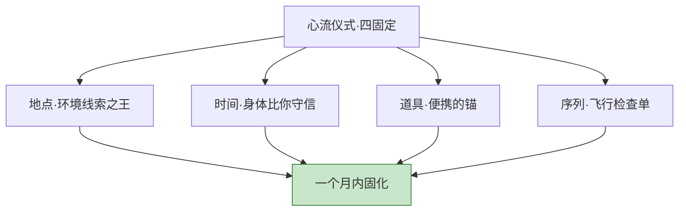
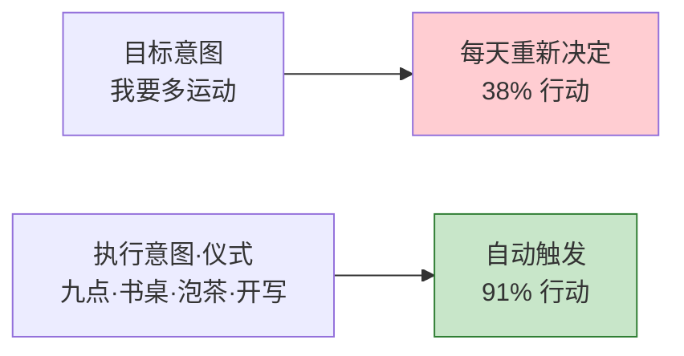
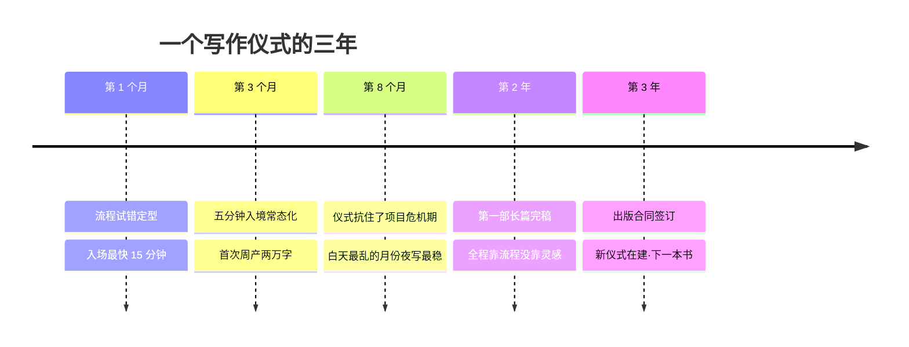
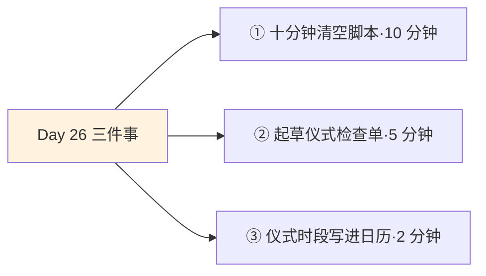

## Day 26·触发心流·上：清空大脑与建立仪式

- [01.看一个真实案例](#01看一个真实案例)
- [02.第一把钥匙清空大脑](#02第一把钥匙清空大脑)
- [03.清空的三个动作](#03清空的三个动作)
- [04.十分钟清空脚本](#04十分钟清空脚本)
- [05.第二把钥匙建立仪式](#05第二把钥匙建立仪式)
- [06.设计你的心流仪式](#06设计你的心流仪式)
- [07.一个误区要提前说清](#07一个误区要提前说清)
- [08.巴甫洛夫的条件反射](#08巴甫洛夫的条件反射)
- [09.执行意图实验](#09执行意图实验)
- [10.总结回顾本章节](#10总结回顾本章节)
- [11.后来发生的改变](#11后来发生的改变)
- [12.今天要做的三件事](#12今天要做的三件事)
- [13.今天起改变三点](#13今天起改变三点)
- [14.课后作业思考下](#14课后作业思考下)

---

## 01.看一个真实案例

先讲一位写作者的入场式。她叫林岁，三十一岁，白天做品牌策划，晚上写小说，目标是明年完成第一部长篇。

她给我描述过她每晚的固定流程，精确得像飞行检查单：**八点五十，泡一杯热茶放在书桌右上角；八点五十五，把手机拿到卧室，关机，放在床头柜第二层抽屉；九点整，戴上那副只用于写作的大耳机——里面不放任何音乐，只是隔音；翻开本子，把当晚要写的一节手写成三行提纲；合上本子，打开电脑文档，从提纲第二行开始打字。**

从坐下到进入状态，最快的一晚用了五分钟。

你可能觉得这套动作有点神经质。但三年前的林岁不是这样的。那时她也在"每晚写作"，实际的样子是：坐下，先看一眼手机有没有消息；写两句，回一条消息；再写两句，点开一个"查资料"，四十分钟后发现在看一个陌生城市的旅行视频；十一点半，带着愧疚和四百个字收场。她说最惨的不是没写——是那种夜复一夜的自我怀疑：**"每晚都要重新说服自己一次'我是真的想写'——说服本身就把力气用完了。"**

转变来自一个偶然。有阵子她家网络故障一周，手机也恰好送修，那晚她被迫"裸坐"在书桌前，没有任何可分心的东西——那周她写出全书进度最快的七章，而且"睡前没有愧疚，是躺着回放情节睡着的"。网络修好那天，她站在路由器前愣了一会儿，做了一个决定：**人为复现那七天。**上面那套流程，就是她一条条试出来、留下来的。用她的话说："**我不是靠自律坐下来的，我是把'坐下'这件事，外包给了一套开关。**"

今天讲的就是这套开关：触发心流的四把钥匙中的前两把——**清空大脑，建立仪式。**第三、四把（干扰结界、颅内模拟）明天讲。

## 02.第一把钥匙清空大脑

第一把钥匙，先解决一个硬件问题。

**大脑和手机一样，存在承载力的限制。**当它超负荷运转时，疲惫和混沌就会出现——后台程序开太多，前台必然卡顿。问题在于，手机的卡顿看得见，大脑的卡顿你看不见，于是多数人以为自己是"状态不好""年纪大了""不够专注"，其实只是后台开着三十个进程。

看看现代人的标准后台：明天要交的报销单、还没回的三个消息、下周要去的医院、答应爸妈的回电、下午那个尴尬的会议、购物车里没结的账。每一件都不重，**但每一件都在持续占用内存**——Day 01 讲过的蔡格尼克效应：未完成的任务会占据心智，直到它被完成，或被外化。一九二七年维也纳那家咖啡馆里的服务员，对未结账的订单记得清清楚楚，结完账立刻忘光——你的大脑对你所有没闭环的事，就是那个服务员。

在这个状态下谈心流，等于在一间没关麦的录音棚里谈录音：不是你唱得不好，是**永远有别的东西在进来**。心流要求意识里只剩一件事，而后台满载的意识里，任何事都待不住超过十分钟。

所以触发心流的第一步，不是"更专注"，而是**关闭输入通道**。原稿说得更彻底：**我们的大脑不是用来记录的，而是用来思考和创造的。将大脑里的东西外在化、可视化，才意味着其他事项和承诺不会在我们专注时闯入注意力空间，才能降低紧张焦虑，全身心投入。**

这句话值得装裱起来。它把职责分派得清清楚楚：**记录，交给纸；思考，留给脑。**你不是记性差，你是让大脑干了它不擅长的兼职，然后怪它主业做不好。

## 03.清空的三个动作

"清空大脑"听着像禅修，其实是一套精确的动线，三个动作，顺序有讲究。


**动作一，关闭通知——先止血。**手机静音不够，要关通知、翻面朝下，最彻底的是离开房间（这是明天"结界"的预告）；电脑关掉邮件提醒、聊天软件角标。这个动作的意义是**切断增量**：你处理不完的后台，首先来自源源不断的新输入。**先关闸，再舀水。**

**动作二，外化任务——把后台搬上桌面。**纸笔比 App 好——因为打开 App 的瞬间就可能被推送带走，而纸不会。拿一张便签，把脑子里所有悬着的、惦记的、怕忘的，一条条全部写下来，写到脑子突然安静为止。别整理格式，别分类，就是倾倒。写完那张纸，**任务还在，但它们从"脑内常驻内存"搬进了"纸上外置硬盘"**——纸替你记着，大脑才可以放它走。这就是外化：蔡格尼克效应的反向开关。

**动作三，排序优先级——只留一件。**在这张纸上圈出**今晚这一个时段真正要推进的那一件事**，其他项划到明天。注意不是"排出顺序全都做"，是"只留一件"——清空的终点不是整齐的任务列表，是**单一任务的意识空间**。三件事等于三件互相打架的后台程序。

三个动作的总耗时不超过十分钟，它买回来的是：**一个后台为零、前台只有一件事的大脑**——这是心流入住前的房型。

林岁流程里"手写三行提纲"就是动作二和三的合体：倾倒+锁定。她说过一句很妙的话："**那张便签是我的更衣室。所有别的事，到这儿换衣服，然后留在门外。**"

## 04.十分钟清空脚本

三个动作讲完了，给你一份可以直接照着念的脚本——今晚第一次练习时，照着走一遍，十分钟。

```text
【第 1 分钟】安顿
        坐到你的位置上。手机翻面或入抽屉。
        对自己说一句：接下来的十分钟，只有我和这张纸。

【第 2–6 分钟】倾倒（动作二）
        拿出一张便签，标题写：悬着的事。
        把脑子里所有的事往外倒，一条一行，不分类、不排序：
        没回的消息、要买的东西、担心的人、模糊的念头……
        判停标准：写下某一条之后，忽然想不出下一条了——就停。

【第 7–8 分钟】圈选（动作三）
        通读一遍，问自己：今晚这几小时，
        哪一件事的推进，会让我睡前觉得"今天值了"？
        把它圈出来。只圈一件。
        其余的，在页脚写四个字：明天再说。

【第 9–10 分钟】清场（动作一）
        处理倾倒清单上真正两分钟内能了结的（回一条"收到"）。
        其余的一律不动。
        把这张便签放到视线之外——它替你记着，你可以走了。
```

第一次做，你大概率会在两件事上不适应。**一是倾倒阶段停不下来**——倒到第六分钟还在冒新条目，正常，前几次的后台积压深，多倒几次就浅了；**二是圈选阶段舍不得**——每件看起来都重要，那就在两件之间问一句"哪件不做会更后悔"，强迫症在这一步必须让位给截止时间。

做完之后，注意一下那种感觉——**脑子突然安静的那一下**。那是后台进程第一次清零的声音，很多人几年没听过了。那个安静，就是第一把钥匙转动到位的声音。

## 05.第二把钥匙建立仪式

大脑清空了，第二个问题是：怎么快速"入场"？

从日常状态到心流状态，中间隔着一段最昂贵的路程——热身期。这段时间的特点是**又慢又贵又险**：慢，普通进入深度专注平均要二十分钟以上；贵，这二十分钟没有任何产出；险，热身期里一次打断（一条消息、一个念头）就可能清零重来。多数人以为自己是"坐不住"，其实是**每次都全款支付了热身期，还常常白付。**

第二把钥匙，就是把这段路修短：**建立仪式感。**仪式是进入状态的开关——一套固定的小动作序列，做完，大脑自动知道"该进去了"。

你身边到处是现成的例子：**作家泡一杯咖啡**才动笔，**程序员戴上耳机**才打开编辑器，**运动员系鞋带**是出场信号，外科医生刷手七分钟才能进手术室。注意这些动作的共同结构：**动作本身和接下来的事没有功能关系**——咖啡不帮你写书，耳机不放音乐，鞋带早就系紧了。它们唯一的用途是**信号**：这个动作之后，是那件事了。

这就是仪式的全部原理：**给大脑装一个条件开关，用固定的前奏，换确定性的入场。**没建立仪式的人，每天都要现挂一个挡；有仪式的人，钥匙一拧就着。省下的不是力气，是每天那段"重新说服自己"的意志力开销——还记得林岁说的吗，最累的不是写，是每晚说服自己写。

## 06.设计你的心流仪式

仪式这么好，怎么设计？四个固定，一个原则。

**固定地点。**一个只用于深度工作的位置——书房那张桌子、图书馆某个座位、甚至椅子上的某个坐姿。地点是环境线索里最强的信号：床只睡觉，桌只干活，各守其土。**在床上办公的人，最后两边都得不到**——工作分不纯，睡眠也毁了。

**固定时间。**每天同一时段进入，生物钟对时间线索极其敏感：你的身体比你的意志力守信。选什么时候？看你的生物节律，但**保护它像保护会议一样写进日历**——仪式最怕"今天再说"。

**固定道具。**林岁的茶、耳机、那本手写提纲的本子。道具是便携锚点：出差住酒店，摆上熟悉的茶杯，五分钟入境——**道具让仪式可以随身携带。**

**固定动作序列。**像飞行检查单一样写成固定的几步，顺序不变：比如清空三动作（便签-圈选-收手机），再加泡茶、戴耳机。三到五步，总长十到十五分钟，不多不少——**序列越长越难坚持，越短信号越弱。**



一个原则：**一个月内固化。**仪式的生效依赖重复次数，前两周是你提醒仪式，后两周是仪式提醒你。这一个月里允许简版（太累时只做泡茶+关手机两步），**不允许断版——断掉的仪式要从头攒。**

三种职业的示例设计，供参考起步：

| 人群 | 固定地点 | 固定时间 | 固定道具 | 动作序列 |
|:---|:---|:---|:---|:---|
| 程序员 | 工位/书房 | 21:00–23:00 | 耳机·马克杯 | 清空便签→泡水→戴耳机→打开昨日注释处 |
| 写作者 | 书桌 | 早晨 6:30 | 同一款茶·提纲本 | 泡茶→手机进抽屉→手写三行提纲→开文档 |
| 备考者 | 图书馆固定座 | 晚 19:30 | 计时器·错题本 | 手机入柜→列今日清单→圈一科→计时开始 |

## 07.一个误区要提前说清

这一节必须单独立在这里，因为它防的是一种最优雅的拖延——**仪式性的拖延。**

有一类人把仪式玩成了新的爱好：精心挑选马克杯、反复调试灯光色温、给仪式流程画一张漂亮的手账图、换到第三个 App 才开始记打卡——四十分钟过去了，正事还没碰。他们不是没做仪式，**他们的仪式本身就是那晚的主菜。**这和 Day 23 讲的清单囤积症是同一个病：准备的动作分泌多巴胺，准备成了目的。

识别信号有两条。**一看时长**：仪式超过十五分钟还在"准备"，大概率已经变味——参照系是林岁的十分钟，够短、够固定、够不体面。**二看情绪**：真仪式做完会有一种"上场前系紧鞋带"的微紧感，伪仪式做完是松了一口气的舒适感——**前者通向工作台，后者通向沙发。**

解药是把仪式重新定义成仆人而不是主人，三条军规。**第一，十五分钟上限**：超时的环节一律砍掉，仪式的预算和它的产出挂钩。**第二，终点必须是动作**：仪式的最后一步必须落在正事的最小启动上——打开文档、写下第一行、翻开第一页。**第三，允许降级**：状态差的时候，只做"关手机+坐下"两步也算数——**简陋的仪式通向工作，精致的仪式通向更多仪式。**

记住判断仪式真伪的唯一标准：**看它最后把你送到了哪里。**

## 08.巴甫洛夫的条件反射

现在讲仪式为什么有效——也是给"这也太玄了吧"的读者一个交代。第一条科学根据，来自心理学里最古老的实验。

**巴甫洛夫条件反射。**一百多年前，俄国生理学家巴甫洛夫发现：铃声本来和分泌唾液毫无关系，但只要铃声反复与食物配对出现，狗最终听到铃声就会流口水——**中性信号通过与特定状态的反复配对，获得了单独触发该状态的能力。**人也一样：固定的前奏反复与深度专注配对出现之后，前奏本身就能单独引发状态的前几步——心跳沉下来，注意力开始收拢，周围的音量自动调低。

这不是比喻，是真的神经系统在学。而且它有一对你应该看清的属性：**铃声不需要被理解，铃声只需要被配对**——你不用相信仪式有用，神经系统照样在替你学；反过来，**配对必须足够重复**——三天打鱼两天换铃声，什么都学不会。这也从科学上解释了 Day 26 反复强调的那条纪律：仪式允许简版，不允许断版——断的不是仪式，是配对训练本身。

对照你自己的生活，其实早就见过它的证据：一进图书馆就自动安静，一闻到消毒水味就想起诊所，一听某首老歌就回到某个夏天——**环境配对的力量你一直在体验，仪式只是第一次让你主动当它的训练师。**

## 09.执行意图实验

第二条根据更现代，也更惊人：**执行意图**——心理学里转化率最高的干预之一。

纽约大学的戈尔维策研究一个所有人都遇过的问题：**决心为什么总是失败？**他找到的答案，藏在你立目标时的句式里。"我要多运动"这种目标意图，把行动的时机留给未来的随机——每天都要重新决定一次"现在动不动"，而每次重新决定，都是给惰性一次翻盘机会。

戈尔维策的改法是把句式焊死成**"如果-就"**：不写"我要多运动"，写"如果是周一早七点，我就穿上跑鞋出门"——把**时间、地点、行为**三样东西钉进同一个触发器。他做过一个著名实验：把"想多锻炼"的大学生分成两组，一组只立目标，一组额外写下"何时何地做什么"。两周后的追踪结果：只立目标的人，百分之三十八开始锻炼；写下执行意图的人，**百分之九十一真的出现在了健身房。**



同一个决心，三倍半的转化率，差别只在于有没有那个具体的"如果-就"。**仪式就是执行意图的仪式化版本**：固定的地点、时间、道具、序列，串成一条自动触发的链——不是每天决定要不要开始，而是让开始这件事自动发生。

两条原理合起来，就是那句话：**让身体先进入状态，大脑会跟上。**听起来违反直觉——我们总以为要"先有状态，才能行动"，仪式把顺序倒了过来：先做身体层面的固定动作，状态作为结果跟上。这也是它对"今天没心情"最狠的破解：**不需要等心情，心情是仪式跑完一圈之后的副产品。**

林岁对这套机制的总结最短："**我不管我今晚写得好不好，我只管每晚九点，把那杯茶放在右上角。**写得好是运，放茶是命。命里有的，运早晚会来。"

## 10.总结回顾本章节

四把钥匙的前两把，解决"进入之前"的事。第一把，清空大脑：大脑有承载力限制，超负荷必卡顿；记录的职责外包给纸，思考的职责留给脑。清空三动作按序执行：关通知止血，外化任务搬后台，排序只留一件事——十分钟的脚本今晚就能照着走。第二把，建立仪式：热身期又慢又贵又险，仪式是预付的决策，用固定前奏换确定性入场。设计四固定：地点、时间、道具、序列，一个月内固化，允许简版不允许断版。警惕仪式性拖延：十五分钟上限，终点必须是动作。原理两条：条件反射，执行意图——百分之九十一对百分之三十八的那个实验，就是仪式的含金量。

明天的后两把钥匙，处理进入之后的事：**怎么防打断（干扰结界），怎么预演（颅内模拟）**。四把合璧，心流从撞大运，变成一条可以每天走的路。

## 11.后来发生的改变

林岁的后续，和一位"反面教材"的逆袭。



第二年的那次危机值得一提。她白天的工作项目连续崩盘，回家时"心是碎的"——按理说是最写不动的时期。但她说那两个月反而写得最稳："**白天我管不了，晚上那杯茶我管得了。**后来我明白了，仪式最大的价值不是帮我写得快，是在我状态最烂的时候，给我留了一根不用思考就能抓住的绳子。"

长篇完稿那天，她数了一下：全书二十九万字，**灵感可靠的晚上不到二十个，仪式可靠的晚上接近六百个。**她在后记里写了一句话，我征得同意抄在这里："这本书不是我意志力的纪念碑，它是我一套流程的运行日志。"

反面教材是一位叫阿岳的读者，他学仪式学了个半吊子：四固定只做了道具——买了林岁同款耳机、同款马克杯，然后躺床上用。三周后跑来问为什么没用。我问他你的固定地点呢，他说沙发也算吧。**仪式的威力在配对，不在道具：四件套缺三件，等于铃声在换着地方响，狗都不知道该去哪流口水。**他后来搬到楼下咖啡馆固定座，两周后开始稳定入境。他现在的说法是："原来仪式不是玄学，**仪式是基建。**"

## 12.今天要做的三件事

说了这么多，到了今天真正要做的事。三个动作，加起来不到二十分钟。



动作一，今晚做一次完整的清空练习。拿第四节那份脚本，十分钟照着走一遍：倾倒、圈选、清场。做完别急着干活，先体会三秒钟那种安静——**那是后台第一次清零的声音**，你接下来三十天的每次开工，都从这三秒钟开始。

动作二，起草你的仪式检查单。四固定逐一填空：地点、时间、道具、序列，暂时做不到的项写"暂缺"及补齐计划。先挑你能立刻做的三个元素起步，写完估一下执行时长——**超过十五分钟的，做减法。**

动作三，把你的心流时段写进日历。像重要会议一样，重复至无限期，标题就叫"开工"。从今天起，**谁跟你约这个时段，你都有了一份现成的、不用编的日程冲突**——保护仪式最好的借口，就是它已经躺在日历里了。

## 13.今天起改变三点

第一，仪式连续执行满一周。不求完美，只求连续：哪怕某天只做"关手机+坐下"两步，也算数——**仪式认的是重复次数，不是豪华程度。**一周后你会发现那个神奇变化：做到第二步的时候，你已经开始想那件事了。

第二，把清空练习变成开工标配。从明天起，每一次深度工作之前，先走一遍三动作（熟练后可以压缩到五分钟）。**清空之于专注，如洗手之于手术**——不做也能做，但做了完全不一样。

第三，给你的仪式装一个"伪仪式报警器"。哪天发现自己在准备环节超过十五分钟、或者仪式做完通向了沙发——当场喊停，直接跳到"最小启动"：打开文档写第一行。**警惕那个越养越肥的仆人。**

## 14.课后作业思考下

第一，写下你的后台清单：此刻脑中所有悬着的、惦记的、怕忘的事，全部写下来，数一数件数。这就是你当前的进程数——以及你"总觉得累却不知道在累什么"的谜底。

第二，对照三动作自查你过往的专注尝试：失败的那几次，分别死在哪个动作的缺失上——没关通知？没外化？还是没锁定唯一任务？找出你的惯死点，明晚优先补它。

第三，做一次执行意图改写：把你拖得最久的那件事，从"我要……"改写成"如果是（时间地点），我就（第一个动作）"。写完贴在你天天看得见的地方——百分之三十八和百分之九十一之间，隔着的就是这一张纸。

第四，检查你的工作环境：你现在常用的"工位"，是不是和刷手机、看剧、发呆的地方混在一起？如果是，选一个新位置——哪怕只是书桌的另一头——**让那里从此只发生一种事。**

---

**明日预告 · Day 27 心流结界模拟。** 后两把钥匙：三级干扰结界怎么建，物理的、数字的、关系的；以及顶级运动员都在用的颅内模拟——菲尔普斯赛前想什么，为什么闭眼三分钟能把入场时间砍半。四把钥匙合璧，明天收官。明天见。
