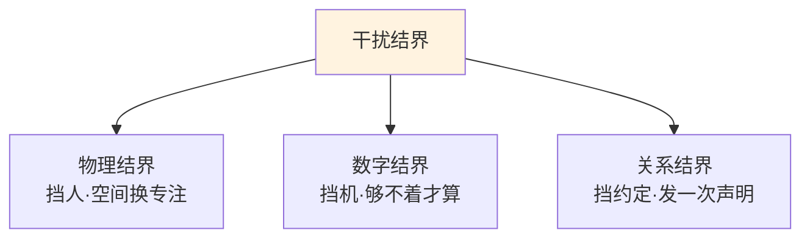
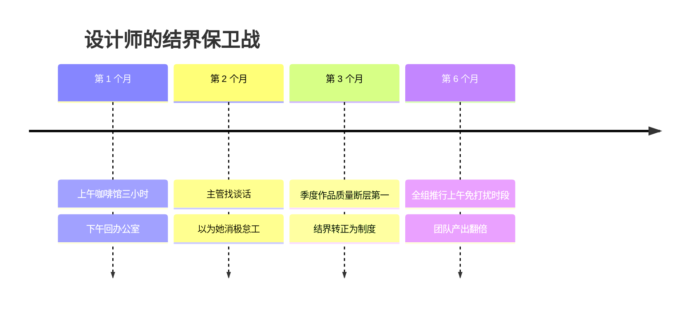

## Day 27·触发心流·下：干扰结界与颅内模拟

- [01.看一个真实案例](#01看一个真实案例)
- [02.第三把钥匙建立干扰结界](#02第三把钥匙建立干扰结界)
- [03.结界的三个级别](#03结界的三个级别)
- [04.第四把钥匙颅内模拟](#04第四把钥匙颅内模拟)
- [05.顶级运动员的颅内模拟](#05顶级运动员的颅内模拟)
- [06.四把钥匙的组合使用](#06四把钥匙的组合使用)
- [07.总结回顾本章节](#07总结回顾本章节)
- [08.后来发生的改变](#08后来发生的改变)
- [09.今天起改变三点](#09今天起改变三点)
- [10.课后作业思考下](#10课后作业思考下)

---

## 01.看一个真实案例

先讲一位设计师的故事。她叫祝同，在一家互联网公司做 UI，开放式工位，头顶是永远亮着的白炽灯，耳边是此起彼伏的会议争论。

她的主业要求深度：一套界面规范，需要连续三小时不受打扰地推敲细节。但她的环境不允许：平均每二十分钟，有人拍一下肩膀问个"很快的事"；每四十分钟，一个@全员的群消息。她试过各种自救——戴耳机、贴"专注中"、早上提前到岗——全部失守。她的描述很生动：**"我像在一个四面漏风的房间里试图点火，每次刚有点火星，就有一阵风吹进来。"**那两年，她所有拿得出手的作品，都是深夜在家补出来的。

转机是她自己发现的。公司楼下的咖啡馆，上午十点以前几乎没人，一壶咖啡坐一上午，没人认识她、没人找她、没有肩膀可拍。她开始每天上午去那儿办公三小时，下午回办公室开会、对齐、社交。**同样的她、同样的脑子，咖啡馆三小时的产出，是办公室的三倍。**

她的总结是一句大白话，但比很多时间管理书都准确："**我不是缺专注力，我是缺一个让专注力活着的地方。**"

这个地方，今天的名字叫**干扰结界**——四把钥匙的第三把。配上第四把（颅内模拟），心流的触发装置就齐了。

## 02.第三把钥匙建立干扰结界

Day 26 的两把钥匙解决"进入之前"，这一把解决"进入之后最贵的事"：**打断**。

先看一组让人心寒的数据。注意力研究反复测到过：一次打断之后，重新回到深度状态平均需要二十分钟以上。更狠的是"注意力残留"：你瞄了一眼那条消息，回了三个字，重新低头工作——但处理消息的那部分认知并没有关干净，它像没拧紧的水龙头，会滴答很久。**这就是为什么很多人一天"忙了八小时"，深度时间加起来不到四十分钟：不是被偷走了大块时间，是被打断打成了碎片。**

心流对打断的耐受度更低：它是可以被瞬间击穿的状态，一次震动，全清零，重建从零开始。**清空和仪式是点火装置，结界是防护罩**——没有防护罩的火，在有风的环境里，等于没点。

结界按干扰的来源分三种，各管一路。

**物理结界：挡住"人"。**关门、戴耳机（哪怕不放音乐，"戴耳机"本身就是现代办公室的免打扰牌）、找专用空间——会议室错峰占用、图书馆、祝同的咖啡馆。物理结界的核心是**空间换专注**：把你的身体移到"来找你的成本变高"的地方。别小看一层楼的距离，它过滤掉八成的随手打断。

**数字结界：挡住"机器"。**飞行模式、专注类 App、退出所有即时通讯、拔掉网线（对，物理拔）。注意：**静音不算结界**——静音只挡声音，挡不住"我知道里面有东西"的那个念头。真正的数字结界是让自己**够不着**：手机锁进抽屉、放到另一个房间。距离产生专注。

**关系结界：挡住"约定"。**提前告知你的协作方：**"每天上午十点到十二点，我这一小时不能被打扰，紧急事情请打电话，其余请留言，我中午统一处理。"**发一次这个声明，你会发现真正"紧急"的事，一周不到一件。关系结界是三种里最治本的：前两种挡的是这一次，这一种挡的是习惯——**让别人习惯你的时段，比每次都独自硬扛，便宜得多。**

## 03.结界的三个级别

结界不是越重越好——重结界有成本（沟通成本、社交压力、离开工位），要按任务的**难度等级**来配。三个级别。

**轻度结界：关通知。**适用：普通任务——回邮件、做表格、开脑洞。成本近零，随时可用。轻度结界配上 Day 26 的仪式，够应付日常八成工作。

**中度结界：关网络。**适用：中等深度任务——写方案、做设计稿、改论文。手机进抽屉，电脑断网（需要资料的话，先下载好再断）。中度结界的标志是**主动制造不便利**：让"去看一眼手机"需要起身走两步——这两步就是护城河。

**重度结界：物理隔离。**适用：高难度、高价值的深度任务——祝同的界面规范、书稿的章节、年度规划。人离开常规环境，进咖啡馆、图书馆、单独房间，配合关系结界广而告之。重度结界是**战略性武器**：一周用两三次，用在最值得的地方——每天用重度结界回消息，那叫社恐，不叫心流。

| 级别 | 动作 | 适用任务 | 使用频率 |
|:---|:---|:---|:---|
| 轻度 | 关通知 | 日常事务 | 每天随用 |
| 中度 | 手机入抽屉·断网 | 写方案·做设计稿 | 每天一两次 |
| 重度 | 离开环境·广而告之 | 写书·核心项目·年度规划 | 每周一两次 |

判断配级有个简单口诀：**任务越接近"作品"，结界越接近"要塞"。**回消息不配要塞，你的书稿配。很多人搞反了：刷手机时谁都不理（重度结界保护碎片时间），做正事时来者不拒（轻度防御都不设）——**把结界用反了，是现代生活最隐蔽的亏损。**

## 04.第四把钥匙颅内模拟

第四把钥匙，最不像钥匙的一把：**开始之前，闭眼三分钟，把整个过程在脑子里过一遍。**

具体做法：仪式做完、结界落位、坐下之后，先不动手。闭眼，在想象里完整走一遍接下来的流程——我从坐下开始；打开那个文件；第一句话大概会写什么；写完第一段，手指在键盘上的感觉；然后是第二段；遇到卡住的地方，我会起来倒杯水，回来重读上一段；然后，继续。**从坐下到进入状态的整条路径，在脑内彩排一遍，再睁眼开始。**

听着像玄学，但它是四把钥匙里**神经科学证据最硬**的一把。运动科学和神经科学的实验反复发现：**生动想象一个动作时，大脑激活的脑区与真实执行该动作时几乎相同。**钢琴家在脑中过一遍乐谱，运动皮层的激活模式接近真实弹奏；运动员做表象训练时，肌肉的微弱电信号会同步出现。脑不严格区分"演练"和"实弹"——**这意味着想象不是安慰剂，想象是一次真的演习。**

它的作用有三个。**第一，预热路径**：该激活的脑区提前激活，真实开始时，热身期被砍掉一半。**第二，预扫障碍**：脑内彩排会撞见潜在坑——"写到第二段我大概会想查资料"——于是你提前把资料下好，把那个打断掐死在发生前。**第三，降低启动阻力**：大脑对"完全未知的过程"天然抗拒，彩排把未知变成了已知，**人对已知的事，从不需要下决心。**

三分钟的具体配方：**一分钟过流程，一分钟过第一段（把开头具体想到能出声），一分钟过感觉**——进入状态之后，那种流畅是什么体感。第三分钟最容易被省略，但它恰恰是菲尔普斯们最看重的一分钟。

## 05.顶级运动员的颅内模拟

第四把钥匙最重的用户，是顶级运动员。

**迈克尔·菲尔普斯**，二十三枚奥运金牌的主人。他从小和教练鲍勃·鲍曼做一套固定功课：**每晚上床前，在脑子里放一遍"录像带"——从跳台到终点，每一下划水、每次转身、水的阻力、甚至泳镜进水怎么办。**鲍曼的说法是："他等于每天多练了一次，在脑子里。"最著名的一次验证是北京奥运会：二百米蝶泳决赛，菲尔普斯的泳镜当场进水，**全程睁眼瞎游，靠脑内的录像带数划水次数，夺冠并破世界纪录。**赛后他说，这情况他"练"过无数次——在脑子里。

高尔夫球手的挥杆预演是同一件事的慢镜头：闭眼空挥、想象弹道、看落点，然后才真正站上球位。**SpaceX 发射火箭前，全流程仿真跑几十上百遍**，每一个阀门、每一个时序，先在计算机里完整飞几十次，才轮到真火箭点火。你看，从泳池到球场到发射塔，**顶级选手在脑子里，已经赢了千百遍。**

把这三个案例放在一起看一个共同点：他们模拟的**不只是成功的过程，还包括出错的应对**。菲尔普斯练过泳镜进水，SpaceX 仿真过引擎熄火。这给颅内模拟补了一条关键规则：**不要只彩排顺利，要彩排恢复。**想象一下你被打断之后怎么回来——这个画面对真实世界的你，价值最大，因为打断必然发生，区别只在于：练过恢复的人和没练过的人，被打断之后的表现是两个物种。

## 06.四把钥匙的组合使用

四把钥匙到此集齐，现在看完整的装置怎么运转。

组合使用的三条军规。

**第一，顺序不能乱。**先清空再仪式（脑子一团浆糊时做仪式，仪式变成发呆）；先仪式再结界再模拟（模拟要在落座、无干扰之后做，否则三分钟彩排被一条消息打穿，等于白彩排）。四步的内在逻辑是一条时间线：**清空是准备大脑，仪式是准备身体，结界是准备环境，模拟是准备路径。**

**第二，每天固定同一时段。**四把钥匙的威力在叠加：同一个时段、同一套动作，重复二十一天，这套装置会从"每次都要主动执行"沉淀为"自动触发"——到点，身体先动，就像你不用决心就能刷牙一样。到那时，你会拥有一个过去不敢想的能力：**随时进入心流**——不是靠状态，是靠装置。

**第三，记录进入用时。**每次完整走完四步，记一笔"今天几分钟进入"。它是你这套装置的仪表盘：第一周平均十五分钟，第二周掉到八分钟，一个月后，三分钟。**看着这个数字变短，是坚持整套流程最强的正反馈。**

原稿里有一句话，是第六章的题眼，放在收官的位置正合适：**对心流时间的追求，是五种时间的核心意义所在。**因为我们不是被动执行任务的机器人，我们是有爱、有自由、有审美的幸福的人。我们的确会有痛苦的生存时间和辛苦的赚钱时间，**但我们同时依然可以拥有澄澈而又幸福的心流时间。**

## 07.总结回顾本章节

第三把钥匙，干扰结界：物理的挡人，数字的挡机，关系的挡约定；三个级别按任务配——日常关通知，写方案断网，做作品物理隔离加广而告之。第四把钥匙，颅内模拟：开始前闭眼三分钟，脑内彩排流程、第一段和体感——想象激活的脑区与真实执行几乎相同，想象就是演习；要彩排恢复，不只彩排顺利。四把钥匙按序组合，每天固定时段，二十一天固化，仪表盘是进入用时。第六章至此收官：**心流从神秘的巅峰体验，变成了可设计、可保护、可预演的工程能力。**

明天进入第七章，收官篇。先清算一件积欠已久的事：时间管理的七大痛点，一条一条算总账。

## 08.后来发生的改变

祝同的后续，和四把钥匙的"全员战报"。

第二个月那次"谈话"值得讲。主管注意到她天天上午消失，约谈了一次。她没辩解，只把两版东西摆出来：上午咖啡馆三小时出的方案，和下午办公室六小时出的方案。主管看了很久，问了句："你下午效率这么低？"她说是所有人下午都这么低，只是没人对比过。第三个月，她的"上午结界"成了组内制度；第六个月，扩展成全组的"上午免打扰时段"。她的总结有点冷幽默："**我什么方法都没发明，我只是把我们组一直在假装看不见的事，摆到了桌面上。**"

四把钥匙的读者战报，摘三条。一位写完长篇的读者说，第四把钥匙最意外："我以前坐下来第一件事是恐惧，现在第一件事是彩排，**恐惧这个东西，居然被三分钟想象挤掉了。**"一位备考的读者测出了自己的仪表盘曲线：十四分钟、九分钟、五分钟、三分钟，"第三周那天我看了一眼表就笑了，像看见自己修的路通车了"。还有一位是失眠康复者，她把四步用于入睡（清空明天的事、固定睡前动作、手机出卧室、脑内回放平静画面），**"原来这套装置不生产心流，它生产'进入'——进入什么都行。**"

## 09.今天起改变三点

第一，今晚做一次完整的四步触发。清空、仪式、结界、模拟，一整套走完，然后做一件十五分钟以上的深度小事——写、画、读、练都行。做完记一笔：**进入用了几分钟。**这是你这套装置的第 0 号数据，以后每一天都和它比。

第二，本周发出你的关系结界声明。给你的核心协作方（同事、家人、室友）发一次正式告知：哪个时段、不可打扰、紧急走电话。发之前你会尴尬，发完你会发现天没塌——**多数人拖了几年没发这条消息，成本只是六十秒的尴尬。**

第三，给最难的那件事预排一个重度结界。你一直想做但总做不进的那件（Day 23 创造清单里的中创造多半在此），本周约一个两小时的重度结界：地点、时段、告知、断网。**只约一次**——一次之后你会自己续约的。

## 10.课后作业思考下

第一，做一次打断审计：记录你明天的每一次打断——来源、事由、恢复用时。数完你会发现，你的深度时间不是被"没时间"杀死的，是被哪些具体的人和机器杀死的。名单里的头两名，分别配什么结界？

第二，按任务给你的下周配结界：列出下周的五个主要任务，逐个贴上轻、中、重的标签。检查有没有"反配"的——重度结界保护刷手机、裸奔状态写方案——这种倒挂每纠正一处，都是白捡的深度时间。

第三，今晚练一次三分钟模拟，写彩排日志：彩排里撞见了哪个"预扫障碍"？（通常是"我大概会想查点什么"）你是提前排掉它了，还是放它发生了？

第四，回答这个本章压轴的问题：菲尔普斯瞎着游完二百米拿了金牌，靠的是练过千百遍的"录像带"。**你的脑子里，有没有任何一件事的录像带？**如果没有，从今晚那份三分钟模拟开始攒——第一盘带子总是最短的，但它会上映。

---

**明日预告 · Day 28 理清时间管理。** 收官篇开始，先算旧账：不懂拒绝、没做预算、习惯浪费、不分优先、事事亲为、拖延、事太多——七大痛点逐条清算，每条配标准解药。全中的读者别慌，全中说明解药也全有。明天见。
