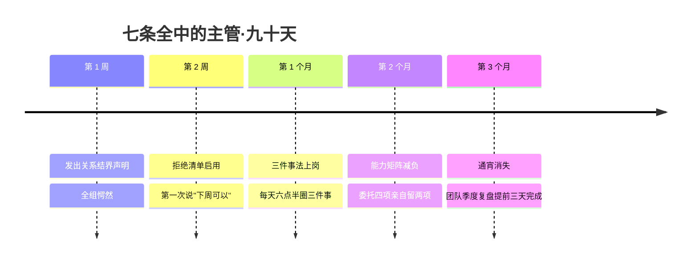

## Day 28·理清时间管理：七大痛点清算

- [01.看一个真实案例](#01看一个真实案例)
- [02.痛点一不懂拒绝](#02痛点一不懂拒绝)
- [03.痛点二没做时间预算](#03痛点二没做时间预算)
- [04.痛点三习惯性浪费](#04痛点三习惯性浪费)
- [05.痛点四没区分优先级](#05痛点四没区分优先级)
- [06.痛点五事事亲力亲为](#06痛点五事事亲力亲为)
- [07.痛点六拖延](#07痛点六拖延)
- [08.痛点七事情就是太多](#08痛点七事情就是太多)
- [09.七痛点总清算表](#09七痛点总清算表)
- [10.总结回顾本章节](#10总结回顾本章节)
- [11.后来发生的改变](#11后来发生的改变)
- [12.今天起改变三点](#12今天起改变三点)
- [13.课后作业思考下](#13课后作业思考下)

---

## 01.看一个真实案例

从今天起，进入第七章：收官篇。最后三篇做三件事——今天清算痛点，明天调平衡，后天毕业。

先讲一位读者，老贺，三十九岁，部门主管。他在读完前面二十七天后，把书里散落的痛点清单拼在一起做了一次自测，然后给我发来一张截图，附了一句话：**"七条，我全中。你写的是不是我的传记？"**

他的自测大概是这样的：不懂拒绝——下属的情绪垃圾他接，别的部门的杂活他接，老板的私事他也接，他形容自己的工位是"全楼情感热线"；没做时间预算——每天一睁眼就开始"接招"，从没想过今天有多少时间可分配；习惯性浪费——一边喊着干不完，一边每天刷掉一个多小时手机，"骂着刷，刷着骂"；不分优先级——一天忙十件事，晚上回想没有一件是他真正该做的；事事亲为——PPT 自己改，数据自己核，理由是"教别人比自己干还慢"；拖延——团队的季度复盘，永远拖到截止前一晚通宵；事太多——这条他划了着重线，"这条不是痛点，是我的人生"。

他问我：全中还有救吗？

我的回答是：**全中恰恰说明有救。**因为——这也是今天的中心论点——**这些痛点没有一条是新问题，全都有标准解药**。你不是遇到了七种绝症，你只是七种常见病都没吃药。更妙的是，这七种病共享同一个病根，而你在 Day 01 已经见过它了：**你从来没有真正看过自己的时间。**今天，一条一条清算。

## 02.痛点一不懂拒绝

**表现：**老好人，委屈自己。别人一开口就答应，答应了就熬自己的夜；不敢拒绝上司，不敢拒绝同事，最不敢拒绝的其实是"别人的失望"。当你背负了不属于你的负担，属于你自己的时间自然就少了。

**病根：**把"拒绝请求"误解成了"拒绝这个人"。你以为说"不"伤关系，真相恰恰相反——**什么都答应的人，最后交付的全是勉强，勉强才是关系的隐形杀手**；边界清晰的人，答应的事才可信。心理学在这里还有个补刀：讨好者对"被讨厌"的恐惧，几乎总是高估了对方在意的程度和时长——你婉拒的那件事，对方当天晚上就忘了。

**解药：三条话术加一个清单。**话术一，缓兵式："我今天排满了，明天给你答复。"——隔一夜，多数请求会自己缩水。话术二，条件式："这事我帮不了全部，可以帮你其中某一部分。"——拒绝整体，接住局部。话术三，直白式："这周不行，下周三之后可以。"——拒绝的是时间，不是人。清单是**拒绝清单**：写下你最近后悔答应的三件事，各配一条你当时"本可以说出口的话"——**台词要提前备好，临场没人即兴得出体面的拒绝。**

## 03.痛点二没做时间预算

**表现：**一天开始了，你却不知道自己今天到底有多少时间。于是有求必应地答应、随口地约、顺手地接——到了下午四点，发现今晚又要透支。你自己都不清楚自己的时间有多少，你就会把时间超常预支出去。

**病根：**你给钱记账、给项目排期，却唯独不给时间做预算——因为时间看起来"总还有"。再叠加上 Day 20 讲过的帕金森定律——**没有预算的时间，工作会自动膨胀到把它填满**——两头一夹，透支成了必然。**做好时间预算，才能保持时间平衡。**

**解药：晨间五分钟预算，晚间五分钟复盘。**早上开工前，先花五分钟回答三个问题：今天可支配的整块时间有几段？已被预约的有哪些？今天最重要的那一件事，安排在哪一段？晚上睡前再花五分钟对账：预算的时段守住了吗，被谁超支了？这两个五分钟就是 Day 01 记录法的日循环版——**一天一次小对账，一周一次大复盘**。别小看这十分钟，它是对抗"日历被别人填满"的唯一防线。

## 04.痛点三习惯性浪费

**表现：**一边抱怨时间不够，一边浪费光阴。嘴上说着"忙死了"，手上刷着短视频；立着"今天早点睡"的誓，躺床上划到一点半。这种浪费最气人的地方是**它总是成对出现**：抱怨和挥霍来自同一个人，在同一天。

**病根：**不是懒，是**无意识**。真正的浪费都发生在不自知里——你如果清醒地知道自己在挥霍，多数时候早就停手了。注意这个痛点和"报复性挥霍"（Day 10）的区别：报复性挥霍是白天被压抑后的情绪反弹，需要的是觉知情绪；习惯性浪费是纯粹的自动驾驶，需要的是让时间显形。

**解药：用 Day 01 的记录法自证，再加一条——浪费税。**记录法的威力在第一章你应该亲历过了：**让时间显形，浪费就自动减半**，因为挥霍最怕被看见。在记录之上再叠加一个机制：每周复盘时算出本周的浪费总量，按每小时给自己定一个"税率"，从娱乐预算里扣——比如浪费五小时，下周的娱乐配额减两小时。**浪费税不是惩罚，是给无意识装一个计价器：自由地浪费可以，隐形地浪费不行。**

## 05.痛点四没区分优先级

**表现：**一天忙到晚，回头一看，什么都没做。你工作速度再快，如果不把重要事务放在前面，就永远是"忙了一天"的感觉配上"拿不出手"的成果——因为**忙的全是别人的优先级**。

**病根：**用"完成数量"代替"完成权重"。十件小事全清的满足感，强过一件大事推进的踏实感——数量是即时反馈，权重要很久才兑现。人性天然选前者：心理学上，**小而确定的完成感对大脑的犒赏，稳定压过大而遥远的收益**——这也是为什么收拾桌子总是比写方案容易开工。

**解药：三件事法，加四象限升级版。**三件事法：每天早上只圈三件事——不是待办清单上勾三件，是问自己"**今天结束时，做完哪三件我才会觉得这一天成立**"。其余都是这三件的配套。四象限升级版：经典四象限告诉你"重要紧急"，升级点只有一个——**把四象限用在每周规划而不是每天救火**：周日下午花十五分钟，把下周的事先投进四个格子，确保"重要不紧急"那一格每周都有真实份额。Day 16 早就讲过原理了：**你未来的重大成果和生活质量，都是重要而不紧急的时间累积决定的。**

## 06.痛点五事事亲力亲为

**表现：**不敢委托、不敢求助。什么都要自己过一遍手：改别人的稿子比自己写还慢，还是自己写；教下属做新流程费劲，还是自己做。人的精力是有限的，要学会寻求帮助。

**病根：**表面看是"追求质量"，底下通常是两种恐惧：怕麻烦别人的社交恐惧，和"只有我做才靠谱"的控制欲。**两者指向同一个结果：你成了全队的天花板，也是全队的瓶颈。**管理学对这个陷阱有个老辣的观察：一个从不委托的管理者，本质上是在用战术上的勤奋，掩盖人才培养上的缺席。

**解药：能力矩阵加委托话术。**画一个二乘二矩阵，横轴"这事我擅不擅长"，纵轴"这事重要不重要"。**不擅长但重要的，立刻委托加盯结果；不擅长也不重要的，立刻委托不盯；擅长但不重要的，标准化后移交；只有"擅长且重要"的才亲自做**——你会发现这一格比你想的小得多。委托话术给你一句万能的："这件事我想请你负责，第一步你先出个初版，有问题随时找我。"——**给了责任，留了后援，比"帮我打个下手"式的假委托有效十倍。**

## 07.痛点六拖延

**表现：**Deadline 前一天通宵。明知道那件事在火烧眉毛地等着，却总能精准地先干完所有别的事：打扫房间、整理文件夹、甚至先把别的拖更久的债还了。**你拖延的时候，勤奋得可怕。**

**病根：**拖延的燃料不是懒，是情绪——对任务某个部分的**畏难、怕丑、怕暴露不会**。你不是不想做，你是不想"开始面对"。而拖延的账单是最冤的：**如果你没有按时完成任务，那你其实是给自己制造了更多工作**——同样的任务，加上了通宵的折损、返工的风险和截止后的崩溃。

这里还有一层没人讲透的机制：**通宵是会上瘾的。**Day 02 讲过稀缺俘获——时间一稀缺，大脑全部带宽自动聚焦。截止前夜那种"全世界只剩一件事"的专注和高效，其实是稀缺制造的一次心流仿品。**很多拖延者不是讨厌通宵，是隐秘地依赖通宵**——它是拖延者唯一能体验到"高度专注"的时刻。看清这一点你就会明白：拖延者缺的不是专注力，是提前制造稀缺的能力。

**解药：五分钟启动法，加拆分成下一步动作。**五分钟启动法：跟自己约定"只做五分钟，五分钟后可以停"——畏难情绪防得住决心，防不住这么小的请求，而一旦启动，惯性会替你做完剩下的大半（这是蔡格尼克效应的正面用法：**开始了的任务会拽着你走完**）。拆分是根治法：把"写季度报告"这种恐惧源，拆到"下一步动作"的颗粒——"打开上季度的报告""新建一个文档写三行小标题"——**恐惧在"报告"这个尺度上是庞然大物，在"三行小标题"这个尺度上，不存在。**

## 08.痛点七事情就是太多

**表现：**这一条不用表现了，它就是表现本身：你做了前面六条的所有功课，事情还是做不完。

**先说一个可能出乎意料的处理：这一条，我们承认它是事实。**不是所有"做不完"都源于方法不对。有些人生阶段，负荷就是超载的——两个孩子的头三年、创业的生死期、家里老人的病榻前后。**对真实的超载，硬讲效率是残忍的**，这时候的解药只有两个字：熬住，以及记住这不是永远——任何一个阶段都会过去，包括这个。

但大多数"事情太多"，剥开看是**"承接太多"**：不拒绝（痛点一）、没预算（痛点二）、不排序（痛点四）、不委托（痛点六）——七条痛点其实是连环的，前面六条的债，最后都由第七条来还。

**解药只有一副药，也是最苦的一副：做减法。**停掉一件事，比多做对三件事更难——因为减法意味着面对"我此前错了"。两个减法抓手：**从承诺端减**——下次答应任何新事之前，先说好它替换掉哪件旧事（不加不减，只置换）；**从身份端减**——承认自己不是所有角色都能当满分，把次要角色的及格线，从七十分降到五十分。**做减法比做加法更难，但更重要。**

## 09.七痛点总清算表

七条清完，合并成一张总表。建议裁下来，贴在你能看见的地方。

| # | 痛点 | 一句话病根 | 核心解药 | 已学过的对应章节 |
|:--:|:---|:---|:---|:---|
| 1 | 不懂拒绝 | 拒绝请求≠拒绝人 | 三条话术+拒绝清单 | Day 27 关系结界 |
| 2 | 没做时间预算 | 时间"看起来总还有" | 晨间五分钟+晚间五分钟 | Day 01·Day 20 |
| 3 | 习惯性浪费 | 浪费发生在无意识里 | 记录自证+浪费税 | Day 01·Day 10 |
| 4 | 没分优先级 | 用数量代替权重 | 三件事法+周度四象限 | Day 16 |
| 5 | 事事亲力亲为 | 怕麻烦+控制欲 | 能力矩阵+委托话术 | Day 13 对手·借力 |
| 6 | 拖延 | 情绪阻力+通宵上瘾 | 五分钟启动+下一步动作 | Day 12 拆分 |
| 7 | 事情太多 | 承接太多+连环债 | 减法：置换式答应+及格线降级 | Day 19 四要素取舍 |

看最右那一列你会发现这张表的本质：**七大痛点，就是前二十七天讲过的东西的病床巡检。**你已经拥有全部的药，今天只是把它们从药柜里一次性摆到了床前。

## 10.总结回顾本章节

七大痛点全清算：不懂拒绝的备好台词再上场；没做预算的用两个五分钟守住日循环；习惯性浪费的让时间显形再上税；不分优先的每天只认三件事、每周投一次四象限；事事亲为的用能力矩阵划出"必须亲自做"的真实版图；拖延的用五分钟骗过畏难、用下一步动作消灭恐惧，并警惕对通宵上瘾；事太多的，先分清真实超载和承接超载——前者熬住，后者做减法。共同病根只有一条：从没真正看过自己的时间。

老贺的全中，你不必全中。**圈出你的前三个**，每个选一条解药今晚就用——这是收官篇的第一个动作。

## 11.后来发生的改变

老贺的三个月战报。

最戏剧性的是第一周。他发完"上午十点到十二点不接杂事"的声明后，忐忑了三天，结果收到的反馈是下属找他谈话——不是抗议，是**请教**："主管，你那个时段声明能不能教教我？我也想要。"他后来发现，整个部门都在等一个人先开口要边界。

第二个月他做能力矩阵时发现一个扎心的事实：他"必须亲自做"的格子，最初填了八件事，按矩阵过了一遍之后——**只剩两件。**他在复盘里写："我抱着那八件事不放，不是公司需要，是我需要——需要那种'没我不行'的感觉。放弃这个感觉，比放弃事情本身难多了。"

九十天后的总结，他发来三段话。第一段是账目："季度复盘第一次提前三天交，我人生中第一次知道'不拖延'是什么感觉——原来是平淡的，没有通宵后的悲壮，就是普通地、按时地做完了。"第二段是关于通宵的告别："**我承认我怀念那种火烧眉毛的专注。但我现在每天上午十点都有同样的专注，还不烧眉毛。原来稀缺可以自己造，不用等死线替我造。**"第三段收尾："七条全中的人有个好处，**随便从哪条开始都有效果，随便哪条有效果都会带着你去找下一条。**我现在的日程表还是满的，但满的东西变了：以前是别人的事，现在是我的三件事。**忙碌这个动作没变，忙碌的主语变了。**"

## 12.今天起改变三点

第一，圈出你的前三个痛点，今晚各用一条解药。别贪七条一起治——老贺也是先治的拒绝。三个痛点配三条解药，今晚就是试用期：话术今天就备、预算明早就做、五分钟启动法现在就挑一件事试。

第二，建立你的日循环双五分钟。明早第一件事：五分钟预算（几段时间、已约几件、最重要一件放哪）。今晚最后一件事：五分钟对账。先跑一周，它是所有解药的地基。

第三，写你的拒绝清单。最近后悔答应的三件事，各配一句"本可以说的话"，背下来。**下次请求来的时候，你不是在临场拒绝，你是在报菜名。**

## 13.课后作业思考下

第一，完成七痛点自测，按"中/不中"打分，排定你的前三。然后回答：你的前三之间有没有连环债关系（比如不懂拒绝导致了事太多）？画出你自己的因果链——**链条的起点，往往是第一个要治的。**

第二，做一次通宵复盘：回忆你最近一次 deadline 前夜。那种全神贯注的感觉，你享受吗？如果答案是隐秘的"是"，写下你可以在平时主动制造的三个稀缺条件（更近的截止、更小的窗口、有人见证的承诺）。

第三，为你的头号痛点写一份"执行剧本"：具体到哪一天、对谁、用哪句话、在哪说。写不出剧本的解药等于没开药方。

第四，做一次"置换测试"：列出你目前承接的所有事项，问自己——如果新增一件重要的事，该替换掉哪件？如果答不出"替换谁"，你其实就理解了痛点七的来源：**你只学会了往里加。**

---

**明日预告 · Day 29 平衡五种时间。** 痛点清完，明天做整合：五种时间没有标准比例，只有此刻的正确比例。生物钟科学的新证据、人生四阶段的参考区间、平衡与失衡的各三个信号、每周十五分钟的调整流程。倒数第二课，明天见。
