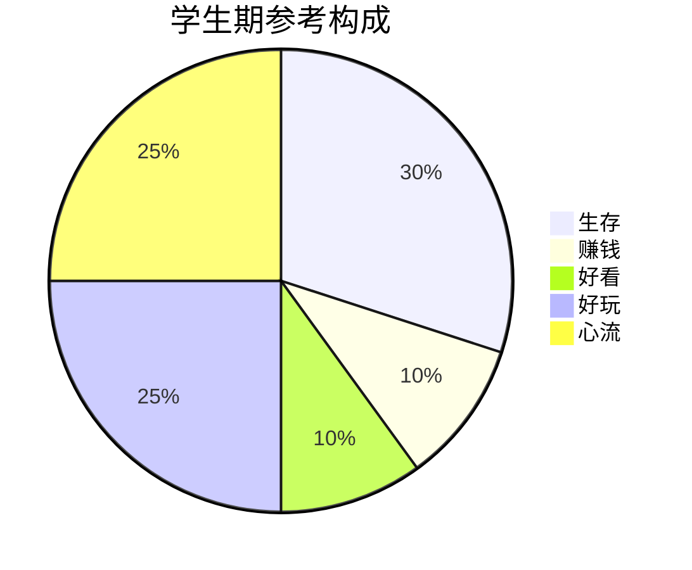
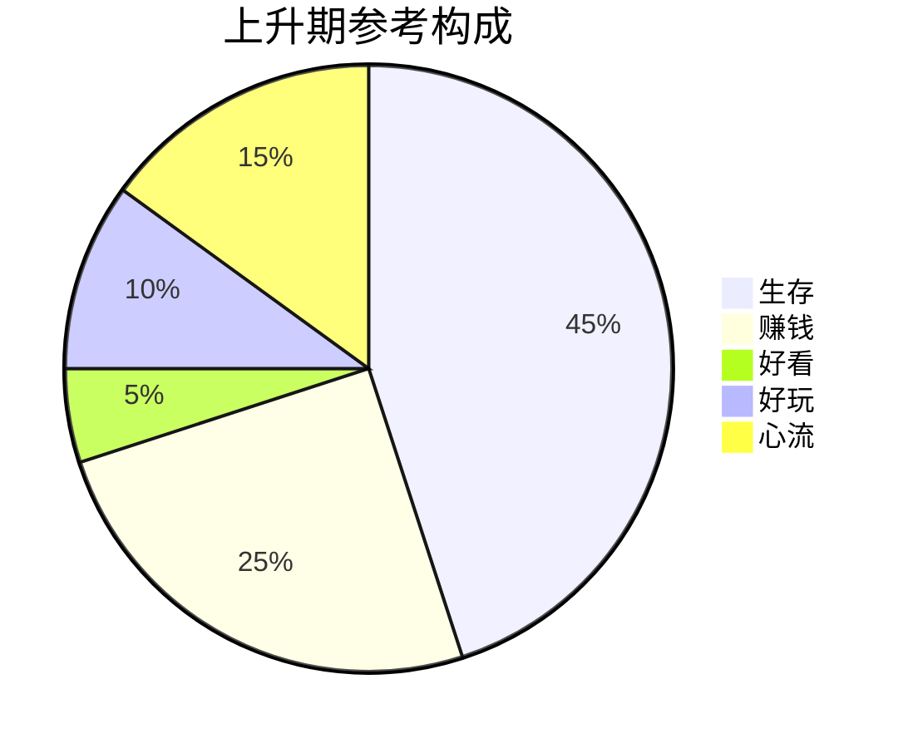
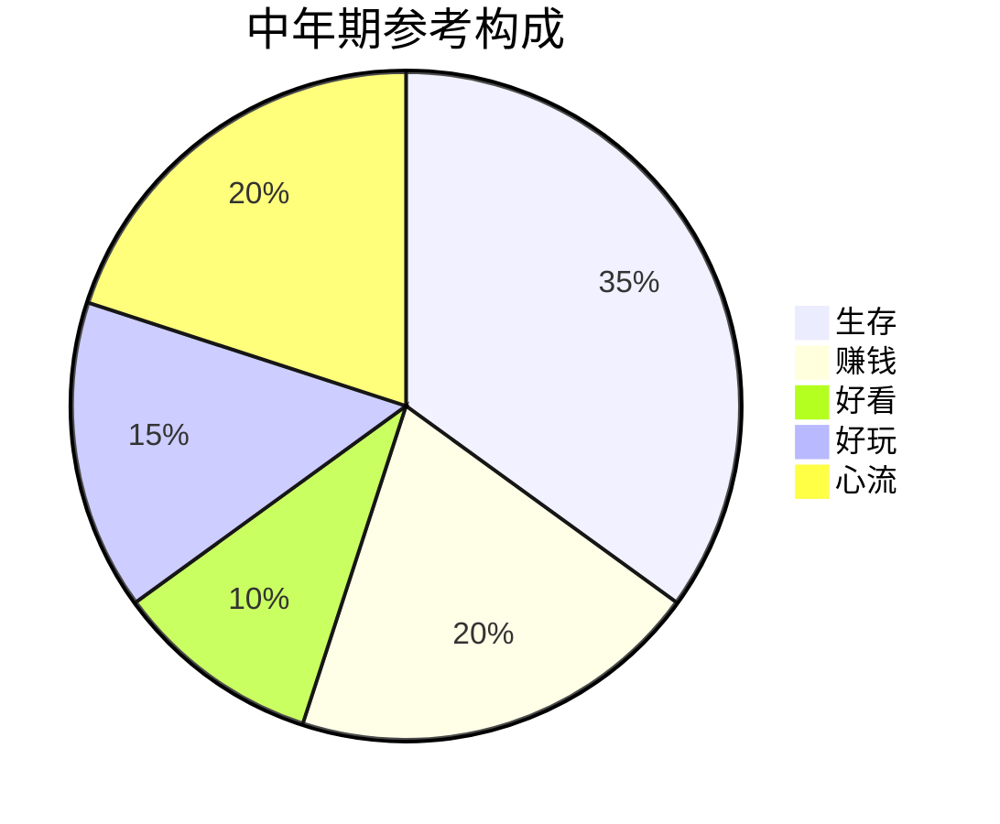
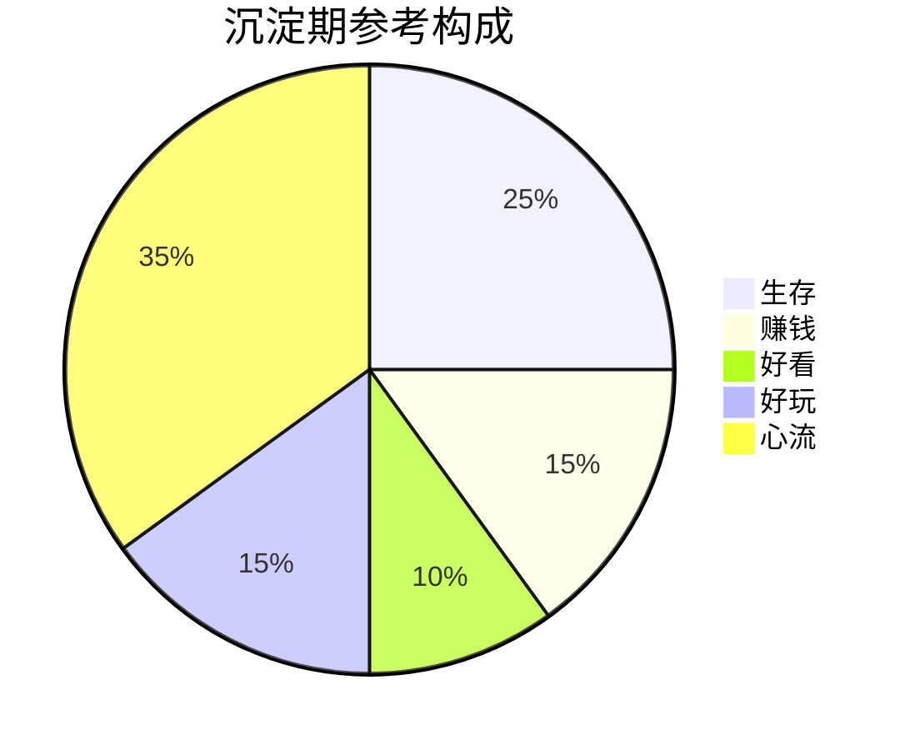
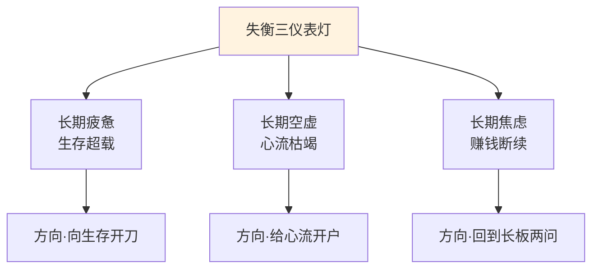
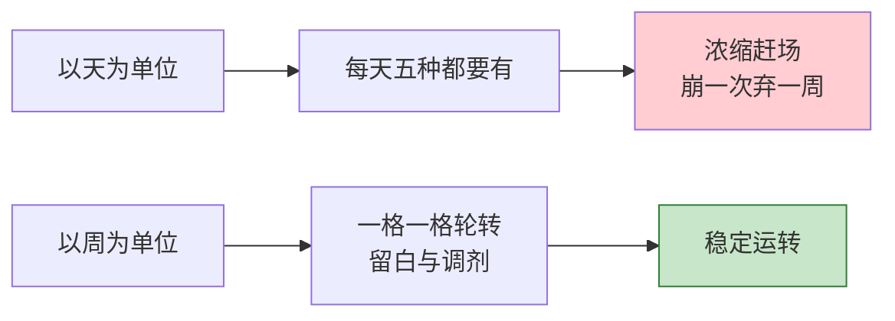
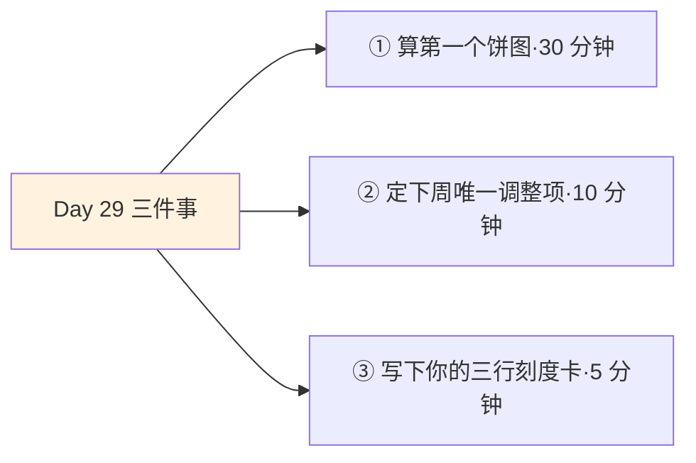
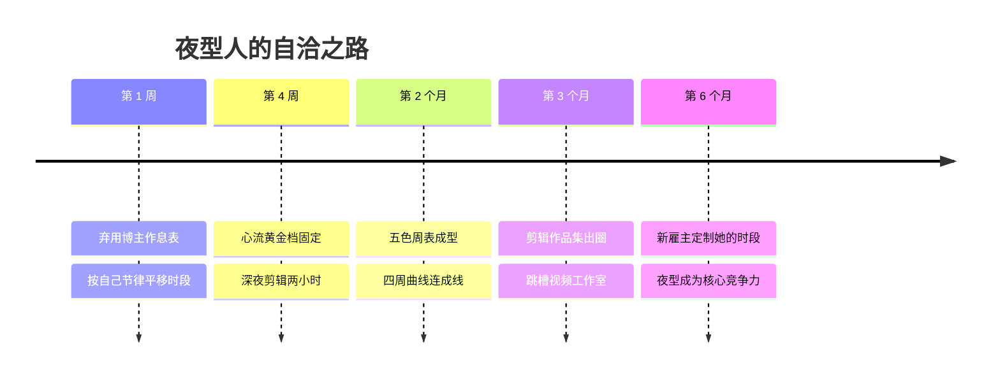

## Day 29·五种时间的动态平衡

- [01.看一个真实案例](#01看一个真实案例)
- [02.五种时间的经验区间](#02五种时间的经验区间)
- [03.算出你的第一个饼图](#03算出你的第一个饼图)
- [04.人生四阶段的比例参考](#04人生四阶段的比例参考)
- [05.平衡的三个信号](#05平衡的三个信号)
- [06.不平衡的三个信号](#06不平衡的三个信号)
- [07.调平衡的三个动作](#07调平衡的三个动作)
- [08.周日十五分钟解剖](#08周日十五分钟解剖)
- [09.一个误区要提前说清](#09一个误区要提前说清)
- [10.今天要做的三件事](#10今天要做的三件事)
- [11.总结回顾本章节](#11总结回顾本章节)
- [12.后来发生的改变](#12后来发生的改变)
- [13.今天起改变三点](#13今天起改变三点)
- [14.课后作业思考下](#14课后作业思考下)

---

## 01.看一个真实案例

先讲一位"抄作业失败"的读者。她叫晏宁，二十六岁，新媒体运营。

她读完本书前面关于记录和分类的部分后，在网上找了一份"高效人士作息表"，打印出来贴在床头，严格执行：五点半起床，六点晨读，七点运动，八点通勤听书……那位博主还附了五种时间占比：生存百分之三十、心流百分之二十——晏宁照单全收，做成饼图，照着配平自己的生活。她给自己的要求是**每天**都对齐这张表。

她坚持了两周，然后崩溃了。不是崩溃在自律上——她是执行力很强的人——是崩溃在"怎么照着做还是不对劲"上：五点半起床让她一整天头昏，因为**她是深度夜型人**，她最好的状态在晚上十点后；博主的心流时间是清晨写作，她的心流时段是深夜做剪辑。更糟的是"每天对齐"这个标准本身：一旦哪天没对上——加班了、朋友生日了、就是不想动了——她就整周弃疗，然后下周带着加倍的愧疚重新开始。她拿着别人的地图，走自己的路，走得比谁都虔诚，也偏得比谁都远。

崩溃之后她给我发消息问：是不是我这个人有问题？

我回她的只有一句话：**比例没有标准答案，作息更没有。你不是有问题，你是拿着别人的尺子量自己。**

她后来自己做的版本是这样的：按自己的生物钟把时段全部平移——十点起床、下午做生存和赚钱、晚饭后好看和好玩、**夜里十一点到凌晨两点，她的心流黄金档**。同样是五种时间配比，只是长在了她自己的节律上。她说换版之后的第一周，"像换了个身体"。

这就是倒数第二课的主题：**没有理想的五种时间比例，只有此刻的正确比例。**今天讲三件事：区间长什么样，失衡怎么识别，平衡怎么调。

## 02.五种时间的经验区间

先给区间。再强调一遍措辞：**这是参考区间，不是标准答案**——它的用途是让你对照时有个参照系，不是让你拿红笔批改自己。

| 时间类型 | 经验区间 | 含义 |
|:---|:---:|:---|
| 生存时间 | 30%–50% | 为活着必须兑换出去的时间 |
| 赚钱时间 | 15%–30% | 主动用于长板与价值创造的时间 |
| 好看时间 | 5%–10% | 让身体与生命力变好的时间 |
| 好玩时间 | 10%–20% | 主动获取乐趣的时间 |
| 心流时间 | 10%–25% | 沉浸、当下满足未来成就的时间 |

三条使用说明。

**第一条，区间内都是健康的，区间外要看持续时长。**某一周生存时间冲到六成——赶项目、家里有事——完全正常，身体扛得住波动。**要看的是持续**：连续三个月生存六成，就不是波动，是结构，那才是需要动刀的情况。

**第二条，五种时间的分母是清醒时间，不是二十四小时。**睡眠属于 Day 21 讲过的"身兼生存与好看"的特殊项，按个人情况归档，别在算比例时重复计算。

**第三条，也是最重要的一条：先认节律，再对区间。**晏宁的教训必须用科学补一刀：慕尼黑大学的生物钟学者罗内伯格研究了几十万人的睡眠数据，结论是**人的时间型——晨型、夜型还是中间型——很大程度是写在天性里的**，就像身高和瞳色。他提出过一个概念叫**社会时差**：你的生物钟和你的社会时钟之间的落差。晨型社会逼着夜型人五点半起床，等于每周让他倒好几次时差——晏宁的两周崩溃，不是意志力输给了作息表，是生物钟输给了别人的作息表。**区间是护栏，你的节律才是方向盘。**

## 03.算出你的第一个饼图

区间有了，节律认了，现在做一件具体的事：**算出你自己的第一个五色饼图。**别小看这个动作——晏宁换了三张博主的表都不对，直到她算出自己的第一张饼，一切才开始。

流程四步，总共半小时。

**第一步，取样本。**翻开你 Day 01 以来的时间记录，取最近完整的一周——有记录用记录，没有就用记忆回放，粗一点没关系，**第一张饼图的意义不是精确，是启动**。

**第二步，五色标记。**Day 05 教过的方法：把每一天的时段逐条染色——生存蓝、赚钱金、好看绿、好玩橙、心流紫。拿不准的条目按"主要产出"归类：边吃饭边开会算生存，认真做的一顿饭算好看。

**第三步，算占比。**五色各加总，除以一周的清醒总时长，得出五个百分比。这一步推荐用最笨的办法：一张纸画五个格，一格一格数——**手算一遍的饼图，比任何 App 生成的都记得牢。**

**第四步，并排对照。**把你的饼图放在两张东西旁边：一张是区间表，看哪几格出界；一张是你 Day 19 的四要素体检表，看缺的那格时间，是不是正好对应着弱的那项要素。**两张纸对完，你通常会在某一格上停住——那一格，就是明天的调整项。**

一位第一次算出饼图的读者的原话送给你："我自以为我是赚钱时间不足，算完发现心流是零——**我以为我缺的是钱，其实我缺的是沉浸。**这张饼比我三十年的自我评价都诚实。"

## 04.人生四阶段的比例参考

比个人差异更大的是**阶段差异**。同一比例，放在人生不同阶段，含义完全不同——二十二岁的生存三成和四十五岁的生存三成，是两种人生。四个阶段的参考构成。



**学生期：生存低、赚钱低、好玩与心流高。**这是人生试错成本最低的阶段——大块的、属于自己支配的完整时间，此生仅此一段。这个期的心流时间格外值钱：学习本身就是天然的心流载体（如果教学方法得当）。**这个阶段最大的浪费，是把心流级的大块时间，过成了好玩级的碎片时间。**



**上升期：生存高、赚钱高，其他被压缩。**职业前十年、创业头几年都是这个形状。注意它不是错误形状，是**过路形状**——但必须知道自己在"路过"，因为过路形状待久了会变成定居。这个阶段要死守两条底线：好看不低于百分之五（身体是过路的本金），心流不归零（那是你不迷路的北极星）。



**中年期：五种趋向平衡。**上有老下有小的阶段，关键词是"守"：守健康（好看），守收入（赚钱），守几件深度关系和深度爱好（好玩与心流）。这个阶段最常见的失衡不是某一种太少，而是**生存时间的隐性扩张**——把焦虑加班、无效社交都算进来，生存悄悄吃掉一切。



**沉淀期：心流最高。**人生后半场最理想的形状——赚钱压力减轻，长板已成资产，把最多的时间交给沉浸和热爱。这是全书的终点站图景：**五种时间的终点，是心流时间的最大化。**你前面二十八天所有的训练，都是在为这张饼图工作。

四张图连起来看一个规律：**生存占比一路走低，心流占比一路走高**——这就是"成为时间的主人"在数据上的样子。

## 05.平衡的三个信号

怎么知道自己的比例对不对？信号比数字准。真平衡的人，三个信号同时成立。

**信号一：情绪稳定。**不是没有情绪，是**波动有底**——会烦，但不会长期陷在烦里；会累，但休息能恢复。情绪是时间结构的最先暴露者：比例失衡时，情绪先于日程表知道。这一条呼应 Day 22：一个人的内在秩序，写在情绪的波动率上。

**信号二：有作品产出。**赚时间终要凝固成看得见的东西——一篇文章、一个项目、一顿认真做的饭、一次陪孩子搭完的乐高。**注意"作品"的宽口径**：凡是"投入了心，留下了痕迹"的产出都算。有持续产出，说明赚钱时间和心流时间没有空转。

**信号三：有余力照顾他人。**能匀出精力真正关心别人——听朋友说完一件事，注意到家人状态的变化。这是最容易被忽略、也最硬核的信号：**一个人只有自己不满负荷，才有真实的余力给别人。**长期连自己都照顾不过来的人，他的"对别人好"多半是义务不是能力。

三个信号的关系是"与"不是"或"：**只有情绪稳定是麻木，只有产出是机器，只有会照顾人是讨好。**三条腿同时站住，才叫平衡。

## 06.不平衡的三个信号

反过来，三种长期状态，分别对应三种失衡。注意关键词是**长期**——持续一个月以上再对号入座。

**长期疲惫，对应生存超载。**睡够了还是累，休假了还是累——那是生存时间长期越界，把好看、好玩、心流的领地全占了。调整方向：向生存开刀。能拒绝的拒绝（Day 28），能委托的委托，能置换的置换。**疲惫不是勋章，是超载的仪表灯。**

**长期空虚，对应心流枯竭。**什么都有、什么都不缺，就是空——热闹填补无效，休息也无效，因为缺的那一格是深度沉浸。调整方向：给心流开户。Day 23 的创造清单、Day 26 的四把钥匙，都是为这一格准备的。**空虚不是矫情，是心流断供的仪表灯。**

**长期焦虑，对应赚钱断续。**那种"再不做点什么就来不及了"的感觉——它通常不是因为没做事，而是因为**做的事没落在长板上、没进入循环增强**：忙了一天天，雪球一毫米没长。调整方向：回到 Day 07 的两问——这事瞄准核心竞争力了吗？进入循环增强了吗？**焦虑不是懦弱，是复利断供的仪表灯。**



**三盏灯的用法**：别等它亮。每月月末问自己一遍这三个词——疲惫吗，空虚吗，焦虑吗——**哪个词先应声，哪一格先检修。**

## 07.调平衡的三个动作

识别之后，怎么调？三个动作，其实就是一条周循环流水线：**记录，分类，重分配。**


**动作一，记录。**Day 01 的方法，用了一整个月的那些。现在你已经是熟练工：每两小时一行，一周的账自然在手上。

**动作二，分类。**Day 05 的五色标记法：把账目逐条归入五种时间，算出占比。五分钟，一眼看清本周的结构。

**动作三，主动重分配，每周一次，只调一项。**这是整个流程唯一产生改变的环节，也是唯一容易贪多的环节——**每次只调整一格**：这周心流为零，就在下周先预约两个"四把钥匙"时段；生存连爆三周，就启动 Day 28 的拒绝话术。为什么只调一项？因为**结构性改变靠的是连续的周循环，不是单周的暴力重构**——晏宁崩溃的教训，一半就在"一次改五样"。

流程的最后加一个小仪式：把每周的占比写进同一张表。四周连起来看，那条属于你自己的曲线就浮现了——**那比任何博主的饼图都珍贵，因为它是用你的时间、你的节律、你的阶段画出来的。**

## 08.周日十五分钟解剖

三个动作听着简单，但很多读者卡在"十五分钟具体怎么花"。这一节把周日的十五分钟切成秒表，你照着跑第一圈。

```text
【第 0–3 分钟】翻账（动作一）
        打开记录本，从周一扫到周日，只看不改。
        扫的时候手里握一支笔，遇到"心流""失控""惊喜"
        就在页边点一个点——先收集信号，不急于下结论。

【第 3–8 分钟】染色（动作二）
        五色标记本周时段，加总出五个百分比。
        写进一张固定的周表（附录 B 工具页六）。
        熟练之后这步只要三分钟——你的手感会替你算。

【第 8–11 分钟】体检（三盏灯）
        问三个词：疲惫吗？空虚吗？焦虑吗？
        哪个词应声，就翻到对应的那盏灯，
        读一遍它指向的检修方向。

【第 11–14 分钟】定一项（动作三）
        只定下周的一个调整，写进日历，具体到时段和动作。
        写完检查一遍：它小到"不需要下决心"吗？
        不够小就再砍一半。

【第 14–15 分钟】一句话
        给下周的自己写一句话，写在周表页脚。
        这是整套流程里唯一的软性环节——
        它是十五分钟里的心跳。
```

几个来自读者的实战提醒。**第一，固定位置**：同一张沙发、同一杯茶——这套流程本身就是一个迷你仪式（Day 26 的原理），环境配对越稳定，启动越不费力。**第二，允许烂账周**：出差周、生病周的账没法看，跳过即可，连续性比完整性重要。**第三，第四周做连线**：把四周的百分比抄成一列曲线——那四个数字连起来的形状，是这本书能给你的最珍贵的一张图。

## 09.一个误区要提前说清

这一节必须单独立在这里，因为晏宁的故事里还埋着第二颗雷，没拆。

她崩溃的完整原因有两层：抄了别人的比例（第一层，前面讲完了），和**要求自己每天平衡**（第二层）。第二层更普遍，也更隐蔽——很多人没抄任何人的表，但心里装着一张"理想的一天"：今天要锻炼了、要学习了、要陪家人了、要有自己的时间了……**用"天"做平衡的单位，是把平衡用错了刻度。**

真实的平衡从来不是日平，而是**周平、月平，甚至季平**。看两个事实就明白了。第一，生理事实：睡眠、运动、恢复这些好看时间的收益是跨天结算的——今天熬的夜后天补，这个月亏的下月还，身体讲的是周期账。第二，心理事实：把每天排满五种时间的人，过的不是平衡的生活，是**浓缩的赶场**——每一样都做了三成，每一样都不尽兴，比专注工作还耗。



正确的刻度用法：**今天可以是"纯生存日"**——出差、赶工、带娃看病，全天都是生存时间，不必愧疚；**这周把账补回来**——周中欠的心流，周末给一个完整的下午。极端的日子甚至可以以月为单位：项目冲刺月，好看和好玩压到底线，**下一个月必须安排"回血周"把账结清**——只要账在周期内是平的，日历上的起伏不是失衡，是呼吸。

所以那条军规要升级一下：每周日只调一项——**允许某几天严重偏科，只要这一周大致圆得回来。**平衡是财务概念，不是几何概念：它看的是结算日的账面，不是每一天的截面。

## 10.今天要做的三件事

说了这么多，到了今天真正要做的事。三个动作，加起来不到一小时。



动作一，算出你的第一个五色饼图。按第三节的四步流程走：取上周样本、五色标记、算占比、并排对照区间表和四要素体检表。**只观察，不评判**——Day 01 的老规矩在这里最后一次生效：你即将看到的那张歪歪扭扭的饼，是你最珍贵的起点数据。

动作二，定下周的唯一调整项。参照三盏灯选优先级：哪盏灯亮了就调哪一格；灯都没亮的，调离区间最远的那格。写进日历，具体到时段和动作——**没有写进日历的调整，只是一种心情。**

动作三，写下你的三行刻度卡。一行时间型（晨型/夜型/中间型），一行黄金时段，一行平衡周期（按周还是按月）。这张小卡片比任何作息表都重要——**以后再看到任何"高效作息"，先过一遍这三行，再决定要不要抄。**

## 11.总结回顾本章节

五种时间没有标准比例，只有参考区间和你的节律：生存三到五成，赚钱一到三成，好看半到一成，好玩一到两成，心流一到两成半；罗内伯格的研究说明时间型写在天性里，抄别人的作息等于自我倒时差。第一个饼图四步算出：取样本、染色、算占比、并排对照——它比三十年的自我评价都诚实。人生四阶段各有形状：学生期好玩心流高，上升期生存赚钱高，中年期五种守衡，沉淀期心流最高——生存一路走低、心流一路走高，就是成为时间主人的数据轨迹。平衡三信号：情绪稳定、有作品产出、有余力照顾人；失衡三盏灯：疲惫对应生存超载，空虚对应心流枯竭，焦虑对应复利断供。调整是每周日十五分钟的流水线：翻账、染色、体检、定一项、一句话——只调一项。最后记住刻度：平衡以周月为单位，不以天为单位——**它看的是结算日的账面，不是每一天的截面。**

核心只有一句话：**时间不是被管理的对象，是被分配的资源。**管理问的是"我效率高吗"，分配问的是"我把它给了谁"——明天的最后一课，会把这个区别讲到尽头。

## 12.后来发生的改变

晏宁的后续，和她的那张曲线表。



第 2 个月那张四周连线的表，她拍照发我，写了一段话："前四周我的心流一栏是：零、零、四十分钟、两小时。第五周我看着那条上扬的线，突然特别想哭——**原来我不需要变成那个五点半起床的谁，我只需要变成比例正常的我自己。**"

跳槽那天的事最值得讲。新雇主是家视频工作室，面试官问她有什么工作习惯，她把六个月的两百多条深夜剪辑记录和作品集放出来，说："我是夜型人，我申请保护我的深夜时段。"面试官看完沉默了一会儿，说了句："我们团队全是晨型人，缺的就是你这块。"**她曾经想戒掉的"毛病"，成了她的稀缺性。**

她现在的签名档改成了："别拿别人的尺子量自己。**尺子这东西，每个人出厂时自带一把，只是大多数人活成了别人的刻度。**"

## 13.今天起改变三点

第一，把周日十五分钟变成雷打不动的仪式。固定位置、固定茶水、固定流程——翻账、染色、体检、定一项、一句话。跑满四周，把四张周表连成曲线；**那条曲线会替你回答"我最近过得怎么样"，比任何自我感觉都可靠。**

第二，接受偏科日，守住周平衡。从下周起，允许自己有纯生存日、纯烂账周——只要结算日账面大致圆回来。**平衡是财务概念，不是几何概念**：放弃每天的截面完美，才能守住每周的真实结算。

第三，每季度用四阶段图自检一次。你处在哪个阶段？你的形状和参考构成差在哪一格？阶段会变，图会换——**你现在守的那两格，一年后可能就不是这两格了。**季度自检让你始终知道自己该守什么。

## 14.课后作业思考下

第一，对照三盏灯自检：长期疲惫、长期空虚、长期焦虑——你亮的是哪盏？这盏灯指向的那格时间，上个月占比是多少？写出它和你期望值之间的具体差距。

第二，判断你的人生阶段和节律：你处在四阶段的哪一段？你的黄金时段在一天的什么时候？把两者结合起来回答：你的阶段里最该守住的两格是什么，它们安排在你的黄金时段了吗？

第三，做一次刻度审计：你现在对"平衡"的默认要求是以天为单位还是以周为单位？过去一个月里，有多少次因为"今天没平衡"而整天弃疗？把那个数字写下来，然后重算：如果以周为单位，那些周里有几周其实是平的？

第四，回答这个本章压轴的问题：如果把你过去一年的五种时间画成一张饼图，挂在客厅里给最重要的人看——**哪一格的大小会让你脸红，哪一格会让你委屈？**这两个答案合起来，就是你明年要动的方向。

---

**明日预告 · Day 30 成为时间主人。** 最后一课。回望三十天的完整旅程：四把镜子、五张地图、一套运动员结构、一条复利曲线、一把心流钥匙。还有两封信——写给三个月后的你，和三年后的你。**你就是时间。**明天见。
