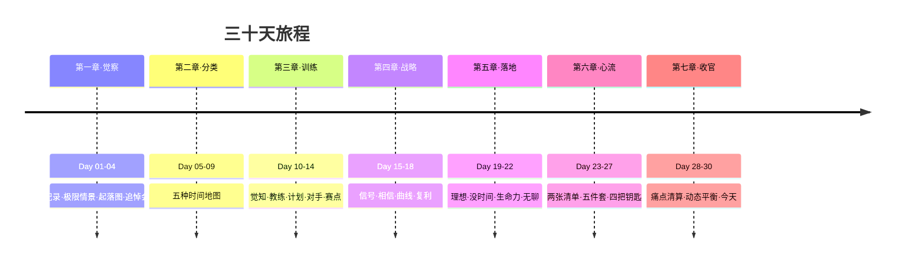
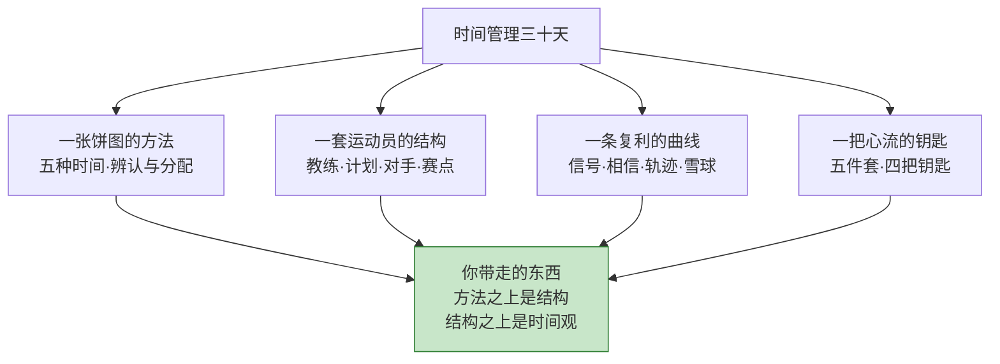

## Day 30·终章：成为时间的主人

- [01.回望三十天](#01回望三十天)
- [02.一个新的自我认识](#02一个新的自我认识)
- [03.给三个月后的自己写一封信](#03给三个月后的自己写一封信)
- [04.给三年后的自己写一封信](#04给三年后的自己写一封信)
- [05.闭环回到第一天](#05闭环回到第一天)
- [06.全书总收官](#06全书总收官)
- [07.后来发生的改变](#07后来发生的改变)
- [08.今天起改变三点](#08今天起改变三点)
- [09.课后作业思考下](#09课后作业思考下)

---

## 01.回望三十天

今天是第三十天。最后一课，先不往前讲，往回看。



**第一段，你从"过日子"到"看见时间"。**还记得 Day 01 那位"一天刷四小时短视频却以为只有四十分钟"的读者吗？你可能就是她。这四天里你做了记录、假设了生命的最后一年、画了起落图、写了自己的墓志铭——四把镜子照下来，你第一次不再是"被日子过"，而是看着自己在过日子。

**第二段，你从"时间一团模糊"到"五种时间自如"。**生存、赚钱、好看、好玩、心流——现在这五个词对你来说已经是五个工具：你能随口说出眼下的这一小时属于哪一种、它给你带来什么、它的陷阱长什么样。辨认当下，是一件非常、非常重要的事——你现在会辨认了。

**第三段，你从"找方向"到"有教练、有对手、有赛点、有雪球"。**运动员的四件套配齐了，战略的四件套也配齐了：你知道自己的小念头本在记什么，你相信时间，你认得出自己的曲线，你在喂养自己的雪球。你的方向未必已经完全清晰——但你的**寻找方式**已经完全不同了。

**第四段，你从"心流靠运气"到"心流工程化"。**五件套配条件，四把钥匙管入场，你还学会了分清滋养的沉迷和被设计的沉迷。你手里有仪表盘：每周那三盏灯，你该看哪盏、怎么检修，你都会了。

三十天，二十九课，你没有一天缺席。这一段本身，就是你给自己的第一个证据：**你说到，做得到，三十天。**

## 02.一个新的自我认识

现在，把三十天学到的东西全部拿开，只剩最后一条认识。也是全书的最后一课。

一路讲来，我们用了很多比喻：时间是地图、是预算、是货币、是雪球、是燃料。这些比喻都有一个共同的语法结构——**时间是一个东西，你是另一个东西，你在"管理"它。**三十天里我们一直这么说，因为这样好学：把时间当成对象，才能观察它、分配它、投资它。

但到了最后一天，我要说这三十天最大的一句实话：**那个语法结构是脚手架，是梯子，用完就该撤掉。**

两千年前，塞涅卡在《论生命之短暂》里写过一个让所有人膝盖中箭的观察。他说，人们总在抱怨人生太短——但**"我们并不是活得短，我们是浪费得多"**；生命本身足够长，只要你肯把它用在正事上；可惜多数人把生命交给了别人、交给了拖延、交给了从未兑现的"以后"——**他们不是活得短，是死得慢。**塞涅卡开出的解法和这本三十天的书惊人地一致：把时间收回到自己手里，成为它的守卫者而不是挥霍者。

那本古书里还有一句话，可以和原稿的结尾并排放在一起看：**真正的时间管理，从来不是时间，而是我们的生活，我们的大脑，我们的自由，和我们的思想。**时间不是一个外在于你的、被管理的对象——**时间就是你。**你的每一天怎么过，你就是什么样的人；你把时间兑到哪，你就把自己铸成哪。你不是一个"拥有时间"的人，你是你的时间的总和本身。

这个认识不是文字游戏，它有一个非常实际的推论。既然你就是时间，那么"管理时间"这个说法里最要命的那个动词——"管"——就失效了。你不能管理你自己，你只能**成为**你自己。于是所有的方法在终点处合流：记录不是管理时间，是认识你自己；分类不是管理时间，是设计你自己；心流不是使用时间，是成为你自己最饱满的样子。

**你不是"有时间的人"，你就是时间。**你的每一个选择，都在实时地定义"你是谁"——不是过去式，不是将来式，是现在进行时。

## 03.给三个月后的自己写一封信

毕业需要两个仪式。第一个仪式，今天做：**给三个月后的自己写一封信。**

为什么是三个月？因为三十天建立的是习惯的毛坯，九十天才是精装：三十天让方法立住，九十天让结构长进生活里。三个月后，正好是检验装修质量的时候。

信很短，三段就够。纸笔或手机备忘录都可以，但**写出来**——脑中的信不算信。

```text
————————— 给三个月后的我 —————————
（今天日期：____年__月__日　寄达日期：__年__月__日）

一、我希望你此刻看到的画面：
（写得像一张照片：翻开记录本看到怎样的周表？
 创造清单第一项微创造旁边写着什么？谁对你说了一句什么？）

二、请你不要忘记的三件事：
（从三十天中挑三样最怕丢掉的——"只记录不评判"？
 "每周日十五分钟"？"四把钥匙"？这三样是你的承重墙。）

三、一句最重要的话：
（只能写一句。你三十天里被打动最深的那句原话。）
```

写完之后，设置一个定时提醒——手机日历或任何定时邮件工具都行——**发送日期：三个月后的今天**。技术会替你保管这封信，到时候它自己会回来。

## 04.给三年后的自己写一封信

第二个仪式，写给更远：**给三年后的自己写一封信。**

为什么是三年？Day 17 画过三种人生曲线，你记得哪条是对的；Day 16 讲过长期主义者的三条铁律——**计划以年为单位；每天为自己安排赚钱时间；要信所未见，所以延迟满足。**三年，是那条循环增强曲线开始明显抬头所需要的最短距离。这封信，就是写给曲线抬头处的那个你。

这封信也只有三段。

**第一段：写下你的相信。**写下你现在相信、但还看不见的东西——你的长板三年后会变多长，你的雪球会滚到哪，你和你想成为的那个人之间隔着的三年的每一天。这一段的意义在 Day 18 讲过了：**长期主义者是相信未来的人。这封信就是你相信的书面形式。**三年后你会知道，当初的相信哪些兑现了、哪些走样了——那都是宝贵的数据。

**第二段：写下你的原谅。**提前原谅三年里必然会发生的——会有一段时间断掉记录，会有一阵子雪球停在原地，会有某个冬天什么都不想做。提前告诉三年后的自己：这些都会发生，这些都在曲线的容差之内，**断掉的线续上就行，不需要从零开始**——后记里还会再讲这个道理。这封信提前替你免除了未来最不需要的东西：自责。

**第三段：写下你的请求。**对三年后的自己提一个请求，只有一个。不是"你要成功"，是更小更实的——"请替我保住每天那两个二十五分钟"，或者"请记得每周看一眼那张曲线表"。**大目标不用请求，小习惯才需要托付。**

写完两封信，做一件事：把它们和 Day 01 的东西放在一起。放在哪？往下看。

## 05.闭环回到第一天

现在，回到一切开始的地方。

序章那天，我请你做了一件事：**在书末附录的起始画像卡上，写下今天的日期、此刻的感受、三十天后的期待。**现在去把它找出来，摊在今天这封信旁边，逐行对读。

日期：那天是三十天前的某一天，你写下它的时候，这本书还一句话没兑现。感受：你还记得那天写的是什么吗？"忙""累""想改变但不知道从哪开始"——多数人写的是这些。期待：你期待三十天后的自己变成什么样？

对读的时候，别用"达标没有"的眼光——用 Day 01 教你的那个眼光：**只看见，不评判。**你会看见的东西大概有这几样：有些期待落空了（正常，期待总是写得慷慨）；有些变化发生了但和期待的不一样（也正常，生活给的和你要的经常不是一个牌子）；还有一些格子，你当时想都不敢想往里写的东西，现在已经在里面了。

然后做今天的核心功课：**写下一个具体的、三十天前你做不到、现在做得到的事。**

注意"具体"两个字。"变得自律了"不算，"现在可以进入心流状态了"太抽象。要写到能演示的程度："现在周日晚上，我会花十五分钟做五种时间的周复盘"——就像这样。老贺的做法值得抄：他给自己写的那条是"我现在会对老板说'下周三之后可以'"——写完他自己笑了很久，他说三十天前，这句话在嘴里能含一星期。

然后看着它，说一句话：**这就是复利的起点。**Day 18 讲过，第一天的一张便签就是资产；今天这个"做得到"，是三十天复利刚刚滚过第一圈的雪球——**第一圈最小，但你已经知道它接下来会怎么滚了。**

## 06.全书总收官

最后一节，把整本书收进一张地图。



你从这本书里带走了四样东西。

**一张饼图的方法。**你有了观察时间的眼睛：记录、分类、平衡，每周十五分钟，你的人生第一次有了自己的数据。

**一套运动员的结构。**你不再靠情绪和意志力活着：训练计划、教练、对手、赛点——用结构对抗随机性，这是你在第三章学会的最硬的一招。

**一条复利的曲线。**你认得三种曲线了，你知道雪球怎么判断、怎么滚动、什么会毁掉它。三年的合同你已经会签。

**一把心流的钥匙。**五件套配条件，四把钥匙管入场——幸福不必等成功，可以当天结算。

而在四样东西之上，你还带走了一样没写在目录里的东西：**一个新的时间观。**时间不再是敌人（"没时间"）、不再是沙漏（"来不及了"）、也不再是账户（"挤一挤总有"）——它就是你。方法会被忘记，结构会随人生阶段改版，工具会过时，但**"你就是时间"这个认识，不会。**它会在以后某一个你快要重新滑回旧日子的瞬间，轻轻拉你一下。

## 07.后来发生的改变

最后一天，不讲单个的故事——讲一群人的。三十天营的结业回访里，我收集过一个问题：**"三十天过去，你的生活具体改变了什么？"**答案千差万别，但可以归成四类，各念几条原话给你。

**第一类，把"看见"留下了。**"我现在还是会下意识地问自己：刚才那两个小时，去哪了。这个毛病，戒不掉了。"——一位产品经理。"带孩子最乱的那年，是那个便签本陪我熬过来的。它不帮我带孩子，它帮我看见我在撑着，这就够撑下去了。"——一位二胎妈妈。

**第二类，把"结构"立起来了。**"我给自己找了个对手，同小区一个跑步博主。我跟踪他的配速两年了，他不知道。上个月我的五公里第一次跑赢了他的视频。"——一位销售。"训练计划表贴了三年，换了三个职业，格式都没变过。"——一位建筑师。

**第三类，把"曲线"走出来了。**"Day 18 那天晚上我数了数，毕业五年，我居然一页拿得出手的东西都没有。现在是第四年，我有四十多篇技术文章和一个快满员的付费专栏。四座山丘，这座我爬了四年没下来。"——一位老穆式读者，你看，曲线换了主语。

**第四类，把"心流"拿到了。**"我爸六十岁开始学二胡，用的我给他的那套四把钥匙。他现在每天晚上拉两小时，我妈说，你爸终于不像退休的人了。"——一条最想让你看到的回访。还有一条是失眠者的："我后来想明白了，那套装置根本不生产心流，它生产'进入'。**人只要会'进入'，进入什么都能成。**"

这些回访里没有一个奇迹，全部是记录、结构、复利、心流这四个词的日常变体。**这就是三十天真正发生的事：没有变成别人，只是终于开始变成自己。**

## 08.今天起改变三点

毕业前的最后三个动作。

第一，今天写完两封信。三个月的和三年的，写完设好定时。**三个月那封设日期提醒，三年那封打印出来**——塞进这本书的序章那页，让"你正在读第一天的你"和"写完第三十天的你"和"三年后的你"夹在同一处。三年后你翻开它，就是你给自己的考古现场。

第二，决定 Day 31 要开始做的一件事。就一件：可以是续签三十天的记录（第二个月开始记"三件事法"下的完成度），可以是启动 Day 23 创造清单的第一项微创造，也可以只是把周日的十五分钟定成永久的闹钟。**三十天的终点不是终点，是第一圈跑完的计圈器。**

第三，把这本书传给下一个人。可以借出去、送出去，或者只是把最打动你的那一篇转给那个"总说没时间"的朋友。传的时候跟他说的那句话我都替你想好了：**"你如何管理时间，就如何管理人生——这句话在你翻开第一页之前听着像口号，翻开之后，它每天都是真的。"**

## 09.课后作业思考下

最后的四道题。

第一，完成你的闭环：找出起始画像卡，对读，写下那个"三十天前做不到、现在做得到"的事。这一题是今天的必答题。

第二，写完两封信之后回答：三个月那封里，你的三面"承重墙"是哪三样？三年那封里，你的那个请求是什么？**写不出请求的，说明还有习惯没长成，回第六章再看一遍。**

第三，给这三十天打个分，十分制，然后写一句评语——像老师给学生写的最后一句那样。写完你会发现：**你既是学生，也是老师。这三十天最后的成果，是你获得了给自己写评语的资格。**

第四，最后一题没有标准答案：**你如何管理时间，就如何管理人生。**现在，用你自己的话，把这句话重新说一遍。你重新说出来的这个版本，就是这本书在你身上留下的、谁也拿不走的东西。

---

三十天前，我们说好：一天一篇，每篇一个动作，三十天不缺席。

你做到了。

塞涅卡说，生命不是太短，是我们挥霍得太多。这三十天，你做的全部事情，说到底只有一件：**把挥霍出去的自己，一寸一寸收了回来。**

真正的时间管理，从来不是时间，而是我们的生活，我们的大脑，我们的自由，和我们的思想。

你就是时间。

从今天起，做它的主人。

（正文完。后记·写在三十天后，翻过去还有最后一页。）
