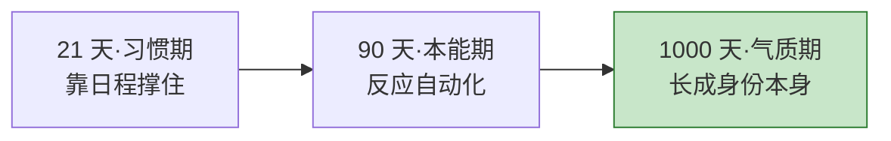
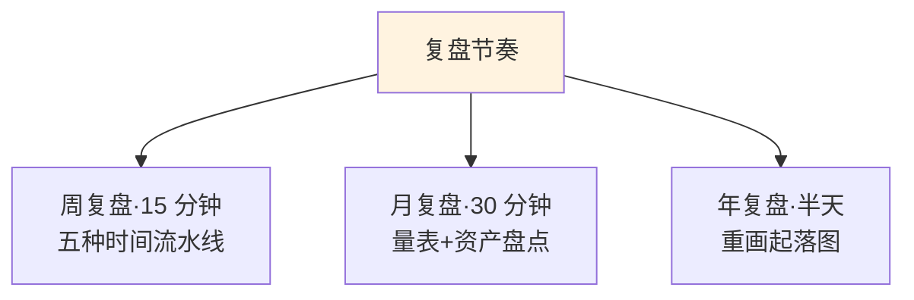

## 后记·写在三十天后

- [01.一个提醒：书合上之后](#01一个提醒书合上之后)
- [02.持续下去的三条路径](#02持续下去的三条路径)
- [03.一个承诺：读完这本书的你](#03一个承诺读完这本书的你)
- [04.致谢与邀请](#04致谢与邀请)

---

## 01.一个提醒：书合上之后

先泼一盆温柔冷水。

三十天走完的此刻，你大概率处在全书状态的最高点：方法都在手上，记录本还热着，仪式还新鲜。但你我心里都清楚，**状态的高点不是常态**。合上书之后的第二周，生活就会开始试探你——一个加班的深夜、一场家庭变故、一次说走就走的出差，都能让三十天的成果看起来一夜归零。

所以要讲清楚三个时间尺度，它们对应你接下来要走的三个阶段。

**二十一天成习惯。**这是第一个尺度。前三个星期，你需要靠日程活着：把周日的十五分钟、每天的两个二十五分钟写进日历，用闹钟、用打印出来的工具页、用一切外部装置撑住自己。这个阶段的要点是 Day 12 讲过的那句：**允许偷懒百分之二十，拒绝放弃百分之百**——断一天没关系，第二天续上就是，只有断掉不续，才算真的断。

**九十天成本能。**第二个尺度。九十天左右，方法会从"要执行的动作"变成"自动发生的反应"：晚上十一点会自然想放下手机，周日晚上会自然坐到复盘的位置。这个阶段的敌人是无聊感——新鲜劲过了，方法显得平淡。请回到 Day 22：**平淡不是失效，是内化**。练到不觉得在练，才叫本能。

**一千天成气质。**第三个尺度，也是最后一个。一千天，大约三年——对，就是 Day 17 你签过的那个合同期。到那时，这些方法会彻底沉到身份层面：你不是"一个在用时间管理方法的人"，你是"一个把日子过得有结构的人"。方法消失了，因为你已经是它。**气质期的你不需要坚持，就像鱼不需要坚持游泳。**

三个尺度的关键词分别是：**日程、环境、身份。**习惯期靠日程，本能期靠环境（把结界和仪式焊死在你的生活空间里），气质期靠身份认同（每次自我介绍时，你心里那个关于"我是谁"的答案）。合上书，你从第一格出发——别跳格。

## 02.持续下去的三条路径

冷水泼完，给三条路。三条可以叠加，叠加的人留存率最高——这是三十天营几年数据里最一致的一条。

**路径一：加入一个三十天陪伴营。**可以是这本书的官方营，也可以是任何一个同类社群。它的作用不是内容——内容你已经有了——是**节拍器**：一群人同一天读同一篇、做同一个动作，这种同步感是最便宜的抗惰性装置。选营只看一条：有没有每日打卡和每周复盘的硬机制。没有机制的群，只是聊天室。

**路径二：找到你的读书搭子。**一个就够。规则很简单：**互相可见。**你们的记录本互相可见，周日复盘互相可见，周日复盘表互相可见。不需要鼓励，不需要监督，只需要可见——Day 25 讲过的原理在这里复用：**有人看着你的进度条，反馈就有了温度。**搭子的最佳人选不是最亲密的朋友，是那个"同样想改变且不会笑你认真"的人。

**路径三：建立三级复盘节奏。**这是三条里唯一不可替代的，因为它不依赖任何他人：**周复盘**，每周日十五分钟，Day 29 的流水线——记录、分类、重分配一项；**月复盘**，每月末三十分钟，附录 A 的量表重测一次，看雷达图的形变，加上 Day 18 的资产盘点；**年复盘**，每年一次半天，重画 Day 03 的起落图——这一次，你能亲眼看到自己把新的一年，画成了想画的样子。

推荐的组合是：**搭子 + 三级复盘打底，陪伴营按需加入。**但无论怎么组合，记住优先级——**复盘节奏 > 搭子 > 社群**。前者在你手里，后两者在你的运气里。

## 03.一个承诺：读完这本书的你

现在，我要向你说一个你可能没意识到的事实：**你已经不是三十天前的那个你了。**

不是鸡汤，是清单。你现在拥有的能力：

**看得清。**你对自己的时间流向不再靠感觉，靠数据。三十天前"一天忙到晚说不清忙了什么"的那种雾，已经被记录、分类、复盘三件套吹散了。这是第一重自由——**多数人一辈子没得到过它：知道自己的一天去哪了。**

**划得动。**你能主动把时间从低价值区域挪到高价值区域。不是被日程推着走，是推着日程走：你会拒绝了，会委托了，会置换了，会做减法了。这是第二重自由——**从"时间的租客"变成了"时间的户主"。**

**走得远。**你手里有那条曲线和那把钥匙：复利教会你把时间当资产滚，心流教会你把时间当幸福用。一内一外，一远一近。这是第三重自由，也是最重要的一重——**你不再是"没时间"的人了。**

"没时间"这四个字，你三十天里见过它的真面目：它是没方向的伪装，是没预算的结果，是不懂拒绝的账单，是没被记录的黑洞。你现在能一眼看穿它——包括从自己嘴里说出来的时候。

所以这个承诺只跟一件事有关：**从今往后，你不会再抱怨没时间。**不是不许，是不必——因为你知道那些被抱怨吃掉的时间，本来就能被你亲手找回来。你会开始做一件三十天前的你觉得矛盾的事：**享受时间**——享受早晨那杯茶配着计划表的十五分钟，享受深夜结界里的两小时，享受周日晚上和自己的复盘对账。

享受时间，是时间管理这门手艺的毕业证。

## 04.致谢与邀请

最后，说两句心里话。

谢谢你陪我走完这三十天。我知道你中间一定有想跳过的章节、有糊弄过的作业、有断掉又续上的记录——没关系的，**这本书不是用完美主义写成的，也不该被完美主义阅读。**三十天里有二十三天认真，就是极好的三十天。

我也要谢谢那些出现在书里的读者：刷四小时短视频的她、画四座山丘的老穆、考下证书的阿慧、瞎游夺金的隐喻、深夜拉二胡的父亲……他们都是真实的人，只是换过了名字。这本书里最有分量的句子，一大半其实出自他们——**我只是那个负责记笔记的人。**

然后是那个邀请：**把这本书传给下一个人。**

不是营销，是私心。第一重私心是 Day 11 讲过的：教是最好的学——当你把"五种时间"讲给朋友听的时候，你对它的理解会当场深一层；转述一遍，三十天的收获翻倍。第二重私心要藏到最后说：这本书能给人的所有改变，都有一个人是你我帮不上的——**在你身边、你想拉一把、但永远不会主动翻开这本书的那个人。**把书放到他能碰到的地方，剩下的交给他的 Day 01。

三十天的书到这里就结束了。

三十天后呢？后记的标题已经回答了：**写在三十天后**——是的，我预支了这个标题：写这本书的时候，我就已经在等你三十天后发来的那条消息了。可能是你的第一张周复盘表，可能是你的雪球第一圈，也可能是你终于"抬头天亮了"的那个早上。

**三十天的书结束了，成为时间主人的旅程，才刚刚开始。**

我们后会有期。下一程，山顶见。

---

（全书完）
