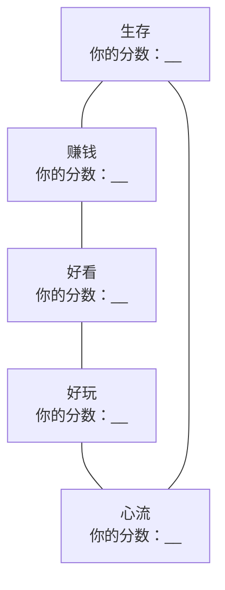
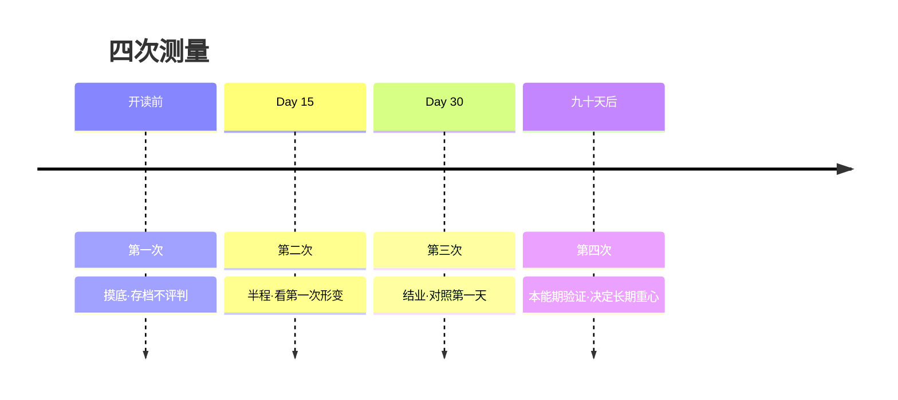

## 附录 A·五种时间自测量表

- [01.量表设计](#01量表设计)
- [02.正式题目](#02正式题目)
- [03.计分与雷达图](#03计分与雷达图)
- [04.四种画像](#04四种画像)
- [05.使用建议](#05使用建议)

---

## 01.量表设计

这份量表是全书理论的自测工具，共三十题。每六题对应一种时间（生存、赚钱、好看、好玩、心流），每题按符合程度打分：

**1 分——完全不符合；2 分——不太符合；3 分——说不清；4 分——比较符合；5 分——非常符合。**

两条例外说明：

1. 标注（R）的题目为反向计分题——它描述的是**不良状态**，符合度越高得分越低：选 1 计 5 分，选 2 计 4 分，选 3 计 3 分，选 4 计 2 分，选 5 计 1 分。
2. 题目问的是**过去一个月**的平均状态，不是最好或最坏的那几天。凭第一反应作答，想超过十秒的题，按十秒内的感觉填。

**做卷时间约十分钟。建议手抄一遍分数，方便四次对比。**

## 02.正式题目

### 第一组·生存时间（第 1–6 题）

1. 过去一个月，我清楚自己的时间每天被哪些"不得不做的事"占用了。
2. 我常觉得日子是"被推着走"的，而不是我主动安排的。（R）
3. 遇到不合理的日程安排，我能有底气地说出"这个时段我有安排"。
4. 我为了应付别人的需求，把自己的正事一拖再拖。（R）
5. 我能分清自己哪些时间是"被动生存"，哪些是"主动选择"。
6. 一想到明天一天的安排，我的第一感觉是疲惫而不是平静。（R）

### 第二组·赚钱时间（第 7–12 题）

7. 我能说出自己最重要的那块"长板"——高于周围平均水平的强项。
8. 我每天都有一段专门用于打磨核心竞争力的时间，哪怕只有半小时。
9. 我做的事情让我"越做越强、越强越有需求"，形成了循环增强。
10. 我对"核心竞争力"的感觉是模糊的，说不出具体是什么。（R）
11. 我现在做的事，明天还能叠加在昨天的成果之上。
12. 我常忙了一天，却说不出自己哪段时间用在长板上。（R）

### 第三组·好看时间（第 13–18 题）

13. 每周我至少有三次刻意运动，每次十五分钟以上。
14. 我的睡眠规律，多数日子在固定时段前后入睡。
15. 我每天会认真吃早餐，而不是随便对付或干脆不吃。
16. 我常靠熬夜挤时间，第二天用咖啡和浓茶硬撑。（R）
17. 我有固定的基础护理习惯（皮肤、牙齿、发型），并且持续执行。
18. 照镜子时，我对"自己的状态"的整体感觉是消极的。（R）

### 第四组·好玩时间（第 19–24 题）

19. 每周我都有主动安排的、纯粹为了快乐的时光。
20. 我玩过之后，整体感觉是"更满"而不是"更空"。
21. 我分得清自己的哪些娱乐是"真好玩"，哪些是"报复性挥霍"。
22. 我的放松方式主要是无意识地刷手机，刷完常后悔。（R）
23. 我对世界保持着好奇——今年学过或尝试过新东西。
24. 我有写下来的体验清单或类似的"想玩什么"列表。

### 第五组·心流时间（第 25–30 题）

25. 过去一个月，我至少有过两三次完全沉浸、忘记时间的体验。
26. 我有一项正在进行、需要长期投入才能完成的作品或创造。
27. 我为深度工作建立了固定的仪式或环境（时段、地点、道具）。
28. 我做事时频繁被打断，很难连续专注二十分钟以上。（R）
29. 沉浸做事之后，我感到的是深度满足而不是空虚。
30. 我能说出自己进入心流的个人条件——热爱、技能、挑战、反馈、目标里，哪几个是齐的。

## 03.计分与雷达图

第一步，逐题计分（记得反向题换算），算出每组总分，填入下表。

| 组别 | 时间类型 | 得分区间 | 你的得分 |
|:---:|:---|:---:|:---:|
| 一 | 生存时间 | 6–30 | |
| 二 | 赚钱时间 | 6–30 | |
| 三 | 好看时间 | 6–30 | |
| 四 | 好玩时间 | 6–30 | |
| 五 | 心流时间 | 6–30 | |

第二步，画你的雷达图：五个方向各画一条六到三十分的刻度线，标上你的五个分数，连成一个五边形。

第三步，读图。三个读法：

**读绝对值**：单边低于 15 分（即平均 2.5 分以下）的那一种时间，是你的"断供项"，也是下一阶段的第一优先级。

**读形状**：不看分看形——你的五边形是缺角的、扁的、还是相对圆的？**缺角形状说明结构问题，圆但整体小，说明总量问题（先解决"没时间"，见 Day 28 与 Day 20）。**

**读变化**：这是第四次测量时的读法。把每次的雷达图拍下来叠着看，形变的方向就是你成长的方向。

## 04.四种画像

按最高分与最低分的组合，最常见的四种画像如下。对号入座之前记住原则：**画像不是判决，是起点描述**——每种画像都附了它的功课。

**画像一：生存者（生存组反向高分，其余全低）**——特征：日程被"不得不"填满，划不动，也停不下。画像典型句："我要是有时间，我也想……"**你的功课**：Day 28 的痛点一（拒绝）和痛点七（减法）是你的主药；从 Day 20 的"两个二十五分钟"起步——别先调比例，先夺回第一块自留地。

**画像二：赚钱者（赚钱组高，好玩与心流低）**——特征：长板清晰、投入凶猛，但娱乐枯竭、沉浸稀少。画像典型句："等我做完这个项目就休息。"**你的功课**：你的问题不是不努力，是油箱漏了。Day 09 的好玩清单和 Day 26 的四把钥匙，是给你补的两个洞；**记住你的复利曲线里，好看时间是本金，好玩时间是利息。**

**画像三：玩家（好玩组高，赚钱组低）**——特征：体验丰富、快乐真实，但长板断续、雪球未滚。画像典型句："开心最重要，想那么多干嘛。"**你的功课**：Day 23 的两张清单是关键——你不缺颗粒，缺线。把体验清单里反复出现的那条线，升级成创造清单的第一项；**你的快乐是燃料，还差一台发动机。**

**画像四：心流者（心流组高，生存与赚钱组低）**——特征：有深度、有热爱，但地基薄弱：收入不稳或身体透支。画像典型句："俗事太烦，我只想做我的事。"**你的功课**：你的排序反了——心流是塔尖，生存是地基，塔尖不能悬空。Day 07 的赚钱一小时和 Day 21 的四支柱是你的补课单；**让地基配得上你的塔尖。**

## 05.使用建议

最后是使用节奏：这份量表设计为**做四次**——

三条心法。

**第一次做，只存档，不评判。**你即将看到的那张缺角雷达图，是你最珍贵的起点数据——Day 01 讲过的道理在这里最后一次出现：**自责让人放弃，看见让人改变。**

**测量的是变化，不是好坏。**第二次、第三次做的时候，别问"我多少分及格了吗"，问"哪条边动过了"。一个从 12 分涨到 18 分的心流边，比一个从 24 分涨到 26 分的任何边，都更值得庆祝。

**第四次之后，以形变定重心。**九十天后第四次测量，你的雷达图会告诉你下一年的主攻方向：哪条边连续两次在涨（保持），哪条边纹丝不动（换方法），哪条边你终于接受了它就是低（恭喜，这也是一种自我认识）。

量表到此结束。翻到附录 B，那里有六张可以撕下来贴上墙的工具页——**量表负责认识自己，工具页负责改造自己。**
