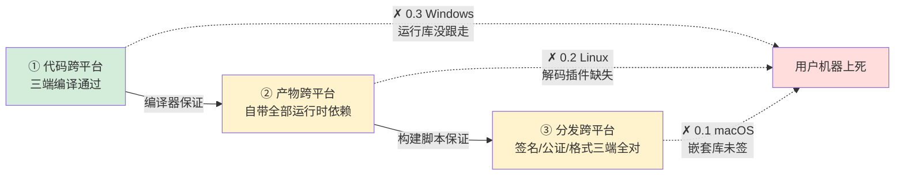
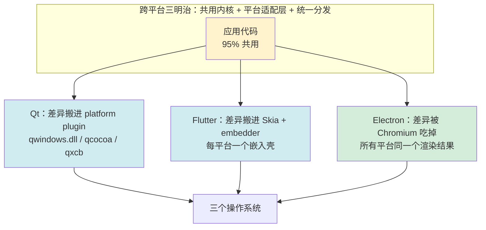
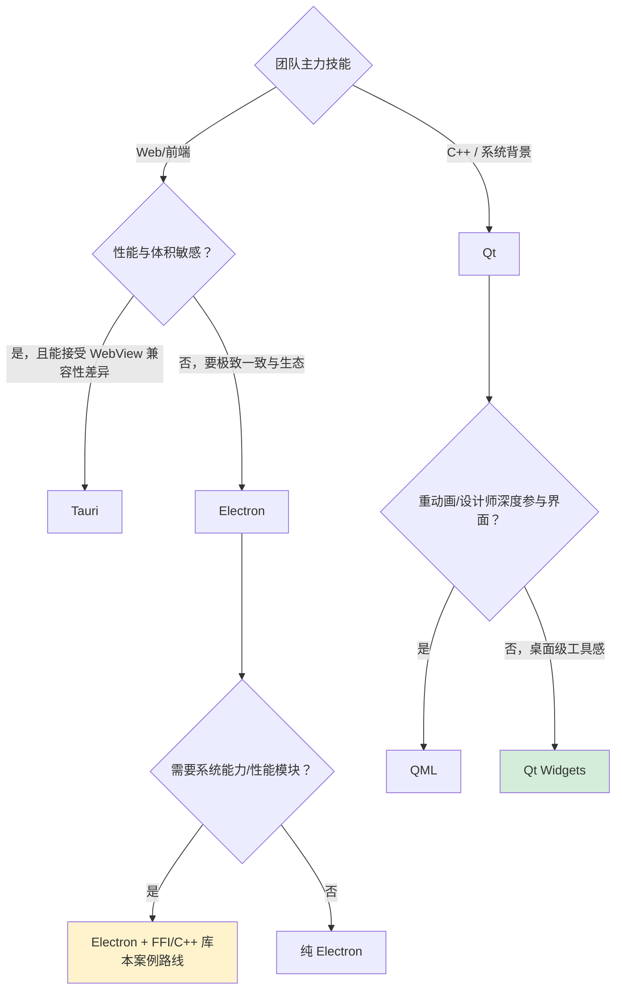

## 13.跨平台桌面应用设计

🎯 **核心矛盾**：**一套代码的效率 vs 三个操作系统的差异** —— 跨平台框架用「抽象层 + 95/5 法则 + C ABI 契约」管理而不是消灭差异

🧭 **设计灵魂**：所有跨平台方案只在做两件事——**把平台差异封装进一层抽象**（Qt 元对象系统 / Electron 浏览器内核）+ **留一条逃生通道到原生**（平台特化代码 / FFI）

🌐 **平台覆盖**：Qt(C++ / 信号槽 / CMake) · Electron(Chromium + Node / 三进程 / electron-builder) · 延伸(Tauri / wxWidgets / Flutter Desktop)

💡 **通用心智**：跨平台 = **「共用内核 + 平台适配层 + 统一分发」三明治**——任何框架都是这三层的不同切法；「代码跨平台」≠「产物跨平台」≠「分发跨平台」三层递进


- [13.跨平台桌面应用设计](#13跨平台桌面应用设计)
- [1.三个平台三种死法](#1三个平台三种死法)
  - [1.1 macOS应用打不开](#11-macos应用打不开)
  - [1.2 Linux没有声音](#12-linux没有声音)
  - [1.3 Windows点击毫无反应](#13-windows点击毫无反应)
  - [1.4 跨平台的三层递进](#14-跨平台的三层递进)
  - [1.5 五个递进追问](#15-五个递进追问)
- [2.概述与背景](#2概述与背景)
  - [2.1 由来与背景](#21-由来与背景)
  - [2.2 跨平台演进史](#22-跨平台演进史)
  - [2.3 为何跨平台难](#23-为何跨平台难)
  - [1.4 主要解决问题](#14-主要解决问题)
  - [1.5 警醒的资源数字](#15-警醒的资源数字)
  - [1.6 设计目标说明](#16-设计目标说明)
  - [1.7 设计哲学思想](#17-设计哲学思想)
- [3.技术路线三大流派](#3技术路线三大流派)
  - [3.1 原生封装派（Qt）](#31-原生封装派qt)
  - [3.2 自绘引擎派（QML / Flutter）](#32-自绘引擎派qml--flutter)
  - [3.3 浏览器内核派（Electron / Tauri）](#33-浏览器内核派electron--tauri)
  - [3.4 三流派对比分析](#34-三流派对比分析)
  - [3.5 三流派一句话本质](#35-三流派一句话本质)
- [4.跨平台通用设计法则](#4跨平台通用设计法则)
  - [4.1 共用内核与特化边界](#41-共用内核与特化边界)
  - [4.2 逃生通道三件套](#42-逃生通道三件套)
  - [4.3 框架无关的共享设计资产](#43-框架无关的共享设计资产)
  - [4.4 分层归属判据](#44-分层归属判据)
- [5.Qt 篇框架讲透彻](#5qt-篇框架讲透彻)
  - [5.1 案例整体框架设计](#51-案例整体框架设计)
  - [5.2 进程与线程模型](#52-进程与线程模型)
  - [5.3 Qt信号槽机制](#53-qt信号槽机制)
  - [5.4 UI 层技术栈](#54-ui-层技术栈)
  - [5.5 平台特化处理](#55-平台特化处理)
  - [4.6 一份 CMake 出三端](#46-一份-cmake-出三端)
  - [5.7 案例与静态核查纪实](#57-案例与静态核查纪实)
- [6.Electron 篇框架讲透彻](#6electron-篇框架讲透彻)
  - [6.1 案例整体框架设计](#61-案例整体框架设计)
  - [5.2 三进程模型：main / preload / renderer](#52-三进程模型main--preload--renderer)
  - [5.3 IPC 契约设计](#53-ipc-契约设计)
  - [5.4 语言边界：koffi FFI 调 C++](#54-语言边界koffi-ffi-调-c)
  - [5.5 双工程协作：应用 + 原生库](#55-双工程协作应用--原生库)
  - [5.6 UI 层：React + Vite（为什么不是 Next.js）](#56-ui-层react--vite为什么不是-nextjs)
  - [5.7 构建与分发：electron-builder 三端打包](#57-构建与分发electron-builder-三端打包)
- [6.双案例对照与选型决策](#6双案例对照与选型决策)
  - [6.1 同一产品两套实现的对照](#61-同一产品两套实现的对照)
  - [6.2 殊途同归：两案例共同遵守的法则](#62-殊途同归两案例共同遵守的法则)
  - [6.3 选型决策树](#63-选型决策树)
- [7.设计总结与演进](#7设计总结与演进)
  - [7.1 核心模式提炼](#71-核心模式提炼)
  - [7.2 哲学本质：给差异一个受管理的家](#72-哲学本质给差异一个受管理的家)
  - [7.3 演进趋势](#73-演进趋势)
  - [7.4 跨领域思想迁移](#74-跨领域思想迁移)
- [8.经典陷阱与反模式](#8经典陷阱与反模式)
- [9.认知阶梯总结](#9认知阶梯总结)
  - [9.1 三层认知](#91-三层认知)
  - [9.2 设计哲学回顾](#92-设计哲学回顾)
  - [9.3 跨端术语对照表](#93-跨端术语对照表)
  - [9.4 本卷章节呼应](#94-本卷章节呼应)
  - [9.5 延伸阅读](#95-延伸阅读)

---

## 1.三个平台三种死法

### 1.1 macOS应用打不开

MiniPlayer Electron 版第一次分发，macOS 端走了完整流程：开发者证书签名 → `notarytool` 提交公证 → Apple 回邮件「Accepted」 → 打包 `.dmg` 上传官网。

第二天收到用户反馈：**「应用已损坏，无法打开」**。

工程师在自己机器上怎么测都正常——因为开发机的 Gatekeeper 早已信任了开发者证书，**「能打开」恰恰是开发环境的假象**。找一台干净 Mac 复现，`syslog` 里躺着真相：

```
AppleMobileFileIntegrity: cdhash [...] not valid
   → 被检查对象不是 MiniPlayer.app 本体
   → 而是 Contents/Resources/native/libmp_native.dylib
```

**根因**：`electron-builder` 的公证流程默认只对 `.app` 主程序签名。而本案例通过 `extraResources` 携带的 C++ 动态库 `libmp_native.dylib`（koffi FFI 在运行时加载它，见 §5.4），**没有被单独 codesign**。Apple 公证员的检查是**深度**的——嵌套的每一份可执行代码都要有签名。一个未签名的 dylib，让整个 `.app` 的签名链断裂，Gatekeeper 直接判定「损坏」。

最讽刺的是：这行 dylib 路径里就写着 `native/`——它是**工程师特意为了跨平台引入的原生能力**，结果成了三端分发里第一个阵亡的。

### 1.2 Linux没有声音

Qt 版三端构建全部通过：`cmake --build` 在 Ubuntu / macOS / Windows 三台 CI 机器上零告警。给同事装上 Ubuntu 版本，界面正常、扫描正常、点播放——**扬声器无声**。

没有崩溃、没有报错、没有日志。媒体文件的时长都在（说明元数据读到了），进度条在走（说明解码器在推进），就是不出声。

**根因**：Qt Multimedia 在 Linux 上的后端是 **GStreamer**。Qt 只带了「框架」，不带「插件」——MP3 解码在 `gstreamer1.0-plugins-ugly` 里，AAC/M4A 在 `gstreamer1.0-libav` 里，而一台标准安装的 Ubuntu **出于专利授权原因，默认不带这些解码插件**。开发机上装过，用户的机器上没有。

`mini-player-qt` 的 FAQ 后来加了一条：

**Q：MP3/AAC 无法播放？** Qt Multimedia 在 Linux 依赖 GStreamer plugins（`gstreamer1.0-plugins-good/bad/ugly/libav`）；Windows/macOS 由系统解码器承载。

一句话总结了三个平台的解码器现实：**Windows 和 macOS 有系统级解码器可用，Linux 的解码器是一堆可选包，装不装随用户**。

### 1.3 Windows点击毫无反应

还是 Qt 版。发给一个普通 Windows 用户，双击 `MiniPlayer.exe`——**没有任何反应**。没有弹窗、没有崩溃对话框、任务管理器里进程闪现一下就消失。

远程看了一下用户机器：干净的 Windows 10，从没装过开发工具。

**根因**：两层缺失叠加——

1. **VC++ Runtime 缺失**：MSVC 编译的程序运行时依赖 `vcruntime140.dll` 等动态运行库，开发机装了 VS 全家桶永远感知不到它的存在，普通用户机器上没有；
2. **Qt 平台插件缺失**：直接把 `build/MiniPlayer.exe` 拷走，旁边没有 Qt 的 DLL 和 `platforms/qwindows.dll`。Qt 找不到平台插件时**静默退出**——连错误弹窗都不给，这是 Windows 端排查成本最高的失败方式。

修法是两条命令：`windeployqt MiniPlayer.exe`（把 Qt 依赖全部摊到 exe 旁边）+ 安装包里捆绑 VC++ Redistributable。但这件事的教育意义在于：**「构建成功」和「用户能跑」之间隔着一整层依赖部署**。

### 1.4 跨平台的三层递进

三个事故看似毫不相干，其实精确地落在三个不同的层面上：

| 事故 | 失败层 | 掉的坑 | 源代码有错吗 |
|---|---|---|---|
| macOS「应用已损坏」 | **分发签名层** | 嵌套 dylib 未单独签名，公证深度检查失败 | 没有 |
| Linux 无声 | **运行时依赖层** | 系统解码插件缺失，专利导致默认不装 | 没有 |
| Windows 双击无反应 | **产物部署层** | 运行库 + 平台插件没跟着 exe 走 | 没有 |

三行「源代码有错吗：没有」就是本篇最重要的第一个洞察：

> **跨平台是一个三层递进的概念：「代码跨平台」→「产物跨平台」→「分发跨平台」。绝大多数团队在第一层就以为完工了，而事故全部发生在后两层。**



用这个模型回看三个事故：macOS 死在第三层、Linux 死在第二层、Windows 死在一二层之间。而它们的**源代码层全部是健康的**——这就是为什么「我本地明明是好的」在跨平台开发里不是辩护词，而是事故报告的第一行。

### 1.5 五个递进追问

带着三个事故，本篇回答五个递进的问题：

| 追问 | 答案章节 |
|---|---|
| 三端到底有多少差异？为什么 UI 之外还有那么多坑？ | §1 |
| Qt、Electron、Tauri……这些框架到底在替你做什么？ | §2 |
| 换一个框架，哪些设计不用重做？（框架无关层怎么划） | §3 |
| Qt 和 Electron 各自的内部机制如何运转，边界在哪？ | §4 / §5 |
| 实际项目怎么选型？踩过的坑怎么系统性规避？ | §6 / §8 |

---

## 2.概述与背景

### 2.1 由来与背景

**生活类比：三个国家的连锁店**。同一家快餐品牌要在中、美、法三国开店——菜单（UI）可以统一设计，但每个国家有自己的食品安全法（签名公证体系）、卫生检查流程（系统服务调用方式）、门店装修规范（窗口与控件风格）、进货渠道（运行时依赖）。品牌总部（你的代码）要的是「一套运营手册」，而现实是每国的执行细节都不一样。

桌面三端的差异，远不止「按钮长得不一样」：

| 维度 | Windows | macOS | Linux |
|---|---|---|---|
| 窗口系统 | Win32（HWND + 消息队列） | Cocoa（NSWindow + RunLoop） | X11 / Wayland（client-server 架构） |
| 事件模型 | `GetMessage` 消息循环 | NSRunLoop + responder chain | epoll 事件分发 |
| 打包格式 | exe + msi / nsis 安装器 | `.app` Bundle + `.dmg` | deb / rpm / AppImage / flatpak / snap |
| 签名体系 | Authenticode（可选但强烈建议） | codesign + 公证（分发必需） | 无强制（社区信任体系） |
| 数据目录 | `%APPDATA%` | `~/Library/Application Support` | `~/.local/share`（XDG 规范） |
| 解码器 | 系统提供（Media Foundation） | 系统提供（AVFoundation） | **可选包**（GStreamer/FFmpeg，专利原因） |
| 菜单规范 | 菜单在窗口内 | 全局菜单栏在屏幕顶部 | 因桌面环境而异 |

七行差异里只有第一行是「UI」，剩下六行全是**工程问题**。而 §0 的三个事故恰好死在打包、签名、解码器三行上——这不是巧合，是必然：**UI 差异框架都能抹平，工程差异才是跨平台的真正成本**。

### 2.2 跨平台演进史

```
1992 年   wxWidgets：走"真原生控件"路线，每个平台用平台自己的控件，外观 100% 原生
          代价：行为差异要逐平台适配，抽象漏成筛子

1995 年   Qt 1.0：走"自绘模拟原生"路线，控件自己画（QStyle 模拟各平台外观）
          一套渲染逻辑 → 行为三端完全一致
          同年 Java 提出 "Write Once, Run Anywhere"
          AWT（原生控件）→ 1997 Swing（自绘）重走了一遍两派之争

2011 年   NW.js（node-webkit）：第一次把 Node 塞进 Chromium
          Web 开发者第一次能做桌面应用

2013 年   Atom Shell（GitHub）→ 2015 年更名 Electron
          VS Code（2015）/ Slack / Discord 验证了这条路的上限
          "Write Once, Run Everywhere" 变成 "Write Once, Ship Chromium"

2019-22 年 Flutter Desktop 稳定 / Tauri 1.0（2022）
          自绘派把移动的统一渲染经验带回桌面
          Tauri 反向操作：不带浏览器，用系统自带的 WebView
```

三十年历史里反复出现同一条主旋律：**「原生控件派」和「自绘派」的拉锯**。原生派赢在体积和原生感，输在行为一致性；自绘派赢在一致性，输在体积和「不像本地应用」。Electron 是自绘派的极端——干脆把整个浏览器当渲染引擎。

### 2.3 为何跨平台难

新手以为跨平台难在「按钮 API 不一样」。真正难的是一张冰山图：

```
水面之上（看得见的）：
   控件外观 · 字体渲染 · 窗口装饰 · 菜单行为 · 快捷键习惯（Ctrl vs Cmd）

水面之下（看不见的，但会让应用死掉的）：
   解码器可用性（§0.2）         → 功能性缺失
   动态库部署（§0.3）           → 应用无法启动
   签名公证（§0.1）             → 应用被系统拒绝
   数据目录规范                  → 卸载残留 / 同步错乱
   HiDPI 与字体缩放              → 界面模糊或控件错位
   文件路径语义                  → 大小写敏感 / 分隔符 / NFD vs NFC 编码
   自动更新机制                  → 三套完全不同的更新通道
   后台驻留行为                  → Dock 常驻 / 托盘 / 守护进程
```

**关键认知**：水上的部分，任何框架都替你解决了；水下的部分，框架只能解决一半，另一半永远需要你「特化」。§3 的 95/5 法则就是对这个事实的工程化回应。

### 1.4 主要解决问题

跨平台框架（以及围绕它的工程方法）要解决五个问题：

- **问题一：开发成本**。三个平台三套代码 = 三倍人力 + 三倍的「同 bug 修三遍」。
- **问题二：行为一致性**。用户在 Windows 学会的使用习惯，换到 macOS 应该依然成立。
- **问题三：人才复用**。Web 团队用 Electron 直接做桌面（VS Code）；C++ 团队用 Qt 直接做桌面（WPS、VirtualBox）。
- **问题四：发布节奏**。一套代码一次提交，三端产物同天发布。
- **问题五：生态共享**。npm 上两百万个包（Electron）、三十年积累的 Qt 生态（QMediaPlayer/QSqlQuery/QtCharts……）。

### 1.5 警醒的资源数字

跨平台的收益不是免费的。以本篇两个案例（MiniPlayer v0.1，功能对等）和社区通用数据为参照：

```
空窗口应用（刚启动，什么都不干）：
   Qt Widgets   : 内存 ~30-50 MB    安装包 ~20-40 MB（需自带 Qt 库）
   Electron     : 内存 ~150-250 MB  安装包 ~80-100 MB（内嵌 Chromium + Node）
   倍数关系     : 内存 5x  /  体积 3x  ——这是"带不带浏览器"的直接代价

一个功能页面（列表 + 播放条）：
   Qt Widgets   : Model/View 虚拟化，10 万行列表无压力
   Electron     : 需要虚拟列表库（react-window 等），否则 1 万行就卡

分发格式矩阵（想覆盖主流用户需要照顾的格式）：
   Windows: nsis exe / msi / portable zip      → 3 种
   macOS  : dmg（universal）/ zip（公证用）    → 2 种
   Linux  : AppImage / deb / rpm / flatpak     → 4 种
   合计 9 种 —— 这就是 §0 事故发生在"分发层"的规模背景
```

这些数字不是劝退，而是**定价**：选 Electron 是用 100MB 体积和 200MB 内存买 Web 生态与开发速度；选 Qt 是用 C++ 的开发成本买 1/5 的资源占用。§6 的选型决策会回到这张价目表。

### 1.6 设计目标说明

| 目标 | 描述 | 实现方式 | 设计思想 |
|------|------|----------|----------|
| **一套源码** | 95% 代码不出现 `#ifdef` | 分层 + 抽象接口 | 关注点分离 |
| **三个产物** | 三端开箱即用 | 构建系统条件化（CMake / electron-builder） | 单一构建入口 |
| **分发合规** | 签名/公证/格式三端全对 | 分发流水线固化 | §0 三层递进全部覆盖 |
| **原生逃生** | 5% 平台特化有标准去处 | 接口 + 工厂 + Stub | 开闭原则 |
| **行为一致** | 同一输入三端同一输出 | 状态机与业务逻辑下沉共享层 | 契约优先 |
| **降级可用** | 可选能力缺失不崩主流程 | 编译开关 + 运行时探测 | 优雅降级 |

### 1.7 设计哲学思想

**哲学一：差异管理，而非差异消灭**。三端的差异是客观存在，任何声称「消灭差异」的方案都在撒谎——差异只能被**搬进框架内部**（Electron 搬进 Chromium，Qt 搬进 platform plugin）或**圈进特化目录**（`src/platform/`）。跨平台架构师的核心工作不是消灭差异，而是**给差异安排一个受管理的家**。

**哲学二：抽象必有边界，边界必有契约**。95% 与 5% 之间需要一条清晰的接缝。Qt 案例的接缝是 `SystemMediaAdapter` 抽象类，Electron 案例的接缝是 `mp_native.h` 这个 C ABI 头文件。契约越薄越稳定——薄到「只有函数签名」，才扛得住两端独立演进。

**哲学三：信任是分层发放的**。Electron 的 renderer 默认不可信（网页可能被 XSS），preload 是唯一过桥口，Node 能力收敛在 main。Qt 的 UI 线程拥有全部权限，所以才有「禁止在 worker 里碰 widget」的铁律。两种模型殊途同归：**能力越大，离不可信代码越远**。

**哲学四：三层都要跨，一层都不能少**。「代码 → 产物 → 分发」三层，任何一层断掉，用户面前的表现都是「应用坏了」。三层需要三种完全不同的工程手段（编译器 / 部署工具 / 签名流水线），缺一层，跨平台就是半成品。

---

## 3.技术路线三大流派

### 3.1 原生封装派（Qt）

这一派用平台原生语言（C++）直接开发，核心思路是**把三套原生 API 封装成一套抽象 API**。

但内部有个关键分岔——**控件从哪来**：

- **wxWidgets：真原生控件**。Windows 上按钮就是真 `BUTTON` 控件、macOS 上就是真 `NSButton`。外观 100% 原生，但行为差异漏得到处都是（原生控件的边距、事件、布局规则各不相同）。
- **Qt Widgets：自绘模拟原生**。控件是 Qt 自己画的，`QStyle` 负责把它画得**像**当前平台。外观 95% 像，行为 100% 一致——因为绘制逻辑只有一份。

Qt 选择自绘是深思熟虑的：**「行为一致性」比「外观原生感」更值钱**。用户抱怨「这个按钮质感不对」的频率，远低于「这个列表在 Mac 上滚动方向反了」。本篇 Qt 案例选 Widgets 而非 QML，理由链是：桌面级设计语言（原生菜单/键盘导航/无障碍免费送）+ 代码量更少 + 启动更快 + 没有_js 引擎_的调试复杂度。

### 3.2 自绘引擎派（QML / Flutter）

把「自绘」推到极致：**连控件树、动画系统、文本排版全部自己实现**，底层只要一块 GPU 画布（Skia / Qt Quick 场景图）。

```
Flutter 的野心：
   同一份 Dart 代码
   → 同一套 Skia 渲染管线
   → 三个平台渲染出像素级完全相同的界面
   → 平台差异被压缩到只剩「一块画布 + 系统服务桥」
```

收益是极限一致性（设计稿到像素零损耗）与动画能力（游戏级渲染管线）；代价是**体积下不来**（引擎必须自带）、**原生感永远差口气**（滚动条、右键菜单、输入法行为都要手工模拟）、以及桌面生态远不如移动成熟。QML 则是 Qt 官方的自绘方案，`mini-player-qt` 为它保留了升级路径——`PlayerService` 上的 `Q_PROPERTY` 注释写着「为将来 QML 预留」。

### 3.3 浏览器内核派（Electron / Tauri）

既然 Web 本身就是最强跨平台 UI 层，干脆**把浏览器变成应用的 UI 引擎**。

- **Electron**：每个应用自带完整 Chromium + Node.js。优点是极致一致（所有用户跑同一个 Chrome 版本，前端工程师泪流满面）+ npm 生态全量可用；缺点就是 §1.5 那笔账——100MB 起步的体积税。
- **Tauri**：不带浏览器，用**系统自带**的 WebView（Windows → WebView2/Edge、macOS → WKWebView、Linux → WebKitGTK）。体积骤降到 3-10MB，代价是**三端 WebView 内核不同**——CSS 兼容性问题从「不存在」变回「存在」，等于把 Electron 消灭掉的差异又请回来一半，只是从「体积」搬家到了「兼容性」。

Electron 案例里还有一个容易忽视的事实：**本案例把 C++ 请回了 Electron**。Node 的能力边界（没有系统媒体控制、没有高性能元数据解析）逼出了一个 `mp-native` C++ 库，通过 koffi FFI 桥接（§5.4）。这印证了一个规律：**浏览器内核派的工程越深入，越需要一条回原生的路**。

### 3.4 三流派对比分析

| 维度 | 原生封装（Qt） | 自绘引擎（Flutter/QML） | 浏览器内核（Electron） |
|---|---|---|---|
| UI 一致性 | 行为一致，外观近似 | **像素级一致** | **像素级一致** |
| 原生感 | **高**（QStyle 模拟 + 原生菜单） | 中（全靠模拟） | 低（网页质感） |
| 空载内存 | ~30-50 MB | ~60-100 MB | ~150-250 MB |
| 安装包 | ~20-40 MB | ~30-50 MB | ~80-100 MB |
| 开发语言 | C++ | Dart / JS(QML) | JS/TS 全家桶 |
| 人才池 | C++ 桌面工程师，缩小中 | 移动转桌面 | **前端全员** |
| 生态 | 30 年 Qt 库 | Flutter 插件市场 | **npm 两百万包** |
| 热更新 | 官方不支持 | 不支持 | **支持**（JS 天然可热更） |
| 调试体验 | 原生调试器 | DevTools | **Chrome DevTools** |
| 上限验证 | WPS / VirtualBox | 大量工具类 | **VS Code** / Slack |

三个流派没有输赢，只有**定价不同**。VS Code 证明了 Electron 的上限不在框架而在工程纪律；WPS 证明了 Qt 在重度性能场景的不可替代性。

### 3.5 三流派一句话本质

把三大流派放回同一张图上，会看到它们其实是**同一个三明治的三种切法**：



**差异守恒定律**：三端的差异总量恒定，框架能做的只是决定它**由谁承担**——Qt 让 C++ 工程师承担（构建配置复杂）、Flutter 让引擎承担（体积）、Electron 让用户承担（内存），Tauri 让兼容性测试承担。理解了这一点，选型（§6.3）就不再是「哪个更好」，而是「**我们团队愿意支付哪种成本**」。

---

## 4.跨平台通用设计法则

> 这一章与框架无关——不管选 Qt、Electron 还是 Tauri，这些法则都成立。它们由两个案例（同一产品两套实现）反向验证：**凡是两个案例长得一样的设计，就是框架无关的设计**。

### 4.1 共用内核与特化边界

跨平台代码库的黄金比例是 **95% 共用 + 5% 特化**。数字本身不重要，重要的是**边界怎么划**——判据只有一条：**判断一段代码属于哪边：把它挪到另一个平台，它的行为会不会变？** 行为不变 → 共用层；行为依赖某个 OS 特性 → 特化层。

用 `mini-player-qt` 的真实统计验证（42 个源文件）：

```text
mini-player-qt/src/
├── types/      1 文件   ┐
├── data/       6 文件   │
├── service/    8 文件   ├─ 38 文件 = 95%：三端共用，零平台分支
├── ui/        28 文件   │
└── platform/   4 文件   ┘ ← 5%：SystemMediaAdapter + StubAdapter
```

注意 `data/`（SQLite）、`service/`（状态机）、`ui/`（三栏界面）**全部是共用层**——SQLite 跨平台、播放状态机与 OS 无关、Widgets 自绘所以 UI 也跨平台。特化目录里只有系统媒体控制一件事。

Electron 案例同理，只是「特化」换了形态：`mp-native/src/sysmedia/` 下按 `mpris_linux / nowplaying_mac.mm / smtc_win` 分流，用编译开关控制——**特化代码在源码树里隔离，而不是散落成 `#ifdef`**。

```cpp
// 反面教材（本案例明令禁止的写法）：
void updateSystemMedia() {
#ifdef Q_OS_WIN
    // 30 行 SMTC
#elif defined(Q_OS_MAC)
    // 30 行 MPNowPlaying
#else
    // 30 行 MPRIS
#endif
}
// 平台代码散在业务逻辑里：没法单测、没法独立编译、审阅时三平台互相干扰
```

### 4.2 逃生通道三件套

逃生通道三件套：抽象接口 + 工厂 + Stub。平台特化怎么隔离？两个案例用了同一套模式，直接看 Qt 案例的真实代码：

```cpp
// src/platform/SystemMediaAdapter.h —— 5% 特化层的唯一入口
class SystemMediaAdapter : public QObject {
    Q_OBJECT
public:
    static SystemMediaAdapter* create(QObject* parent = nullptr);  // ② 工厂

    virtual void setMetadata(const MediaItem& item) = 0;           // ① 抽象接口
    virtual void setPlaybackState(PlaybackState s) = 0;
    virtual void setPosition(qint64 positionMs, qint64 durationMs) = 0;

signals:
    void playRequested();        // 反向通知：用户在系统媒体中心点了"下一首"
    void nextRequested();
    void previousRequested();
};
```

三个角色各司其职：

- **① 抽象接口**：上层（PlayerService）只认识这三个方法和五个信号，**不知道 SMTC/MPRIS/MPNowPlaying 的存在**；
- **② 工厂**：`create()` 内部按编译期平台分流——`#if defined(Q_OS_LINUX) return new MprisAdapter(parent);` ——分支只存在这一处；
- **③ Stub 占位**：当前版本三个真实适配器都未上线，`create()` 返回空实现的 `StubAdapter`，**上层代码零改动**。这就是"骨架先行、逐端填充"的施工顺序。

Electron 案例的同型设计是 `native/src/sysmedia/` 的编译开关隔离 + `MP_WITH_SYSMEDIA=OFF` 时的 stub 实现——**平台无关的调用方 + 可插拔的平台实现**，两边长成了同一个形状。

### 4.3 框架无关的共享设计资产

MiniPlayer 有五端实现（Android / iOS / Web / Qt / Electron），把它们放在一起对比，会发现一批**在任何一端都长一样的资产**。它们才是跨平台应用的真正内核：

**资产一：稳定 ID 算法**。为什么不 用数据库自增主键？因为扫描是幂等的——同一文件重复导入必须得到同一 ID，否则播放记录和收藏全部错乱。Qt 端的真实实现：

```cpp
// src/data/MediaScanner.cpp —— 五端同款算法
QString MediaScanner::stableId(const QString& path, qint64 size, qint64 mtime) {
    const QByteArray input = (path + QString::number(size) + QString::number(mtime)).toUtf8();
    const QByteArray hash  = QCryptographicHash::hash(input, QCryptographicHash::Sha1);
    return QString::fromLatin1(hash.toHex().left(16));   // 16 字节足够唯一
}
```

`path + size + mtime` 三个因子各有含义：路径变了算新文件（行为正确）；内容变了 mtime 变、ID 也变（重新入库）；而 Electron 端 `shared/types.ts` 里写着同一行注释：`id: string; // 稳定主键：SHA1(path+size+mtime)`。

**资产二：seeking 标志位**。进度条拖动时，播放引擎会不断回调「当前进度」——如果把这个回调直接渲染到进度条上，拖动把手会被引擎「拽回去」。解法是一个标志位：拖动开始置 true、结束置 false，期间忽略引擎回调。`PlayerService.h` 的注释只有一行：`// seeking 标志位：进度条拖动期间不被引擎覆盖（四端同款坑）`。**同一个坑在五个端各踩一次**，说明它属于「业务与引擎的边界」，与框架无关。

**资产三：200ms 位置节流**。引擎上报进度的原生频率很怪：QMediaPlayer 内置约 1Hz（太粗），HTMLMediaElement 的 `timeupdate` 约 4Hz（还是粗）。两端都选择：**用定时器 200ms 采样一次当前进度广播给 UI**——既平滑又不淹没 UI 线程。

**资产四：同一份 SQLite schema**。Qt 端 `DbManager` 与 Electron 端（未来）用同一张 `media` 表、同样的 WAL 模式、同样的 `prepare + bindValue` 防注入纪律。数据层完全框架无关——**SQLite 才是跨平台之王**。

这些资产验证了一个结论：**跨平台应用的「平台无关内核」= 数据契约 + 状态机 + 业务规则**，框架只负责「壳」。

### 4.4 分层归属判据

把 §3.3 的观察推广成一张归属表，任何一段新代码落笔前先问一遍：

| 代码 | 归属层 | 判据 | 案例对应 |
|---|---|---|---|
| 业务规则（断点续播阈值、随机播放算法） | **共享层** | 与 UI/OS 无关 | `>5s && <duration-10s` 才恢复进度 |
| 数据契约（MediaItem 字段、schema） | **共享层** | 五端字段一一对应 | `types/MediaItem.h` ↔ `shared/types.ts` |
| 状态机（PlaybackState / 转移条件） | **共享层** | 引擎事件语义的翻译结果 | Idle/Loading/Playing/Paused/Ended/Error |
| UI 布局与交互 | **框架层** | 换框架必须重写 | Widgets ↔ React 组件 |
| 框架胶水（信号槽 / IPC 通道） | **框架层** | 机制随框架变 | `signals:` ↔ `ipcMain.handle` |
| 系统服务（媒体控制、托盘、通知） | **平台层** | 一端一套实现 | MPRIS / MPNowPlaying / SMTC |
| 构建与分发 | **平台层** | 三套工具链 | CMake ↔ electron-builder |

一行判据总结：**共享层放「如果重写一遍会肉疼的逻辑」，框架层放「必须重写但不心疼的胶水」，平台层放「想写也没法共用的」**。

---

## 5.Qt 篇框架讲透彻

> 以 `mini-player-qt`（MiniPlayer 的 Qt 版，42 个源文件，三端 95% 共用）为主线，从整体架构讲到构建分发，每节配真实代码。

### 5.1 案例整体框架设计

先看全景。按「三端入口 → 汇合到唯一入口 → 共用核心分层 → 平台差异收口」的画法，一眼看清依赖、流转和边界：

```text
 [Windows · qwindows.dll]   [macOS · qcocoa]   [Linux · qxcb / qwayland]
        │ 平台插件：把三套窗口系统 / 事件循环翻译成统一 Qt API
        └──────────────────────────┬───────────────────────────┘
                                   ▼ ① 三端唯一入口
   ┌──────────────────────────────────────────────────────────────────────┐
   │ main.cpp（组装根）→ QApplication::exec() 事件循环                      │
   │ 42 个源文件：38 个三端共用（95%），依赖只准向下                         │
   ├──────────────────────────────────────────────────────────────────────┤
   │ ui/       MainWindow · LibraryPage · PlayingPage · PlayerBar           │
   │           components/ MediaListModel+Delegate 自绘 · ProgressSlider    │
   │              │ 信号槽（moc 编译期生成）；UI 只在主线程活动               │
   │              ▼                                                          │
   │ service/  PlayerService ★ QMediaPlayer 事件 → 业务状态机                │
   │           （seek 标志位 / 200ms 节流 / 元数据 lazy 回库）               │
   │           LyricsParser · SleepTimer · ThemeManager                     │
   │              │                                                          │
   │              ▼                                                          │
   │ data/     MediaScanner(QThread+moveToThread) → batchFound 队列信号      │
   │           MediaRepository(prepare+bindValue) → DbManager(SQLite WAL)   │
   │ types/    MediaItem / PlaybackState / LoopMode（Q_DECLARE_METATYPE）   │
   └──────────────┬──────────────────────────────────────┬────────────────┘
                  │ ② 平台特化 5%（抽象接口 + 工厂 + Stub）  │ ③ 运行时依赖注入
                  ▼                                        ▼
   platform/SystemMediaAdapter::create()           QtMultimedia 后端三选一：
     ├─ Linux    MprisAdapter（D-Bus MPRIS）        Linux    GStreamer plugins-*
     ├─ macOS    MPNowPlayingAdapter（.mm 混编）     macOS   AVFoundation
     └─ Windows  SmtcAdapter（C++/WinRT）            Windows Media Foundation
                  │                                        │
                  ▼                                        ▼
   三端系统媒体中心（锁屏 / 快捷键 / 通知栏）      三端部署：windeployqt / dmg / AppImage

图例：① 三端共用同一份 main.cpp 与 38 个共用源文件，#ifdef 只出现在 CMake 的 10% 分支里
      ② 平台差异收口在 platform/ 目录，上层只认识抽象接口；当前 StubAdapter 占位
      ③ Qt 只带框架不带解码器：Linux 的 GStreamer 插件由宿主环境提供，缺了就无声（§1.2 事故）
一份 CMakeLists.txt 产出三端二进制；平台适配器逐端填充时上层零改动（接入路线见 §5.5）
```

**依赖方向铁律**：`ui → service → data` 单向向下，所有层只依赖 `types`；`platform` 被 service 消费但**通过抽象接口反转**——UI 层永远不知道 SQLite 和 SMTC 的存在。这套依赖规则和后端 MVC 分层同构，**桌面应用的架构功夫，一半在框架、一半在与框架无关的分层纪律**。

**数据流转三条线**（看懂这三条，整个工程就通了）：

- **扫描入库流**：LibraryPage 选目录 → `MediaScanner`（后台线程）→ `emit batchFound(batch)` 队列信号自动切回主线程 → `MediaRepository::upsertBatch` → SQLite；
- **播放控制流**：列表点击 → `PlayerService::play()` → QMediaPlayer 异步加载 → `mediaStatusChanged / playbackStateChanged` 信号 → PlayerService 翻译成业务状态机 → 信号广播 → PlayerBar / LyricsWidget 更新；
- **平台外播流**：PlayerService 状态变化 → `SystemMediaAdapter::update()` → 工厂分流到 MPRIS / MPNowPlaying / SMTC。

**核心技术栈**：Qt 6.4+ Widgets（非 QML）· CMake 3.21+ · QtMultimedia（QMediaPlayer + QAudioOutput + QVideoWidget）· QtSql（QSQLITE）· QThread + moveToThread + 队列信号 · QPainter + QPropertyAnimation 自绘 · QSS 主题 · QStandardPaths 数据目录。

组装根 `main.cpp` 只做四件事，60 行以内（节选）：

```cpp
int main(int argc, char* argv[]) {
    // ① 注册跨线程类型（Scanner 的 batchFound 要带 QVector<MediaItem> 过队列）
    qRegisterMetaType<mp::MediaItem>("mp::MediaItem");
    qRegisterMetaType<QList<mp::MediaItem>>("QList<mp::MediaItem>");
    QApplication app(argc, argv);
    // ② 数据库：平台标准数据目录（见 4.5 三端差异）
    const QString dbPath = QStandardPaths::writableLocation(
        QStandardPaths::AppDataLocation) + "/library.db";
    mp::DbManager::instance().init(dbPath);
    // ③ 主题 + 全局 QSS（打包进资源文件，路径 :/resources/style.qss）
    mp::ThemeManager::instance().applyInitial();
    // ④ 主窗口
    mp::MainWindow w;  w.resize(1200, 760);  w.show();
    return app.exec();   // Qt 的心跳：事件循环
}
```

### 5.2 进程与线程模型

Qt 是**单进程**架构：一个进程、一个主线程（GUI 线程）+ N 个工作线程。与 Electron 的多进程（§5.2）是两种世界观——线程共享内存（快但要守纪律），进程隔离内存（安全但通信贵）。

**GUI 主线程纪律**：所有 widget 的创建、修改、销毁必须在主线程。这条纪律的物理根源在操作系统的窗口系统——X11/Win32 的窗口句柄天然绑定创建线程的消息队列。Qt 官方文档的原话是：「QThread 对象本身属于创建它的线程，而不是它代表的那条线程」——这句话是新手陷阱的总纲。

**后台扫描实战**——扫描 10 万个文件不能冻结 UI，工程里的标准五步：

```cpp
// 正确姿势：worker 对象 moveToThread（不是继承 QThread！）
auto* thread  = new QThread(this);
auto* worker = new MediaScanner();          // ① 没 parent（有 parent 的对象不能搬家）
worker->moveToThread(thread);               // ② worker 的所有槽从此在 thread 里跑
connect(thread, &QThread::finished, worker, &QObject::deleteLater);
QMetaObject::invokeMethod(worker, "scanDirectories",      // ③ 投递任务
                          Qt::QueuedConnection, Q_ARG(QStringList, roots));
connect(worker, &MediaScanner::batchFound, this,          // ④ 队列信号回主线程
        &LibraryPage::onBatchFound);
thread->start();                            // ⑤
```

**跨线程回来的机制是信号自动变队列投递**。Qt 的 `connect` 默认 `Qt::AutoConnection`，判定规则：

| 信号发射线程 | 槽所属线程 | 实际行为 |
|---|---|---|
| 主线程 | 主线程 | DirectConnection（函数直调） |
| 工作线程 | 主线程 | **QueuedConnection**（事件投递回主线程执行） |
| 工作线程 | 工作线程 | DirectConnection |

队列投递的载荷会被**拷贝**进主线程的事件队列——所以 `main.cpp` 必须先 `qRegisterMetaType<QList<mp::MediaItem>>`，没注册的类型在运行期投递时直接报错。这是 Qt 的「序列化检查点」，与 Electron IPC 只传可 structured-clone 数据的约束完全同构（§5.3）。

`MediaScanner` 的批处理设计也值得一提：不 scan 完再一次性回报（UI 迟迟无反馈），而是**每 32 个文件 `emit batchFound`**——进度可见、可取消（`m_cancelled` 原子标志）、单批事务写库不卡主线程。

### 5.3 Qt信号槽机制

Qt 的信号槽是「观察者模式 + 编译期代码生成」的组合。

**moc 元对象系统干了什么**：`Q_OBJECT` 宏声明的东西由 moc（Meta-Object Compiler）在构建期展开——为每个类生成一张「元对象表」（含信号索引、属性表、字符串化的函数签名）。`emit someSignal(...)` 本质是调用 moc 生成的普通成员函数，它做的事是遍历该信号的所有连接、逐个调用对方槽函数。`emit` 关键字甚至是可选的纯语义提示。**信号槽 = 编译期生成的类型安全事件总线**——对比 JS 的 `addEventListener`（运行期字符串匹配）和 Electron IPC（运行期通道名匹配），moc 把匹配错误提前到了编译期。

**为什么需要「翻译层」**：引擎词汇 ≠ 业务词汇。`QMediaPlayer::playbackStateChanged(StoppedState)` 可能意味着「播完了」（该自动下一首）也可能意味着「出错了」（该报错）——光看 state 分不出来，要结合 `mediaStatus` 与 `error` 判断。所以 PlayerService 的角色是**把引擎的物理信号翻译成业务的语义信号**：

```cpp
// PlayerService —— 引擎信号进，业务信号出
private slots:
    void onMediaStatusChanged(QMediaPlayer::MediaStatus st);   // 物理词汇
    void onPlaybackStateChanged(QMediaPlayer::PlaybackState st);
    void onErrorOccurred(QMediaPlayer::Error err, const QString& errorString);
    void onTick();                          // 200ms 节流广播

signals:
    void stateChanged(mp::PlaybackState s);             // 业务词汇
    void positionChanged(qint64 ms);
    void currentChanged(const mp::MediaItem& it);
    void metadataResolved(const mp::MediaItem& it);     // 「元数据好了，UI 可刷新标题」
    void errorOccurred(const QString& text);
```

UI 只连接右侧的业务信号，**永远不直接连接 QMediaPlayer**。这一层翻译在五端全部存在：Android 的 `Player.Listener` 翻译、Web 的 `audio` 事件翻译、Electron 的 main 进程翻译——**「引擎适配层」是框架无关资产**（§3.3），只是 Qt 用信号槽表达、JS 用回调表达。

### 5.4 UI 层技术栈

UI 层：Widgets + Model/View + QSS

**Model/View：虚拟化列表的 C++ 时代答案**。曲库可能有 10 万行，但屏幕只显示 30 行——QListView 只向 Model 要可见行的数据，Delegate 只绘制可见行。`MediaListModel` 继承 `QAbstractListModel` 暴露 9 个 role（标题、艺术家、时长、封面、正在播放态……），`MediaListDelegate` 在 `paint()` 里用 QPainter 逐行绘制。**React 世界要用 react-window 才能获得的能力，Qt 的 Model/View 架构 1995 年就内置了**——代价是写起来比 JSX 啰嗦三倍。

**QSS：与 Web 端同一套视觉**。QSS 是 CSS 的方言（选择器子集 + Qt 盒模型），`resources/style.qss` 里定义了与 Web 端 / Electron 端一致的紫粉渐变主题和深浅两套配色——**设计系统跨框架复用**在这里是字面意义的。

**深浅色跟随**：Qt 6.5+ 提供 `QStyleHints::colorScheme`，ThemeManager 监听它做系统级深浅色跟随，用户手动选择持久化到 QSettings——三行核心代码解决 Web 端 `prefers-color-scheme` 媒体查询同一件事。

### 5.5 平台特化处理

特化层的完整清单只有三件事：

**系统媒体控制三件套**（§3.2 的抽象接口已展示）。三端接入方式差异巨大，这正是它们必须隔离在 `platform/` 的原因：

| 平台 | 技术 | 工程要点 |
|---|---|---|
| Linux | MPRIS over D-Bus | CMake 加 `Qt6::DBus`；实现 `org.mpris.MediaPlayer2` 两个接口 |
| macOS | MPNowPlayingInfoCenter | 源文件改 `.mm`（Objective-C++）；link `-framework MediaPlayer` |
| Windows | SMTC via C++/WinRT | `cppwinrt.exe` 生成投影头；link `WindowsApp.lib` |

**数据目录**。`QStandardPaths::AppDataLocation` 一个调用抹平三端——这行 API 的背后是 §1.1 表格里的三行规范：

```text
Linux  : ~/.local/share/MiniPlayer/library.db
macOS  : ~/Library/Application Support/MiniPlayer/library.db
Windows: %APPDATA%\MiniPlayer\library.db
```

注意 Electron 端的对应物是 `app.getPath('userData')`——**同一个概念、两套 API**，这属于 §3.4 表里的「框架层胶水」。

**窗口行为差异**。macOS 用户习惯关窗后 App 留在 Dock（`quitOnLastWindowClosed = false` + 处理 `aboutToQuit`），Windows/Linux 用户习惯关窗即退出。一行属性的差异，但**忘了它就会被两个平台各骂一次**。

### 4.6 一份 CMake 出三端

`CMakeLists.txt`（163 行）的骨架揭示了「一份构建脚本出三端」的真实结构：

```cmake
# ① 全平台共同部分（占脚本 90%）
find_package(Qt6 6.4 REQUIRED COMPONENTS Core Gui Widgets Multimedia MultimediaWidgets Sql)

qt_add_executable(MiniPlayer
    WIN32            # Windows 子系统（无控制台黑窗）
    MACOSX_BUNDLE    # macOS 产出 .app 包
    ${MINIPLAYER_COMMON_SOURCES}      # 38 个共用源文件一视同仁
)

# ② 平台分支（占 10%，每支只有几行）
if(CMAKE_SYSTEM_NAME STREQUAL "Linux")     # 注：内置变量 LINUX 要 CMake 3.25+
    # find_package(Qt6 QUIET COMPONENTS DBus) + 将来挂 MprisAdapter
elseif(APPLE)
    # enable_language(OBJCXX) 已在文件头开启 + 将来挂 .mm 和 framework
elseif(WIN32)
    # 将来挂 SmtcAdapter.cpp + WindowsApp.lib
endif()
```

**三端依赖矩阵**——这一条直接对应 §0.2 的 Linux 无声事故：

| 平台 | UI 依赖 | 多媒体依赖 | 部署方式 |
|---|---|---|---|
| Linux | 系统 Qt（apt 装的） | **GStreamer 插件（用户可选装）** | 发行版包 / AppImage |
| macOS | 自带 Qt 进 .app | 系统 AVFoundation | macdeployqt + dmg |
| Windows | Qt DLL 随包 | 系统 Media Foundation | **windeployqt** + 安装器 |

矩阵里 Linux 那格的括号就是事故根源：**框架能跨平台，解码器的专利政治跨不了**。工程回应是把「装插件」写进安装文档和 AppImage 的依赖声明——运行时依赖层的坑只能用分发层的手段来填。

### 5.7 案例与静态核查纪实

v0.1 代码落定后做了一轮静态核查，修复清单里最有教学价值的四条：

- 🔴 **`LibraryPage.h` 槽签名用了 `mp::MediaItem` 却没 include**——AUTOMOC 生成的代码引用了不完整类型，**构建直接炸**。教训：信号槽签名里的类型必须在其声明处可见；
- 🟡 **`qRegisterMetaType<QVector<mp::MediaItem>>` 缺失**——跨线程 payload 容器没注册，队列投递运行期报错（§4.2 的伏笔）；
- 🟡 **`if(LINUX)` → `if(CMAKE_SYSTEM_NAME STREQUAL "Linux")`**——内置变量 `LINUX` 要 CMake 3.25+，声明 3.21 兼容就得用老写法。**「我的构建脚本」和「用户的 CMake 版本」也是一对跨平台关系**；
- 🟢 **`ProgressSlider` 里 unused 的 QFontMetrics**——顺手用它决定时间气泡宽度，变废为宝。

这轮核查的产出不止修 bug：**AUTOMOC 炸、metaType 漏注册、CMake 版本方言**，全部沉淀进了 §8 陷阱清单。

---

## 6.Electron 篇框架讲透彻

> 以 `mini-player-electron` + `mp-native` 为主线。本章包含 FFI 全链路——这是 Electron 区别于「纯 Web」方案的核心能力，也是 §0.1 事故里那个 dylib 的来历。

### 6.1 案例整体框架设计

Electron 版是**双工程 × 三进程**的结构。和 Qt 篇一样用收敛式画法——两条语言路径在 C ABI 汇合，往下才分三端：

```text
 [Electron Demo（一套 TS 三端）]              [smoke.c（纯 C 消费者 / ctest）]
        │ shared/types.ts 定义 IPC 契约              │ 直接 #include "mp_native.h"
        ▼                                            ▼
   preload 白名单（5 个函数）                    （无桥：直调 C 函数）
        │ ipcRenderer.invoke → ipcMain.handle          │
        ▼                                            │
   koffi FFI（main/native/bindings.ts）              │
        └──────────────────────┬─────────────────────┘
                               ▼ ① 所有调用方唯一入口
   ┌──────────────────────────────────────────────────────────────────────┐
   │ C ABI：mp_native.h（应用侧唯一契约头；库共 26 符号 / 6 组）             │
   │ mp_version / mp_free / mp_probe / mp_metadata_read+release             │
   │ mp_lrc_parse+release / mp_sysmedia_init+update+shutdown（+kv / log 组） │
   │ 三铁律：所有权显式 · 变长三件套（指针+长度+释放）· 仅传 POD              │
   └───────────────────────────────┬──────────────────────────────────────┘
                                   ▼
   ┌──────────────────────────────────────────────────────────────────────┐
   │ mp_native core（C++17，零 Electron 依赖）★ 可独立构建 / 安装 / 发版     │
   │ 能力：version · probe(16 字节 magic) · metadata(TagLib 可选) · lrc      │
   │       sysmedia(MPRIS / MPNowPlaying / SMTC) · kv · log                 │
   │ 一份 CMake 出 .so / .dylib / .dll；可选能力用编译开关隔离，默认零依赖    │
   └──────────────┬─────────────────────────────────────┬─────────────────┘
                  │ ② 系统媒体控制三端分流                 │ ③ 宿主注入 + 运行时选产物
                  ▼                                       ▼
   sysmedia/mpris_linux.cpp(D-Bus)              loader.ts 按 platform-arch 挑库
             nowplaying_mac.mm(ObjC++)           out/multi/ → fetch-native.cjs
             smtc_win.cpp(C++/WinRT)             → resources/native/
                  │                                       │
                  ▼                                       ▼
   三端系统媒体中心（MPRIS / SMTC / MPNowPlaying）  .so / .dylib / .dll 进 extraResources
                                                  （macOS 公证须单独签，§1.1 事故）

图例：① 两条语言路径在 C ABI 汇合——TS 与 C++ 互不知道对方存在，头文件是唯一真相；
         契约测试只需覆盖这一层（smoke.c 就是最小契约测试，不经过 Node/koffi）
      ② core → sysmedia：平台差异只剩「系统媒体中心怎么接」一处，编译开关隔离
      ③ 平台差异只剩「产物放哪、路径 / 日志回调谁注入」两处，由 loader 与宿主回调提供
C ABI 随 core 同交付，MAJOR 内只增不删；默认产物零外部依赖（MP_WITH_TAGLIB /
MP_WITH_SYSMEDIA 默认关），加能力只加符号不改调用约定（全链路见本章 FFI 小节）
```

**依赖方向铁律**（比 Qt 版多一层进程边界）：

- renderer **零 Node 依赖**——它就是一个网页，只认识 `window.api` 这五个函数；
- preload 是**唯一过桥者**——白名单即全部攻击面；
- main 是 Node 能力的唯一持有者，native/ 与应用通过 `include/mp_native.h` 这个 **C ABI 契约头**协作——**TS 与 C++ 互相不知道对方存在，头文件是唯一真相**。

**数据流转三条线**：

- **调用流**（以读元数据为例）：`App.tsx` → contextBridge → `ipcMain.handle('native:readMetadata')` → koffi 调 `mp_metadata_read` → 堆内字符串先拷贝再 release → 可序列化对象原路返回 renderer（§5.4 逐步展开）；
- **产物流**（构建期）：`mp-native/out/multi/<platform-arch>/` 六平台产物 → `fetch-native.cjs` → `resources/native/` → 运行时 `loader.ts` 按优先级定位（§5.5）；
- **打包流**（分发期）：electron-builder + extraResources 携带 dylib → 三端产物 → macOS 公证对 `.dylib` 单独签（§5.7，§0.1 的复盘）。

**核心技术栈**：Electron 40 · electron-vite · React 19 + TypeScript 5.9 · Vite（非 Next.js，§5.6）· koffi 2.15 FFI · CMake / C++17 · electron-builder 26 · Node ≥ 20.19。

### 5.2 三进程模型：main / preload / renderer

**为什么是三个进程？** 三个理由对应三种工程焦虑：

1. **安全边界**：renderer 跑的是网页，网页可能被 XSS。Chromium 的进程沙箱保证 renderer 被攻破时攻击者拿不到 Node；
2. **稳定性隔离**：renderer 崩了（页面白屏）只重启该窗口，main 活着就能优雅恢复；
3. **能力收敛**：Node（fs、进程、FFI）只存在于 main，**能力越大离不可信代码越远**。

一个类比：renderer 是**客房**（任何客人都可能是坏人），preload 是**传菜口**（菜单上有什么就只能点什么），main 是**后厨**（刀具、燃气、仓库全在这，只有员工能进）。

**安全三纪律**——`main/index.ts` 的真实配置：

```ts
const win = new BrowserWindow({
  webPreferences: {
    contextIsolation: true,    // ① 页面 JS 与 preload 隔离（各自独立世界）
    nodeIntegration:  false,   // ② renderer 禁用 Node
    sandbox:          true,    // ③ renderer 进程进 Chromium 沙箱
    preload: path.join(__dirname, '../preload/index.cjs'),
  },
});
```

三条缺一不可：只关 `nodeIntegration` 不关 `contextIsolation` 的话，恶意脚本可以通过原型链污染 preload 的执行环境——沙箱形同虚设（§8.6）。

**preload 白名单**——renderer 能看到的全部能力，总共五个函数：

```ts
// src/preload/index.ts —— 全文
import { contextBridge, ipcRenderer } from 'electron';

const api = {
  getVersion:   ()                 => ipcRenderer.invoke('app:getVersion'),
  probeFile:    (p: string)        => ipcRenderer.invoke('native:probe', p),
  readMetadata: (p: string)        => ipcRenderer.invoke('native:readMetadata', p),
  parseLrc:     (text: string)     => ipcRenderer.invoke('native:parseLrc', text),
  pickFile:     ()                 => ipcRenderer.invoke('dialog:pickFile'),
};
contextBridge.exposeInMainWorld('api', api);
```

对照 Qt：Qt 的 UI 通过**编译期依赖**访问 Service（`#include "service/PlayerService.h"`，多了一点就被编译器骂），Electron 的 renderer 通过**运行期白名单**访问 main（多了一点用户也看不见）。前者靠语言保障安全，后者靠架构保障安全。

### 5.3 IPC 契约设计

三进程之间靠 IPC 契约粘合，契约的**单一事实源**是 `src/shared/types.ts`：

```ts
// shared/types.ts —— main 与 renderer 双向约束
export interface Api {
  getVersion(): Promise<{ app: string; electron: string; node: string; native: string }>;
  probeFile(path: string): Promise<{ format: string; code: number }>;
  readMetadata(path: string): Promise<{
    ok: boolean; reason?: string;
    title?: string; artist?: string; album?: string;
    durationMs?: number; bitrateKbps?: number;
  }>;
  parseLrc(text: string): Promise<Array<{ timeMs: number; text: string }>>;
  pickFile(): Promise<string | null>;
}
declare global { interface Window { api: Api } }   // renderer 侧 window.api 有类型
```

**main 侧的三条纪律**（真实代码，`native:readMetadata` 的实现）：

```ts
ipcMain.handle('native:readMetadata', (_e, filePath: string) => {
  try {                                              // 纪律②：异常必须在 main 侧捕获
    const m = getNative().readMetadata(filePath);
    if (!m) {
      return { ok: false, reason: 'metadata_read failed（可能未启用 TagLib）' };
    }
    return { ok: true, title: m.title ?? path.basename(filePath), /* … */ };
  } catch (e: any) {
    return { ok: false, reason: e.message };         // 纪律③：错误也是数据，不是异常
  }
});
```

- **纪律一（参数校验）**：通道是公开面，`filePath` 可能是任何值；
- **纪律二（try/catch 兜底）**：`ipcMain.handle` 里抛出的异常跨进程传回 renderer 时可能**不可序列化**（C++ 指针、koffi 错误对象），renderer 拿到的是一句没用的 "Error occurred in handler"；
- **纪律三（错误即数据）**：返回值永远 `{ ok, ... }` 结构——**把错误建模为合法返回值**，renderer 侧就不需要 try/catch 两个分支。

### 5.4 语言边界：koffi FFI 调 C++

这是 Electron 案例的技术重心：**为什么、怎么、以及边界在哪**。

**为什么需要 FFI**：Node 没有系统媒体控制的 API（SMTC/MPRIS/MPNowPlaying 都是 OS 原生接口），而元数据解析（TagLib）在 C++ 生态里最成熟。两条路：写 N-API 原生模块（C++ 编译进 Node，版本耦合深）或 **FFI 调共享库**（koffi 在运行时加载 `.so/.dylib/.dll`，Node 与库解耦）。本案例选后者——库可以独立发版（`mp-native` 就是独立工程），Electron 升级不用重编。

**四层链路**，以读元数据为例，数据逐层穿越：

```text
① React 组件（renderer，网页世界）
     const m = await window.api.readMetadata(p);
        ↓  contextBridge（结构化克隆过进程）
② preload 白名单
     ipcRenderer.invoke('native:readMetadata', p)
        ↓  Chromium IPC（mojo）
③ main 进程
     ipcMain.handle('native:readMetadata', handler)
        ↓  函数调用（同进程）
④ koffi 绑定层
     fn.mp_metadata_read(path, out)      ← FFI 边界：JS 值 ↔ C 值 marshaling
        ↓  操作系统动态加载器
⑤ libmp_native.dylib → mp_metadata_read()  ← C ABI（调用约定由 OS 固化）
```

**C ABI 契约头**——链路尽头的唯一真相（`mp_native.h` 节选）：

```c
typedef struct {
  const char* title;        // UTF-8，可能为 NULL
  const char* artist;
  const char* album;
  int32_t     duration_ms;
  int32_t     bitrate_kbps;
  int32_t     sample_rate;
  int32_t     channels;
} MpMetadata;

MP_API int  mp_metadata_read(const char* file_path, MpMetadata* out);
MP_API void mp_metadata_release(MpMetadata* meta);   // 配对释放
```

**C ABI 三铁律**（为什么头文件长这样）：

1. **所有权显式**：谁分配谁释放。结构体字段是库 malloc 的，必须走 `mp_metadata_release`，**跨 CRT 堆混用 free 必崩**——Windows 上 Node 的 CRT 和库的 CRT 可能是两个堆；
2. **变长数据三件套**：指针 + 长度 + 释放函数（`mp_lrc_parse(text, len, &out)` 返回行数、`mp_lrc_release` 释放）。不能只给指针——`strlen` 只对 NUL 结尾的字符串有效，二进制数据没有 NUL；
3. **只传 POD**：C++ 对象的内存布局没有稳定 ABI（不同编译器/版本布局不同），string / int / POD struct 才是所有语言都认的「世界语」。

**koffi 翻译层**——`bindings.ts` 的核心两段：

```ts
// ① struct 定义：字段顺序与 C 头一字不差（错位 = 读到垃圾值，不报错）
const MpMetadata = koffi.struct('MpMetadata', {
  title: 'string', artist: 'string', album: 'string',
  duration_ms: 'int32', bitrate_kbps: 'int32',
  sample_rate: 'int32', channels: 'int32',
});
const mpMetadataRead = lib.func('mp_metadata_read',
    'int', ['string', koffi.out(koffi.pointer(MpMetadata))]);

// ② 调用：先拷贝，再 release（⭐ 全篇最重要的三行）
readMetadata(path: string) {
  const out: any = {};                        // koffi.out 出参容器
  const rc = mpMetadataRead(path, out);
  if (rc !== 0) return null;
  const copy = { title: out.title ?? null, /* … 浅拷贝所有字段 */ };
  mpMetadataRelease(out);                     // C 侧释放后，out.title 成悬垂指针
  return copy;                                // 返回的是 JS 自己的拷贝，安全
}
```

**回调跨线程 marshal**——反向调用（C → JS）的纪律：`mp_native` 的日志回调、sysmedia 回调触发在**库的线程**，而 Electron API 只能在主线程碰。回调体第一行必须是 `setImmediate(() => { ...真正的逻辑... })`——跳回主 event loop 再动 BrowserWindow / webContents。与 Qt 的队列信号（§4.2）对照：**一边是「事件投递回主线程」，一边是「setImmediate 跳回主循环」——同一个问题的两种运行时方言**。

### 5.5 双工程协作：应用 + 原生库

`mp-native`（C++ 库）与 `mini-player-electron`（应用）拆成两个独立工程，通过「标准产物接口」协作。README 记录了保持**单仓库内双工程**的四条理由，核心是第一条：**原子变更**——改一个 C ABI 签名，头文件、koffi 绑定、消费代码在同一次 commit 里完成，永不出现「库和应用版本错位」。同时 `native/` 是自洽子工程（有自己的 CMakePresets / install 规则），拆出去的成本随时为零。

**产物流**是协作的关键设计——`loader.ts` 的真实逻辑：

```ts
export function nativeLibCandidates(): string[] {
  const base = nativeLibDir();   // 开发期: resources/native/；打包后: process.resourcesPath/native
  return [
    path.join(base, platformTag(), nativeLibName()),  // ① multi/ 布局：darwin-arm64/libmp_native.dylib …
    path.join(base, nativeLibName()),                 // ② 单平台布局
  ];
}
// platformTag() = `${process.platform}-${process.arch}`
// 目录名与 Electron 的 platform-arch 命名一一对应——
// 同一个安装包可以携带全部六平台产物，运行时按需挑选
```

`fetch-native.cjs` 在 dev/dist 前自动执行：优先取 `mp-native/out/multi/` 的预编译产物，缺失时回退源码构建。**CI 打包只要「有产物或工具链」其中之一即可**——本机不需要全平台 CMake。

**可选能力的编译开关**：`MP_WITH_TAGLIB`（元数据）与 `MP_WITH_SYSMEDIA`（系统媒体控制）默认关——库的默认产物零外部依赖，任何机器都能构建；要哪个能力开哪个开关。这是 §1.6「降级可用」目标的落地：没开 TagLib 时 `mp_metadata_read` 返回 -3，应用的 `readMetadata` 返回 `ok: false, reason: '可能未启用 TagLib'`——**功能缺失被建模为可读的错误，而不是崩溃**。

### 5.6 UI 层：React + Vite（为什么不是 Next.js）

Electron 打包后从 `file://` 加载页面——**没有服务器**。Next.js 的核心价值（SSR / ISR / 服务端路由）在 file:// 下全部失效，还得用 `output: 'export'` 把动态路由剥掉，等于带着 Next 的构建复杂度却只用它的静态导出。所以本案例选 Vite：开发期 `ELECTRON_RENDERER_URL` 走 dev server（热更新），打包后 `win.loadFile()` 加载静态产物——**工具与场景匹配**。

App.tsx 的第一个面板是个值得学习的细节——**环境自检**：

```tsx
useEffect(() => {
  if (!window.api) {                       // preload 未注入时的降级提示，避免整页崩
    setErr('preload 未加载：window.api 不可用…');
    return;
  }
  window.api.getVersion().then(setVer);    // 首屏即调 C++：mp_version()
}, []);
```

首屏渲染的版本信息里有一行 `C++ native`——它显示 `mp_native 0.1.0` 就证明 **dylib 已成功通过 koffi 加载**（FFI 链路全通）；显示 `error: ...` 则提示用户跑 `pnpm native:build`。**启动即自检，把「依赖缺失」从运行期偶发故障变成首屏可见状态**——这是对 §0 三类事故的架构级防御。

### 5.7 构建与分发：electron-builder 三端打包

`electron-builder.yml` 一份配置出三端产物矩阵：

| 命令 | 产物 | native 产物来源 |
|---|---|---|
| `pnpm dist:linux` | `MiniPlayer-0.1.0.AppImage` + `.deb` | 自动取 `linux-x64` |
| `pnpm dist:mac` | `MiniPlayer-0.1.0-universal.dmg` | 自动 `lipo` 合并 arm64+x64 为 fat dylib |
| `pnpm dist:win` | `MiniPlayer Setup 0.1.0.exe`（nsis） | 自动取 `win32-x64` |

**签名公证深水区**——§0.1 事故的技术复盘。macOS 分发的正确姿势分五步：

```text
① 对 extraResources 里的每个 dylib 单独 codesign（关键！electron-builder 默认不签它们）
② codesign --deep 对整个 .app 签
③ notarytool 提交 Apple 公证（公证员深度检查所有嵌套可执行代码）
④ stapler 把公证票据钉进 .app（离线机器也能验证）
⑤ 打 dmg
```

事故的教训浓缩成一条工程规则：**「你的产物清单里每一个二进制，都是 Gatekeeper 的检查对象」**——主程序、动态库、帮助工具（ffmpeg 之类）、node 原生模块（.node 文件），一个都不能漏。

Windows 端对应的是 Authenticode 签名（不签则 SmartScreen 弹「未知发布者」警告）；Linux 端无强制签名，但 AppImage 需要 `chmod +x` 且部分发行版要求处理 FUSE 依赖。**同一个「分发合规」目标，三套实现——这就是 §3.4 里分发为什么永远在平台层**。

---

## 6.双案例对照与选型决策

### 6.1 同一产品两套实现的对照

MiniPlayer 的 Qt 版与 Electron 版功能对等（v0.1 阶段），是一份难得的对照样本（数量级为开发期观测，非严格基准）：

| 维度 | mini-player-qt | mini-player-electron |
|---|---|---|
| 语言 | C++17 | TypeScript（+ C++ 原生库） |
| 空载内存 | ~40 MB | ~200 MB（三进程合计） |
| 产物体积 | ~30 MB | ~100 MB |
| 首屏启动 | 明显更快（无 Chromium 启动） | 稍慢 |
| 播放引擎 | QMediaPlayer（GStreamer/AV/MF 三后端） | Chromium `<audio>`（自带解码） |
| 解码器风险 | **高**（Linux 依赖系统插件，§0.2） | **低**（Chromium 自带常用解码） |
| UI 开发速度 | 慢（自绘 Delegate 啰嗦） | **快**（React 生态） |
| 热更新 | 无 | 可以做 |
| 原生能力路径 | 直接写（本来就是 C++） | FFI（koffi + C ABI 契约） |
| 分发复杂度 | 三套部署工具（deployqt 系列） | electron-builder 一份配置 |
| 调试 | 原生调试器 + qWarning | **Chrome DevTools** |
| 上限参照 | WPS / VirtualBox | VS Code / Slack |

两个反直觉的发现值得单独说：

**第一，「解码器风险」两版正好相反**。Qt 版死在 Linux 系统插件缺失（§0.2），Electron 版因为 Chromium 自带常用解码反而不踩这个坑——「Electron 体积大」的另一面是「运行时依赖自足」。§0 三类事故里 Electron 版只会死在分发签名层（§0.1），Qt 版会死在运行时依赖层和产物部署层。

**第二，Electron 版最后也变成了「C++ 项目」**。系统媒体控制、高性能元数据解析把 `mp-native` 拽了回来，工程里最深的坑（C ABI 设计、跨 CRT 堆、回调 marshal）全是 C++ 的坑。**Electron 降的是 UI 层的门槛，降不了系统层的门槛**。

### 6.2 殊途同归：两案例共同遵守的法则

把两版的代码摆在一起，长得一样的部分就是 §3 的通用法则：

- **分层完全同构**：types → data → service → ui 的依赖方向，Electron 版映射为 shared → (native) → main → renderer；
- **状态机语义一致**：`PlaybackState`（Idle/Loading/Playing/Paused/Ended/Error）与 `PlayState`（idle/preparing/playing/paused/error）字段对齐；
- **同一套防注入纪律**：Qt 的 `q.prepare + bindValue` 与数据层的参数绑定，同一原则；
- **同一套视觉系统**：紫粉渐变 + 深浅主题，QSS 与 CSS 各写一遍但 token 相同；
- **seeking 标志位、200ms 节流、稳定 ID**：三件 §3.3 的框架无关资产在两边原文出现。

这印证了本篇的核心论点：**框架决定你为跨平台支付什么成本（§2.5），法则决定你的产品内核稳不稳（§3）**。选错框架是贵，违反法则是死。

### 6.3 选型决策树



几条经验化的场景判断（不是教条，是起点）：

- **长期重型工具（IDE、设计软件、办公套件）、C++ 团队、性能红线** → Qt Widgets（本案例 Qt 路线）；
- **Web 团队、生态优先、快速迭代、需要热更新** → Electron（本案例 Electron 路线）；
- **体积红线 + 简单 UI + 愿意养兼容性测试** → Tauri；
- **只在单一平台深度集成系统（如只需 macOS）** → 别跨平台，直接原生（Cocoa/SwiftUI），跨平台是成本不是勋章。

最后一条最容易被忽略：**跨平台是手段，不是目的**。如果 95% 的用户在一个平台上，那 5% 的特化代码就变成了 95% 的负担。

---

## 7.设计总结与演进

### 7.1 核心模式提炼

| 模式 | 一句话 | 案例锚点 |
|---|---|---|
| **三明治切分** | 共用内核 + 平台适配 + 统一分发，任何框架都是三种切法 | §2.5 |
| **95/5 法则** | 平台差异圈进独立目录，不散落成 #ifdef | `src/platform/` / `sysmedia/` |
| **接口+工厂+Stub** | 特化可插拔，骨架先行逐端填充 | `SystemMediaAdapter::create()` |
| **C ABI 契约** | 两个世界只共享函数签名，头文件即法律 | `mp_native.h` |
| **引擎翻译层** | 引擎的物理事件必须翻译成业务语义再给 UI | `PlayerService` 槽/信号对 |
| **启动自检** | 把依赖缺失从偶发故障变成首屏可见状态 | App.tsx 环境自检 |
| **错误即数据** | 跨边界（IPC/FFI）的错误建模为返回值，不抛异常 | `{ ok: false, reason }` |

### 7.2 哲学本质：给差异一个受管理的家

本篇反复出现的母题：差异不会消失，只会搬家。跨平台架构师的价值不在于「消灭差异」的幻想，而在于三件务实的事：**决定差异由谁承担**（框架选择，§2.5 的差异守恒）、**给差异一个受管理的家**（§3.1 的目录纪律与 §3.2 的接口隔离）、**在边界上立契约**（§5.4 的 C ABI、§5.3 的 IPC）。

对照本卷其他篇章会发现这是同一个母题的变奏：窗口系统给「多应用争一块屏幕」立了 WMS 这个裁判（5.1）；消息循环给「乱序事件」立了队列这个法庭（5.5）；IPC 给「进程隔离 vs 协作」立了 Binder 这些通道（5.6）。**计算机科学的进步史，就是一部给冲突立契约的历史**。

### 7.3 演进趋势

- **Tauri 与「差异搬家」的再验证**：体积差异消失了，兼容性差异回来了。下一代方案在差异守恒定律下继续腾挪；
- **WebView2 的普及让 Windows 有了「系统级 Chromium」**：Electron/Tauri 的体积之争可能被操作系统本身终结——如果三大平台都内置了现代 WebView，「带不带浏览器」就不再是问题（macOS/Linux 早已如此）；
- **WASM 边界模糊化**：C/C++/Rust 编译成 WASM 跑进沙箱，「FFI 边界」从 OS 调用约定变成内存线性边界，安全性更高性能税更低；
- **AI 代码生成改变人才盘算**：当「C++ 写得慢」的差距被工具抹平，§6.3 决策树里「团队技能」权重会下降，「运行时成本」权重会上升。

### 7.4 跨领域思想迁移

- **C ABI 契约 → 微服务 API 契约**：「只共享签名，不共享实现」的纪律，与 gRPC proto / OpenAPI 是同一件事——版本只增不删（`mp-native` 的 MAJOR 内 ABI 只增不删 = REST API 的向后兼容承诺）；
- **95/5 法则 → BFF 分层**：前端个性需求收敛在 BFF（5%），领域服务保持纯净（95%），同样的「差异圈养」；
- **三进程安全模型 → 零信任架构**：renderer 默认不可信 = 「永不信任，始终验证」，preload 白名单 = 最小权限网关；
- **启动自检 → 云原生健康检查**：把依赖缺失显式化，liveness/readiness probe 的桌面版。

---

## 8.经典陷阱与反模式

> 以下 11 条全部来自两个案例的真实记录（含静态核查与分发事故复盘），每条按「现象 → 根因 → 修法」组织。

**8.1 macOS dylib 公证被拒（Electron）**
现象：公证 Accepted，用户打开报「应用已损坏」。根因：extraResources 里的 `.dylib` 未单独签名，公证员深度检查嵌套代码，签名链断裂。修法：afterSign 钩子里对产物目录每个二进制逐个 codesign；把「产物清单 = 检查对象清单」写进发布 checklist。

**8.2 Linux 无声（Qt）**
现象：界面正常、进度走、无声无错。根因：GStreamer 解码插件缺失，标准 Ubuntu 不带（专利）。修法：安装文档/包依赖声明写明 `gstreamer1.0-plugins-good/bad/ugly/libav`；运行期可探测后端并给出人话提示。

**8.3 继承 QThread 而不是 moveToThread（Qt）**
现象：重写 `QThread::run()` 里干活，但槽函数还是在主线程跑，UI 照样卡。根因：QThread 对象属于创建它的线程，它的槽默认在主线程执行。修法：worker 对象无 parent → moveToThread → invokeMethod 投递任务（§4.2 五步）。

**8.4 `ipcMain.handle` 不 try/catch（Electron）**
现象：main 侧抛异常，renderer 只收到一句 "Error occurred in handler"，原始信息全丢。根因：异常对象跨进程序列化失败。修法：handler 内部 try/catch，把错误降维成 `{ ok: false, reason }` 返回（§5.3 纪律三）。

**8.5 koffi 堆返回没先拷贝就 release（Electron）**
现象：偶现乱码字符串或崩溃。根因：`mp_metadata_release(out)` 之后 `out.title` 是悬垂指针，读它 = use-after-free。修法：先浅拷贝全部字段到 JS 对象，再 release（§5.4 的三行⭐代码）。

**8.6 关了 nodeIntegration 忘了关 contextIsolation（Electron）**
现象：安全审计不通过，脚本可逃逸。根因：只隔离 Node 不隔离上下文，恶意脚本可污染 preload 原型链。修法：三条纪律一起上：`contextIsolation + nodeIntegration:false + sandbox:true`。

**8.7 C 回调里直接碰 Electron API（Electron）**
现象：回调触发即崩或不生效。根因：回调在库线程执行，Electron API 要求主线程。修法：回调体第一行 `setImmediate(() => {...})` 跳回主 event loop。

**8.8 CMake `if(LINUX)` 老机器失效（Qt）**
现象：声明支持 CMake 3.21，3.21-3.24 的机器上平台分支静默不进。根因：内置变量 `LINUX` 是 3.25 新增。修法：`if(CMAKE_SYSTEM_NAME STREQUAL "Linux")`；或干脆提高最低版本要求。

**8.9 AUTOMOC 槽签名引用未 include 的类型（Qt）**
现象：构建直接炸，报错指向 moc 生成文件，难以定位。根因：槽签名用了 `mp::MediaItem` 但头文件没 include，moc 展开的代码里类型不完整。修法：信号槽签名里的类型必须在声明处可见；看到 moc_ 开头的报错先查头文件。

**8.10 Electron 里硬上 Next.js（Electron）**
现象：构建配置复杂、路由受限、包体积虚胖。根因：file:// 加载必须 `output: 'export'`，SSR/ISR 全废，Next 的核心优势用不上。修法：桌面壳用 Vite 纯静态（§5.6）；只有「同一代码库还要跑 Web 站点」时才考虑 Next 统一。

**8.11 跨 CRT 堆释放（FFI 通用）**
现象：Windows 上偶发堆损坏崩溃，地址随机。根因：库用一套 CRT 分配，宿主用另一套 CRT 释放——两个堆互不认账。修法：铁律①所有权显式——库分配的内存只用库的释放函数（`mp_free` / `*_release`），永远不要在 JS/C# 侧 `free` 别人的内存。

---

## 9.认知阶梯总结

### 9.1 三层认知

- **第一层：API 使用者**——会调 `QMainWindow` / `new BrowserWindow()`，能做出能跑的 demo。此层的坑：以为「能跑 = 跨平台完成」（§0 三层递进的教训）。
- **第二层：机制理解者**——明白信号槽背后是 moc 生成的元对象表、Electron 三进程是安全与稳定性的分层、moveToThread 与 setImmediate 是同一问题的两种方言。此层能看懂框架文档的「为什么」，而不只是「怎么做」。
- **第三层：边界设计者**——能划出 95/5 的接缝、能在语言边界上立 C ABI 契约、能为产物清单上每一个二进制规划签名。此层不再问「用什么框架」，只问「差异由谁承担、契约立在何处」。

### 9.2 设计哲学回顾

差异管理而非消灭 · 抽象必有边界、边界必有契约 · 信任分层发放 · 三层递进一层不能少。四句话对应 §1.7，也分别被 §2.5、§5.4、§5.2、§0.4 四个章节做了实证。

### 9.3 跨端术语对照表

| 概念 | Qt | Electron | Web |
|---|---|---|---|
| 事件通知 | 信号槽（moc 编译期生成） | `ipcMain.handle` / `ipcRenderer.invoke` | `addEventListener` / 回调 |
| 后台任务 | `QThread` + `moveToThread` | main 进程内 Worker / 子进程 | Web Worker |
| 跨线程/进程数据约束 | `qRegisterMetaType`（可拷贝） | structured clone（可序列化） | structured clone |
| 样式系统 | QSS（CSS 方言） | CSS（原生） | CSS |
| 长列表虚拟化 | `QAbstractListModel` + Delegate | react-window 等库 | 虚拟滚动库 |
| 编译期胶水 | moc | JSX/Babel/TS | 同左 |
| 数据目录 | `QStandardPaths::AppDataLocation` | `app.getPath('userData')` | — |
| 部署工具 | macdeployqt / windeployqt | electron-builder | — |
| 引擎适配层 | `PlayerService`（信号翻译） | main 进程（handler 翻译） | store（事件翻译） |

### 9.4 本卷章节呼应

- **呼应 5.1 窗口**：`QMainWindow` 封装的是三套窗口系统（HWND/NSWindow/X11 Window）的差异，`BrowserWindow` 封装的是 Chromium 的窗口树——本篇把它们放进 §1.1 的差异矩阵；
- **呼应 5.5 消息机制**：`QApplication::exec()` 与 Node event loop 是同一心跳（事件循环），信号队列投递与 `setImmediate` 是同一纪律（回主线程）——§4.2 与 §5.4 各自做了对照；
- **呼应 5.6 跨进程通信**：Electron 三进程是 IPC 的教材级实战（结构化克隆、通道契约、错误即数据），FFI 则是「同进程内语言间通信」的极古老形态——差异只在「边界上立什么契约」。

### 9.5 延伸阅读

- → 第 10.Apps 卷「综合音视频案例」五端篇：Android（Java+AndroidX）/ iOS / Web（Vue3）/ Qt（C++ 三端）/ Electron（React + C++）——同一产品五套实现，本篇的通用法则在五端全部显形；
- → `code/App/mini-player-qt` 与 `code/App/mini-player-electron`、`code/App/mp-native`：本篇全部代码锚点的出处，可直接构建运行；
- → 下一站：若想继续追问「浏览器内核怎么渲染 UI」，回到本卷 5.2 / 5.3；若想追问「进程隔离的安全边界」，回到 5.6。

---

<!--
写作记录（2026-11-12）：
- 正文完成，框架稿的所有【待写】已消除；章节结构与框架稿一致（0-9 共 10 章）
- 发布待办：① 替换 permalink ② 同步更新本卷 00.README.md（12 篇 → 13 篇 + 知识脉络图 + 篇章总览表加 5.13 行）
- 全部代码锚点已与工程实际文件核对：mini-player-qt（main.cpp/PlayerService.h/MediaScanner.cpp/MediaItem.h/SystemMediaAdapter.h/MediaRepository.cpp/CMakeLists.txt）、
  mini-player-electron（main/index.ts/preload/index.ts/bindings.ts/loader.ts/shared/types.ts/App.tsx）、mp-native（mp_native.h/README.md）
-->
