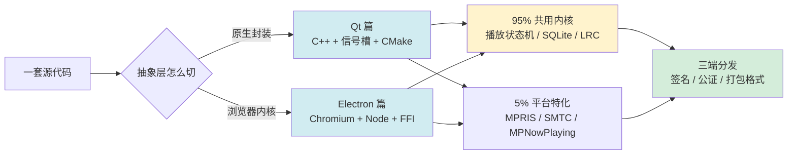
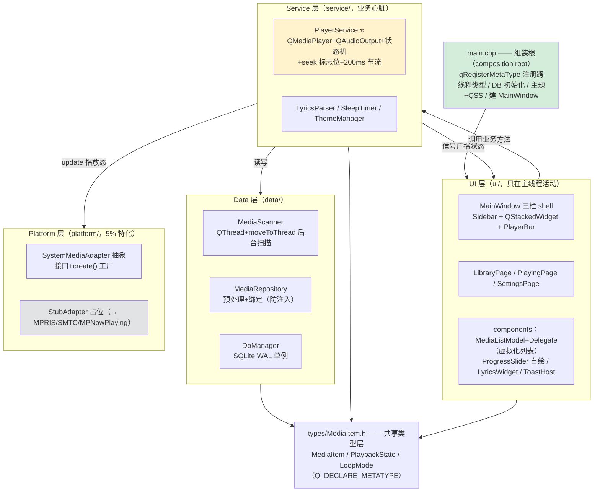
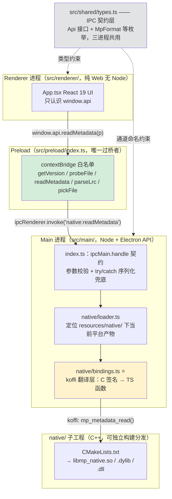

<!-- ============================================================
     ⚠️ 框架稿 v0.1（2026-11-12）—— 仅含章节骨架，正文未写。
     待办：
       ① 发布前替换 permalink
       ② 正文完成后同步更新本卷 00.README.md（12 篇 → 13 篇 + 知识脉络图）
       ③ 本篇双案例锚点：
          - code/App/mini-player-qt        （C++ / Qt Widgets / 三端 95% 共用）
          - code/App/mini-player-electron  （TS + React / koffi FFI 调 mp-native）
          - code/App/mp-native             （独立 C++ 库，一份 CMake 出三端产物）
     ============================================================ -->

# 13.跨平台桌面应用设计思想

> 📍 **本篇位置**：第 5 卷 · 交互与系统 · 第 13 篇（跨端最后一公里）
> 🎯 **核心矛盾**：**一套代码的效率 vs 三个操作系统的差异** —— 跨平台框架用「抽象层 + 95/5 法则 + C ABI 契约」管理而不是消灭差异
> 🧭 **设计灵魂**：所有跨平台方案只在做两件事——**把平台差异封装进一层抽象**（Qt 元对象系统 / Electron 浏览器内核）+ **留一条逃生通道到原生**（平台特化代码 / FFI）
> 🌐 **平台覆盖**：Qt(C++ / 信号槽 / CMake) · Electron(Chromium + Node / 三进程 / electron-builder) · 延伸(Tauri / wxWidgets / Flutter Desktop)
> 🔗 **真实案例**：`mini-player-qt` · `mini-player-electron` · `mp-native`（同一产品 MiniPlayer 的两套实现 + 一个共享 C++ 库）
> 💡 **通用心智**：跨平台 = **「共用内核 + 平台适配层 + 统一分发」三明治**——任何框架都是这三层的不同切法；「代码跨平台」≠「产物跨平台」≠「分发跨平台」三层递进

---

#### 目录介绍

- [0.三个平台三种死法（开场事故）](#0三个平台三种死法开场事故)
- [1.概述与背景](#1概述与背景)
- [2.技术路线三大流派](#2技术路线三大流派)
- [3.跨平台通用设计法则](#3跨平台通用设计法则)
- [4.Qt 篇：把一个框架讲透彻](#4qt-篇把一个框架讲透彻)
- [5.Electron 篇：把一个框架讲透彻](#5electron-篇把一个框架讲透彻)
- [6.双案例对照与选型决策](#6双案例对照与选型决策)
- [7.设计总结与演进](#7设计总结与演进)
- [8.经典陷阱与反模式](#8经典陷阱与反模式)
- [9.认知阶梯总结](#9认知阶梯总结)

---

## 0.三个平台三种死法（开场事故）

> 【待写】以三个真实事故开场，揭示「跨平台」的三层递进：代码 → 产物 → 分发

- 0.1 macOS：公证通过但 dylib 没单独签名 → Gatekeeper 秒杀
  - 案例锚点：`mini-player-electron` macOS 公证流程（extraResources 里的 `.dylib` 必须单独 codesign + notarize）
- 0.2 Linux：GStreamer 插件缺失 → 音频无声 / 黑屏
  - 案例锚点：`mini-player-qt` FAQ「MP3/AAC 无法播放」（Qt Multimedia 在 Linux 依赖 gstreamer plugins-good/bad/ugly/libav）
- 0.3 Windows：用户机器缺 VC++ Runtime → 双击无反应
- 0.4 事故揭示：三个事故对应三个不同的失败层——源码层、运行时依赖层、分发签名层
- 0.5 五个递进追问（引出全篇）

## 1.概述与背景

- 1.1 由来与背景：桌面三端割裂现状——Win32 / Cocoa / X11+Wayland 三套窗口系统、事件模型、打包格式、签名体系
- 1.2 跨平台演进史：Swing → wxWidgets → Qt → AIR → Electron → Tauri / Flutter Desktop
- 1.3 为何跨平台难：差异不止 UI——还有解码器、数据目录、菜单规范、更新机制
- 1.4 主要解决问题
- 1.5 警醒的资源数字
  - 【待写】Electron 空应用内存/体积 vs Qt 空窗口的实测对比
  - 三端分发格式清单（AppImage / deb / rpm / dmg / pkg / exe / msi / nsis）
- 1.6 设计目标：一套代码 + 三个产物 + 原生体验不打折
- 1.7 设计哲学：「95% 共用 + 5% 特化」——差异管理，而非差异消灭

## 2.技术路线三大流派

- 2.1 流派一：系统原生封装（Qt Widgets / wxWidgets）——控件来自各平台或统一自绘
- 2.2 流派二：自绘引擎（QML / Flutter Desktop）——框架自己画每一个像素
- 2.3 流派三：浏览器内核（Electron / NW.js / Tauri 系统 WebView）——UI 交给渲染引擎
- 2.4 三流派对比分析：性能 / 包体积 / 开发效率 / 原生感 / 生态（对比表）
- 2.5 一句话本质：跨平台 = 把平台差异封装进「虚拟机 / 抽象层」，差异不会消失，只会搬家

## 3.跨平台通用设计法则

> 【待写】与具体框架无关、两个案例共用的设计资产——这一章是「不管选 Qt 还是 Electron 都要遵守」的通用层

- 3.1 95/5 法则：共用内核与平台特化的边界怎么划
  - 案例锚点：`mini-player-qt` 的 `src/platform/`（特化只留 5%）与 `mini-player-electron` 的 `native/src/sysmedia/` 平台分流
- 3.2 逃生通道设计：平台特化的三件套模式——抽象接口 + 工厂 + Stub 占位
  - 案例锚点：`SystemMediaAdapter::create()` 工厂 + `StubAdapter`（Qt 案例）；`MP_WITH_SYSMEDIA` 编译开关（Electron 案例）
- 3.3 框架无关的共享设计资产（同一产品两套实现证明它们与框架解耦）
  - PlayerState 播放状态九元组（不可变状态对象）
  - 稳定 ID 算法：SHA1(path + size + mtime)
  - seeking 标志位（用户主动 seek 与播放器内部 position 回调的竞态，五端同款坑）
  - 200ms 位置上报节流
  - 同一份 SQLite schema（WAL / 预处理绑定防注入）
- 3.4 数据与行为的分层：哪些放共享层、哪些放框架层、哪些放平台层

## 4.Qt 篇：把一个框架讲透彻

> 【待写】以 `mini-player-qt` 为主线，从进程模型讲到分发，一次讲透一个框架。每节都有案例真实代码。

- 4.1 真实案例整体框架设计（`mini-player-qt` 五层架构）
  - 分层架构图（自上而下，依赖只准向下）：

  - 依赖方向铁律：`ui → service → data`，全部只依赖 `types`；`platform` 被 `service` 消费但通过抽象接口反转（UI 层永远不知道 SQLite 和 SMTC 的存在）
  - 数据流转三条线：
    - **扫描入库流**：LibraryPage 选目录 → `MediaScanner`（后台线程 `moveToThread`）→ `emit batchFound(...)` 队列信号自动切回主线程 → `MediaRepository::upsertBatch` → SQLite
    - **播放控制流**：列表点击 → `PlayerService::play()` → `QMediaPlayer` 异步加载 → `mediaStatusChanged / playbackStateChanged / errorOccurred` 信号 → PlayerService 翻译成业务状态机 → 信号广播 → PlayerBar / PlayingPage / LyricsWidget 更新
    - **平台外播流**：PlayerService 状态变化 → `SystemMediaAdapter::update()` → 工厂分流到 MPRIS(D-Bus) / MPNowPlaying / SMTC
  - 核心技术栈：Qt 6.4+ Widgets（非 QML）· CMake 3.21+ · QtMultimedia（QMediaPlayer + QAudioOutput + QVideoWidget）· QtSql（QSQLITE 驱动）· QThread + moveToThread + 队列信号 · QPainter + QPropertyAnimation 自绘 · QSS 主题 · QStandardPaths 数据目录 · QSettings 偏好持久化
- 4.2 进程与线程模型：单进程多线程
  - GUI 主线程纪律：所有 widget 操作必须在主线程
  - 后台扫描实战：`QThread` + `moveToThread`（不要继承 QThread 新手陷阱）
  - 跨线程通信用队列信号：`emit batchFound(...)` autoConnection 自动切回主线程
  - 对照：与 Electron 多进程的根本差异（线程共享内存 vs 进程 IPC）
- 4.3 信号槽机制：Qt 的「响应式」
  - moc 元对象系统干了什么；信号槽 vs 回调 vs 事件总线（呼应 5.5 消息机制篇）
  - 播放器事件翻译实战：`PlayerService` 把 `QMediaPlayer` 的信号翻译成业务状态机
- 4.4 UI 层：Widgets + Model/View + QSS
  - Model/View 自绘：`QAbstractListModel` 9 roles + `MediaListDelegate` 自绘（虚拟化列表的 C++ 时代答案）
  - QSS 设计系统：与 Web 端一致的紫粉渐变 + 深浅主题（`style.qss`）
  - 深浅色跟随：`QStyleHints::colorScheme`（Qt 6.5+）
- 4.5 平台特化（5%）
  - 系统媒体控制三件套接入路线：MPRIS(D-Bus) / MPNowPlaying(.mm 混编) / SMTC(C++/WinRT)
  - 数据目录三端：`~/.local/share` vs `~/Library/Application Support` vs `%APPDATA%`
  - 平台行为差异：Mac Dock 常驻 / `quitOnLastWindowClosed`
- 4.6 构建与分发：一份 CMake 出三端
  - `CMakeLists.txt` 三端条件分支 + Bundle/Install
  - 三端依赖矩阵：Linux 靠系统包（apt）、Windows/macOS 自带解码器
  - 打包：windeployqt / .app Bundle / Linux AppImage 思路
- 4.7 案例走读：`mini-player-qt` 从 `main.cpp` 到三栏 shell 的全链路
  - 工程结构速览（types / data / service / ui / platform 五层，对照 4.1 架构图）
  - 静态核查修 bug 纪实（AUTOMOC 炸 / qRegisterMetaType / CMake 老语法兼容）

## 5.Electron 篇：把一个框架讲透彻

> 【待写】以 `mini-player-electron` + `mp-native` 为主线。本章包含 FFI 全链路——这是 Electron 区别于所有「纯 Web」方案的核心能力。

- 5.1 真实案例整体框架设计（`mini-player-electron` 双工程 × 三进程）
  - 分层架构图（横向按进程切，纵向按职责分层）：

  - 依赖方向铁律：renderer **零 Node 依赖**（只看 preload 白名单）；main 是 Node 能力的唯一持有者；`native/` 与应用通过 `include/mp_native.h` **C ABI 契约头**协作——TS 与 C++ 互相不知道对方存在，头文件是唯一真相
  - 数据流转三条线：
    - **调用流**（读元数据为例）：`App.tsx` → contextBridge → `ipcMain.handle('native:readMetadata')` → `bindings.ts` koffi 调 `mp_metadata_read` → 堆内字符串先拷贝再 release → 可序列化对象原路返回 renderer
    - **产物流**（构建期）：`mp-native/out/multi/<platform-arch>/` 六平台产物 → `fetch-native.cjs`（multi 优先、缺失回退源码构建）→ `resources/native/` → 运行时 `loader.ts` 按优先级定位 → `koffi.load`
    - **打包流**（分发期）：`electron-builder.yml` + extraResources 携带 dylib → 三端产物（AppImage+deb / universal dmg / nsis exe）→ macOS 公证须对 `.dylib` 单独签
  - 核心技术栈：Electron 40 · electron-vite · React 19 + TypeScript 5.9 · Vite（非 Next.js）· koffi 2.15 FFI · CMake / C++17（native 子工程）· electron-builder 26 · Node ≥ 20.19 · pnpm 10
- 5.2 三进程模型：main / preload / renderer
  - 为什么是三个进程：安全边界 + 稳定性隔离 + Node 能力收敛
  - 安全三纪律：`contextIsolation: true` + `nodeIntegration: false` + `sandbox: true`
  - contextBridge：preload 白名单是 renderer 能看到的全部能力（呼应 5.6 跨进程通信篇——Electron 三进程就是 IPC 实战教材）
- 5.3 IPC 契约设计
  - `ipcMain.handle` 的纪律：参数校验 + try/catch 把异常翻译成可序列化错误
  - 通道命名与 `shared/types.ts` 的 Api 接口双向约束
- 5.4 语言边界：koffi FFI 调 C++（本章重心）
  - 为什么需要 FFI：Node 没有系统媒体控制 / 高性能元数据解析
  - 四层链路全解：React → contextBridge → ipcMain → koffi → C ABI
    - 案例锚点：`mp_metadata_read` 真实链路（`App.tsx` → `preload/index.ts` → `main/index.ts` → `bindings.ts` → `mp_native.h`）
  - C ABI 三铁律：所有权显式（跨 CRT 堆混用必崩）/ 变长数据三件套（指针+长度+释放）/ 仅传 POD
  - 结构体穿越：koffi struct 字段顺序与 C 头一字不差；堆内字符串先拷贝再 release
  - 回调跨线程 marshal：`setImmediate` 跳回主 event loop 才能碰 Electron API
- 5.5 双工程协作：应用 + 原生库怎么组织
  - `mp-native`（独立 C++ 库，一份 CMake 出 .so/.dylib/.dll）与 `mini-player-electron`（应用）
  - 产物接入：`out/multi/` 六平台目录 → `fetch-native.cjs` → `resources/native/`
  - 编译开关隔离可选能力：`MP_WITH_TAGLIB` / `MP_WITH_SYSMEDIA`
- 5.6 UI 层：React + Vite（为什么不是 Next.js）
  - file:// 加载静态导出的约束 → SSR 优势失效 → 选 Vite
  - 深浅色主题、与 Qt 端同款的视觉设计
- 5.7 构建与分发：electron-builder 三端打包
  - 产物矩阵：AppImage + .deb / universal .dmg（lipo 合并 arm64+x64）/ nsis exe
  - 签名公证深水区：macOS 公证对内嵌 dylib 必须单独签（§0.1 事故的技术复盘）
  - CI 只需有对应平台产物或工具链即可打包（本机不需要全平台 CMake）

## 6.双案例对照与选型决策

- 6.1 同一产品两套实现的对照表
  - 代码量 / 启动速度 / 内存 / 包体积 / 依赖复杂度 / 开发效率 / 调试体验 / 生态 / 长期维护
- 6.2 殊途同归的部分：两案例都遵守 §3 通用法则（状态机 / schema / 主题视觉一致）
- 6.3 选型决策树
  - 团队技能（C++ vs Web）、性能/体积敏感度、生态需求、生命周期长度
  - 何时 Qt / 何时 Electron / 何时都不选（Tauri / 原生 / PWA）

## 7.设计总结与演进

- 7.1 核心模式提炼：抽象层封装 / C ABI 契约 / 95/5 法则 / 接口+工厂+Stub
- 7.2 哲学本质：跨平台不是消灭差异，而是给差异一个受管理的家
- 7.3 演进趋势：Tauri（复用系统 WebView）/ Flutter 自绘统一 / WASM 边界模糊化
- 7.4 跨领域思想迁移：C ABI 契约思想 → 微服务 API 契约；95/5 → 前端 BFF 分层

## 8.经典陷阱与反模式

> 【待写】全部来自两个案例的真实记录，逐条给「现象 → 根因 → 修法」

- 8.1 macOS dylib 公证：extraResources 里的动态库没单独签名就被拒（Electron）
- 8.2 Linux 解码黑屏：GStreamer 插件缺失，系统包依赖必须写进安装文档（Qt）
- 8.3 继承 QThread 而不是 moveToThread：槽根本不在新线程跑（Qt）
- 8.4 `ipcMain.handle` 不 try/catch：异常不可序列化直接丢给 renderer（Electron）
- 8.5 koffi 堆返回没先拷贝就 release：JS 侧拿到悬垂字符串（Electron）
- 8.6 关了 nodeIntegration 却忘了关 contextIsolation：沙箱形同虚设（Electron）
- 8.7 C 回调里直接碰 Electron API：不在主线程必崩，须 setImmediate（Electron）
- 8.8 CMake `if(LINUX)` 老写法在 CMake 3.21-3.24 失效（Qt）
- 8.9 AUTOMOC 槽签名用了未 include 的类型直接炸（Qt）
- 8.10 Electron 里硬上 Next.js：file:// + output:export 让核心优势失效（Electron）
- 8.11 跨 CRT 堆释放：库分配的内存用宿主 free 释放必崩（FFI 通用）

## 9.认知阶梯总结

- 9.1 三层认知：API 使用者（会调 QMainWindow / BrowserWindow）→ 机制理解者（明白信号槽 / 三进程为何如此设计）→ 边界设计者（能划出 95/5 与 C ABI 契约）
- 9.2 设计哲学回顾
- 9.3 跨端术语对照表：信号槽 ↔ IPC invoke ↔ 事件回调；moveToThread ↔ Worker；QSS ↔ CSS；Delegate 自绘 ↔ 组件渲染
- 9.4 本卷章节呼应：窗口（5.1）· 消息机制（5.5）· 跨进程通信（5.6）在两框架中的投影
- 9.5 延伸阅读：→ 第 10.Apps 卷「综合音视频案例」五端篇（Android / iOS / Web / Qt / Electron 同一产品的完整实现）

---

<!--
框架调整记录（2026-11-12）：
- 原方案 §6 平台特化 / §7 构建分发 / §8 双案例对照 三个横切章 → 已拆除
- 改为 §4 Qt 篇 / §5 Electron 篇 两个纵深章，各自完整覆盖：进程线程 → 机制 → UI → 平台特化 → 构建分发 → 案例走读
- 原方案 §3 进程线程 / §4 FFI / §5 UI 对照 的内容按框架归属分别并入 §4 / §5；与框架无关的通用内容沉淀为 §3 通用设计法则
- 双案例对照压缩为 §6，与选型决策合并
-->
