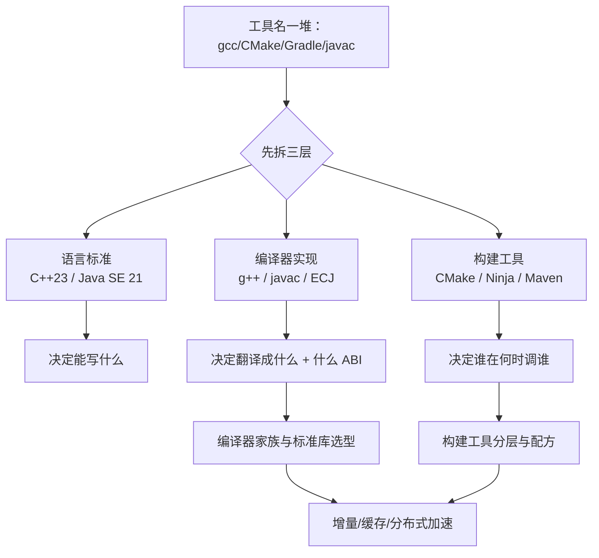
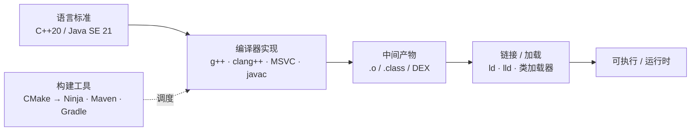
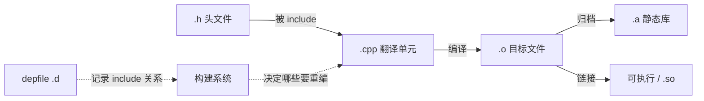
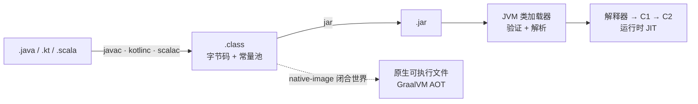
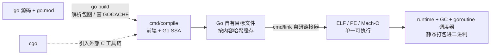
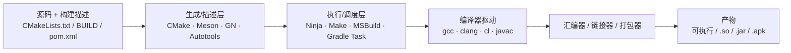
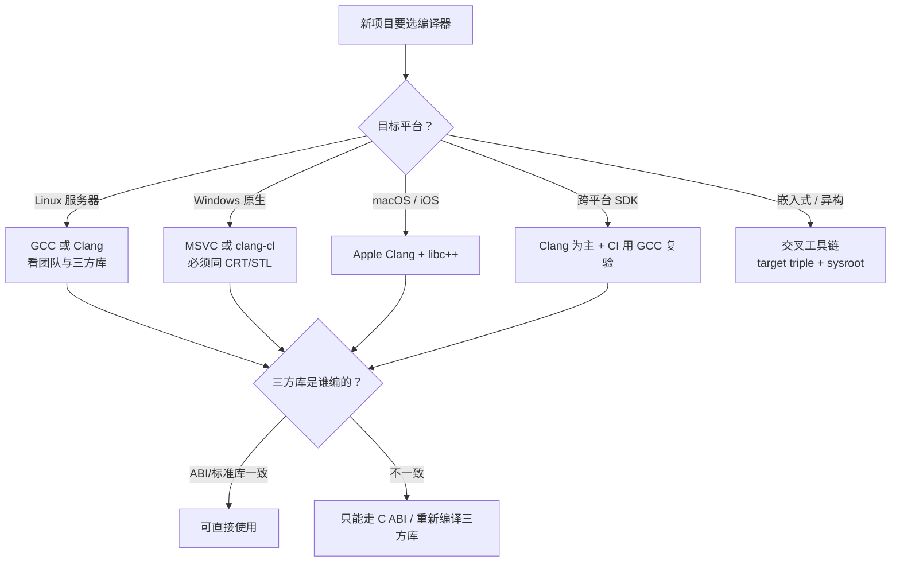

## 6.编译器与构建工具

> 📍 **本篇位置**：第 7 卷 · 编译与链接之道 · 第 6 篇（工程速查篇）
> 🎯 **核心矛盾**：**`gcc`、`g++`、`clang`、`cl.exe`、`javac`、CMake、Ninja、Maven、Gradle……名字一大堆，到底谁在真的"编译"？为什么 C++ 换个编译器就链不上，Java 换 JDK 却没事？为什么"选编译器"其实是在选 ABI、标准库和构建生态？**
> 🧭 **设计灵魂**：把一堆工具名拆成**三层正交结构**——**语言标准**（规定写什么）→ **编译器实现**（把源码翻译成什么）→ **构建工具**（决定谁在什么时候调谁）。`CMake` 从不编译一行代码，`javac` 从不优化一行热点，`JIT` 不属于构建期——**绝大多数工具链困惑，都是把这三层的职责张冠李戴**。
> 🌐 **跨语言覆盖**：C（GCC/Clang/MSVC/TCC/Emcc）· C++（g++/clang++/MSVC/MinGW/ICX/NVCC）· Java（javac/ECJ/kotlinc/native-image）· Go（cmd/compile / go build / cmd/link）· Rust/C#/Swift/Kotlin · Android NDK 与交叉编译
> 🔗 **延伸阅读**：← [7.5 语言到机器的三种路线](./05.语言到机器的路线.md) · [7.1 从源码到可执行](./01.从源码到可执行.md) · [7.4 ABI 与调用约定](./04.ABI设计与调用约定.md) · [嵌入式构建与编译体系](../../10.Apps/04.Linux应用开发/04.嵌入式之实战/03.构建与编译体系原理.md)
> 💡 **一句话**：**编译器决定"翻译成什么"，构建工具决定"什么时候、按什么顺序、调谁去翻译"，而 ABI 决定"你翻译出来的东西能不能和别人的拼在一起"**。

> 📢 **本篇定位说明**
> 前 5 篇讲的是**原理与取舍**（流水线、符号、链接、ABI、三条路线）；本篇是**工程名录与速查**，刻意不重复原理推导，只回答"有哪些工具、各自负责哪一层、怎么组合、怎么选"。**想查命令和清单就来这里，想问"为什么"回前 5 篇**。

---

## 目录介绍

- [6.编译器与构建工具](#6编译器与构建工具)
- [目录介绍](#目录介绍)
- [00.真实场景引入：三个"编译"引发的误会](#00真实场景引入三个编译引发的误会)
  - [场景 1：换编译器，库链不上了](#场景-1换编译器库链不上了)
  - [场景 2：改了 CMakeLists.txt，构建毫无变化](#场景-2改了-cmakeliststxt构建毫无变化)
  - [场景 3：`-source 8 -target 8` 编出的包，在 JDK 8 上跑挂了](#场景-3-source-8--target-8-编出的包在-jdk-8-上跑挂了)
  - [三个场景的共同拷问](#三个场景的共同拷问)
  - [探索路径](#探索路径)
- [01.三层心智模型：标准 / 实现 / 调度](#01三层心智模型标准--实现--调度)
  - [1.1 四个最容易混的词](#11-四个最容易混的词)
  - [1.2 三层结构](#12-三层结构)
  - [1.3 一句话本质](#13-一句话本质)
- [02.编译器驱动与工具链四件套](#02编译器驱动与工具链四件套)
  - [2.1 driver 不是编译器本体](#21-driver-不是编译器本体)
  - [2.2 四件套对照](#22-四件套对照)
  - [2.3 为什么必须用 driver 链接](#23-为什么必须用-driver-链接)
  - [2.4 一句话本质](#24-一句话本质)
- [03.编译的几种形态：不止 Debug 与 Release](#03编译的几种形态不止-debug-与-release)
- [04.C 编译器家族](#04c-编译器家族)
- [05.C++ 编译工具全景](#05c-编译工具全景)
  - [5.1 为什么需要编译](#51-为什么需要编译)
  - [5.2 C++编译背景](#52-c编译背景)
  - [5.3 一次 C++ 编译到底发生了什么](#53-一次-c-编译到底发生了什么)
  - [5.4 常见编译工具全景](#54-常见编译工具全景)
  - [5.5 C++ 特有的编译形态](#55-c-特有的编译形态)
  - [5.6 编译工具怎么选：先定 ABI，再谈优化](#56-编译工具怎么选先定-abi再谈优化)
  - [5.7 构建方式：从一条命令到构建系统](#57-构建方式从一条命令到构建系统)
  - [5.8 构建原理：依赖图、增量判定与缓存](#58-构建原理依赖图增量判定与缓存)
  - [5.9 打包与发布：把产物交到别人手里](#59-打包与发布把产物交到别人手里)
  - [5.10 一条完整链路：从源码到发布包](#510-一条完整链路从源码到发布包)
  - [5.11 常见坑速查（C++ 专属）](#511-常见坑速查c-专属)
  - [5.12 一句话本质](#512-一句话本质)
- [06.Java 编译体系](#06java-编译体系)
  - [6.1 一条完整链路](#61-一条完整链路)
  - [6.2 构建期的编译器们](#62-构建期的编译器们)
  - [6.3 `--release` 才是正确的跨版本开关](#63---release-才是正确的跨版本开关)
  - [6.4 为什么 Java 换实现不容易出 ABI 事故](#64-为什么-java-换实现不容易出-abi-事故)
  - [6.5 一句话本质](#65-一句话本质)
- [07.Go 编译器体系](#07go-编译器体系)
  - [7.1 一条完整链路](#71-一条完整链路)
  - [7.2 工具链组件对照](#72-工具链组件对照)
  - [7.3 为什么 Go 编译快](#73-为什么-go-编译快)
  - [7.4 交叉编译与常用观察命令](#74-交叉编译与常用观察命令)
  - [7.5 与 C/C++ / Java 的定位对照](#75-与-cc--java-的定位对照)
  - [7.6 非官方实现与其他后端](#76-非官方实现与其他后端)
  - [7.7 一句话本质](#77-一句话本质)
- [08.其他语言工具链速查](#08其他语言工具链速查)
- [09.构建工具三层分工](#09构建工具三层分工)
  - [9.1 一次构建的完整链路](#91-一次构建的完整链路)
  - [9.2 三层职责](#92-三层职责)
  - [9.3 常见组合配方](#93-常见组合配方)
  - [9.4 一次构建里的六个动词](#94-一次构建里的六个动词)
- [10.增量、缓存与分布式编译](#10增量缓存与分布式编译)
- [11.选型决策树与常见配方](#11选型决策树与常见配方)
  - [11.1 选编译器：先定 ABI，再谈优化](#111-选编译器先定-abi再谈优化)
  - [11.2 选构建工具：四个问题](#112-选构建工具四个问题)
  - [11.3 一句话本质](#113-一句话本质)
- [12.经典陷阱与反模式](#12经典陷阱与反模式)
  - [12.1 反模式：把名录当决策](#121-反模式把名录当决策)
  - [12.2 一句话本质](#122-一句话本质)
- [13.一句话总结与术语速查](#13一句话总结与术语速查)
  - [13.1 三层认知](#131-三层认知)
  - [13.2 术语速查](#132-术语速查)
  - [13.3 七字真言](#133-七字真言)
  - [13.4 卷内回链](#134-卷内回链)
  - [13.5 延伸阅读](#135-延伸阅读)

---

## 00.真实场景引入：三个"编译"引发的误会

> 🔍 **探索起点**：**下面三起事故，工程师都在说"编译出问题了"，但出错的其实是三个完全不同的层。**

### 场景 1：换编译器，库链不上了

某 Windows 项目把 C++ 三方库从 MSVC 编的 `.lib` 换成 MinGW 编的 `.a`，链接器报一屏 `undefined reference to '?add@math@@YAHHH@Z'` 之类的怪符号。

**真相**：两边源码都是合法 C++17，但 **C++ ABI 阵营不同**——MSVC 用 MSVC mangling，MinGW/GCC 用 Itanium mangling，符号名根本对不上（详见 [7.4 §4.3](./04.ABI设计与调用约定.md)）。

**这不是"编译失败"，是"二进制契约没对齐"**。

### 场景 2：改了 CMakeLists.txt，构建毫无变化

工程师在 `CMakeLists.txt` 里加了 `add_definitions(-DFEATURE_X=1)`，直接跑 `cmake --build build`，结果宏没生效。

**真相**：CMake 是**生成器**——它先读 `CMakeLists.txt` 生成 `build.ninja` / `Makefile`，再由 Ninja/Make 去调编译器。只跑 build、没重新 configure，描述文件就没重新生成。

**这不是"编译器忽略了我的宏"，是"我根本没让调度层重新排日程"**。

### 场景 3：`-source 8 -target 8` 编出的包，在 JDK 8 上跑挂了

某 Java 服务用 JDK 11 的 `javac -source 8 -target 8` 编译，字节码版本确实是 52（Java 8），上线却报 `NoSuchMethodError: java.util.List.of(...)`。

**真相**：`-source/-target` 只管**语法和字节码版本**，不管**用到的 JDK API**；代码里调用了 JDK 9+ 才有的 `List.of`，JDK 8 上当然找不到。正确写法是 `javac --release 8`（JDK 9+），它同时锁定语法、字节码版本与可用 API。

**这不是"Maven 编错了"，是"给编译器的边界条件声明错了"**。

### 三个场景的共同拷问

1. **谁在真的编译？**——`gcc` 是驱动不是编译器本体，`CMake` 连代码都不碰，IDE 只是个调用者。
2. **"编译器"这个词被复用了几次？**——构建期编译器（`javac`）、运行时编译器（JIT）、AOT 编译器（`native-image`）、转译器（`tsc`）都叫"编译器"。
3. **为什么 C++ 要挑编译器，Java 不太挑？**——因为 C++ 没有稳定 ABI，编译器与标准库绑定；Java 的契约是**字节码格式 + JVM 规范**，厂商实现可以替换。

### 探索路径



---

## 01.三层心智模型：标准 / 实现 / 调度

> 🔍 **探索起点**：**把工具名按"职责层级"归位，90% 的困惑当场消失。**

### 1.1 四个最容易混的词

| 词 | 是什么 | 例子 | 会不会产出机器码 |
|---|---|---|---|
| **语言标准** | 一份规范文档，规定语法与语义 | C17、C++20、Java SE 21、C# 12 | 不会，它只是纸 |
| **编译器实现** | 把源码翻译成某种产物的**程序** | GCC、Clang、MSVC、`javac`、ECJ | AOT 会；`javac` 只到字节码 |
| **构建工具** | 决定编译顺序、参数、依赖、缓存的**调度程序** | Make、Ninja、CMake、Maven、Gradle、Bazel | **不会**，它只调别人 |
| **IDE / 编辑器** | 带 UI 的调用壳 + 增量索引 | VS Code、CLion、IntelliJ、Xcode、Visual Studio | 不会，它调编译器或自己的增量编译器 |

### 1.2 三层结构



**关键**：**构建工具与编译器是"上下层"关系，不是并列的同类产品**。`CMake` 和 `GCC` 无法二选一，它们是一起用的；真正能二选一的是 `GCC ↔ Clang`、`Ninja ↔ Make`、`Maven ↔ Gradle`。

### 1.3 一句话本质

> **标准定"写什么"，编译器定"翻成什么"，构建工具定"怎么翻、翻几遍、什么时候不用翻"**——三者各管一层，任何工具链选型先问"我现在在第几层"。

---

## 02.编译器驱动与工具链四件套

> 🔍 **探索起点**：**`gcc hello.c -o hello` 这一条命令里，`gcc` 其实几乎没编译，它只是个"包工头"。**

### 2.1 driver 不是编译器本体

```bash
gcc -### hello.c -o hello        # 只打印将要执行的子命令，不真编译
clang -### hello.c -o hello      # Clang 同理
gcc -v hello.c -o hello          # 打印详细过程与搜索路径
```

你会看到一条链：`cc1`（或 `clang -cc1`）→ `as` → `collect2`/`ld`。**`gcc`/`clang`/`cl.exe` 是驱动（driver）**：解析命令行、补默认参数、按顺序拉起子进程、最后传参给链接器。这也是 [7.1 §3.2](./01.从源码到可执行.md) 四步流水线的真实执行形态。

### 2.2 四件套对照

| 角色 | GNU 工具链 | LLVM 工具链 | MSVC 工具链 | JVM 工具链 |
|---|---|---|---|---|
| **驱动** | `gcc` / `g++` | `clang` / `clang++` | `cl.exe`（常由 MSBuild 调度） | `javac`（常由 Maven/Gradle 调度） |
| **编译本体** | `cc1` / `cc1plus` | `clang -cc1` + LLVM 中后端 | `cl.exe` 前端 | `javac` / ECJ |
| **汇编器** | `as`（binutils） | LLVM MC（可内置） | 内置；独立汇编用 `ml64` | 无（产物是字节码） |
| **链接器** | `ld` / `collect2` | `lld` | `link.exe` | **类加载器**（运行时，见 7.2） |
| **归档 / 打包** | `ar` → `.a` | `llvm-ar` | `lib.exe` → `.lib` | `jar` → `.jar` |
| **中间产物** | ELF `.o` | ELF/COFF/Mach-O `.o` | COFF `.obj` | `.class`（含常量池） |
| **查错工具** | `nm` / `objdump` / `readelf` / `gdb` | `llvm-nm` / `llvm-objdump` / `lldb` | `dumpbin` | `javap` / `jdeps` |

### 2.3 为什么必须用 driver 链接

```bash
g++ -c main.cpp -o main.o
gcc  main.o -o main      # ❌ 常见报错：undefined reference to `std::cout' ...
g++  main.o -o main      # ✅ g++ 自动补上 -lstdc++ 和启动文件
```

`g++` 与 `gcc` 前端差别不大，**差别主要在链接时自动带的库**：C++ runtime、`libstdc++`、`crt1.o`/`crtbegin.o` 等启动文件。所以"编译用 gcc、链接也得用 gcc"这条经验**只对 C 成立**。

### 2.4 一句话本质

> **你以为在调一个编译器，实际在调一条"驱动 → 编译 → 汇编 → 链接"的流水线**；`-v` / `-###` 是看清这条链的最短路径。

---

## 03.编译的几种形态：不止 Debug 与 Release

> 🔍 **探索起点**：**"C++ 有哪些编译"这句话，其实混了 7 根互相正交的轴。**

| 轴 | 取值 | 典型开关 / 工具 |
|---|---|---|
| **优化与调试** | Debug / Release / RelWithDebInfo / MinSizeRel | `-O0 -g`、`-O2`、`-O2 -g`、`-Os`；MSVC `/Od` `/O2` `/Zi` |
| **目标平台** | 本机编译 / **交叉编译** | target triple `aarch64-linux-gnu`、`--sysroot`、Android NDK |
| **编译范围** | 全量 / 增量 / 单编译单元 | `-c`、`-MMD -MP` depfile、构建系统的增量判定 |
| **产物链接方式** | 静态 / 动态 | `-static`、`-fPIC -shared`（见 [7.3](./03.静态链接与动态链接.md)） |
| **优化视野** | 普通 / LTO(ThinLTO) / PGO | `-flto`、`-fprofile-generate` → `-fprofile-use`（见 [7.5 §3.3](./05.语言到机器的路线.md)） |
| **翻译时刻** | AOT / JIT / 解释 | `gcc`、`HotSpot C2`、CPython（见 [7.5](./05.语言到机器的路线.md)） |
| **模块模型** | 头文件展开 / PCH / C++20 Modules | `-include`、`.gch`、`import std;`（见 [7.1 §4.5](./01.从源码到可执行.md)） |

**C++ 还多两个独有负担**：模板**在每个编译单元里重复实例化**、以及**显式实例化 / `extern template`** 的控制。这正是 Chrome 全量编译 40 分钟的主因之一（[7.1 §10.1](./01.从源码到可执行.md)）。

> **一句话**：所谓"有几种编译"，不是几种产品，而是**同一个翻译动作在这些轴上的不同取值组合**；`-O2`、`-flto`、`-static`、`--target=...` 可以任意叠加。

---

## 04.C 编译器家族

> 🔍 **探索起点**：**C 的标准极简、ABI 稳定，所以"换编译器"几乎不会出事——它的家族主要按平台和优化目标分化。**

| 实现 | 命令 | 主战场 | 特点 |
|---|---|---|---|
| **GCC** | `gcc` | Linux / 服务器 / 嵌入式 | 老牌全平台后端，优化成熟，`cc1` 前端 |
| **Clang / LLVM** | `clang` | macOS、Chrome、Android、新项目 | 错误信息友好、模块化、可嵌库；产出 LLVM IR |
| **Apple Clang** | `clang`（Xcode 自带） | macOS / iOS | Apple 私有分支，与上游版本号不一一对应 |
| **MSVC** | `cl.exe` | Windows | 生成 COFF/PE，绑定 Windows SDK 与 UCRT |
| **Intel ICC / ICX** | `icc` / `icx` | HPC、数值计算 | 经典 ICC 已退役；**ICX 基于 LLVM**，Linux 兼容 GCC ABI、Windows 兼容 MSVC ABI |
| **MinGW-w64** | `x86_64-w64-mingw32-gcc` | 在 Windows 上产原生 PE | GCC 工具链的 Windows 移植，**不依赖 MSVC 运行时** |
| **TCC (TinyCC)** | `tcc -run` | 教学、脚本化 C | 无 IR、直出机器码，快到能当解释器用；优化几乎没有 |
| **Emscripten** | `emcc` | 浏览器 / WASM | 基于 Clang/LLVM，把 C/C++ 编到 `.wasm` |
| **Zig** | `zig cc` | 交叉编译 | Clang 包装 + 自带多平台 sysroot，`zig cc -target ...` 一行交叉 |
| **嵌入式专用** | SDCC、IAR、Keil ARMCC、`arm-none-eabi-gcc` | 8051 / Cortex-M / 裸机 | 目标 ABI 与主机完全不同，需完整交叉工具链 |

**标准开关**：`-std=c89|c99|c11|c17|c23`、`-std=gnu11`（GNU 扩展）、`-pedantic`（严格报错）。**所有实现编出的 C 函数符号名都是原样**，调用约定由平台 psABI 规定——这就是 C 能当"跨语言世界语"的原因（[7.4 §4.1](./04.ABI设计与调用约定.md)）。

```bash
gcc -std=c11 -Wall -Wextra -O2 -c foo.c -o foo.o
clang -std=c17 -S -emit-llvm foo.c -o foo.ll     # 看 LLVM IR
```

---

## 05.C++ 编译工具全景

🔍 **探索起点**：**为什么 C++ 非编译不可？为什么 `g++` 和 `cl.exe` 编出的库不能互相链接？为什么改一个头文件要重编五分钟？为什么编译明明过了，发布到别的机器还是跑不起来？

这一节按「为什么 → 背景 → 流程 → 工具 → 选型 → 构建 → 打包」由浅入深拆完，读完你能独立给一个 C++ 项目配出整条工具链。**
> 🧭 **阅读路线**：`5.1-5.3` 原理与历史 → `5.4-5.6` 工具与选型（查表即用）→ `5.7-5.10` 构建与发布（工程落地）→ `5.11-5.12` 排错与总结。

### 5.1 为什么需要编译

**最底层的理由**：CPU 只认「取指 → 译码 → 执行」的机器码，而 C++ 源码是给人看的文本。`class`、模板、异常、RAII、虚函数、lambda 这些抽象，必须被**降维**成「指令 + 寄存器 + 内存地址」，而 C++ 选择**在运行之前就全部降完**。

| 语言 | 源码变成什么 | 谁负责最后一步 | 运行前需要什么 |
|---|---|---|---|
| **C++** | 机器码（`.o` → 可执行） | 链接器（构建期） | 目标平台的 CPU + OS |
| Java | 字节码（`.class`） | JVM 类加载 + JIT（运行时） | JVM |
| Python | 字节码（`.pyc`） | 解释器（每次执行） | 解释器 |
| Go | 机器码（含 runtime） | `cmd/link`（构建期） | 只要 OS |

**为什么 C++ 尤其必须提前编译**：

- **静态类型 + 零成本抽象**：模板、内联、RAII 的价值就在「编译期展开完、运行时零开销」，解释执行等于把优势全丢掉。
- **没有 VM / GC / 运行时兜底**：内存布局、对象生命周期、调用约定都得在编译期定死。
- **要直接对接硬件与 OS**：内核、驱动、游戏引擎、嵌入式没有更底层的解释器可用。

**不编译行不行？** 有 `cling`（基于 Clang 的 C++ 解释器，CERN ROOT 在用）和早期的 CINT，主要做 REPL、教学、交互式数据分析；但它们不产出可部署产物，**生产环境仍是 AOT**。

### 5.2 C++编译背景

**一句话看历史**：**C++ 的编译复杂度 = 语言特性逐级叠加 + 1970 年代的头文件模型一直没换掉**。

| 年代 | 关键事件 | 给今天留下了什么 |
|---|---|---|
| 1970s | C 与 `cc` 诞生；机器内存极小，编译器一次只能吃一个文件 | **预处理 / 编译 / 汇编 / 链接四步分工**、文本粘贴式 `#include` |
| 1980s 前期 | `cfront` 把 C++ **先翻译成 C**，再交给 `cc` | 「编译器也可以是转译器」；也解释了 C++ 与 C 的血缘 |
| 1980s 后期–90s | GCC/g++、MSVC、Borland 等**原生前端**出现；模板、异常、RTTI 加入 | **name mangling**、vtable、异常展开表 → ABI 急剧复杂化 |
| 1990s–2000s | STL / 标准库普及；Itanium C++ ABI 与 MSVC ABI 两套阵营定型 | 「同语言、不同编译器链不上」成为历史遗留问题（[7.4 §4.3](./04.ABI设计与调用约定.md)） |
| 2000s | LLVM / Clang 把前端—IR—后端解耦 | 错误信息友好、模块化、可嵌库；`lld` 等组件可独立替换 |
| 2011 起 | C++11/14/17/20/23 三年一版；constexpr、Concepts、Modules | 编译期做的事越来越多 → **编译越来越慢** |
| 现在 | PCH / Modules / ccache / LTO / 分布式编译 / 远程缓存 | 工程优化几乎都在对抗「翻译单元重复解析」 |

### 5.3 一次 C++ 编译到底发生了什么

```bash
g++ -E main.cpp -o main.i      # ① 预处理：展开 #include / 宏，产出纯 C++ 文本
g++ -S main.i   -o main.s      # ② 编译：语义分析 → IR → 优化 → 汇编
g++ -c main.s   -o main.o      # ③ 汇编：助记符 → 机器码 + 符号表 + 重定位表
g++ main.o      -o main        # ④ 链接：解析符号、补地址、带入库与启动文件

g++ -### main.cpp -o main      # 只看 driver 准备拉起哪些子进程
g++ -v   main.cpp -o main      # 看详细过程与头文件/库搜索路径
```

| 步骤 | 输入 → 输出 | 主要工作 | 典型报错 |
|---|---|---|---|
| 预处理 | `.cpp` → `.i` | 文本粘贴、宏展开、条件编译 | `fatal error: xxx.h: No such file` |
| 编译 | `.i` → `.s` | 词法/语法/语义、模板实例化、mangling、优化 | `error: ...`、类型/重载不匹配 |
| 汇编 | `.s` → `.o` | 编码指令、生成符号表与重定位项 | 少见（汇编语法错误） |
| 链接 | `.o` + 库 → 可执行 | 符号解析、重定位、段合并 | `undefined reference`、`multiple definition` |

编译器内部还有三段（[7.1 §5](./01.从源码到可执行.md)）：**前端**（AST / 语义）→ **中端**（LLVM IR / GIMPLE 上做优化）→ **后端**（指令选择、寄存器分配）。C++ 特有的三件事都发生在前端：**模板实例化、name mangling、vtable/RTTI 生成**。

**最关键的约束：翻译单元（translation unit）**。每个 `.cpp` 连同它展开的头文件，是一个**彼此看不见**的独立编译单位；`A.cpp` 里定义的东西，`B.cpp` 只能靠头文件里的**声明**知道，真实地址要等链接时才补（[7.2](./02.符号表与重定位.md)）。后面所有「头文件、ODR、链接顺序、编译慢」的问题，根子都在这里。

### 5.4 常见编译工具全景

**① 编译器实现**

| 实现 | 命令 | 默认标准库 | ABI 阵营 | 典型场景 |
|---|---|---|---|---|
| **GCC / G++** | `g++` | libstdc++ | Itanium | Linux 事实标准、服务器 |
| **Clang** | `clang++` | libstdc++（Linux）/ libc++（可切） | Itanium | `-stdlib=libc++` 切换；Chrome、Android |
| **Apple Clang** | `clang++` | **libc++** | Itanium | macOS / iOS 默认 |
| **MSVC** | `cl.exe` | MSVC STL | **MSVC** | `/std:c++17`、`/EHsc`；Windows 原生 |
| **clang-cl** | `clang-cl` | MSVC STL | **MSVC** | Clang 前端 + MSVC 兼容命令行，可与 MSVC 产物互链 |
| **Intel ICX** | `icx` / `icpx` | 跟随平台 | 跟随平台 | HPC；Linux 兼容 GCC、Windows 兼容 MSVC |
| **MinGW-w64** | `g++`（交叉前缀） | libstdc++ | Itanium | Windows 上产原生 PE，**ABI 与 MSVC 不兼容** |
| **Emscripten** | `em++` | libc++ | WASM 侧 | 编到 `.wasm` |
| **NVCC** | `nvcc` | 跟随 host | 跟随 host | CUDA：device 代码编 PTX/SASS，host 代码转交 `g++`/`cl.exe` |
| **商用 / 教学前端** | EDG、Circle、chibicc 等 | — | — | EDG 被多家 IDE / 编译器用作前端 |

**标准开关**：`-std=c++11 / 14 / 17 / 20 / 23`（GCC/Clang，老版本用 `c++2a`/`c++2b`）、`-std=gnu++17`（GNU 扩展）、`/std:c++17|latest`（MSVC；要让 `__cplusplus` 准确需加 `/Zc:__cplusplus`）。

**② driver 之外的配套工具**（通用四件套见 §02）

| 工具 | 作用 |
|---|---|
| `as` / LLVM MC | 汇编器 |
| `ld` / `lld` / `mold` / `link.exe` | 链接器 |
| `ar` / `lib.exe` | 打静态库 `.a` / `.lib` |
| `nm` / `objdump` / `readelf` / `dumpbin` | 看符号、看段、看依赖 |
| `c++filt` | 把 `_ZN3foo3barEi` 还原成 `foo::bar(int)` |
| `strip` | 去符号与调试信息，缩小产物 |

**③ 观察与调试工具**

```bash
clang++ -Xclang -ast-dump -fsyntax-only main.cpp   # 看 AST
clang++ -S -emit-llvm main.cpp -o main.ll          # 看 LLVM IR
g++ -fdump-tree-original main.cpp                  # 看 GCC 前端树
pahole app                                         # 看结构体内存布局（需 -g）
```

再配 [Compiler Explorer](https://godbolt.org/) 在线对照不同编译器、不同优化级别产出的汇编——这是理解「零成本抽象到底有没有零成本」的最短路径。

### 5.5 C++ 特有的编译形态

| 形态 | 开关 / 手法 | 解决什么 |
|---|---|---|
| Debug / Release / RelWithDebInfo / MinSizeRel | `-O0 -g` / `-O2` / `-O2 -g` / `-Os` | 调试体验 vs 性能 vs 体积 |
| 单 / 多编译单元 | `-c` 逐个编译 | 增量编译的前提 |
| 全量 / 增量 | 构建系统的依赖判定 | 改一行后要等多久 |
| 静态 / 动态 | `-static`、`-fPIC -shared` | 部署形态（[7.3](./03.静态链接与动态链接.md)） |
| LTO / ThinLTO | `-flto`、`-flto=thin` | 跨模块内联 |
| PGO | `-fprofile-generate` → 跑负载 → `-fprofile-use` | 用真实热点指导优化 |
| PCH / C++20 Modules | `-include`、`.gch`、`import std;` | 少展开几遍头文件 |
| Unity / Jumbo build | 多个 `.cpp` 合成一个单元 | 全量编译加速（牺牲增量粒度） |
| 交叉编译 | `--sysroot` + target triple | 目标平台与主机不同 |

> 这些轴**可以任意叠加**：`-O2 -flto -fPIC -std=c++20 --target=aarch64-linux-gnu` 是一次合法的编译配置。通用坐标见 §03。

### 5.6 编译工具怎么选：先定 ABI，再谈优化

**第一层：三套标准库，才是真正的隐形分界线**

| 标准库 | 所属 | 常见平台 | 与其他库能否互传 `std::string` / `std::vector` |
|---|---|---|---|
| **libstdc++** | GNU | Linux/GCC、MinGW | 只与同样 libstdc++ 的产物 |
| **libc++** | LLVM | macOS/iOS、Clang `-stdlib=libc++` | **布局与 libstdc++ 不同**，跨 `.so` 传 STL 对象会崩 |
| **MSVC STL** | Microsoft | Windows/MSVC | 只与同版本、同配置的 MSVC 产物 |

**GCC 5 的经典坑**：为修 C++11 `std::string`/`std::list` 的合规问题，libstdc++ 引入了**双 ABI**，符号带 `__cxx11` 命名空间；`_GLIBCXX_USE_CXX11_ABI=0/1` 两端不一致就会出现 `undefined reference to ...::__cxx11::basic_string...`（[7.4 §1.1](./04.ABI设计与调用约定.md)）。

**第二层：能不能互链，一张表说清**

| 组合 | 能否互链 | 原因 |
|---|---|---|
| GCC + libstdc++ ↔ Clang + libstdc++ | ✅ | 同 Itanium ABI、同标准库 |
| GCC ↔ Clang + libc++ | ⚠️ 仅 C 接口可 | mangling 同，但 STL 类型布局不同 |
| MSVC ↔ clang-cl | ✅ | clang-cl 刻意兼容 MSVC ABI |
| MSVC ↔ MinGW-w64 | ❌ | mangling、异常模型、CRT 全都不同 |
| MSVC Release(`/MD`) ↔ Debug(`/MDd`) | ❌ | CRT 与 `_ITERATOR_DEBUG_LEVEL` 改变 STL 布局 |
| Linux x86_64 ↔ macOS arm64 | ❌ | 目标文件格式与 CPU 指令都不同 |

> **选型四问**：目标平台是什么？ABI 阵营是哪边？标准库是哪套？三方库是用哪套编的？——**四问答完，编译器基本就定了**；性能差异反而常常不是首要因素。

**第三层：按场景落决策**

| 场景 | 推荐组合 | 理由 |
|---|---|---|
| Linux 服务端 | GCC 或 Clang + libstdc++ | 与发行版、三方库二进制一致 |
| Windows 桌面 | MSVC（或 clang-cl） | CRT / Windows SDK / 调试器一体 |
| 跨平台 SDK | Clang 为主，CI 上 GCC + MSVC 复验 | 尽早暴露标准与 ABI 差异 |
| Apple 平台 | Apple Clang + libc++ | 系统默认，Framework 生态绑定 |
| 嵌入式 / 裸机 | `arm-none-eabi-g++` 等交叉工具链 | 目标 ABI 与主机完全不同 |
| 浏览器 / WASM | `em++` | 复用 C++ 核心，编到 `.wasm` |
| GPU 计算 | `nvcc` + 匹配的 host compiler | device/host 两段分别编译 |

**别忽略许可证**：GCC 是 GPL + Runtime Library Exception（运行时库可随闭源程序分发）；Clang/LLVM 是 Apache-2.0 系，对「把编译器前端嵌进商业 IDE / 工具」更友好；MSVC 则绑定 Visual Studio / Windows SDK 的授权。

### 5.7 构建方式：从一条命令到构建系统

| 阶段 | 做法 | 解决了什么 / 还差什么 |
|---|---|---|
| ① 单文件 | `g++ main.cpp -o main` | 够用；文件一多就管不了 |
| ② Makefile | 手写规则 + `-MMD -MP` 生成依赖 | 有增量；跨平台难、头文件依赖易漏（[7.1 §9.2](./01.从源码到可执行.md)） |
| ③ Autotools / qmake | `./configure` 探测环境 | 跨平台；生成物庞大、慢 |
| ④ **CMake / Meson / GN** | 描述 target → 生成 `build.ninja`/Makefile | 事实标准；描述层与执行层分离 |
| ⑤ Bazel / Buck2 | 一份 `BUILD` 同时做描述、调度、缓存 | hermetic + 远程缓存，适合 monorepo |
| ⑥ IDE | VS/MSBuild、Xcode、CLion | 只是壳，底层仍是上述工具 |

一个最小可跑的例子：

```cmake
cmake_minimum_required(VERSION 3.20)
project(demo LANGUAGES CXX)
set(CMAKE_CXX_STANDARD 20)
add_library(core STATIC core.cpp)
target_include_directories(core PUBLIC ${CMAKE_CURRENT_SOURCE_DIR}/include)
add_executable(app main.cpp)
target_link_libraries(app PRIVATE core)
```

```bash
cmake -B build -G Ninja -DCMAKE_BUILD_TYPE=Release -DCMAKE_CXX_COMPILER=clang++
cmake --build build -j
ctest --test-dir build
```

> **别把三层混在一起**（§01）：编译器是 `clang++`，生成层是 CMake，执行层是 Ninja，依赖层是 vcpkg/Conan。通用的三层分工见 §09。

### 5.8 构建原理：依赖图、增量判定与缓存



**四件核心事**：

1. **依赖图**：`ninja`/`make` 靠 depfile 才知道 `core.cpp` 依赖了 `config.h`；这份表由编译器用 `-MMD -MP` 自动生成，不该手写。
2. **增量判定**：Make 看时间戳，Bazel/Gradle 看内容哈希；前者快但易被骗，后者可复现（hermetic）。
3. **缓存**：ccache/sccache 按预处理结果复用 `.o`；PCH/Modules 让头文件只解析一次；远程缓存让 CI 与本地共享产物。
4. **并行与链接**：`-j` 并行编译，`lld`/`mold` 并行链接，ThinLTO 把跨模块优化拆开并行做。

**为什么改一个公共头文件会重编五分钟**：头文件被 N 个 `.cpp` 文本粘贴 → 依赖图里 N 条边同时失效 → N 个翻译单元全部重走一遍预处理 + 模板实例化（[7.1 §1.1](./01.从源码到可执行.md) 的事故、[7.1 §10.1](./01.从源码到可执行.md) 的 Chrome 数据）。**解法只有三类**：减少展开（PCH / Modules）、复用结果（ccache）、分发任务（distcc / goma / RBE）。通用加速清单见 §10。

### 5.9 打包与发布：把产物交到别人手里

**① 产物形态**

| 产物 | Linux | Windows | macOS | 使用者拿到什么 |
|---|---|---|---|---|
| 可执行 | ELF | PE / `.exe` | Mach-O | 直接跑 |
| 静态库 | `.a` | `.lib` | `.a` | 链接期并入 |
| 动态库 | `.so` | `.dll` | `.dylib` | 运行期加载 |
| SDK | 头文件 + 库 + `.pc` / `FooConfig.cmake` | 同 | Framework | 二次开发 |

**② 从编译到包的五步**

```bash
g++ -std=c++20 -O2 -fPIC -c core.cpp -o core.o       # 编译
ar rcs libcore.a core.o                              # 静态归档（或 g++ -shared ... -o libcore.so）
strip --strip-unneeded libcore.so                    # 去符号与调试信息
cmake --install build --prefix /usr/local            # 安装头文件 + 库 + CMake config
cpack -G TGZ                                        # 打包（也可生成 deb/rpm/NSIS）
```

**③ 运行时依赖必须一起验**

```bash
ldd ./app                              # Linux 看 .so 依赖
otool -L ./app                         # macOS 看 dylib 依赖
readelf -d libcore.so | grep SONAME    # 看 soname 与 ABI 版本
```

- **RPATH / RUNPATH**：`-Wl,-rpath,'$ORIGIN/../lib'` 让程序相对自身找库；macOS 对应 `@rpath` + `install_name_tool`。
- **soname 与版本**：`libfoo.so.1.2.3` + `SONAME=libfoo.so.1`，让 ABI 兼容升级不破坏下游（[7.4](./04.ABI设计与调用约定.md)）。
- **符号可见性**：Linux 默认全导出，建议 `-fvisibility=hidden` + 显式 `__attribute__((visibility("default")))`；Windows 用 `__declspec(dllexport)`；跨语言边界一律 `extern "C"`。
- **调试信息**：`-g` 保留、`strip` 剥离；大型项目分离存放（MSVC `.pdb`、macOS `.dSYM`、ELF `-gsplit-dwarf`），崩溃时按 build-id 找回符号。

**④ 分发格式怎么选**：内网用 tar/zip；Linux 发行版用 deb/rpm；Windows 用 MSI/NSIS；桌面 Linux 用 AppImage/flatpak/snap；C++ 依赖分发用 Conan/vcpkg；服务交付用 Docker 镜像（把 `.so` 与 glibc 版本一起锁死）。

### 5.10 一条完整链路：从源码到发布包


> 每一个箭头都对应前文的某一层：**为什么要编译（5.1）→ 四步流水线（5.3）→ 编译器选型（5.6）→ 构建调度（5.7 / 5.8）→ 打包分发（5.9）**。

### 5.11 常见坑速查（C++ 专属）

| 现象 | 根因 | 修复 |
|---|---|---|
| `undefined reference to std::...` | 用 `gcc` 链接了 C++ 的 `.o`，没带 `-lstdc++` | 用 `g++` 链接（§02） |
| `undefined reference to ...__cxx11::...` | GCC5 双 ABI 宏不一致 | 统一 `_GLIBCXX_USE_CXX11_ABI` |
| 改了 `.h` 但行为没变 | Makefile 漏了头文件依赖 | `-MMD -MP`，或改用 CMake/Ninja |
| 静态库顺序导致符号找不到 | 链接器单遍扫描 | 被依赖者放右边，或 `--start-group` |
| 模板函数链接不到 | 定义放在 `.cpp`，其它单元看不见 | 定义进头文件 / 显式实例化 |
| Debug 库与 Release 主程序混链后崩 | MSVC CRT 与 STL 布局随配置变 | 全链路统一配置 |
| `std::string` 跨 `.so` 崩 | libstdc++ 与 libc++ 混用 | 边界只传 C 类型 / POD |
| 换机器就跑不起来 | 动态库、glibc 版本或 rpath 缺失 | `ldd` 验证 + 静态链接或容器 |
| 导出符号太多、体积大 | 默认全可见 | `-fvisibility=hidden` + `strip` |

> 通用工具链陷阱见 §12；符号与重定位的原理见 [7.2](./02.符号表与重定位.md)，链接策略见 [7.3](./03.静态链接与动态链接.md)。

### 5.12 一句话本质

> **C++ 的"编译"从来不是一条命令，而是四层责任的接力**：**编译器**把抽象降成机器码，**链接器**把翻译单元拼起来，**构建系统**决定哪些要重做，**打包**把产物连同它的 ABI 与依赖一起交出去。**换编译器 = 换 ABI 阵营，换构建工具 = 换调度策略**——先定阵营，再谈优化。

---

## 06.Java 编译体系

> 🔍 **探索起点**：**Java 的"编译"被切成三段：`javac`（构建期到字节码）、JIT（运行时到机器码）、AOT（提前到原生二进制）——三者常被混叫"Java 编译器"。**

### 6.1 一条完整链路



注意：**`javac` 只走到字节码，几乎不做性能优化**；真正的激进优化（内联、去虚化、逃逸分析）在 JVM 的 JIT，见 [7.5 §04](./05.语言到机器的路线.md) 与第 2 卷 2.6。

### 6.2 构建期的编译器们

| 工具 | 角色 | 说明 |
|---|---|---|
| **`javac`** | JDK 官方前端 | OpenJDK/Oracle JDK 自带；Maven/Gradle 最终都是调它（或等价于它的 API） |
| **ECJ** | Eclipse JDT Compiler | Eclipse IDE 的增量编译器，可被单独嵌入构建流程；错误恢复更宽容 |
| **`kotlinc` / `scalac` / `groovyc`** | JVM 语言前端 | 同样产出 `.class`，只是源语言不同 |
| **注解处理器（JSR 269）** | 编译期插件 | `AbstractProcessor`、Lombok、Dagger、MapStruct；Kotlin 侧对应 **KSP/kapt** |
| **d8 / R8** | Android 字节码转换 | `.class` → DEX，R8 兼做混淆与裁剪；ART 在安装/运行时再做 AOT+JIT |
| **`native-image`** | GraalVM AOT | 把字节码提前编成原生二进制，代价是闭合世界假设（[7.5 §6.2](./05.语言到机器的路线.md)） |
| **C1 / C2 / Graal JIT** | **运行时**编译器 | 不属于构建期，别和上面几个混为一谈 |
| **`javap` / `jdeps`** | 观察工具 | `javap -c -p Foo.class` 看字节码，`jdeps` 看依赖 |

### 6.3 `--release` 才是正确的跨版本开关

```bash
javac --release 8 Main.java        # ✅ 语法 + 字节码版本 + 可用 API 三者都锁到 Java 8
javac -source 8 -target 8 Main.java  # ⚠️ 只锁语法与 class 版本，仍可能误用高版本 API
javac -parameters -g Main.java     # 保留参数名 / 调试信息（Spring、反射框架常用）
javap -verbose Main.class | grep 'major version'
```

JDK 自带过的实验性 `jaotc` 已在 JDK 16 移除，**Java AOT 现在主要走 GraalVM Native Image**。

### 6.4 为什么 Java 换实现不容易出 ABI 事故

- 契约是**字节码格式 + JVM 规范**（JVMS），不是某个厂商的二进制布局。
- `.class` 里没有 name mangling，跨模块引用走**常量池 + 运行时 Resolution**（[7.2 §5](./02.符号表与重定位.md)）。
- 因此 JDK 版本、JVM 厂商（HotSpot/OpenJ9/GraalVM）可以换，只要**字节码版本 ≤ 运行时支持版本**。

**代价**：链接被推到运行时，才有 `NoClassDefFoundError` / `NoSuchMethodError` 这类"编译能过、跑起来才炸"的错误。

### 6.5 一句话本质

> **Java 的"编译"是一场接力：`javac` 只跑第一棒（到字节码），JIT 或 `native-image` 跑第二棒（到机器码）**；Maven/Gradle 是发令员，不是运动员。

---

## 07.Go 编译器体系

> 🔍 **探索起点**：**Go 是主流语言里最"反常识"的一支——没有独立的构建系统、不用系统链接器、也没有 JIT，一条 `go build` 把依赖、编译、汇编、链接、缓存全包了，产物还是自带 runtime 的单一静态二进制。**

### 7.1 一条完整链路



**三个关键点**：

- `go` 命令**同时是编译器驱动、构建系统、包管理器**——它不生成 Makefile，也不调 Ninja，自己维护包依赖图。
- `cmd/compile`（历史上叫 `gc`，与 GNU GCC 无关）产出 **Go 自有的对象格式**，不是标准 ELF `.o`；最终由 `cmd/link` 生成目标平台的可执行文件。
- **没有 JIT**：优化全部发生在构建期；runtime 是静态链接进来的库，不是独立 VM（见 [7.5 §3.4](./05.语言到机器的路线.md)）。

### 7.2 工具链组件对照

| 角色 | Go 实现 | 与 C/C++ 的差别 |
|---|---|---|
| **驱动 / 构建** | `go build` / `go install` / `go test` | 无 CMake/Make；内置包图与内容哈希缓存 |
| **编译器前端** | `cmd/compile`（Go 1.5 起自举，用 Go 写） | 无头文件、无模板实例化 |
| **中端 IR** | **Go SSA**（Go 1.7 起） | 承担逃逸分析、内联、边界检查消除 |
| **汇编器** | `cmd/asm`（Plan 9 风格伪汇编） | 主要服务 runtime 与极少数热点 |
| **链接器** | `cmd/link` | 自研、并行、默认静态，不依赖系统 `ld` |
| **依赖管理** | `go mod` / `go.mod` / `go.sum` / module proxy | 语言自带，无第三方包管理器 |
| **缓存** | `$GOCACHE`（内容哈希、包级增量） | 比 make 的时间戳更可靠，天然可跨机器 |
| **产物** | 单一可执行；`-buildmode=plugin\|c-shared` 才动态 | 内含 runtime，体积从几 MB 起 |

> `cmd/compile` 这个名字容易误读：它是 Go 官方编译器，不是"命令编译器"，也不读 LLVM IR。

### 7.3 为什么 Go 编译快

| 因素 | C/C++ | Go |
|---|---|---|
| 头文件 | 每个 `.cpp` 展开十万行 | 无，`import` 直接读包的导出数据 |
| 编译粒度 | 单文件 → `.o` | **包级**，产物按内容哈希缓存 |
| 重复编译 | 模板在每个编译单元实例化 N 次 | 泛型按形状共享生成代码，重复度低 |
| 依赖判定 | 需 `-MMD -MP` 生成 depfile | `go.mod` + import 图天然精确 |
| 链接器 | GNU `ld` 有单线程历史包袱 | `cmd/link` 并行、默认静态 |
| 前端复杂度 | Clang 数百万行 | 前端刻意做薄 |

**结论**：不是"编译算法更聪明"，而是**语言设计主动砍掉了昂贵环节**——与 [7.1 §10.2](./01.从源码到可执行.md) 的结论一致。

### 7.4 交叉编译与常用观察命令

```bash
# 纯 Go：一行切换目标平台，无需安装外部交叉工具链
GOOS=linux GOARCH=arm64 go build -o app ./cmd/app

# 彻底静态（关掉 cgo，避免动态 glibc）
CGO_ENABLED=0 GOOS=linux GOARCH=amd64 go build -o app

go build -x ./...                  # 打印实际拉起的编译 / 链接命令
go build -gcflags=-m ./...         # 看内联与逃逸分析决策
go tool compile -S main.go         # 看编译器生成的汇编
go tool nm ./app                   # 看符号表
go env GOCACHE                     # 看构建缓存目录
```

**三个易踩的开关**：

- **`cgo`**：一旦启用，就要外挂 GCC/Clang 并动态链接 glibc，静态性与"一行交叉编译"同时失效（见 [7.1 §9.4](./01.从源码到可执行.md)、[7.3](./03.静态链接与动态链接.md)）。
- **`//go:build`**：构建约束（build tags），相当于编译期条件编译，代替 C 的 `#ifdef` 平台分支。
- **`GOAMD64=v1..v4`、`-pgo`**：前者按 CPU 微架构级别选指令集，后者用 profile 反馈优化；两者都印证 §03 里"优化视野"这根轴。

### 7.5 与 C/C++ / Java 的定位对照

| 维度 | C/C++ | Java | **Go** |
|---|---|---|---|
| 翻译产物 | 机器码 | 字节码（+ JIT 到机器码） | **机器码** |
| 谁负责链接 | `ld` / `lld` / `link.exe` | JVM 类加载器（运行时） | `cmd/link`（构建期） |
| 构建系统 | 外部（CMake/Ninja…） | 外部（Maven/Gradle…） | **语言自带 `go build`** |
| 运行时 | 无或极小 | 独立 JVM | **静态打包进二进制** |
| 跨平台方式 | 每平台一份 + 交叉工具链 | 一份字节码全平台 | 一份源码 + `GOOS/GOARCH` 重编 |
| ABI 稳定性 | C 稳 / C++ 分阵营 | 字节码契约稳定 | 内部 ABI 不承诺，对外只走 C ABI（`cgo`） |

> **回扣 §01 的三层心智**：C/C++/Java 的"编译器实现"与"构建工具"是两层可替换的产品；**Go 把这两层（外加依赖管理）焊成了一个 `go` 命令**——代价是生态必须统一工具链，很难只换其中一层。

### 7.6 非官方实现与其他后端

| 实现 | 路线 | 定位 |
|---|---|---|
| **`gccgo`** | GCC 的 Go 前端 | 复用 GCC 优化与后端，可覆盖 `gc` 未支持的平台 |
| **gollvm** | LLVM 后端的实验实现 | 探索 LLVM 优化能力，非默认工具链 |
| **TinyGo** | 基于 LLVM | 嵌入式 / WASM，牺牲部分反射与 runtime 换体积 |

**共同约束**：这些实现的 runtime 与内部 ABI 和官方 `gc` 并不完全一致；跨实现调库仍要落回 **C ABI**（[7.4](./04.ABI设计与调用约定.md)）。

### 7.7 一句话本质

> **Go 把"编译器 + 链接器 + 构建系统 + 包管理器"合成一个 `go` 命令，用"不可替换"换来了"极简、极快、单文件部署"**——这正是它能把 20 万行项目 5 秒编完、把一个二进制丢上服务器就跑的根本原因。

---

## 08.其他语言工具链速查

> Go 的完整工具链展开见 [§07](#07go-编译器体系)；这里只保留一行速查。

| 语言 / 生态 | 编译器 / 前端 | 构建工具 | 中间产物 | 链接 / 执行 |
|---|---|---|---|---|
| **Rust** | `rustc`（MIR → LLVM） | `cargo`（内置） | `.rlib` / `.o` | `rust-lld` / `ld`，静态为主 |
| **Go** | `cmd/compile`（Go SSA） | `go build`（**语言自带，无 Makefile**） | `.a` | `cmd/link` 自研，默认静态 |
| **C# / .NET** | `csc`（Roslyn）→ CIL | `dotnet build` / MSBuild | `.dll`（含 CIL + 元数据） | CLR + RyuJIT；NativeAOT 用 ILC |
| **Swift** | `swiftc`（SIL → LLVM） | SwiftPM / `xcodebuild` | `.o` / `.swiftmodule` | `ld64` / `dyld` |
| **Kotlin/Native** | `konanc` → LLVM IR | Gradle | `.o` | `lld` |
| **Android App** | `kotlinc` / `javac` → `d8`/`R8` | Gradle (+ CMake for NDK) | DEX | ART（AOT+JIT） |
| **Android NDK** | Clang 交叉编译 | Gradle → CMake → Ninja | `.so`（多 ABI） | `linker`/`dlopen` |
| **TypeScript / JS** | `tsc`（类型检查+转译）、`esbuild`/`swc` | Vite / webpack / pnpm | `.js` | V8 / Node（JIT） |
| **Python** | CPython 首次 import 编 `.pyc`；Cython / Nuitka 可 AOT 到 C | setuptools / poetry / hatch | `.pyc` / `.so` | 解释器 / C 扩展 |
| **C/C++ → WASM** | `emcc` / `em++` | CMake 可驱动 | `.wasm` | 浏览器 / wasmtime（加载时再编译） |

**两种典型组织方式**：

- **构建工具内嵌进语言**：`cargo build`、`go build`——一条命令搞定依赖、编译、链接，没有独立构建系统。
- **编译器藏在构建工具后面**：Gradle/Maven → `javac`、CMake → Ninja → `clang`——用户几乎不直接碰编译器。

---

## 09.构建工具三层分工

> 🔍 **探索起点**：**`CMake` 不编译、`Make` 不编译、`IDE` 也不编译——那到底是谁在编译？**

### 9.1 一次构建的完整链路



### 9.2 三层职责

| 层 | 回答的问题 | 代表工具 | 产物 |
|---|---|---|---|
| **① 描述 / 生成层**（meta-build） | "有哪些 target、依赖谁、用什么编译选项" | **CMake**、Meson、GN、Autotools、qmake、Premake、Xcode project | `build.ninja` / `Makefile` / `.sln` |
| **② 执行 / 调度层** | "哪些文件变了、按什么顺序、开几个并行" | **Ninja**、GNU Make、MSBuild、Gradle Task Engine、Bazel 内置执行器 | 调用编译器的命令行 |
| **③ 生态 / 依赖层** | "三方库从哪来、版本怎么锁、产物怎么发布" | **Maven / Gradle**、cargo、npm/pnpm、vcpkg / Conan、pkg-config | 依赖解析 + 缓存 + 打包 |

**跨层的"全栈"构建系统**：**Bazel / Buck2 / Pants** 用一份 `BUILD` 文件同时做描述、调度、依赖与远程缓存，强调 **hermetic（可复现）** 与 monorepo 增量；`cargo` / `go build` 也是"语言内全栈"。

### 9.3 常见组合配方

| 场景 | 组合 | 为什么 |
|---|---|---|
| Linux C/C++ 服务 | `CMake → Ninja → GCC/Clang → ld/lld` | 跨平台描述 + 最快调度 |
| Chromium / Android AOSP | `GN → Ninja → Clang → lld` | 超大 monorepo，生成快、可分布式 |
| Windows 原生 | `MSBuild / CMake → cl.exe → link.exe` | 与 Visual Studio、Windows SDK 一体 |
| Apple 平台 | `xcodebuild / SwiftPM → Apple Clang → ld64` | 签名、Framework、SDK 绑定 Xcode |
| Java 后端 | `Maven / Gradle → javac → jar` | 依赖解析 + 生命周期标准化 |
| Android App | `Gradle → kotlinc/javac → R8 → DEX`；NDK 走 `Gradle → CMake → Clang` | 一套构建同时管 Java 与 native |
| Rust / Go | `cargo build` / `go build` | 语言自带全栈工具链 |
| 前端 | `pnpm → tsc/esbuild → Vite/webpack` | 转译 + 打包 + 开发服务器 |

### 9.4 一次构建里的六个动词

| 动词 | 做什么 | 典型命令 |
|---|---|---|
| **configure** | 探测工具链、平台、依赖，生成描述 | `cmake -B build -G Ninja -DCMAKE_BUILD_TYPE=Release` |
| **generate** | 生成执行器能读的文件 | CMake → `build.ninja` |
| **compile** | 源码 → `.o` / `.class` | `ninja`、`mvn compile` |
| **link / package** | 拼装与打包 | `ninja`、`mvn package` |
| **install** | 把产物按约定放到前缀目录 | `cmake --install build`、`mvn install` |
| **test / clean** | 验证与清理 | `ctest`、`ninja clean` |

> **一句话**：**构建工具的全部本事，是"知道哪些不用重编"**（增量）**和"把参数一致地传给编译器"**（可复现）——编译本身永远是编译器干的。

---

## 10.增量、缓存与分布式编译

> 🔍 **探索起点**：**大项目真正贵的不是"编译一次"，而是"改一行后要等多久"。**

| 手段 | 作用层 | 代表 | 关键机制 |
|---|---|---|---|
| **依赖自动发现** | 描述/执行层 | `-MMD -MP`、Ninja depfile | 让构建系统知道 `.cpp` include 了哪些 `.h`（[7.1 §9.2](./01.从源码到可执行.md)） |
| **增量判定** | 执行层 | Make（时间戳）、**Bazel/Gradle/Buck2（内容哈希）** | 哈希比时间戳更能保证 hermetic |
| **编译缓存** | 编译层 | **ccache / sccache** | 相同预处理结果直接复用 `.o`，可跨机器共享 |
| **预编译头 / 模块** | 预处理层 | PCH、C++20 Modules | 头文件只展开/解析一次 |
| **分布式编译** | 调度层 | distcc、IceCC、goma、RBE | 把 `.i`/编译任务分发到集群 |
| **链接加速** | 链接层 | `lld` / `mold`、ThinLTO | 并行链接 + 并行化跨模块优化 |
| **远程缓存** | 全链路 | Bazel Remote Cache、Gradle Build Cache | CI 与本地共享产物 |

**注意层次不要串**：换 `mold` 只加速链接，救不了头文件展开；上 ccache 也救不了每次都变的生成代码。想要系统性提速，得先定位瓶颈在 [7.1 §3.4](./01.从源码到可执行.md) 四步里的哪一步。

> 交叉编译、sysroot、CMake toolchain 文件、`pkg-config` 隔离等实战细节，见 [嵌入式构建与编译体系](../../10.Apps/04.Linux应用开发/04.嵌入式之实战/03.构建与编译体系原理.md)。

---

## 11.选型决策树与常见配方

### 11.1 选编译器：先定 ABI，再谈优化



### 11.2 选构建工具：四个问题

1. **要不要跨平台描述？** → 要：CMake / Meson；不要：`make` 或语言自带工具即可。
2. **规模多大、要不要可复现？** → 超大 monorepo / 强 CI 复现：Bazel / Buck2；中小项目：CMake + Ninja。
3. **依赖怎么来？** → C++：vcpkg/Conan + pkg-config；JVM：Maven/Gradle；前端：pnpm；Rust/Go：语言自带。
4. **增量与缓存要多强？** → 本地够用：Ninja + ccache；要远程共享：Gradle Build Cache / Bazel Remote Cache / sccache。

### 11.3 一句话本质

> **没有"最好的编译器/构建工具"，只有"和你的目标平台、ABI 阵营、三方库二进制、CI 形态一致的那一套"**——一致性比性能参数重要得多。

---

## 12.经典陷阱与反模式

| # | 陷阱 | 根因（在哪一层） | 修复 |
|---|---|---|---|
| 1 | MSVC 的 `.lib` 给 MinGW 用，符号全找不到 | ABI 阵营不同 | 统一编译器，或改暴露 C ABI |
| 2 | 跨 `.so` 传 `std::string`，一端 libstdc++ 一端 libc++ | 标准库 ABI 不同 | 边界只传 C 类型 / POD |
| 3 | `undefined reference to ...::__cxx11::...` | GCC5 双 ABI 宏不一致 | 统一 `_GLIBCXX_USE_CXX11_ABI` |
| 4 | Debug 与 Release 的库混链后随机崩 | MSVC CRT / STL 布局随配置变 | 全链路统一配置 |
| 5 | 改了 `CMakeLists.txt` 没生效 | 只 build 没 configure | `cmake -B build` 或让 Ninja 自动重生成 |
| 6 | `gcc` 链接 C++ 的 `.o` 报标准库符号缺失 | driver 没带 C++ runtime | 用 `g++` 链接，或显式 `-lstdc++` |
| 7 | `-source 8 -target 8` 的包在 JDK 8 上 `NoSuchMethodError` | 只锁语法/字节码，没锁 API | 改 `--release 8` |
| 8 | Gradle 增量编译漏掉生成类 | 注解处理器输出未声明为 source | 在构建脚本声明 generated source 目录 |
| 9 | 交叉编译链上了 host 的 `/usr/lib` | `-I/-L`/`pkg-config` 指向主机 | `--sysroot` + `PKG_CONFIG_LIBDIR` 隔离 |
| 10 | 把 JIT / `native-image` 当成"另一个 javac" | 混淆了翻译时刻 | 明确区分构建期 / 运行时 / AOT |

### 12.1 反模式：把名录当决策

"我们项目用 CMake、Ninja、Clang、lld、ccache、Bazel 远程缓存"——**工具越多不等于越快**。每加一层，都多一处配置漂移的可能；先用数据定位瓶颈（[7.1 §10.4](./01.从源码到可执行.md) 的耗时统计），再按层加工具。

### 12.2 一句话本质

> **工具链故障 80% 不是"编译器有 bug"，而是"参数、ABI、配置、依赖版本在两层之间没对齐"**——排查时先问"我现在站在哪一层"。

---

## 13.一句话总结与术语速查

### 13.1 三层认知

- **Level 1**：`gcc` 编译 C，`g++` 编译 C++，`javac` 编译 Java，CMake/Maven 是"编译工具"。
- **Level 2**：编译器是 driver + 编译本体 + 汇编器 + 链接器；构建工具只负责描述、调度、依赖；C++ 的编译器选择实质是 **ABI + 标准库阵营**选择。
- **Level 3**：**语言标准、编译器实现、构建工具、运行时是四张独立的牌**——同一门语言可以换实现（javac ↔ ECJ）、换翻译时刻（JIT ↔ native-image）、换构建系统（Maven ↔ Gradle）而语义不变；C++ 之所以不能随便换，是因为它把"实现"与"二进制契约"焊在了一起。

### 13.2 术语速查

| 中文 | 英文 / 命令 | 属于哪一层 |
|---|---|---|
| 编译器驱动 | driver（`gcc` / `clang` / `cl.exe`） | 编译器实现 |
| 编译本体 | `cc1` / `cc1plus` / `clang -cc1` / `javac` | 编译器实现 |
| 工具链 | toolchain（编译器+汇编器+链接器+标准库） | 编译器实现 |
| 目标三元组 | target triple（`x86_64-unknown-linux-gnu`） | 交叉编译 |
| 系统根 | sysroot | 交叉编译 |
| 语言标准 | `-std=c++20` / `/std:c++latest` / `--release 8` | 语言标准 |
| 元构建 / 生成器 | meta-build / generator（CMake、Meson、GN） | 构建工具 ① |
| 执行器 | Ninja / Make / MSBuild | 构建工具 ② |
| 可复现构建 | hermetic build | 构建工具 ③ |
| 依赖文件 | depfile（`-MMD -MP`） | 增量编译 |
| 编译缓存 | ccache / sccache | 增量编译 |
| 链接时优化 | LTO / ThinLTO（`-flto`） | 优化视野 |
| 反馈驱动优化 | PGO | 优化视野 |
| 预编译头 / 模块 | PCH / C++20 Modules | 预处理层 |
| 注解处理 | Annotation Processing (JSR 269) / KSP | Java 编译期 |
| Go 编译器 / 驱动 | `cmd/compile` / `go build` | 编译器实现 + 构建工具（合一） |
| 构建缓存 | `$GOCACHE`（内容哈希、包级增量） | 增量编译 |
| 交叉编译目标 | `GOOS` / `GOARCH` / `GOAMD64` | 交叉编译 |
| cgo 开关 | `CGO_ENABLED`（引入外部 C 工具链） | 交叉编译 / 链接 |
| 应用二进制接口 | ABI（Itanium / MSVC） | 二进制契约（7.4） |
| 即时编译 | JIT（C1 / C2 / RyuJIT / TurboFan） | 运行时（7.5） |
| 提前编译 | AOT（`native-image` / .NET NativeAOT） | 构建期（7.5） |

### 13.3 七字真言

> **标准、实现、调度、契约**——**四张牌分开看，任何工具链都能一眼拆明白**。

### 13.4 卷内回链

| 想问的问题 | 去哪篇 |
|---|---|
| 四步流水线每步产出什么 | [7.1 从源码到可执行](./01.从源码到可执行.md) |
| `undefined reference` 到底怎么来的 | [7.2 符号表与重定位](./02.符号表与重定位.md) |
| 静态 / 动态链接的权衡 | [7.3 静态链接与动态链接](./03.静态链接与动态链接.md) |
| 为什么 C++ 换编译器就链不上 | [7.4 ABI 与调用约定](./04.ABI设计与调用约定.md) |
| AOT / JIT / 解释三条路线 | [7.5 语言到机器的三种路线](./05.语言到机器的路线.md) |
| 卷内脉络与阅读路径 | [7.0 导读](./00.README.md) |

### 13.5 延伸阅读

- **GCC 官方文档** <https://gcc.gnu.org/onlinedocs/> — `-std` / `-f` 选项全集
- **Clang / LLVM 文档** <https://clang.llvm.org/docs/> — driver 与 `-cc1` 的分工
- **CMake 官方文档** <https://cmake.org/cmake/help/latest/> — generator / target / toolchain 文件
- **Ninja 手册** <https://ninja-build.org/manual.html> — depfile 与增量判定
- **Bazel 概念文档** <https://bazel.build/concepts/build-ref> — hermetic 与远程缓存
- **Itanium C++ ABI** <https://itanium-cxx-abi.github.io/cxx-abi/> — 为什么 GCC/Clang 能互链
- **JVMS（Java 虚拟机规范）** <https://docs.oracle.com/javase/specs/jvms/se21/html/> — `.class` 与字节码契约
- **`javac` 工具文档** <https://docs.oracle.com/en/java/javase/21/docs/specs/man/javac.html> — `--release` / 注解处理
- **《程序员的自我修养——链接、装载与库》** — GNU 工具链的最佳中文读物
- **[嵌入式构建与编译体系](../../10.Apps/04.Linux应用开发/04.嵌入式之实战/03.构建与编译体系原理.md)** — 交叉编译、sysroot、CMake toolchain 实战

---

> **本卷收官**：7.1-7.5 讲清了"源码 → CPU 指令"的**空间形态、绑定机制、拼装时机、二进制契约、翻译时刻**；本篇把镜头拉回工程现场，给这些原理配上一份**能查、能选、能排错**的工具地图。**原理回答"为什么"，名录回答"用什么"——两边对上，才算真正看懂一条工具链。**
