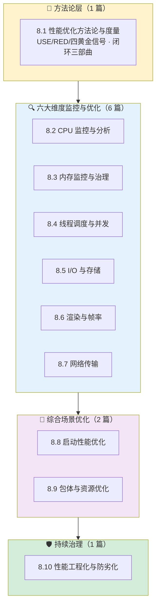
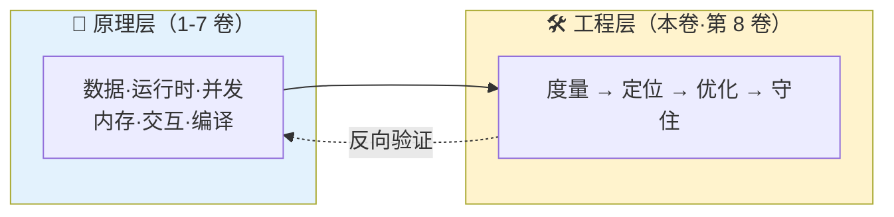

# 第 8 卷｜性能的优化之道

> **核心命题**：前七卷讲的是"程序是怎么运行的、为什么这样设计"——那是一张**地图**；这一卷讲的是"程序怎么跑得更好、怎么一直跑得好"——这是**导航系统**。你会写代码，但你能一眼看出一次慢请求的瓶颈在 CPU 还是 I/O？你能让一次冷启动从 3s 砍到 800ms 并守住它不回退吗？你能让一个 60fps 的页面在 p99 下也不掉帧吗？——这一整卷讲的，就是把前七卷的**原理**转译为**可度量、可定位、可持续守住**的工程手段。

---

## 一、这一卷要回答什么

工程里 90% 的"性能问题"，不是写不出来，而是**看不见、测不准、找不到、守不住**。你也许都经历过：

- 服务 QPS 下跌 30%，监控面板一片绿，**没人能说清究竟是 CPU 慢了、GC 变凶了，还是上游 RT 抖了**？
- 一个列表页在新机器上流畅、旧机器掉帧——**平均 60fps 的指标为什么没告诉你 1% low 掉到了 25fps**？
- OOM 排查 3 天拉了 20 份 Heap Dump，还是不敢上线修复——**到底是真泄漏，还是业务高峰下的"合理增长"**？
- 冷启动优化做了半年，上线一个月又回到起点——**没有防劣化机制，所有优化都是一次性的**。
- 弱网下 App 转圈，运维说"服务器 RT 没抖"——**到底是 DNS 慢、TCP 慢、TLS 慢，还是业务慢**？

这一卷不只是教你"用哪个 Profiler"，而是带你看见：**每一类性能问题，背后都有一套"指标 → 工具 → 定位方法 → 治理动作 → 防回退机制"的完整闭环**。看懂这个闭环，面对任何陌生系统你都能开动"性能雷达"，而不是靠经验撞运气。

---

## 二、这一卷与前七卷的根本区别

> **一句话**：前七卷讲 "**是什么、为什么**"；这一卷讲 "**怎么看见它、怎么量化它、怎么守住它**"。

| 维度 | 前七卷（1-7 卷） | 本卷（第 8 卷） |
|------|-----------------|---------------|
| **问题视角** | 原理视角：这个机制是怎么运作的 | 工程视角：这个机制在生产环境出问题了怎么办 |
| **知识形态** | 概念 + 设计 + 跨语言实现 | 指标 + 工具 + 定位路径 + 治理策略 |
| **成功判据** | "我理解了为什么是这样" | "我能把这个指标从 X 优化到 Y，并且 3 个月不回退" |
| **典型产出** | 一张设计图、一张跨语言对照表 | 一张监控大盘、一条 CI 卡口、一个 SLO |

**本卷不重复**：
- 不重讲 GC 算法细节（在 4.5），只讲"**如何用分配率/停顿时间/驻留集这些指标，把 GC 问题变成可测量的工程问题**"。
- 不重讲协程/线程池设计（在 3.13 / 3.15-3.17），只讲"**线程泄漏、锁竞争、队列堆积在生产上怎么发现与治理**"。
- 不重讲 GPU 管线（在 5.3），只讲"**jank/FPS/1% low 怎么定义与采集、掉帧四因如何定位、滑动流畅度如何守住**"。
- 不重讲 TCP/HTTP 的历史（本卷聚焦工程），只讲"**RTT 预算怎么分配、连接复用能省多少、弱网下三种策略怎么选**"。

---

## 三、学完你能回答

- **方法论侧**：USE / RED / 四黄金信号到底在量什么？为什么说"平均值是最大的骗子"？
- **CPU 侧**：火焰图的"宽度"真的代表耗时吗？采样 vs instrumentation 的误差来自哪里？`perf` / `pprof` / `Async Profiler` / `Instruments` 的采样原理有什么本质差异？
- **内存侧**：GC 频繁但堆不大，到底是什么在"分配风暴"？Soft/Weak 引用做缓存为什么还会 OOM？驻留集（RSS）和堆（Heap）的差值去哪了？
- **线程侧**：线程泄漏在生产环境怎么只用一行命令发现？锁竞争用什么指标量化？"优先级倒置"真实世界的样子是什么？
- **I/O 侧**：为什么一次 fsync 的代价能是普通 write 的 1000 倍？`O_DIRECT` / mmap / sendfile / io_uring 分别适合什么场景？数据库慢查询的本质是不是 I/O 问题？
- **渲染侧**：p99 掉帧为什么比平均 FPS 更能反映"卡顿感"？Choreographer / CADisplayLink / rAF 回调里的时间戳具体代表什么时刻？过度绘制的真正成本在哪一级？
- **网络侧**：一次首屏请求的"800ms"里，DNS 占多少、TCP 握手占多少、TLS 占多少？HTTP/2 的多路复用解决了什么又带来了什么新问题？弱网下为什么应该优先优化"重试策略"而不是"带宽"？
- **启动侧**：启动是"所有性能的综合题"——类加载、链接、I/O、渲染全部在抢同一段时间，怎么找到真正该砍的那 20%？
- **包体侧**：为什么 Tree Shaking 对动态语言几乎无效？资源拆分、懒加载、按需加载的边界在哪？
- **工程化侧**：怎么从"每次都靠英雄救火"变成"每次回归都被 CI 挡住"？SLO 和告警阈值到底谁决定谁？

---

## 四、卷内脉络



**四段递进**：
1. **先立"看见的能力"**：没有度量就没有优化（8.1）。
2. **再练"维度拆解"**：把一次慢投影到 6 大维度，各个击破（8.2-8.7）。
3. **再过"综合场景"**：启动与包体是把六维合在一起考——真正的高级场（8.8-8.9）。
4. **最后建"持续治理"**：优化不是一次性的，要靠工程体系守住（8.10）。

---

## 五、章节速览

### 📏 方法论篇

| # | 文档 | 关键问题 |
|---|---|---|
| 8.1 | [性能优化方法论与度量](./01.性能优化方法论与度量.md) | 优化三步法（观测→分析→行动）；USE / RED / 四黄金信号；为什么"平均值是最大的骗子"（p50/p95/p99/1%low）；指标金字塔（业务→应用→系统→硬件）；SLI/SLO 心智 |

### 🔍 六大维度篇

| # | 文档 | 关键问题 | 跨平台覆盖 |
|---|---|---|---|
| 8.2 | [CPU 监控与分析优化](./02.CPU监控与分析优化.md) | 采样 vs instrumentation；火焰图的读法与误读；user/sys/iowait/steal 真实含义；热点函数定位；SIMD / 分支预测 / 循环展开的工程边界 | perf / pprof / Async Profiler / JFR / Instruments / VTune / Chrome DevTools |
| 8.3 | [内存监控与治理](./03.内存监控与治理.md) | 分配率、驻留集、GC 停顿；堆内 vs 堆外 vs RSS；缓存设计（LRU/LFU/W-TinyLFU）；对象池的适用边界；OOM 应急三板斧 | MAT / JFR / pprof / Instruments / LeakCanary / Chrome Memory / tracemalloc |
| 8.4 | [线程调度与并发性能优化](./04.线程调度与并发性能优化.md) | 线程泄漏发现路径；锁竞争量化（contention / wait time）；上下文切换成本；优先级倒置；池化与 QoS；无锁与分片的真实收益 | top -H / jstack / perf sched / pprof block|mutex / Instruments Time Profiler |
| 8.5 | [I/O 与存储性能优化](./05.I_O与存储性能优化.md) | 顺序 vs 随机、同步 vs 异步、批量 vs 流式；page cache / direct I/O / mmap / sendfile / io_uring；WAL 与 fsync；DB 慢查询本质 | iostat / blktrace / strace / eBPF / MySQL EXPLAIN / Instruments File Activity |
| 8.6 | [渲染与帧率卡顿优化](./06.渲染与帧率卡顿优化.md) | FPS / jank / p99 掉帧的工程定义；掉帧四因（CPU 录制 / GPU fillrate / VSync 错过 / 合成卡）；滑动流畅度；长列表与动画治理 | Android GPU Profiler / Systrace / Perfetto / iOS Instruments Core Animation / Chrome Performance / Flutter DevTools |
| 8.7 | [网络传输性能优化](./07.网络传输性能优化.md) | RTT 预算分配；DNS / TCP / TLS / HTTP(2/3) 握手代价；连接复用、合并请求、预热；弱网三策略（重试退避 / 优雅降级 / 预取） | Chrome DevTools / Charles / Wireshark / tcpdump / netperf / curl --trace-time |
| 8.8 | [启动性能优化](./08.启动性能优化.md) | 启动的"路径综合题"：类加载 + 链接 + I/O + 渲染全部抢时；首屏 vs TTI vs 可交互；懒加载边界；AOT/预热/快照 | Android Startup / iOS os_signpost / 冷启动埋点 / Baseline Profiles / React Native Hermes 字节码预编译 |
| 8.9 | [包体与资源优化](./09.包体与资源优化.md) | 冗余四根源：代码 / 资源 / 依赖 / 元数据；Tree Shaking 的边界；按需加载与分片；混淆压缩与符号精简；多语言拆包 | R8/ProGuard / Rollup/esbuild / webpack bundle analyzer / Bitcode / App Thinning |
| 8.10 | [性能工程化与防劣化](./10.性能工程化与防劣化.md) | SLI/SLO/错误预算；性能基线 + CI 卡口；A/B 实验分流；灰度与一键回滚；监控大盘与告警降噪；从"救火"到"防火" | Prometheus / Grafana / OpenTelemetry / Perfetto / Firebase Performance / Sentry |

---

## 六、与其他卷的位置关系



- **与第 3 卷并发**：8.4 线程优化是把"锁 / CAS / 协程 / 线程池"换成生产可观测的 contention / wait time / block profile。
- **与第 4 卷内存**：8.3 内存治理把"虚拟内存 / GC / 引用 / 泄漏诊断原理"落到真实的分配率、停顿时间、驻留集治理。
- **与第 5 卷交互**：8.6 渲染优化把"渲染管线 / 合成器"落到帧率 / jank / 1% low 的生产度量。
- **与第 7 卷编译链接**：8.8 启动与 8.9 包体直接复用"链接、符号、ABI"的知识做启动路径分析与裁剪。

> **本卷不替代** APM 产品手册、也不讲具体 SRE 流程——那是《Site Reliability Engineering》与各家 APM 的地盘。本卷只讲**跨语言、跨端通用的"性能看见与守住的方法论"**。

---

## 七、贯穿这一卷的三对矛盾

| 矛盾 | 一端 | 另一端 | 谁在做取舍 |
|------|------|--------|-----------|
| **度量精度 vs 开销** | 全采样精确，但对系统干扰大 | 低频采样低开销，但有盲区 | pprof 定时 10ms ↔ instrumentation 全埋点 |
| **延迟 vs 吞吐** | 低延迟（p99 砍到 50ms） | 高吞吐（QPS 翻倍） | 实时系统 ↔ 批处理 |
| **一次性优化 vs 持续守住** | 冲一波数据漂亮，但 3 个月后回退 | 慢工细活，但 CI 卡口永不回退 | 救火文化 ↔ 工程化文化 |

**看清这三对矛盾，本卷就有了认知骨架——任何性能动作，都是在这三对天平上重新称重**。

---

## 八、三条阅读路径

> 不建议所有人从头读到尾——按角色选路径，吸收率提升 5 倍。

### 🟢 应用开发路径（看见代码的性能）
```
8.1 方法论 → 8.2 CPU → 8.3 内存 → 8.6 渲染 → 8.8 启动
```

### 🟡 服务端路径（看见服务的性能）
```
8.1 方法论 → 8.2 CPU → 8.3 内存 → 8.4 线程 → 8.5 I/O → 8.7 网络 → 8.10 工程化
```

### 🔴 架构师 / Tech Lead 路径（看见体系的性能）
```
8.1 方法论 → 8.10 工程化 → 8.8 启动 → 8.9 包体 → 回头精读 6 大维度
```

---

## 九、每篇遵循的"九段式"（与前七卷一致）

```text
📖 统一篇章结构
━━━━━━━━━━━━━━━━━━━━━━━━━━━━━━━━━━━━━
0️⃣  §00 真实事故引入
      一次真实的"看不见、找不到、守不住"的事故
      引出灵魂三问 + 五个递进追问 + 探索路径

1️⃣  §01 根本矛盾与度量心智
      这类性能问题的根本矛盾是什么
      关键指标体系与"看见"的方法

2️⃣  §02-§05 诊断原理 + 工具原理 + 优化策略
      采样 / 埋点 / 可观测的工程原理
      常用工具的内部机制（不是用法！）
      优化策略从"治标"到"治本"

3️⃣  §06 跨平台 / 跨端工具矩阵
      JVM / Native / Web / 移动端 / 后端服务 的横向对照

4️⃣  §07 经典陷阱与反模式
      7 大常见反模式（过早优化、指标误读、治标不治本…）

5️⃣  §08 综合案例串讲
      一次完整的"从告警 → 定位 → 修复 → 回归验证 → 防回退"全过程

6️⃣  §09 一句话总结 + 七字真言 + 延伸阅读
      三层认知阶梯 + 本卷内链 + 跨卷联动
━━━━━━━━━━━━━━━━━━━━━━━━━━━━━━━━━━━━━
```

---

## 十、阅读建议

- **通读**：按 8.1 → 8.10 顺序，每篇 1.5-2 小时。
- **围猎**：只想解决具体问题？
  - "服务 CPU 飙高找不到热点" → 直奔 8.2
  - "App 冷启动慢" → 直奔 8.8
  - "列表滑动卡顿" → 直奔 8.6
  - "弱网下首屏慢" → 直奔 8.7
  - "优化上线一个月就回退" → 直奔 8.10
- **对照**：读完本卷，回头再看第 3 卷并发、第 4 卷内存、第 5 卷交互，会有"**从原理到工程两头对上**"的通透感。

---

## 十一、一句话总结

> **"看见"决定你能不能开始优化；"量化"决定你能不能收敛优化；"卡口"决定你的优化能不能守住。**
> 性能优化不是一门"玄学"，而是一门有指标、有工具、有闭环、有防线的**工程学科**——这一卷讲的，就是把前七卷的原理，变成你每天上班能用、能守、能传承的"工程肌肉记忆"。
