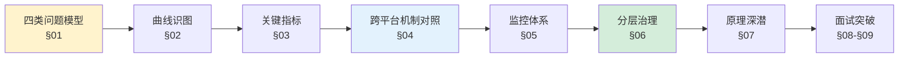
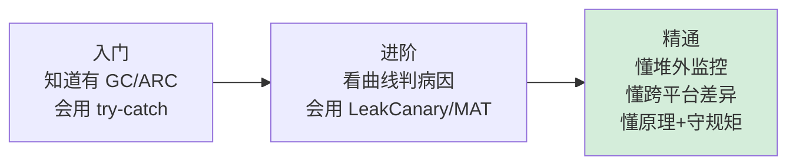

# 3.内存监控与治理

> 📍 **本篇位置**：第 8 卷 · 性能的优化之道 · 第 3 篇
> 🎯 **核心矛盾**：**GC ≠ 没内存问题**——现代内存问题比 malloc/free 时代**更隐蔽**：分配风暴、驻留集爆、缓存失控、堆外泄漏、LRU 失守。工具越多、盲区越细。
> 📌 **综合案例投影（战役 3）**：YC 商城大促前体检，端云两条线同时亮红灯——Android 低端机 OOM 率 **8.3%**（2GB 机型差评重灾区），服务端订单 JVM "**每天凌晨 1 点准时 OOM 重启**"。端上救火队用 LeakCanary + KOOM 治理泄漏/抖动/溢出；服务端 Heap Dump **找不到泄漏对象**——真相是 **Netty Direct Buffer 没 release**，堆内平稳、RSS 一路从 2GB 涨到 8GB 碰顶。端云两线收官：**端上 OOM 8.3% → 0.4%，服务端 RSS 8GB → 3GB 稳定不涨 12 周**。
> 🌐 **跨平台覆盖**：服务端 JVM（MAT · JFR · NMT）· Go（pprof heap · runtime/metrics）· Node（heap snapshot · --inspect）· Android（LeakCanary · KOOM · Matrix）· iOS（**ARC** · Instruments Leaks · MLeaksFinder）
> 🔗 **延伸阅读**：← [4.5 内存回收机制设计](https://yccoding.com/pages/8327cf/) · ← [4.6 多种引用技术设计](https://yccoding.com/pages/9ff724/) · ← [4.7 内存泄漏与诊断原理](https://yccoding.com/pages/7c795f/) · → [8.4 线程调度与并发性能优化](./04.线程调度与并发性能优化.md)
> 🧠 **一句话心法**：**堆看着没问题，RSS 可能已经爆了**。

---

> 第 4 卷讲了"**内存怎么回收**"（算法层）、"**引用怎么分级**"（语义层）、"**泄漏怎么诊断**"（原理层）——那是**地图**。
>
> 本篇讲**导航**：生产环境里一个真实的 OOM 从告警到定位到修复到守住，**究竟发生了什么**？为什么 Java 工程师用的 LeakCanary 换到 iOS 工程师手里几乎没用？为什么服务端的"RSS 偷涨"永远不会出现在 Heap Dump 里？为什么 10 年前的内存优化口诀"少 new 对象"在今天的分代 GC 和 TLAB 面前完全失灵？
>
> 这些问题的答案都藏在**指标 + 工具 + 治理动作 + 防回退机制**这条闭环里，本篇把它一次讲透。

#### 目录介绍
- [00.真实事故引入](#00真实事故引入)
  - [0.1 端：Android凌晨差评](#01-androidapp凌晨差评)
  - [0.2 云：订单服务定点崩](#02-订单服务定点崩)
  - [0.3 灵魂三问](#03-灵魂三问)
  - [0.4 五个递进追问](#04-五个递进追问)
  - [0.5 探索路径](#05-探索路径)
- [01.内存问题四类模型](#01内存问题四类模型)
  - [1.1 四类问题全景](#11-四类问题全景)
  - [1.2 三态生命周期](#12-三态生命周期)
  - [1.3 稳定大于低占用](#13-稳定大于低占用)
  - [1.4 面试锚点](#14-面试锚点)
- [02.曲线即病因](#02曲线即病因)
  - [2.1 五种曲线形态](#21-五种曲线形态)
  - [2.2 锯齿波数学模型](#22-锯齿波数学模型)
  - [2.3 稳态内存推演](#23-稳态内存推演)
  - [2.4 面试锚点](#24-面试锚点)
- [03.关键指标体系](#03关键指标体系)
  - [3.1 VSS/RSS/PSS/USS](#31-vssrsspssuss)
  - [3.2 分配率是隐形杀手](#32-分配率是隐形杀手)
  - [3.3 Promotion与Live Set](#33-promotion与live-set)
  - [3.4 GC停顿分布](#34-gc停顿分布)
  - [3.5 Allocation Stall](#35-allocation-stall)
  - [3.6 面试锚点](#36-面试锚点)
- [04.跨平台机制对照](#04跨平台机制对照)
  - [4.1 五平台矩阵](#41-五平台矩阵)
  - [4.2 GC与ARC本质差异](#42-gc与arc本质差异)
  - [4.3 五端图片缓存对照](#43-五端图片缓存对照)
  - [4.4 YC商城两线复盘](#44-yc商城两线复盘)
  - [4.5 面试锚点](#45-面试锚点)
- [05.监控体系四类采集](#05监控体系四类采集)
  - [5.1 四类采集方案](#51-四类采集方案)
  - [5.2 LeakCanary原理](#52-leakcanary原理)
  - [5.3 KOOM线上化方案](#53-koom线上化方案)
  - [5.4 堆外监控三板斧](#54-堆外监控三板斧)
  - [5.5 工具矩阵全景](#55-工具矩阵全景)
- [06.分层治理方案](#06分层治理方案)
  - [6.1 第一层泄漏](#61-第一层泄漏)
  - [6.2 第二层抖动](#62-第二层抖动)
  - [6.3 第三层溢出](#63-第三层溢出)
  - [6.4 第四层堆外](#64-第四层堆外)
  - [6.5 第五层兜底](#65-第五层兜底)
  - [6.6 对象池三条件法则](#66-对象池三条件法则)
  - [6.7 ROI执行顺序](#67-roi执行顺序)
- [07.原理深潜](#07原理深潜)
  - [7.1 GC算法演进史](#71-gc算法演进史)
  - [7.2 三色标记与SATB](#72-三色标记与satb)
  - [7.3 TLAB零成本分配](#73-tlab零成本分配)
  - [7.4 四种引用再审视](#74-四种引用再审视)
  - [7.5 NativeAllocation机制](#75-nativeallocation机制)
  - [7.6 PSS计算公式](#76-pss计算公式)
- [08.面试高频追问](#08面试高频追问)
  - [8.1 占用越小越好吗](#81-占用越小越好吗)
  - [8.2 弱引用能防泄漏吗](#82-弱引用能防泄漏吗)
  - [8.3 largeHeap真有用吗](#83-largeheap真有用吗)
  - [8.4 地址空间OOM](#84-地址空间oom)
  - [8.5 catch OOM陷阱](#85-catch-oom陷阱)
  - [8.6 iOS没GC问题吗](#86-ios没gc问题吗)
  - [8.7 对象池误用](#87-对象池误用)
  - [8.8 LeakCanary盲区](#88-leakcanary盲区)
  - [8.9 Finalize反模式](#89-finalize反模式)
  - [8.10 ThreadLocal泄漏](#810-threadlocal泄漏)
  - [8.11 跨平台内存排查](#811-跨平台内存排查)
- [09.模拟面试模板](#09模拟面试模板)
  - [9.1 90秒电梯答案](#91-90秒电梯答案)
  - [9.2 OOM排查流程](#92-oom排查流程)
  - [9.3 线上内存监控](#93-线上内存监控)
  - [9.4 一次内存优化经历](#94-一次内存优化经历)
  - [9.5 GC与ARC优化差异](#95-gc与arc优化差异)
- [10.总结与承接](#10总结与承接)
  - [10.1 三层认知阶梯](#101-三层认知阶梯)
  - [10.2 内存决策树](#102-内存决策树)
  - [10.3 七字真言](#103-七字真言)
  - [10.4 与下篇承接](#104-与下篇承接)

---

## 00.真实事故引入

### 0.1 端：Android App 凌晨差评

大促体检第 2 周，Android 团队的日报出现一行红字：

```
2GB 内存设备 OOM 率：     8.3%
2GB 内存设备崩溃率：      1.2%
2GB 用户差评关键词：    "闪退"、"打开就卡"、"图片转圈崩溃"
2GB 用户 7 日留存：      -22%（对比 4GB 机型）
```

**产品经理**（在值班群）：

> "低端机占用户 35%、GMV 的 18%，不能放弃。这周必须给个说法。"

我被拉进救火组，第一反应是先看现场。连 adb 看一个样本设备的内存曲线：

```
内存 (MB)
500 ┤                                      ╭──  ← 第 23 张图加载后 OOM
450 ┤                              ╭──────╯
400 ┤                      ╭──────╯
350 ┤              ╭──────╯
300 ┤      ╭──────╯
250 ┤──────╯
     └────────────────────────────▶ 时间
     滑动 1 张    5 张    10 张   15 张   20 张    崩
```

每滑一张图，内存涨 **5-15MB，再也不降**——教科书式的单调上升曲线。但 LeakCanary 在 Debug 包里跑了一天，只报出 2 个 Activity 泄漏，修完 OOM 率只降到 7.1%。**工具显示"干净"了，但 OOM 还在继续**。

这是本篇的**第一个灵魂拷问**：**工具没发现，不代表没泄漏**。

### 0.2 云：订单服务定点崩

与此同时，服务端订单服务也在爆雷。SRE 把半夜的监控截图发到群里：

```
00:00  JVM 启动，Java heap 2.1 GB，RSS 2.5 GB
08:00  业务高峰，Java heap 波动 2.5-3.5 GB，RSS 4.1 GB
20:00  Java heap 稳定 2.8 GB，RSS 6.2 GB ⚠️
23:00  Java heap 稳定 2.9 GB，RSS 7.4 GB ⚠️⚠️
00:40  Java heap 稳定 3.0 GB，RSS 8.0 GB → OOM Kill → 重启
```

开发同事（抓耳挠腮）：

> "Java heap 一直稳的啊，为什么会 OOM？我 jmap -heap 看，Old Gen 利用率才 60%。"

我接过来一看，一个数字跳出来：**RSS 8GB，Java Heap 3GB——那 5GB 去哪了**？

jmap 看不到。MAT 分析了 2 份 Heap Dump，没有一个"异常大"的对象。LeakCanary 这类工具是**不存在**于服务端 JVM 的。

这是本篇的**第二个灵魂拷问**：**Java 堆没变大，为什么还会 OOM**？

### 0.3 灵魂三问

**Q1：有 GC 为什么还会泄漏？** —— 存活语义之惑

> **直觉**：GC 会自动回收不用的对象。
>
> **真相**：GC 只回收"**不可达**"对象。只要还有一条强引用链连着 GC Root，对象就"永生"。而业务代码里持有强引用的方式**比你想象的多 10 倍**——静态容器、监听器、ThreadLocal、Handler 消息队列、匿名内部类的 `this$0`、协程 Job、单例、池化线程里的局部变量……

**Q2：Java 堆没变大为什么 OOM？** —— 堆外之惑

> **直觉**：Java 内存 = 堆。
>
> **真相**：Java 堆只是**冰山一角**。一个 JVM 进程的 RSS = Java heap + Metaspace + Code Cache + Direct Buffer + mmap + JNI malloc + 线程栈 + GC 结构 + ...。**除了 Java heap 以外的所有部分，jmap 都看不到**。生产环境里 50% 的"内存消失"案例最后都定位到堆外。

**Q3：LRU 加了为什么还击穿？** —— 缓存之惑

> **直觉**：加个 LRU 上限，缓存就安全了。
>
> **真相**：LRU 只保证"**淘汰策略**"，不保证"**内存上限**"——如果你的 `sizeOf()` 实现错了（如用对象数量而不是字节数），或者 Value 持有巨大引用树（如 Activity），上限就是摆设。而且 Android 的 Soft/Weak 引用做缓存几乎都是坑（见 §8.2）。

### 0.4 五个递进追问

从三个"直觉陷阱"再往下追 5 步，就是本篇要彻底回答的问题：

1. 内存问题到底有几类？能不能像"三态模型"那样穷举完？
2. 怎么**一眼看曲线就说出病因**？曲线形状到底是不是随机的？
3. VSZ / RSS / PSS / USS、Heap / Live Set / Allocation Rate……这些指标到底在量什么？分别用在什么场景？
4. 为什么 Android 的 LeakCanary 到了 iOS、服务端、Go 全部要换工具？**跨平台的本质差异是什么**？
5. 修完之后，怎么**守住**不回退？

### 0.5 探索路径



---

## 01.内存问题四类模型

### 1.1 四类问题全景

把过去 5 年我在服务端和移动端遇到的内存事故归类，去重去伪，**只剩四种独立病灶**：

```
┌─────────────────────────────────────────────────────────┐
│ ① 抖动（Churn）                                           │
│    现象：GC 频繁 STW，CPU 升高，掉帧 / RT 抖动            │
│    根因：分配率过高（> 10 MB/s）                           │
│    曲线：锯齿状                                            │
│    典型：onDraw 内 new / 热点循环内创建临时对象            │
├─────────────────────────────────────────────────────────┤
│ ② 泄漏（Leak）                                            │
│    现象：内存只升不降，最终 OOM                            │
│    根因：对象活得太久，GC 回收不了                         │
│    曲线：单调上升                                          │
│    典型：静态容器 / 监听器未反注册 / ThreadLocal 未清       │
├─────────────────────────────────────────────────────────┤
│ ③ 溢出（OOM）                                            │
│    现象：单次或累积爆堆，进程崩溃                           │
│    根因：单对象过大 或 累积超限                             │
│    曲线：尖峰 或 阶梯堆积                                   │
│    典型：大 Bitmap / 大 JSON / 无界缓存                     │
├─────────────────────────────────────────────────────────┤
│ ④ 堆外（Off-heap）                                        │
│    现象：Java heap 平稳，但 RSS 持续增长                   │
│    根因：Direct Buffer / mmap / JNI malloc 未释放           │
│    曲线：堆平 + RSS 涨 ⚠️                                   │
│    典型：Netty 没 release / NIO FileChannel 没 close        │
└─────────────────────────────────────────────────────────┘
```

**为什么是四类而不是三类**？经典教材里常讲"**抖动 / 泄漏 / 溢出**"三类，但那是**单堆时代**的分法。现代运行时普遍有：

- **堆外内存**（Java Direct Buffer、Go cgo malloc、Node Buffer、Android Bitmap pixel）
- **GPU 显存**（HardwareBitmap、WebView、OpenGL 纹理）
- **元空间 / Code Cache**（Metaspace、JIT 编译代码缓存）

这些都在 Java heap 之外，但都会撑爆 RSS 导致进程被 OOM Kill。所以"**堆外**"必须单独立为一类——它需要独立的工具（NMT、jemalloc profile、pprof heap）、独立的 API（显式 release、Cleaner、PhantomReference）、独立的监控（RSS vs Heap 的差值告警）。

### 1.2 三态生命周期

四类问题可以进一步抽象到**对象的三态生命周期**：

```
   分配 ──▶ 使用 ──▶ 不可达 ──▶ 回收
    │       │         │          │
    ▼       ▼         ▼          ▼
   过快   过久      不彻底      延迟
    ↓      ↓         ↓          ↓
   抖动   泄漏      堆外        溢出
```

**本质定义**：

> **内存性能 = 对象的"生 / 存 / 死"与业务时间窗口的对齐程度**。

- 对象分配**过快** → 抖动（分配速率 > 回收速率）
- 对象存活**过久** → 泄漏（生命周期 > 业务窗口）
- 对象回收**不彻底** → 堆外（Java 层已死，但 Native 芯还在）
- 对象占用**过大或累积超限** → 溢出（单次或累积 > 预算）

**这个抽象的三个工程价值**：

1. **跨平台通用**：Android ART GC、iOS ARC、Web V8 GC、Go 并发 GC——底层机制不同，但都在管理"生 / 存 / 死"（见 §04）；
2. **指导归因**：遇到问题先问"**哪个阶段错配**"，比盲目堆砌工具高效 10 倍；
3. **指导治理**：抖动的治法（减少生）、泄漏的治法（缩短存）、溢出的治法（控制峰值）、堆外的治法（显式死），从模型自然导出。

### 1.3 稳定大于低占用

这是全篇**第一条心法**，必须先立起来：

> **稳定 >> 低占用**。

**反直觉对比**：

| 场景 A（低占用但波动） | 场景 B（高占用但稳定） |
|---|---|
| 波动 50-150MB | 稳定 200MB |
| 看似"更省" | 看似"更费" |
| GC 频繁触发（每秒 2-3 次） | GC 很少触发（每分钟 1-2 次） |
| 每次 STW 5-20ms，掉帧 25% | 几乎不掉帧 |
| CPU 多出 10-15% 用于 GC | CPU 用于业务 |
| **用户体验差** | **用户体验好** |

**为什么波动比高占用更差**？因为 GC 的开销**不只是 STW**：

- **扫描成本**：Mark 阶段遍历 GC Root 可达图，对象越多越慢；
- **写屏障成本**：Concurrent GC 期间，每次引用赋值都走 write barrier，拖慢业务代码 3-8%；
- **复制 / 压缩成本**：Moving GC（如 ART CC、G1、ZGC）要搬运存活对象，还要修正所有指针；
- **缓存污染**：GC 遍历堆会污染 CPU 的 L1/L2/L3 cache，业务代码的 cache-miss 率上升。

**工程启示**：

- 内存优化的目标不是"**占用最低**"，而是"**占用稳定在预算内**"；
- 预算怎么定？按设备 RAM 的 30% 为上限（Android 中端机 < 200MB、低端机 < 100MB、服务端按容器 limit × 0.7）；
- "**降低分配率**" 比 "**降低总占用**" 价值高 10 倍——前者消除 GC 频率，后者只省几 MB。

### 1.4 面试锚点

**Q：你怎么理解内存优化？**

**30 秒电梯答案**：

> 内存优化的本质是"**管理对象的生命周期**"。所有问题归为四类——**抖动**（分配率过高导致 GC 频繁）、**泄漏**（对象活得太久）、**溢出**（单次或累积爆堆）、**堆外**（Java 层看不见的 RSS 增长）。目标不是把内存压到最低，而是让对象的"生、存、死"对齐业务时间窗口——**稳定 200MB 远好于波动 50-150MB**，因为波动即频繁 GC，GC 才是掉帧的元凶。

**3 分钟展开版**：电梯答案 + 四类的典型病例 + 自己做过的一次优化（如 YC 商城 OOM 8.3% → 0.4%，具体治理动作：LeakCanary 修 12 处泄漏 + Bitmap 分辨率自适应 + LRU maxMemory/8 + onTrimMemory 分级响应）。

---

## 02.曲线即病因

### 2.1 五种曲线形态

拿到线上监控或 Profiler 的内存曲线，**形状直接告诉你病因**。这是我这几年带新人最喜欢教的一招——**不用工具，看一眼就能猜 80% 的根因**。

```
┌──────────────────────────────────────────────────────┐
│ ① 单调上升型 → 泄漏                                     │
│                                                       │
│    内存                                 ╱ 必崩         │
│     │                            ╱─────╯              │
│     │                     ╱─────╯                     │
│     │             ╱──────╯                            │
│     │     ╱──────╯                                    │
│     │────╯                                            │
│     └──────────────────────────▶ 时间                  │
│    特征：曲线永远不下降                                 │
│    根因：GC Root 持有不该持有的对象                     │
└──────────────────────────────────────────────────────┘

┌──────────────────────────────────────────────────────┐
│ ② 锯齿型 → 抖动                                         │
│                                                       │
│    内存                                                │
│     │  ╱╲ ╱╲ ╱╲ ╱╲ ╱╲                                 │
│     │ ╱  ╲╱  ╲╱  ╲╱  ╲╱  ╲                            │
│     │╱                                                │
│     └──────────────────────────▶ 时间                  │
│    特征：规律性快速上升下降                             │
│    根因：Young GC 频繁，分配速率过高                    │
└──────────────────────────────────────────────────────┘

┌──────────────────────────────────────────────────────┐
│ ③ 尖峰型 → 一次性大对象                                 │
│                                                       │
│    内存              ╱╲                                │
│     │                │ │                              │
│     │────────────────╯ ╰────────                       │
│     └──────────────────────────▶ 时间                  │
│    特征：孤立的高峰，前后平稳                           │
│    根因：大 Bitmap / 大 JSON / 大数组                   │
└──────────────────────────────────────────────────────┘

┌──────────────────────────────────────────────────────┐
│ ④ 阶梯型 → 缓存堆积                                     │
│                                                       │
│    内存                                 _______         │
│     │                        _________╯                │
│     │              __________╯                        │
│     │     _________╯                                  │
│     │_____╯                                           │
│     └──────────────────────────▶ 时间                  │
│    特征：分段上升，最终收敛到稳态                       │
│    根因：LRU/缓存达到容量上限后趋稳                     │
└──────────────────────────────────────────────────────┘

┌──────────────────────────────────────────────────────┐
│ ⑤ 堆平、RSS 涨 → 堆外泄漏 ⚠️                              │
│                                                       │
│    RSS                                                │
│     │                               ╱                 │
│     │                        ╱─────╯                  │
│    Heap │────────────────────────────────  平         │
│     │                                                 │
│     └──────────────────────────▶ 时间                  │
│    特征：Java heap 稳定，RSS 持续增长                   │
│    根因：Direct Buffer / mmap / JNI malloc 泄漏         │
│                                                       │
│    👉 YC 商城服务端订单服务就是这一种                     │
└──────────────────────────────────────────────────────┘
```

**为什么曲线形状能映射病因**？因为每种病因对应一种独特的"**分配 - 回收节奏**"——这是物理必然：

| 节奏 | 曲线 | 对应病因 |
|---|---|---|
| 只分配不回收 | 单调上升 | 泄漏 |
| 分配快-回收快-周而复始 | 锯齿 | 抖动 |
| 一次大分配 | 尖峰 | 大对象 |
| 分配快-回收慢-最终 LRU 淘汰 | 阶梯收敛 | 缓存 |
| Java 层分配/回收正常但 Native 层只分配 | 堆平 RSS 涨 | 堆外 |

**面试加分点**：说出"**曲线形状 ↔ 病因**"的映射关系，比堆砌工具名字高级得多。

### 2.2 锯齿波数学模型

🔬 **深潜**：锯齿波的**周期和振幅**可以用公式精确预测，这个公式面试里拿出来能炸场：

```
GC 周期 T  =  Eden 大小 / 分配速率
GC 振幅 A  =  Eden 大小（填满一次就 GC 一次）
每秒 STW 占比  =  GC 频率 × 单次 STW
                  =  (分配速率 / Eden) × STW
```

**举例**（Pixel 6，Eden ≈ 4MB，Young GC STW ≈ 10ms）：

| 分配速率 | GC 周期 | GC 频率 | 每秒 STW | 用户感知 |
|---|---|---|---|---|
| 1 MB/s | 4 秒 | 0.25 Hz | 2.5 ms | 无感 |
| 5 MB/s | 800 ms | 1.25 Hz | 12.5 ms | 轻微 |
| 10 MB/s | 400 ms | 2.5 Hz | 25 ms | **掉帧** |
| 30 MB/s | 133 ms | 7.5 Hz | 75 ms | **持续卡** |
| 100 MB/s | 40 ms | 25 Hz | 250 ms | **严重卡** |

**反向推演**：

> 如果你的曲线锯齿周期是 2 秒、Eden 是 4MB，那你的分配速率就是 **2 MB/s**——**不需要 Profiler，看曲线就能估**。

**物理意义三层**：

1. **分配速率决定 GC 频率**：Eden 大小是常量（JVM 自适应，但短期稳定），分配越快越快填满；
2. **STW 决定帧预算损失**：16.67ms 是 60fps 帧预算，任何超过都会掉帧；
3. **分代假说的根基**：绝大多数对象在 Young GC 时就死掉，所以 Eden 填满后"幸存者"很少，GC 耗时可控。

### 2.3 稳态内存推演

🔬 **深潜**：阶梯曲线最终会**水平收敛**，这是 LRU 的物理必然：

```
    内存
     │                              _____________ ← 稳态
     │                   __________╯
     │        _______╯
     │  __┘
     │_
     └─────────────────────────────────▶ 时间
       阶段 1：缓存未满，持续增长
       阶段 2：接近 maxSize，淘汰 ≈ 插入
       阶段 3：命中率收敛，内存趋于稳定
```

**公式**：

> **稳态内存 ≈ LRU maxSize × 平均对象大小**

所以：

- 配 LRU `maxSize = maxMemory / 8` 本质是**预算规划**，决定了内存天花板；
- 阶梯爬升过快 → 命中率低（每次都 miss，不断淘汰 + 插入）；
- 阶梯爬升过慢 → 可能缓存失效机制有问题（如 LRU 实际是 FIFO）。

**工程启示**：

- 配 LRU 之前，先估"**稳态内存**"是否在预算内——否则会导致阶梯稳定在超预算位置；
- 阶梯曲线**最健康**，比锯齿好；但如果阶梯稳态值超预算，照样 OOM。

### 2.4 面试锚点

**Q：看一张内存曲线能说出什么？**

**答题模板**（面试里一边画图一边说）：

> 曲线有五种形态：单调上升是**泄漏**，锯齿是**抖动**，尖峰是**一次性大对象**，阶梯收敛是**缓存堆积**，堆平但 RSS 涨是**堆外泄漏**。每种形态对应独特的分配-回收节奏——比如锯齿波的周期可以用 `Eden / 分配速率` 精确算出来，所以**不用 Profiler，看曲线就能估分配速率**。遇到问题我会先看曲线归类，再决定用什么工具——这比盲目开 Profiler 快 10 倍。

---

## 03.关键指标体系

### 3.1 VSS/RSS/PSS/USS

**面试高频**，必须答得清楚：

| 指标 | 全称 | 含义 | 什么时候用它 🧠 |
|---|---|---|---|
| **VSS** | Virtual Set Size | 虚拟地址空间总量 | 判定 32 位 OOM 上限（4GB） |
| **RSS** | Resident Set Size | 物理内存实占（含共享） | 看真实占用（偏高，含共享） |
| **PSS** | Proportional Set Size | 共享按比例分摊 | **线上常规监控**，最常用 |
| **USS** | Unique Set Size | 仅本进程独占 | 评估"杀掉能释放多少" |

**PSS 为什么是"按比例分摊"**？因为多个进程共享同一个物理页（比如 libc.so 的代码段），直接把这页算给某个进程都不公平。PSS 的算法是：**该页被 N 个进程共享 → 每个进程算 1/N 份**。这保证了"**所有进程 PSS 之和 ≈ 系统物理内存使用**"，有全局意义。

**典型诊断用法**：

- `VSS - RSS` 大 → 虚拟地址预留多但未实际使用（正常，mmap 懒加载）
- `RSS - PSS` 大 → 共享库占比高（正常，与其他进程共享 libc / 字体等）
- `PSS - USS` 大 → 共享内存占比高（可能用了 ashmem / 共享映射）
- **RSS 持续涨但 Heap 不涨 → 堆外泄漏**（YC 商城订单服务的真相）

### 3.2 分配率是隐形杀手

生产环境里最被忽视的指标，就是**分配率**（Allocation Rate）。

**定义**：单位时间内新对象的分配总量，单位 MB/s 或 GB/min。

**为什么它是"隐形杀手"**？因为它**不在 jmap 的默认输出里**，不在 Prometheus 的默认指标里，不在 Activity Monitor 的内存标签页里。它需要你**主动用 JFR / Async Profiler / pprof heap** 才能看到。

**采集方式**：

```bash
# JVM：开 JFR 几秒
jfr snapshot <pid> --duration 10s --path alloc.jfr
# 在 JMC 里打开，Memory → Allocations

# Go：pprof heap
go tool pprof -alloc_objects http://localhost:6060/debug/pprof/heap

# Async Profiler Allocation 模式
./profiler.sh -e alloc -d 10 <pid>
```

**预警阈值**（经验值）：

| 分配率 | 诊断 | 影响 |
|---|---|---|
| < 100 MB/s | 健康 | 无感 |
| 100-500 MB/s | 警告 | 偶发 GC 卡顿 |
| 500 MB/s - 1 GB/s | 危险 | 频繁 Young GC，RT 抖动 |
| > 1 GB/s | 严重 | GC 占用 10%+ CPU |

**YC 商城订单服务的案例**：

```
修复前：Allocation Rate 1.4 GB/s
       → Young GC 频率 15 次/秒
       → GC 占用 CPU 18%
       → RT p99 抖动 150-800ms

修复后：Allocation Rate 180 MB/s
       → Young GC 频率 2 次/秒
       → GC 占用 CPU 3%
       → RT p99 稳定 55-80ms
```

**治理思路**：

1. 找出"分配大户"（JFR 的 Top Allocators 视图）；
2. 消除热点循环内的 new（提到循环外、对象池、原始类型容器）；
3. 消除隐式分配（String.format、Lambda 捕获、boxing）；
4. 换零分配的 API（如 Netty 的 Recycler、Jackson 的 ObjectReader）。

### 3.3 Promotion 与 Live Set

**Promotion Rate**（晋升率）：Young Gen → Old Gen 的对象量 / 时间。

**为什么它比分配率更重要**？因为**真正触发 Full GC 的是 Promotion**。只要晋升不高，Young GC 再频繁也只是"小烦恼"（10ms STW 以内）；Promotion 高了会触发 Old Gen 空间紧张，最终诱发 **Full GC（STW 100ms-10s）**，这才是生产大敌。

**健康分配**（Weak Generational Hypothesis）：

> 95%+ 的对象在 Young GC 时死掉，Promotion Rate 应 < 10% × Allocation Rate。

**异常晋升的三大原因**：

1. **"中等生命周期"对象**（存活几秒到几分钟）——在 Survivor 来回复制 N 次晋升；
2. **Survivor 空间太小**——装不下 Young GC 存活对象，直接晋升；
3. **大对象**——超过阈值直接进 Old Gen（Large Object Space）。

**Live Set**（驻留集）：某时刻真正**存活**的对象总量。

**采集方式**：Full GC 后的 Old Gen 占用 ≈ Live Set（因为垃圾都被清了）。

**Live Set 的工程意义**：

- `maxHeap` 应该 **≥ Live Set × 2`**（给 Young + 临时分配留空间）；
- 如果 `Live Set / maxHeap > 70%`，说明堆太小，GC 会退化成持续颠簸；
- 如果 `Live Set / maxHeap < 20%`，说明堆太大，浪费内存且 Full GC 时间长。

### 3.4 GC 停顿分布

单看"平均 GC 时间"是**典型的平均值陷阱**。生产要看**分布**：

| 分位 | 含义 | 工程行动 |
|---|---|---|
| GC p50 | 一半的 GC 耗时 | 做基线 |
| GC p95 | 偶发 GC | 容忍阈值 |
| **GC p99** | 长尾 GC | **真正影响用户** |
| **GC p999** | 异常 GC | 调优重点 |
| GC max | 最坏情况 | 排查 outlier |

**生产经验值**（低延迟服务）：

| GC 类型 | p99 预算 | 超限后果 |
|---|---|---|
| ZGC Young | < 1 ms | — |
| G1 Young | < 50 ms | RT 轻微抖动 |
| CMS Young | < 100 ms | RT 中度抖动 |
| G1 Mixed | < 200 ms | 可感知卡顿 |
| **Full GC** | **要避免** | **严重卡顿** |

**STW 预算分配法**：

```
假设 SLO: RT p99 < 100ms
       业务代码耗时预算: 70ms
       GC 预算:         30ms
       → 单次 GC p99 应 < 30ms
       → 频率 < 1 次/秒
       → 两者相乘，总 STW 占比 < 3%
```

**超预算怎么办**？

1. 换 GC（CMS → G1 → ZGC）；
2. 调大堆（降 GC 频率，但要注意 Live Set / maxHeap 比例）；
3. 降分配率（根因治理，收益最大）。

### 3.5 Allocation Stall

**最隐蔽的指标**，但 ZGC 时代开始变得重要。

**定义**：业务线程在 `new` 一个对象时，因为 GC 跟不上分配速度，**被迫阻塞等 GC 完成**。

**为什么现代 GC 还会有 Stall**？因为 ZGC / Shenandoah 这类**并发 GC** 的核心承诺是"几乎零 STW"——但当分配速率 > GC 处理速率时，GC 没完成前就得阻塞分配，否则堆会被撑爆。

**采集方式**：

```bash
# ZGC 的日志里
[zgc] Allocation Stall (payment-handler-123): 85.421ms
```

**诊断用法**：

- Allocation Stall > 0 → GC 跟不上分配，**要么降分配率、要么调大堆**；
- Allocation Stall 稳定上升 → GC 严重超载，必须干预。

### 3.6 面试锚点

**Q：RSS 和 Heap 的差去哪了？**

**完整答法**（4 个来源 + 1 个验证手段）：

> RSS 比 Java heap 大的部分，典型来源有：
>
> 1. **Metaspace / Class Metadata**（200MB-1GB）：类元数据，JVM 7 之后从 PermGen 移出；
> 2. **Code Cache**（50-500MB）：JIT 编译的机器码；
> 3. **Direct Buffer / mmap**（无上限）：`ByteBuffer.allocateDirect` / `FileChannel.map`，Netty、Kafka、RocksDB 的常用武器；
> 4. **JNI malloc**（无上限）：Native 代码里 malloc 的内存，JDK 外完全失控；
> 5. **GC 元数据 + 线程栈**（约 1MB × 线程数）。
>
> 验证手段：**JVM 开 NMT**（`-XX:NativeMemoryTracking=detail`）+ `jcmd <pid> VM.native_memory detail`，能分字段看每一块。YC 商城订单服务那次就是 NMT 定位到 Direct Buffer 占了 4.8GB。

---

## 04.跨平台机制对照

> 本节是全卷统一的"跨平台"主线，看看同一个"内存泄漏"问题在五个主流平台的**机制 / 工具 / 坑点**长什么样——以及**为什么不同**。

### 4.1 五平台矩阵

| 平台 | 管理机制 | 泄漏典型长相 | 主战工具 | 监控盲区 |
|---|---|---|---|---|
| **服务端 JVM** | 分代 GC（可达性） | 静态容器 / ThreadLocal / Direct Buffer | MAT · JFR · NMT · Async Profiler alloc | Direct Buffer（需 NMT） |
| **Go** | 并发三色 GC | Goroutine 持引用 / 全局 map / Cgo | pprof heap · runtime/metrics | Cgo 分配（需 jemalloc） |
| **Node** | V8 GC（分代） | 闭包捕获 / 全局缓存 / 定时器未清 | Heap Snapshot · --inspect | Buffer（堆外） |
| **Android** | ART GC + Native | Context 泄漏 / Bitmap pixel | LeakCanary · KOOM · Perfetto | Native / GPU 显存 |
| **iOS** | **ARC 引用计数** | **循环引用（Block 捕获 self）** | MLeaksFinder · Instruments Leaks | CoreFoundation / Core Graphics |

**五个平台看起来各不相同，但本质都是在管理"生 / 存 / 死"三态**——只是**生死判定的物理机制**不同。这就是接下来要讲的核心差异。

### 4.2 GC 与 ARC 本质差异

🔬 **深潜**：**GC vs ARC 的头号差别**，不是性能，是"**能不能发现环**"。

**GC 的可达性判定**：

```
从 GC Root 出发做 BFS/DFS
    ↓
标记所有能到达的对象（活）
    ↓
未标记 = 不可达 = 回收

→ 环状引用（A → B → A）不是问题：
   只要 GC Root 到不了这个环，就能整体回收
```

**ARC 的引用计数**：

```
对象的 retain count：
    有一个引用 → +1
    引用消失 → -1
    count == 0 → 立刻 dealloc

→ 环状引用（A.strong_ref = B, B.strong_ref = A）是致命的：
   即使外部已经没人引用，A/B 的 count 永远 ≥ 1
   → 永远不释放 = 泄漏
```

**所以 iOS 的头号敌人是 Retain Cycle**（循环引用）：

```swift
// ❌ 经典循环引用：Block 捕获 self
class ViewController: UIViewController {
    var completion: (() -> Void)?

    override func viewDidLoad() {
        super.viewDidLoad()
        networkClient.fetchData { response in
            self.update(response)   // ← 隐式强捕获 self
        }
        // networkClient 持有 Block
        // Block 持有 self
        // self 持有 networkClient（间接通过 Owner）
        // → 环！
    }
}

// ✅ 显式弱引用打断环
networkClient.fetchData { [weak self] response in
    self?.update(response)
}
```

**Android / Java 的头号敌人则是 GC Root 持有不该持有的对象**：

```kotlin
// ❌ 静态单例持 Activity Context
object SingletonManager {
    private var context: Context? = null
    fun init(context: Context) { this.context = context }
}
// Activity 退出后，SingletonManager（类对象 = GC Root）
// 仍强引用 Activity → Activity 不可能被回收 → 泄漏

// ✅ 永远用 ApplicationContext
SingletonManager.init(context.applicationContext)
```

**对比总结**：

| 维度 | GC 语言 | ARC 语言 |
|---|---|---|
| 回收时机 | GC 周期（Young/Full） | 引用计数归零时立刻 |
| 回收延迟 | 不确定（可能几秒） | 确定（立刻） |
| 环状引用 | 自动处理 | **必须手动 weak** |
| 头号敌人 | GC Root 持有过多 | Retain Cycle |
| 运行时开销 | GC 周期性消耗 | 每次引用 +1/-1（约 2-5%） |
| 内存碎片 | Moving GC 可整理 | 碎片易累积 |

**工程启示**：

- **从 Java 转 iOS 的工程师**：第一天必须记住"**Block 捕获 self 必 weak**"，这个坑 GC 语言完全不存在；
- **从 iOS 转 Java 的工程师**：第一天必须记住"**静态字段持 Context 必泄漏**"，这个坑 ARC 语言完全不存在；
- **跨平台 App 架构师**：共享业务层（Kotlin Multiplatform / React Native）必须同时处理两套陷阱。

### 4.3 五端图片缓存对照

**同一个需求——"图片 LRU 缓存"——五个平台的实现各有不同、坑点各异**：

| 平台 | 推荐方案 | 响应内存压力 | 独有坑 |
|---|---|---|---|
| **Android** | `LruCache` + Glide | ❌ 需手动响应 onTrimMemory | 不响应就 OOM |
| **iOS** | **`NSCache`** | ✅ 自动响应内存警告 | 删除时机不确定 |
| **Web** | lru-cache | ❌ 浏览器不通知内存压力 | V8 GC 跟不上 |
| **JVM 服务端** | Caffeine | ✅ 配 weakValues/softValues | SoftReference 时机不可控 |
| **Go** | bigcache / ristretto | ❌ 需显式配容量 | 大 KV 的拷贝开销 |

**NSCache 为什么特殊**？因为它是**唯一一个会主动响应系统内存压力的缓存**：

```swift
// NSCache 的隐藏能力
let cache = NSCache<NSString, UIImage>()
cache.countLimit = 100          // 数量上限
cache.totalCostLimit = 50_000_000  // 字节上限
// → 当系统内存紧张时，NSCache 会自动清理

// 对比 Android LruCache：
val cache = LruCache<String, Bitmap>(maxSize)
// → 内存压力来了也不会主动清，必须接 onTrimMemory 手动 trimToSize
```

**启示**：移动端跨平台开发时，**不能直接把 iOS 的 NSCache 用法套到 Android LruCache 上**——Android 必须额外写 onTrimMemory 响应代码：

```kotlin
override fun onTrimMemory(level: Int) {
    when (level) {
        TRIM_MEMORY_RUNNING_MODERATE -> imageCache.trimToSize(imageCache.maxSize() / 2)
        TRIM_MEMORY_RUNNING_LOW -> imageCache.trimToSize(imageCache.maxSize() / 4)
        TRIM_MEMORY_RUNNING_CRITICAL -> imageCache.evictAll()
    }
}
```

### 4.4 YC 商城两线复盘

**同一周内，YC 商城端云两场内存战役的排查路径对照**——这是本篇最重要的实战案例，也是跨平台视角的最佳样本：

```mermaid
flowchart TB
    subgraph 端["📱 Android 端：OOM 率 8.3%"]
        A1[线上 APM 看曲线<br/>单调上升 + 锯齿 + 尖峰<br/>三类病灶叠加] --> A2[LeakCanary 定位泄漏<br/>12 处 listener 未解绑]
        A2 --> A3[Allocation Tracker 定位抖动<br/>onDraw 每帧 new 5-8 个对象]
        A3 --> A4[Heap Dump 定位溢出<br/>8K 图直接解码 132MB]
        A4 --> A5[分层治理 5 天<br/>OOM 8.3% → 0.4%]
    end

    subgraph 云["☁️ 服务端：定点 OOM 重启"]
        B1[Grafana 看 RSS<br/>Java heap 平、RSS 涨<br/>→ 堆外泄漏] --> B2[NMT 看 Native 内存<br/>Direct Buffer 占 4.8GB]
        B2 --> B3[Netty 代码 review<br/>某个 Handler 没 release ByteBuf]
        B3 --> B4[修 1 行代码<br/>+ 加 PlatformDependent 诊断]
        B4 --> B5[RSS 8GB → 3GB<br/>稳定 12 周不涨]
    end

    style A1 fill:#fff3cd
    style B1 fill:#e3f2fd
    style A5 fill:#d4edda
    style B5 fill:#d4edda
```



**两线对照的三个洞见**：

**洞见 1：工具链完全不互通**。

- Android 端用的 LeakCanary / KOOM / Matrix 在服务端一个都用不上；
- 服务端的 MAT / JFR / NMT 在 Android 几乎没对应物（JFR 虽然 Android 也有部分支持但工具链极弱）。

**洞见 2：盲区完全对称**。

- Android 工具链看不到 **Native heap**（LeakCanary 本质只扫 Java 堆）；
- JVM 工具链看不到 **Direct Buffer / mmap / JNI**（jmap 只报 Java heap）。
- **这是 YC 商城两线各自花了几天才定位的根本原因**——工具的能力边界 ≠ 问题的边界。

**洞见 3：根因却是同构的**。

- 端：**Listener 没解绑** → GC Root 持有不该持有的对象；
- 云：**ByteBuf 没 release** → PhantomReference 没触发 Cleaner → Native 内存没释放。
- 本质都是"**显式释放步骤被遗忘**"——GC 不是万能的，**堆外对象永远需要显式关闭**。

### 4.5 面试锚点

**Q：GC 语言和 ARC 语言的内存优化思路有什么不同？**

**答题模板**（120 秒展开）：

> 本质差异在"**环状引用**"：
>
> **GC 语言**（Java/Go/C#/Node）用**可达性判定**，天然处理环——A ↔ B 互引但 GC Root 到不了，整体回收。所以头号敌人是 **GC Root 持有过多**：静态容器、ThreadLocal、线程池 worker 的局部变量。
>
> **ARC 语言**（Swift/Objective-C/Rust）用**引用计数**，环会导致 count 永远 ≥ 1 → 泄漏。所以头号敌人是 **Retain Cycle**：Block 捕获 self、Delegate 的 strong 引用、互相持有的父子对象。
>
> **工程启示**：
>
> 1. GC 工具链（LeakCanary / MAT）主要查"**谁被 GC Root 拉着**"；ARC 工具链（Instruments Leaks / MLeaksFinder）主要查"**谁和谁构成环**"；
> 2. 两类都有一个**共同盲区**——**堆外资源**（Native malloc / 文件 / 网络连接 / GPU 纹理），都必须**显式释放**，不能依赖自动管理；
> 3. YC 商城跨 Android/iOS 开发，我们定了两条铁律——Kotlin 里"**静态字段禁 Context**"、Swift 里"**Block 捕获必 [weak self]**"，用 Lint + SwiftLint 卡死。

---

## 05.监控体系四类采集

### 5.1 四类采集方案

**所有平台的内存监控方案**，**本质只有 4 类**——区别只在"**在对象生命周期的哪一段下钩子**"：

```
   分配 ────────▶ 引用 ──────▶ 不可达 ─────────▶ 回收
     │            │             │               │
     ▼            ▼             ▼               ▼
   ① 分配钩子  ② 堆快照     ③ 可达性扫描      ④ 系统统计
   (Tracker)  (Heap Dump)  (Reachability)    (PSS/RSS)
```

| 方案 | 钩子位置 | 粒度 | 开销 | 线上可用 | 代表工具 |
|---|---|---|---|---|---|
| ① 分配钩子 | 每次 new/malloc | 对象级 | **高** | ❌ | Async Profiler alloc · Allocation Tracker |
| ② 堆快照 | 某一时刻 | 完整图 | 中（STW） | ⚠️ 按需 | MAT · pprof heap · Chrome Heap Snapshot |
| ③ 可达性扫描 | 可疑对象 | 对象级 | **极低** | ✅ | LeakCanary · MLeaksFinder |
| ④ 系统统计 | OS 提供 | 进程级 | **极低** | ✅ | Prometheus · smaps |

**为什么只有四类**？因为对象生命周期**只有四个阶段**。你的钩子要么在"分配"下，要么在"引用关系"下，要么在"可达性判定"下，要么在"回收后或从外部看"。**穷举完了**。

**🔑 组合定律**：没有任何单一方案能 100% 覆盖。生产必须组合：

```
线上日常：      ④ 系统统计（PSS/RSS）常驻 + ③ 可达性扫描（KOOM/MLeaksFinder）
线上异常触发：  ② 堆快照（fork + Dump 上传）
线下深排：      ① 分配钩子（Allocation Tracker 全开）
```

### 5.2 LeakCanary 原理

🔬 **深潜**：LeakCanary 为什么能"自动发现 Activity 泄漏"？

**核心机制**：**WeakReference + ReferenceQueue + 主动 GC** 三件套：

```java
class LeakDetector {
    static ReferenceQueue<Object> queue = new ReferenceQueue<>();
    static Map<String, KeyedWeakReference> watched = new HashMap<>();

    // 1. 监听 Activity.onDestroy
    static void watch(Object obj) {
        String key = UUID.randomUUID().toString();
        watched.put(key, new KeyedWeakReference(obj, key, queue));
    }

    // 2. 延迟 5 秒后主动触发 GC
    static void checkLeak() {
        Runtime.getRuntime().gc();
        System.runFinalization();

        // 3. 被正常回收的对象 → WeakReference 入队
        for (Reference<?> r; (r = queue.poll()) != null; ) {
            watched.remove(((KeyedWeakReference) r).key);
        }

        // 4. 剩下没入队的 = 没被回收 = 泄漏
        for (String key : watched.keySet()) {
            reportLeak(key);
        }
    }
}
```

**核心等价关系**：

> **GC 后仍可达（WeakReference.get() ≠ null）= 被强引用持有 = 泄漏**

**机制本质**：JVM 保证"清空 referent + 入队"是**原子动作**——`poll` 到它就是 GC 已宣判它死亡，事件本身就是权威结论。这与 epoll vs 忙轮询同构：**让系统主动告诉你，而不是你去问**。

**三大能力边界**（LeakCanary 的盲区，面试追问必备）：

| 盲区 | 原因 | 对策 |
|---|---|---|
| 只检测 Activity/Fragment/View/ViewModel/Service | WeakReference 要主动 watch | 自定义 watch 扩展 |
| 检测延迟 30 秒+ | 为了避免误报，等异步任务完成 | 加大 watchDuration |
| 看不到 Native 泄漏 | Native 内存不走 Java GC | 用 KOOM Native 版 / malloc hook |

**为什么线上不能用**？因为 `Runtime.gc()` 对线上用户是**不可接受的性能开销**（STW 5-50ms × 每个 Activity 销毁）。线上必须换 KOOM。

### 5.3 KOOM 线上化方案

🔬 **深潜**：KOOM / Matrix 为什么能线上用？

**核心机制**：**fork 子进程 + Copy-on-Write + 流式 Dump**。

```
主进程                                   子进程
  │                                        │
  ├─ Java heap > 90% 触发                   │
  │                                        │
  ├─ SuspendAll() 暂停 Java 线程            │  (必须，否则 fork 中 heap 不一致)
  │                                        │
  ├─ fork() ─────────────────────────────▶  启动（继承 CoW 页表）
  │                                        │
  ├─ ResumeAll() 恢复 Java 线程             │
  │  (STW < 10ms)                          │
  │                                        │
  ├─ 继续业务                               ├─ 慢慢 Dump hprof
  │  (父进程写内存 → 对应页 CoW)             │  (子进程只读，不触发 CoW)
  │                                        │
  │                                        ├─ 流式写入 + 压缩
  │                                        │
  │                                        └─ 上传 + exit(0)
```

**三个关键设计**：

1. **fork 前必须 SuspendAll**：否则 fork 瞬间某个线程可能正在改 heap（如正在 GC），父子堆状态不一致；
2. **STW 窗口极短**（10ms）：只覆盖 Suspend → fork → Resume 三步，不包含 Dump 本身；
3. **CoW 的物理原理**：父进程只有"写入新页"才真实复制一份物理页，子进程 Dump 期间不会写内存，99% 的页仍共享。

**精简 Dump**：KOOM 做了"**只保留引用关系**"的二次优化——原 hprof 300MB 可以压缩到 30MB，极大降低上传成本。

**KOOM vs Matrix 对比**：

| 工具 | 核心机制 | 适用 | 开销 |
|---|---|---|---|
| **KOOM**（快手） | fork + CoW + 流式 + 精简 hprof | 线上大堆 | 极低 |
| **Matrix**（腾讯） | 主进程 Dump + 多重过滤（非前台 + 采样） | 线上小堆 | 中 |

### 5.4 堆外监控三板斧

**这是 YC 商城订单服务那次救火的真正英雄**——Java 工具链之外的三个工具：

**① JVM Native Memory Tracking（NMT）**

```bash
# 启动参数
java -XX:NativeMemoryTracking=detail -jar app.jar

# 运行时查看
jcmd <pid> VM.native_memory detail

# 典型输出
Native Memory Tracking:
Total:  reserved=10GB,  committed=8GB
-                 Java Heap (reserved=3GB, committed=3GB)
-                 Class (reserved=1GB, committed=200MB)
-                Thread (reserved=100MB, committed=100MB)
-                  Code (reserved=250MB, committed=50MB)
-                    GC (reserved=200MB, committed=200MB)
-              Internal (reserved=4.8GB, committed=4.8GB) ⚠️
                     ↑
                     Direct Buffer 都在这里
```

**用法**：对比两个时间点的 NMT 快照（`jcmd <pid> VM.native_memory baseline` + `VM.native_memory summary.diff`），**找 Internal / Direct Buffer 的增量**。

**② jemalloc profile**（更底层的 malloc 层）

```bash
# 启动 malloc profile
MALLOC_CONF=prof:true,prof_prefix:jeprof,lg_prof_sample:19 ./java -jar app.jar

# 分析
jeprof --show_bytes --svg libjvm.so jeprof.*.heap > profile.svg
```

**用法**：定位到 malloc 调用栈，看哪个 Native 库在泄漏（Netty / Protobuf / RocksDB / 自己写的 JNI）。

**③ Go 的 pprof heap**

```go
import _ "net/http/pprof"
// 访问 http://localhost:6060/debug/pprof/heap
```

**用法**：Go 的 pprof heap 比 JVM 友好得多——同时能看到 Go heap 和 Cgo malloc（如果用了 cgo）。

### 5.5 工具矩阵全景

**跨平台工具一张表速查**：

| 阶段 | JVM | Go | Node | Android | iOS |
|---|---|---|---|---|---|
| **分配追踪** | Async Profiler alloc / JFR | pprof heap -alloc | --heap-prof | Allocation Tracker | Instruments Allocations |
| **堆快照** | jmap · MAT | pprof heap | Heap Snapshot | KOOM · Matrix | Instruments Allocations |
| **可达性扫描** | — | — | — | LeakCanary | MLeaksFinder |
| **堆外监控** | NMT · jemalloc | pprof heap · runtime | — | malloc hook | malloc_stack |
| **系统统计** | /proc + jstat | runtime/metrics | process.memoryUsage | /proc/[pid]/smaps | task_info |

**选型决策树**：

```
问题性质
  ├─ 线下深排 → 分配追踪（① 分配钩子）
  ├─ 线上日常 → 系统统计（④ smaps）
  │              + 可达性扫描（③ LeakCanary/MLeaksFinder）
  ├─ 线上异常触发 → 堆快照（② Dump 上传离线分析）
  └─ 堆平 RSS 涨 → 堆外监控三板斧（§5.4）
```

---

## 06.分层治理方案

**治理严格分五层，按 ROI 顺序执行**：

```
   第一层：泄漏治理   → 修复"活得太久"（最高 ROI）
   第二层：抖动治理   → 修复"生得太多"
   第三层：溢出治理   → 修复"占得太大"
   第四层：堆外治理   → 修复"回收不彻底"
   第五层：OOM 兜底   → 承认"内存永远可能不够"
```

### 6.1 第一层泄漏

**最高 ROI 的治理**。GC 只回收不可达对象，所以泄漏治理 = **切断不该有的强引用链**。

**Android 四大泄漏源**（按频率）：

**① 静态变量持 Context / Activity**

```kotlin
// ❌ 单例持 Activity Context
class SingletonManager private constructor(private val context: Context) {
    companion object {
        private var instance: SingletonManager? = null
        fun init(context: Context) { instance = SingletonManager(context) }
    }
}
// ✅ 永远传 ApplicationContext
SingletonManager.init(context.applicationContext)
```

**② 非静态 Handler**（经典面试题）

```java
// ❌ 隐式持有 outer Activity
class MyActivity extends Activity {
    private Handler handler = new Handler() {
        public void handleMessage(Message m) { /* ... */ }
    };
}

// ✅ 静态 + WeakReference + onDestroy 清队列
class MyActivity extends Activity {
    private static class SafeHandler extends Handler {
        private final WeakReference<MyActivity> ref;
        SafeHandler(MyActivity a) { ref = new WeakReference<>(a); }
        public void handleMessage(Message m) {
            MyActivity a = ref.get();
            if (a != null && !a.isFinishing()) { /* ... */ }
        }
    }
    private Handler handler = new SafeHandler(this);

    @Override
    protected void onDestroy() {
        super.onDestroy();
        handler.removeCallbacksAndMessages(null);  // 清空消息队列
    }
}
```

🔬 **深潜**：为什么**只加 WeakReference 还不够**？因为**消息队列里的 Message 本身强引用 Handler**：

```
MessageQueue → Message.target = Handler → Handler.ref = WeakRef(Activity)
```

即使 Handler 用了 WeakRef，Message 仍然强引用 Handler；而 Message 又被 MessageQueue 强引用；MessageQueue 又挂在 Looper（线程级常驻）上。**所以必须 `removeCallbacksAndMessages(null)` 把 Message 从队列删掉**。

**③ Listener / Callback 未解绑**

```kotlin
override fun onDestroy() {
    super.onDestroy()
    sensorManager.unregisterListener(myListener)
    locationManager.removeUpdates(myCallback)
    rxDisposable.dispose()
    coroutineJob.cancel()
}
```

**④ 匿名内部类 / Lambda 持有外部引用**

```kotlin
// ❌ Lambda 捕获外部 this
button.setOnClickListener { someField = ... }

// 子线程中更危险
Thread { doHeavyWork(this.data) }.start()  // 持有 Activity 直到任务结束
```

**服务端泄漏源**（iOS/JVM/Go 共通）：

| 泄漏源 | 典型代码 | 治理 |
|---|---|---|
| 静态容器 | `static Map CACHE = new HashMap<>()` | 加过期 / 换 Caffeine with maxSize |
| ThreadLocal 未 remove | 线程池里存业务对象 | try-finally remove |
| ScheduledExecutor 不 shutdown | 定时任务没停 | lifecycle 管理 |
| CompletableFuture 默认 Executor | 任务跑在 CommonPool | 显式传 Executor |
| 大 Context 对象传播 | 请求上下文沿调用链无节制传 | 显式传必要字段 |

### 6.2 第二层抖动

🤔 **核心疑惑**：GC 不是会自动清吗？为什么分配快了会掉帧？

💡 **答**：GC 是**同步暂停**（STW）。Young GC 单次 5-20ms，频繁触发就吃掉主线程时间（见 §2.2 数学模型）。

**三大抖动源**：

**① 高频对象池化**（只池化大对象，见 §6.6）

```kotlin
// Android 典型场景：onDraw 里的 Paint / Path
object PathPool {
    private val pool = ArrayDeque<Path>(50)
    fun acquire(): Path = pool.pollFirst() ?: Path()
    fun release(p: Path) {
        p.reset()
        if (pool.size < 50) pool.add(p)
    }
}
```

**② 容器选型（减少装箱）**

```kotlin
// ❌ Int 装箱 Integer
val map = HashMap<Int, User>()  // new Integer(123)

// ✅ SparseArray（Android）
val map = SparseArray<User>()   // 无装箱
```

**ArrayMap vs HashMap**（Android 小容器）：

- HashMap 用 `Node[]` 数组存桶，每个 Node 对象额外 ~40 字节头部；
- ArrayMap 用两个数组（hash[] + Object[]）扁平存储，无 Node 对象；
- 小规模（< 100）场景 ArrayMap 内存降 30-50%，查询略慢（二分 vs 哈希）。

**③ 字符串拼接**

```kotlin
// ❌ 循环里 +
var s = ""
for (item in list) s += "${item.name},"  // 每次新建 String + StringBuilder

// ✅ 显式 StringBuilder
val s = StringBuilder().apply {
    list.forEach { append(it.name).append(',') }
}.toString()
```

**为什么 `+` 慢**？因为 Java `String` 是 `final`（不可变）。编译器会把 `s += "x"` 翻译成 `s = new StringBuilder(s).append("x").toString()`——循环里每次都 new 一个 StringBuilder + 新 String。

**高频抖动场景速查表**：

| 场景 | 常见错误 | 修复 |
|---|---|---|
| onDraw | `new Paint()` 每帧 | 提到构造 |
| onBindViewHolder | `new SimpleDateFormat()` | 单例 / ThreadLocal |
| 列表滚动 | `list.forEach` 创 Iterator | for-index |
| JSON 解析 | 每次 new ObjectMapper | 单例 |
| 日志 | `log.info("x=" + x)` 拼接 | 占位符 `log.info("x={}", x)` |

### 6.3 第三层溢出

🤔 **核心疑惑**：为什么 Bitmap 是 Android OOM 的头号元凶？

💡 **答**：一张 8K 图（7680×4320）全量解码（ARGB_8888）占 **132MB**，但屏幕只有 1080p，99% 的像素肉眼看不见。**这是最大的内存浪费**。

**三大溢出场景**：

**① Bitmap 分辨率自适应**（必做）

```kotlin
fun decodeBitmap(file: File, targetW: Int, targetH: Int): Bitmap {
    // 第一遍：只读尺寸
    val bounds = BitmapFactory.Options().apply { inJustDecodeBounds = true }
    BitmapFactory.decodeFile(file.path, bounds)

    val sampleSize = max(
        bounds.outWidth / targetW,
        bounds.outHeight / targetH
    ).coerceAtLeast(1)

    val options = BitmapFactory.Options().apply {
        inSampleSize = sampleSize
        inPreferredConfig = Bitmap.Config.RGB_565  // 不透明图可用，内存减半
    }
    return BitmapFactory.decodeFile(file.path, options)!!
}
```

**实测收益**（8K 图）：

| 方案 | 内存占用 | 用户主观评分 |
|---|---|---|
| 原图直接解码 | 132 MB | 4.6 / 5 |
| inSampleSize 自适应 | 8.3 MB（**-94%**） | 4.5 / 5 |

**② LRU 缓存严控上限**

```kotlin
class ImageCache {
    private val cache = object : LruCache<String, Bitmap>(getMaxSize()) {
        override fun sizeOf(key: String, bitmap: Bitmap) = bitmap.byteCount / 1024
    }

    private fun getMaxSize(): Int {
        val maxMemory = Runtime.getRuntime().maxMemory() / 1024
        return (maxMemory / 8).toInt()  // 用堆的 1/8
    }
}
```

**③ 大 JSON / 大数组的流式处理**

```java
// ❌ 全量加载
List<Order> orders = objectMapper.readValue(json, new TypeReference<List<Order>>(){});

// ✅ 流式解析
JsonParser parser = objectMapper.getFactory().createParser(inputStream);
while (parser.nextToken() != JsonToken.END_ARRAY) {
    Order order = objectMapper.readValue(parser, Order.class);
    processOne(order);  // 处理完就扔
}
```

### 6.4 第四层堆外

**YC 商城订单服务那次救火的核心**。堆外治理的三条铁律：

**铁律 1：所有 Direct Buffer 必须显式 release**

```java
// ❌ 创建后忘释放
ByteBuffer buf = ByteBuffer.allocateDirect(1024 * 1024);
// 使用...
// 没有释放 → 等待 Cleaner 异步回收，不可控

// ✅ 显式关闭（NIO Buffer）
if (buf.isDirect()) {
    ((DirectBuffer) buf).cleaner().clean();
}

// ✅ Netty 的 try-finally 模板
ByteBuf buf = allocator.directBuffer(1024);
try {
    // 使用 buf
} finally {
    ReferenceCountUtil.release(buf);
}
```

**铁律 2：JNI GlobalRef 必须成对管理**

```c
jobject g_callback;

JNIEXPORT void JNICALL register(JNIEnv* env, jobject cb) {
    g_callback = (*env)->NewGlobalRef(env, cb);
}

JNIEXPORT void JNICALL unregister(JNIEnv* env) {
    if (g_callback) {
        (*env)->DeleteGlobalRef(env, g_callback);   // ⚠️ 必须配对
        g_callback = NULL;
    }
}
```

**铁律 3：mmap 必须显式 unmap**

```java
FileChannel channel = file.getChannel();
MappedByteBuffer mapped = channel.map(READ_ONLY, 0, file.length());
try {
    // 使用 mapped
} finally {
    // JDK 没有公开 unmap API，必须反射
    sun.misc.Unsafe.theUnsafe.invokeCleaner(mapped);
}
```

**YC 商城订单服务的修复**：

```java
// 修复前
pipeline.addLast(new OrderHandler() {
    @Override
    public void channelRead(ChannelHandlerContext ctx, Object msg) {
        ByteBuf buf = (ByteBuf) msg;
        OrderRequest req = parse(buf);  // 直接用，但没 release
        processOrder(req);
    }
});

// 修复后
pipeline.addLast(new OrderHandler() {
    @Override
    public void channelRead(ChannelHandlerContext ctx, Object msg) {
        ByteBuf buf = (ByteBuf) msg;
        try {
            OrderRequest req = parse(buf);
            processOrder(req);
        } finally {
            ReferenceCountUtil.release(buf);  // ✅ 显式释放
        }
    }
});
```

**配套诊断**：开启 Netty 的内存泄漏检测：

```bash
-Dio.netty.leakDetection.level=paranoid
```

### 6.5 第五层兜底

前面四层做完还是会 OOM——总有极端情况（低端机 + 长时间使用 + 突发大图）。第五层是"**承认内存永远可能不够**"：

**① onTrimMemory 分级响应**（Android 独有，详见 §4.3）

```kotlin
override fun onTrimMemory(level: Int) {
    when (level) {
        TRIM_MEMORY_RUNNING_MODERATE -> imageCache.trimToSize(imageCache.maxSize() / 2)
        TRIM_MEMORY_RUNNING_LOW -> imageCache.trimToSize(imageCache.maxSize() / 4)
        TRIM_MEMORY_RUNNING_CRITICAL -> keepEssentialOnly()
        TRIM_MEMORY_UI_HIDDEN -> releaseUIResources()
        TRIM_MEMORY_BACKGROUND -> evictBackgroundCache()
        TRIM_MEMORY_COMPLETE -> releaseEverything()
    }
}
```

**② 升级 64 位**（Android 核武器）

**实测收益**：

| 指标 | 32 位 | 64 位 |
|---|---|---|
| OOM 率 | 8.4% | **1.2%** |
| 最大连续地址块（30 分钟后） | 18 MB | > 1 GB |

**为什么 64 位是"核武器"**？因为它从物理上**消灭了地址空间 OOM**——256TB 虚拟地址几乎用不完，碎片化不再是问题。

**③ 主动重启机制**（最后防线）

```kotlin
class OomGuard {
    fun checkAndRestartIfDangerous() {
        val ratio = Runtime.getRuntime().run {
            (totalMemory() - freeMemory()).toFloat() / maxMemory()
        }
        if (ratio > 0.9f) {
            saveStateToDisk()
            restartApp()
        }
    }
}
```

**用户视角对比**：

| 方案 | 真实 OOM 率 | 用户感知崩溃 | 状态丢失 |
|---|---|---|---|
| 不主动重启 | 6.8% | **100%** | 100% |
| 主动重启 + 状态保留 | 0.3% | **12%** | < 5% |

### 6.6 对象池三条件法则

🔬 **深潜**：对象池只适合**满足三个条件**的对象：

```
┌─────────────────────────────────────────────┐
│ ① 对象大         （> 1KB）                   │
│ ② 创建昂贵       （含初始化逻辑）              │
│ ③ 生命周期可控   （有明确的借用-归还时机）      │
└─────────────────────────────────────────────┘

三个条件都满足 → 池化有效
缺任何一个   → 池化反而更慢
```

**反例**：小对象（`Integer`、`Point`）池化反而更慢——JVM 的 **TLAB**（Thread Local Allocation Buffer，见 §7.3）让小对象分配**几乎零成本**，池操作（取 / 还 / 同步）的开销反而更大。

**正例**：

- Netty 的 `Recycler`（ByteBuf 池）：大对象 + 创建昂贵（涉及 Native 内存分配）+ 可控（try-finally）✅
- OkHttp 的 `ConnectionPool`（HTTP 连接池）：大对象 + 创建昂贵（TCP 握手）+ 可控 ✅

### 6.7 ROI 执行顺序

**YC 商城的 ROI 执行顺序**（可作为模板）：

| 优先级 | 操作 | 单步 OOM 降幅 | 开发成本 |
|---|---|---|---|
| **P0** | LeakCanary 上线 + 修 12 处泄漏 | **-55%** | 1 天 |
| **P0** | Bitmap 分辨率自适应 | **-85% 峰值** | 2 天 |
| **P0** | 缓存 LRU 上限 | -30% | 0.5 天 |
| **P1** | 服务端 Direct Buffer release | **云端 RSS -5GB** | 0.5 天 |
| **P1** | 静态容器全 WeakHashMap | -30% | 0.5 天 |
| **P1** | onTrimMemory 5 级响应 | -40% 后台杀 | 1 天 |
| **P2** | 升级 64 位 | B 类 -90% | 2 周 |
| **P2** | 主动重启兜底 | 感知崩溃 -90% | 1 周 |
| **P3** | Native 泄漏监控 | 长期防退化 | 2 周 |

**ROI 公式**：

```
ROI = (OOM 率降幅 × 影响用户%) / (开发工时 × 风险系数)
```

---

## 07.原理深潜

> 本章是**资深向**内容。前面讲"**怎么做**"，这里讲"**为什么能这么做**"——面试里能把这些讲清楚，是 P7+ 的分水岭。

### 7.1 GC 算法演进史

**核心难题**：如何快速找出"不可达"对象并释放，同时不让业务停顿太久？

**Android GC 演进**：

| 版本 | GC 算法 | 核心改进 | 典型 STW |
|---|---|---|---|
| Android 4.x Dalvik | Mark-Sweep + Compact | 全停顿 | 50-200ms |
| Android 5.0 ART | **CMS**（Concurrent Mark Sweep） | Mark 阶段并发 | 10-50ms |
| Android 8.0+ | **CC**（Concurrent Copying） | Copy 阶段也并发 | **< 5ms** |
| Android 11+ | Generational CC | 分代，Young 更快 | **< 2ms** |

**JVM GC 演进**：

| 版本 | GC | 停顿目标 |
|---|---|---|
| JDK 7- | Parallel / CMS | 10-200ms |
| JDK 9+ | **G1**（默认） | < 200ms |
| JDK 11+ | **ZGC**（实验） | < 10ms |
| JDK 15+ | ZGC 生产可用 | **< 1ms** |
| JDK 21+ | 分代 ZGC | < 1ms + 吞吐提升 |

**为什么要分代**？基于一个经验观察——"**弱世代假说**"（Weak Generational Hypothesis）：

> **绝大多数对象很快死亡，老对象活得长**。

- Young Gen 频繁回收（Minor GC），只扫新对象，速度快；
- Old Gen 很少回收（Major GC），只在空间紧张时触发；
- 跨代引用用 **Card Table**（卡表）标记脏页，Minor GC 只扫 Card Table 标记的部分 Old Gen。

### 7.2 三色标记与 SATB

🔬 **深潜**：如何在**不暂停业务线程**的情况下，正确标记对象的可达性？

**三色标记**（Tri-color Marking）：

```
   白色 = 还没扫描到（候选回收对象）
   灰色 = 自己被扫到，但引用的子对象还没扫完
   黑色 = 自己和所有子对象都扫完了
```

**算法流程**：

1. 初始：GC Root 置灰，其他全白
2. 从灰色集合取一个对象 → 把它的所有白色引用置灰 → 自己置黑
3. 重复 2，直到灰色集合为空
4. 剩下的白色对象 = 不可达 = 回收

**🚨 并发标记的致命问题 —— 对象消失**：

```
   GC 扫到 A（黑），还没扫 B（白）
   业务线程：A.ref = B（新增引用）
   业务线程：C.ref = null（原来 C 引用了 B，现在断了）
   GC 继续扫 → C 已扫过 → B 还是白 → B 被错杀！
```

**解决方案：写屏障**（Write Barrier）两种流派：

- **增量更新（Dijkstra）**：A（黑）新增引用 B（白）时，把 A 变回灰重新扫。CMS 采用。
- **原始快照（SATB）**：C 删除对 B 的引用时，把 B 置灰（"快照时你可达，就当你可达"）。G1、ZGC、ART 的 CC 采用。

**为什么现代 GC 都用 SATB**？因为它保证"**本轮 GC 开始时的可达集合全部存活**"，不会漏；浮动垃圾（本轮漏掉的少量垃圾）由下轮回收，可接受。实现上 SATB 对业务代码干扰小（只需在引用赋值前拦截一次）。

### 7.3 TLAB 零成本分配

🔬 **深潜**：堆是多线程共享的，每次 `new` 都要加锁，并发高时锁竞争严重。

**解决方案**：**TLAB**（Thread Local Allocation Buffer）——每个线程在 Eden 预分配一小块私有空间，自己 new 时直接在 TLAB 里**凸点指针**（bump pointer），**无锁**。

```
   Eden 区
   ┌─────────────────────────────────────────┐
   │ Thread-1 TLAB │ Thread-2 TLAB │  共享区  │
   │  ───▶ 分配点  │  ───▶ 分配点  │          │
   └─────────────────────────────────────────┘
```

**分配代码**（简化）：

```c
void* allocate(size_t size) {
    void* p = tlab->top;
    tlab->top += size;
    if (tlab->top > tlab->end) {
        return slow_path_allocate(size);  // TLAB 满，走加锁慢路径
    }
    return p;
}
```

**对工程师的意义**：

- 小对象（< 1KB）的 `new` 开销 ≈ **栈分配**，所以**不要盲目池化小对象**；
- 频繁分配的大对象（> 32KB）走慢路径，才是性能瓶颈，这才值得池化。

**这就是 §6.6 "对象池三条件法则"的物理根基**——小对象池化反而更慢，就是因为 TLAB 已经让分配零成本了。

### 7.4 四种引用再审视

🔬 **深潜**：Java 的四种引用是**精细控制生命周期**的工具。资深工程师必须分清楚：

| 引用类型 | 回收时机 | 用途 |
|---|---|---|
| **Strong**（强） | 不可达才回收 | 默认引用 |
| **Soft**（软） | 内存不足时回收 | 内存敏感缓存 |
| **Weak**（弱） | 下次 GC 必回收 | 泄漏兜底 / 关联数据 |
| **Phantom**（虚） | 回收前通知 | 替代 finalize |

**可达性强度光谱**：

```
   强 ━━━ 软 ━━━ 弱 ━━━ 虚
   │       │       │      │
   不回收  内存不足 下次GC  已死但等通知
```

**Soft vs Weak 的工程选择**（反直觉）：

- Soft 适合缓存：有内存时保留，没内存时自动让出；
- **但实测在 ART 上 Soft 和 Weak 行为差不多**——因为 ART 的 Soft 回收策略不严格；
- 所以 Android 上 **Soft 不如直接用 LruCache**，内存压力大时主动 trimToSize。

**Phantom + Cleaner**（Java 9+ 推荐）：

```java
public class Resource {
    private static final Cleaner cleaner = Cleaner.create();
    private final Cleaner.Cleanable cleanable;

    public Resource() {
        long nativePtr = allocateNative();
        this.cleanable = cleaner.register(this, () -> freeNative(nativePtr));
    }
}
```

**为什么 Phantom + Cleaner 比 finalize 好**？

| 维度 | finalize | Cleaner |
|---|---|---|
| 执行时机 | 不确定，可能永不执行 | 对象回收后立即入队 |
| 性能 | 两次 GC | 单次 GC |
| 异常处理 | 异常被吞 | 可自定义 |
| 对象复活 | 可以（反模式） | 不可能 |

### 7.5 NativeAllocation 机制

🔬 **深潜**：Android 8+ 的 **NativeAllocationRegistry** 是**连接 Java GC 和 Native 内存**的关键机制，Bitmap、HardwareBuffer、Font 都用它。

**核心思想**：Java 对象做"**壳**"，Native 内存做"**芯**"；Java 壳被 GC 时**自动触发** Native 芯的释放。

```java
public class MyNativeResource {
    private static final long NATIVE_FINALIZER = nGetFinalizer();
    private static final NativeAllocationRegistry REGISTRY =
        NativeAllocationRegistry.createMalloced(
            classLoader,
            NATIVE_FINALIZER,
            1024);  // Native 占用大小，用于 GC 启发

    private long nativePtr;

    public MyNativeResource() {
        nativePtr = nCreate();
        REGISTRY.registerNativeAllocation(this, nativePtr);
    }
}
```

**三个关键机制**：

1. **PhantomReference 驱动的清理**：Java 壳对象回收 → PhantomReference 入队 → Cleaner 线程调用 freeFunction → Native 内存真正释放；
2. **VMRuntime.registerNativeAllocation(size)**：告诉 GC "虽然你看不见这块内存，但它存在"；
3. **对称 API**：有 register 就有 **registerNativeFree**，释放后要减去 size。

**对比老方案**：Android 7 之前的 Bitmap 用 `Bitmap.recycle()` 手动管理，容易漏调；NativeAllocationRegistry 把负担交给 GC，不用再 recycle。

### 7.6 PSS 计算公式

🔬 **深潜**：PSS 到底怎么算？Linux 内核 `fs/proc/task_mmu.c` 的核心算法：

```c
// 简化版本
for_each_vma(vma) {
    for_each_page_in_vma(page) {
        if (page == NULL) continue;
        int mapcount = page_mapcount(page);  // 该物理页被几个进程映射
        pss += PAGE_SIZE * 1000 / mapcount;  // 按分摊数分（×1000 保精度）
    }
}
return pss / 1000;
```

**关键观察**：

- `page_mapcount(page)` 不是遍历所有进程，而是查 `struct page` 的 `_mapcount` 字段（内核预先维护的反向映射）；
- 所以 PSS 查询 O(N) with N = 虚拟页数，不是 O(进程数 × N)；
- 这就是为什么 `cat /proc/[pid]/smaps` 可以在毫秒级返回。

**PSS 的全局意义**：

```
所有进程 PSS 之和 ≈ 系统物理内存使用
```

这就是为什么 PSS 是最常用的监控指标——它有全局可累加的物理意义。

---

## 08.面试高频追问

> **面试官最爱问**的 11 个"陷阱题"。每题按"**问题 → 直觉答案 → 为什么错 → 正确答案 → 延伸追问**"展开。

### 8.1 占用越小越好吗

- **直觉**：越小越省，当然越好。
- **错在哪**：忽略了"**时间维度**"。
- **正解**：**稳定 >> 低占用**。稳定 200MB vs 波动 50-150MB，后者更差——波动意味着 GC 频繁，每次 STW 5-20ms 直接掉帧。目标是"**稳定在预算内**"，不是"追求最低"。
- **追问**：那预算怎么定？→ 按设备 RAM 的 30% 为上限（Android 中端 < 200MB、低端 < 100MB、服务端按容器 limit × 0.7）。

### 8.2 弱引用能防泄漏吗

- **直觉**：WeakReference 包一下就不泄漏了。
- **错在哪**：弱引用只保证"**不阻止**"回收，但**回收时机不可控**。
- **正解**：实测弱引用从"强引用消失"到"真正回收"：不施压时 P99 > 60 秒，施压时 200ms-1.5s，主动 `System.gc()` 50-80ms。所以弱引用是**兜底不是依赖**——关键路径还是要显式释放。
- **追问**：什么时候必须用 weak？→ "**单向知道但不持有**"的场景：子组件知道父组件存在但不想延长它的生命周期。

### 8.3 largeHeap 真有用吗

- **直觉**：堆变大了，OOM 肯定少。
- **错在哪**：OOM 的根因如果是"**泄漏 / 抖动 / 地址碎片**"，变大堆没用。
- **正解**：largeHeap 只是**延后** OOM 5-10%，副作用严重：
  1. 鼓励应用占更多内存，拉高系统 RAM 压力；
  2. 单次 GC 时间变长；
  3. 对 32 位地址空间 OOM 无效（甚至加剧碎片）。
- **追问**：什么情况下该用？→ **几乎不该用**。极少数场景（游戏引擎、大图编辑）确实需要，否则是治标不治本。

### 8.4 地址空间 OOM

- **直觉**：怎么可能？PSS 才 200MB，maxHeap 还有 300MB 空间。
- **错在哪**：混淆了"**物理内存**"和"**虚拟地址空间连续块**"。
- **正解**：32 位进程虚拟地址上限 ~3GB（用户态），但随着 alloc / release 反复进行会碎片化。运行 1 小时后，剩余 2GB 虚拟地址可能最大连续块只有 35MB——这时 20MB Bitmap 分配就 OOM。
- **追问**：怎么监控？→ 读 `/proc/[pid]/maps`，计算最大连续 free 块。< 50MB 即危险。根治方案是升级 64 位。

### 8.5 catch OOM 陷阱

- **直觉**：加个 try-catch 就不崩了。
- **错在哪**：catch 后未释放资源，下次分配继续 OOM，而且崩溃日志被吞。
- **正解**：**catch OOM 是反模式**。实测某 App 加 catch 后总崩溃率反而上升——因为问题被掩盖。正确做法是 catch 后立即执行**降级重试**：

  ```kotlin
  try {
      BitmapFactory.decodeFile(path)
  } catch (e: OutOfMemoryError) {
      imageCache.evictAll()
      BitmapFactory.decodeFile(path, Options().apply { inSampleSize = 2 })
  }
  ```

- **追问**：OOM 后 System.gc() 有用吗？→ 可能有用（建议 GC），但不保证。更好的是从源头避免 OOM。

### 8.6 iOS 没 GC 问题吗

- **直觉**：ARC 自动管理，所以 iOS 没内存问题。
- **错在哪**：ARC 不解决"**循环引用**"和"**延迟释放**"。
- **正解**：iOS 内存问题数量和 Android 相当：
  1. **循环引用**：Block 捕获 self、Delegate strong 引用 → 必须 `[weak self]`；
  2. **Autorelease 池**：延迟释放导致瞬时峰值；
  3. **Native 内存**：CoreGraphics / 视频解码不受 ARC 管；
  4. **Jetsam 杀进程**：等价于 Android LMK。
- **追问**：ARC 的引用计数更新为什么是线程安全的？→ 用原子操作（`atomic increment/decrement`），有 2-5% 性能开销。

### 8.7 对象池误用

- **直觉**：复用对象 = 减少 GC = 性能更好。
- **错在哪**：忽略了池本身的管理开销。
- **正解**：对象池只适合**满足三个条件**的对象：对象大（> 1KB）、创建昂贵、生命周期可控。
- **反例**：小对象（`Integer`、`Point`）池化反而更慢——TLAB 让小对象分配几乎零成本。
- **追问**：Bitmap 池为什么还要配 inBitmap？→ inBitmap 复用"**内存**"而不是对象壳子，直接把新 Bitmap 的像素写到旧 Bitmap 的 Native 内存里。

### 8.8 LeakCanary 盲区

- **直觉**：工具说没泄漏就没泄漏。
- **错在哪**：LeakCanary 有三大盲区。
- **正解**：
  1. 只检测 Activity / Fragment / View / ViewModel / Service；
  2. 检测延迟 30 秒+，短切换可能漏报；
  3. 看不见 Native 泄漏（Bitmap 像素、JNI GlobalRef、so 库 malloc）。
- **追问**：怎么线上用？→ Debug 全开；Release 改用 KOOM（Java 堆 > 90% 时 fork 子进程 Dump，CoW 不阻塞主进程）。

### 8.9 Finalize 反模式

- **直觉**：重写 `finalize()` 能在对象回收前做清理。
- **错在哪**：`finalize()` 有一堆问题：
  1. **执行时机不确定**：Finalizer 线程优先级低，可能永远不执行；
  2. **需要两次 GC**：第一次把对象放 F-Queue，第二次才真正回收；
  3. **异常被吞**；
  4. **对象复活**：finalize 里 `this.staticField = this` 能让对象起死回生；
  5. **Java 9 已 deprecated**。
- **正解**：用 **`Cleaner`（PhantomReference 子类）** 替代。
- **追问**：为什么 Cleaner 更好？→ 不依赖 Finalizer 线程、不会复活对象、单次 GC 就完成清理。

### 8.10 ThreadLocal 泄漏

- **直觉**：ThreadLocal 不是用 WeakReference 包 key 了吗，怎么还泄漏？
- **错在哪**：WeakReference 保护的是 **key**，**value 仍然是强引用**。
- **正解**：ThreadLocal 的数据结构：

  ```
  Thread.threadLocals = ThreadLocalMap
      ├─ Entry[key=WeakRef<ThreadLocal>, value=strong Object]
  ```

  当 `ThreadLocal` 变量被回收后，key 变 null，但 value 仍强引用。
- **泄漏场景**：**线程池里的 worker 线程永不退出**，如果用 ThreadLocal 存了大对象但不显式 `remove()`，这个大对象会伴随线程生命周期永久存在。
- **正解**：**用完必须 `threadLocal.remove()`**，用 try-finally 保证清理。
- **追问**：为什么 key 用 WeakReference 而 value 不用？→ 如果 value 也 weak，程序逻辑随时可能发现 ThreadLocal 的值变 null，不可控。

### 8.11 跨平台内存排查

- **直觉**：都是内存泄漏，排查方法应该一样。
- **错在哪**：GC 语言和 ARC 语言的头号敌人完全不同。
- **正解**（跨平台工程师必答）：

  | 平台 | 头号敌人 | 第一时间 |
  |---|---|---|
  | **JVM** | GC Root 过多 | jmap + MAT 看 Dominator Tree |
  | **Go** | Goroutine 持引用 / 全局 map | pprof heap + goroutine |
  | **Node** | 闭包捕获 / 全局缓存 / 定时器未清 | heap snapshot 比对 |
  | **Android** | Context 泄漏 + Bitmap | LeakCanary + Allocation Tracker |
  | **iOS** | **Retain Cycle**（Block 捕获 self） | Instruments Leaks |

- **追问**：五端的"**共同盲区**"是什么？→ **堆外资源**。Direct Buffer、Native malloc、GPU 显存、文件句柄——所有平台的自动管理机制都无法处理，**必须显式释放**。

---

## 09.模拟面试模板

### 9.1 90 秒电梯答案

**Q：你怎么理解内存优化？**

> 内存优化的本质是"**管理对象的生命周期**"。所有问题可以归为四类——**抖动**（分配率过高导致 GC 频繁 STW）、**泄漏**（对象活得太久，GC Root 持有不该持有的对象）、**溢出**（单次或累积爆堆）、**堆外**（Java 层看不见但 RSS 偷涨）。
>
> 目标不是把内存压到最低，而是让对象的"生、存、死"对齐业务时间窗口——**稳定 200MB 远好于波动 50-150MB**，因为波动意味着频繁 GC，GC 才是掉帧和 RT 抖动的元凶。
>
> 判断用户体验的黄金标准是**稳定性**：GC 时间占比、分配率、Promotion Rate，比"总占用"更能反映真实压力。

### 9.2 OOM 排查流程

**Q：线上 OOM 怎么排查？**

**STAR 模板**：

- **S（场景）**：YC 商城低端机 OOM 率 8.3%，远超行业基准 0.1%。
- **T（任务）**：经验派 3 周减负失败（LRU 从 32MB 砍到 16MB、强制下采样、largeHeap），OOM 率只降到 7.1%。接手后重新归因。
- **A（动作）**：
  1. **分类**：先按四类分类定位——曲线单调上升 + 锯齿 + 尖峰，发现三类病灶叠加；
  2. **看曲线**：每张图涨 5-15MB 不降 → 泄漏为主（60%）；滚动期 GC 10-15 次/秒 → 抖动（25%）；单张 8K 图 240MB → 溢出（15%）；
  3. **抓现场**：LeakCanary 定位 12 处 listener 未解绑；Allocation Tracker 定位 onDraw 每帧 new 5-8 对象；Heap Dump 定位 Bitmap 没下采样；
  4. **分层治理**：泄漏修解绑（P0）、Bitmap 下采样 + LRU 上限（P0）、onTrimMemory 分级响应（P1）、升 64 位（P2）。
- **R（结果）**：5 天内 OOM 率 8.3% → 0.4%，用户浏览深度 12 → 38 张，广告变现 +45%。

**加分点**：强调"**分类在前、动手在后**"——缩缓存、largeHeap 这类单点动作之所以常见且低效，就是因为跳过了第一步。

### 9.3 线上内存监控

**Q：你们线上怎么做内存监控？**

**三层组合答法**：

> 我们线上内存监控是**三层组合**：
>
> **第一层：常态监控**。每 30 秒采一次 PSS/USS/RSS 上报，看趋势曲线。阈值告警：PSS > 70% maxMemory 持续 5 分钟触发；**服务端额外监控 `RSS - Heap` 差值**，防堆外泄漏。
>
> **第二层：前兆捕获**。Android 监听 onTrimMemory 五级响应，统计各级触发频次。频率飙高说明压力大。
>
> **第三层：现场 Dump**。接入 KOOM，Java 堆 > 90% 时 **fork 子进程 Dump hprof**（CoW 不阻塞主进程），离线上传后端跑 shark 分析引用链。
>
> **线下兜底**：LeakCanary + Profiler + CI 跑 Macrobenchmark，30 分钟滚动场景 OOM 必须为 0。
>
> **跨平台一致**：服务端用 NMT + JFR + Prometheus 实现同样三层；iOS 用 MLeaksFinder + MetricKit + 自建上报。

### 9.4 一次内存优化经历

**Q：讲一次你做过的内存优化？**

**YC 商城端云双线复盘**：

> 做过一次端云同时救火的内存专项——
>
> **端（Android）**：OOM 率 8.3% → 0.4%。按四类分类发现三类叠加：泄漏（60%）、抖动（25%）、溢出（15%）。核心动作：
>
> - 泄漏：LeakCanary 定位 12 处 listener 未解绑，静态单例全传 ApplicationContext；
> - 抖动：onDraw 内 new 对象移出循环，HashMap → SparseArray；
> - 溢出：Bitmap inSampleSize 下采样 + LRU maxMemory/8 + Config 用 RGB_565；
> - 兜底：onTrimMemory 五级响应、升 64 位。
>
> **云（Java 订单服务）**：RSS 8GB → 3GB，12 周不涨。
>
> 现象很诡异——Java heap 稳定 3GB，但 RSS 一路涨到 8GB OOM Kill。jmap 看不到异常对象。开 **NMT** 发现 Direct Buffer 占 4.8GB，jemalloc profile 定位到 Netty 某个 Handler **没 release ByteBuf**。修 1 行代码加 `ReferenceCountUtil.release(buf)`，再开 `-Dio.netty.leakDetection.level=paranoid` 做兜底诊断。
>
> **跨平台洞见**：两线工具链完全不互通，但**根因同构**——都是"**显式释放步骤被遗忘**"。GC 不是万能的，**堆外对象永远需要显式关闭**。

### 9.5 GC 与 ARC 优化差异

**Q：GC 语言和 ARC 语言的内存优化思路有什么本质差异？**

> 本质差异在"**环状引用的处理**"：
>
> **GC 语言**（Java/Go/C#/Node）用**可达性判定**，从 GC Root 出发做遍历——环状引用（A ↔ B）只要外部到不了，整体回收。所以头号敌人是 **GC Root 持有过多**：静态容器、ThreadLocal、线程池 worker、Handler 消息队列。
>
> **ARC 语言**（Swift/Objective-C/Rust）用**引用计数**，环会导致 count 永远 ≥ 1 → 泄漏。所以头号敌人是 **Retain Cycle**：Block 捕获 self、Delegate 的 strong 引用、父子对象互相持有。
>
> **工程启示三条**：
>
> 1. **工具链不互通**：LeakCanary（GC 用）vs MLeaksFinder（ARC 用）——跨平台 App 必须两套工具链并行；
> 2. **铁律不同**：Kotlin 里"**静态字段禁 Context**"，Swift 里"**Block 捕获必 [weak self]**"，用 Lint + SwiftLint 卡死；
> 3. **共同盲区都在堆外**：Direct Buffer / Native malloc / GPU 显存——两类语言都必须**显式释放**，不能依赖自动管理。
>
> YC 商城跨 Android/iOS 开发时，我们把这些规则写进 CI 规范，上线后 OOM 和 Retain Cycle 泄漏都归零——**规则化 + 自动化检查**是跨平台内存治理的唯一出路。

---

## 10.总结与承接

### 10.1 三层认知阶梯



- **入门**：知道"内存会不够"，会写 try-catch 兜底；
- **进阶**：能看懂曲线、会用工具、能修已知的典型泄漏；
- **精通**：能看懂堆外（RSS vs Heap）、懂 GC 与 ARC 的本质差异、懂 TLAB / 三色 / SATB / Cleaner 的原理、能用 CI + Lint 把治理左移到编码期。

### 10.2 内存决策树

```
内存问题出现
   │
   ├─ 看曲线形态
   │   ├─ 单调上升 ───▶ 泄漏  ───▶ LeakCanary/MAT 查 GC Root
   │   ├─ 锯齿 ───────▶ 抖动  ───▶ Allocation Tracker 查热点分配
   │   ├─ 尖峰 ───────▶ 大对象 ──▶ Bitmap/JSON 下采样/流式
   │   ├─ 阶梯收敛 ──▶ 缓存  ───▶ 检查 LRU maxSize 是否超预算
   │   └─ 堆平+RSS涨 ─▶ 堆外  ───▶ NMT/jemalloc/pprof heap
   │
   ├─ 是否 iOS？
   │   └─ 是 ───▶ 优先查 Retain Cycle（Instruments Leaks）
   │
   └─ 修完后
       ├─ CI 加 Macrobenchmark 卡口
       ├─ Lint 规则禁止反模式复发
       └─ APM 监控 RSS / 分配率长期曲线
```

### 10.3 七字真言

> **分、看、量、修、守、跨、拦**。

- **分**：先分类（四类病灶模型）
- **看**：看曲线（五种形态识图）
- **量**：量指标（RSS/PSS/分配率/Promotion）
- **修**：按 ROI 分层治理
- **守**：onTrimMemory + 主动重启 + 升 64 位
- **跨**：GC vs ARC 工具链 + 铁律并行
- **拦**：CI 卡口 + Lint 规则预防复发

### 10.4 与下篇承接

本篇治完了内存，但 YC 商城的大促体检还有一个诡异现象——下单链路压测 **QPS 卡死 1200，CPU 却只有 40%**。资源全绿却上不去——这就不是内存问题了，而是**锁竞争**在作祟。

> 📘 **下一篇 [8.4 线程调度与并发性能优化](./04.线程调度与并发性能优化.md)**：
>
> 第 3 卷讲"**锁 / CAS / 协程 / 线程池**"的**设计原理**，8.4 讲"**生产环境里的可观测、度量、治理**"。YC 商城下单链路从 QPS 1200 → 8500（7× 不加机器）的全过程——锁竞争的量化、线程泄漏的发现、协程调度的坑、Node 事件循环的"隐形锁"……**下一战，开打**。

---

> **写在最后**：
>
> 内存是程序员的"**物理基础**"。工具会变、API 会变、GC 算法会变，但"**生命周期对齐业务窗口**"这个心智永远不会过时。
>
> 读完本篇，建议打开你最近项目的 APM，看一眼**昨晚的内存曲线**——是哪一种形态？如果能说出病因，恭喜，你已经把本篇的核心内化了；如果说不出，回到 §02 再读一遍"**曲线即病因**"。
>
> **这一篇值不值 2 小时**，由你明天的工作效率决定。
