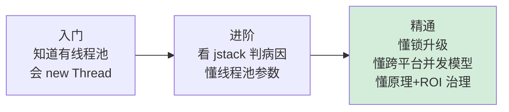

# 4.线程调度与并发性能优化

> 📍 **本篇位置**：第 8 卷 · 性能的优化之道 · 第 4 篇
> 🎯 **核心矛盾**：**线程多 ≠ 快，CPU 不高也可能很慢**——真正的敌人是**锁竞争、线程泄漏、上下文切换、优先级倒置**。90% 的并发性能事故，根因都不在 CPU，而在"**有多少线程在真的干活、有多少线程在排队等锁**"。
> 📌 **综合案例投影（战役 4）**：YC 商城下单链路大促压测 **QPS 卡死 1200**，网关 CPU 只有 **40%**、内存正常、磁盘空闲、网络带宽剩 70%——**资源全绿却上不去**。扩容到 3 倍机器，QPS 还是 1200。jstack 连抓 3 次快照：**90% 工作线程 BLOCKED 在同一行**——`库存服务的 `synchronized` 保护的全局库存表`。分段锁 + 本地预扣 + 读写分离三板斧改造后 **QPS 1200 → 8500（7× 不加一台机器）**，大促当天平稳扛过峰值 12 万 QPS。
> 🌐 **跨平台覆盖**：Java（jstack · JFR · Async Profiler lock）· Kotlin 协程（Dispatchers）· Go（GMP · pprof block/mutex）· Node（事件循环 · clinic doctor）· Swift（async/await · actor · Instruments）· Android（主线程 ANR · Perfetto）
> 🔗 **延伸阅读**：← [3.11 锁的设计与演进](https://yccoding.com/pages/80c3f4/) · ← [3.13 协程调度模型](https://yccoding.com/pages/4e3c82/) · ← [3.17 线程池参数调优](https://yccoding.com/pages/a7b1c9/) · → [8.5 I/O 与存储性能优化](./05.IO与存储性能优化.md)
> 🧠 **一句话心法**：**线程池慌，不如锁改良**。

---

> 第 3 卷讲了锁的实现原理（CAS、MCS、偏向→轻量→重量升级）、协程的调度模型（M:N、work-stealing、GMP）、线程池参数的 API 语义——那些是**语法层面**的知识。
>
> 本篇讲**生产环境里**：当你的监控大盘上 QPS 突然卡在某个值不动、CPU 却怎么都压不上去、下游延迟没抖动、磁盘和网络也没打满——**这时候，你怎么一步步定位到问题，怎么量化锁竞争，怎么把 QPS 翻 7 倍而不加一台机器**。
>
> 这是一道生产级综合题，答案藏在"**线程画像 + 锁可视化 + 调度分析 + 分层治理**"的闭环里，本篇把它一次讲透。

#### 目录介绍
- [00.真实事故引入](#00真实事故引入)
  - [0.1 大促压测现场](#01-大促压测现场)
  - [0.2 jstack 快照的秘密](#02-jstack-快照的秘密)
  - [0.3 灵魂三问](#03-灵魂三问)
  - [0.4 探索路径](#04-探索路径)
- [01.并发性能四类问题](#01并发性能四类问题)
  - [1.1 四类问题全景](#11-四类问题全景)
  - [1.2 锁竞争的物理本质](#12-锁竞争的物理本质)
  - [1.3 阿姆达尔定律](#13-阿姆达尔定律)
  - [1.4 面试锚点](#14-面试锚点)
- [02.线程画像与识图](#02线程画像与识图)
  - [2.1 jstack 线程状态分布](#21-jstack-线程状态分布)
  - [2.2 四种状态的真实含义](#22-四种状态的真实含义)
  - [2.3 三种病态画像](#23-三种病态画像)
  - [2.4 vmstat 看上下文切换](#24-vmstat-看上下文切换)
  - [2.5 面试锚点](#25-面试锚点)
- [03.锁竞争的量化](#03锁竞争的量化)
  - [3.1 等待时间与持有时间](#31-等待时间与持有时间)
  - [3.2 Async Profiler 定位热点锁](#32-async-profiler-定位热点锁)
  - [3.3 JFR 的锁事件](#33-jfr-的锁事件)
  - [3.4 contention ratio 阈值](#34-contention-ratio-阈值)
  - [3.5 锁升级的生产分布](#35-锁升级的生产分布)
  - [3.6 面试锚点](#36-面试锚点)
- [04.跨平台并发模型对照](#04跨平台并发模型对照)
  - [4.1 五平台矩阵](#41-五平台矩阵)
  - [4.2 Node 的隐形锁竞争](#42-node-的隐形锁竞争)
  - [4.3 Go channel 即锁](#43-go-channel-即锁)
  - [4.4 主线程就是天字第一号锁](#44-主线程就是天字第一号锁)
  - [4.5 YC 商城三端画像](#45-yc-商城三端画像)
  - [4.6 面试锚点](#46-面试锚点)
- [05.监控体系四件套](#05监控体系四件套)
  - [5.1 jstack 快速发现](#51-jstack-快速发现)
  - [5.2 Async Profiler 热点定位](#52-async-profiler-热点定位)
  - [5.3 JFR 持续采集](#53-jfr-持续采集)
  - [5.4 eBPF 内核级分析](#54-ebpf-内核级分析)
  - [5.5 工具矩阵全景](#55-工具矩阵全景)
- [06.分层治理方案](#06分层治理方案)
  - [6.1 减粒度](#61-减粒度)
  - [6.2 读写分离](#62-读写分离)
  - [6.3 无锁化](#63-无锁化)
  - [6.4 线程池调优](#64-线程池调优)
  - [6.5 协程异步化](#65-协程异步化)
  - [6.6 批处理合并竞争](#66-批处理合并竞争)
  - [6.7 YC 下单链路改造复盘](#67-yc-下单链路改造复盘)
  - [6.8 ROI 执行顺序](#68-roi-执行顺序)
- [07.原理深潜](#07原理深潜)
  - [7.1 优先级倒置](#71-优先级倒置)
  - [7.2 ConcurrentHashMap 分段思想](#72-concurrenthashmap-分段思想)
  - [7.3 Disruptor 无锁环形队列](#73-disruptor-无锁环形队列)
  - [7.4 Go GMP 调度延迟](#74-go-gmp-调度延迟)
- [08.面试高频追问](#08面试高频追问)
  - [8.1 CPU 不高为什么还慢](#81-cpu-不高为什么还慢)
  - [8.2 synchronized vs ReentrantLock](#82-synchronized-vs-reentrantlock)
  - [8.3 线程池参数怎么调](#83-线程池参数怎么调)
  - [8.4 无界队列的坑](#84-无界队列的坑)
  - [8.5 CachedThreadPool 的问题](#85-cachedthreadpool-的问题)
  - [8.6 Fork/Join 的 CommonPool](#86-forkjoin-的-commonpool)
  - [8.7 死锁怎么排查](#87-死锁怎么排查)
  - [8.8 活锁和死锁](#88-活锁和死锁)
  - [8.9 线程泄漏怎么发现](#89-线程泄漏怎么发现)
  - [8.10 协程里能打阻塞 IO 吗](#810-协程里能打阻塞-io-吗)
  - [8.11 CompletableFuture 的坑](#811-completablefuture-的坑)
  - [8.12 跨平台并发优化](#812-跨平台并发优化)
- [09.模拟面试模板](#09模拟面试模板)
  - [9.1 90 秒电梯答案](#91-90-秒电梯答案)
  - [9.2 并发排查流程](#92-并发排查流程)
  - [9.3 线程池参数怎么定](#93-线程池参数怎么定)
  - [9.4 一次锁优化经历](#94-一次锁优化经历)
  - [9.5 跨平台并发差异](#95-跨平台并发差异)
- [10.总结与承接](#10总结与承接)
  - [10.1 三层认知阶梯](#101-三层认知阶梯)
  - [10.2 并发决策树](#102-并发决策树)
  - [10.3 七字真言](#103-七字真言)
  - [10.4 与下篇承接](#104-与下篇承接)

---

## 00.真实事故引入

### 0.1 大促压测现场

大促预演前 2 周的那个周四晚上，压测组在值班群里甩了一张截图：

```
下单链路压测结果（60 分钟稳定态）：
───────────────────────────────────────
目标 QPS：      30,000
实际 QPS：      1,218  ← 卡死不动
网关 CPU：      38%
网关内存：      42% / 32GB
网关 GC：       Young GC 1.2 次/秒，p99 15ms（健康）
数据库 QPS：    280（远低于容量 1 万）
Redis QPS：     940（远低于容量 5 万）
下游 RT p99：   180ms（健康）
───────────────────────────────────────
扩容到 3 倍机器后：QPS 1,215 ← 几乎没变
```

架构师（在群里）：

> "资源全绿、下游全绿、网络带宽剩 70%，QPS 就是上不去。扩容无效——这明显不是容量问题。"

**资源够、下游不慢、QPS 却卡在某个值**——这是生产环境里最经典的"**并发瓶颈**"画像。它和内存问题的画像完全不同（内存问题 CPU 和 GC 会异常），和 I/O 问题也不同（I/O 问题 iostat await 会飙升）。

### 0.2 jstack 快照的秘密

我接到电话后第一反应：**连抓三次 jstack**，间隔 10 秒。为什么是三次？因为单次快照会"**冤枉好人**"——某个线程恰好 BLOCKED 一下，不代表它真的在排队。**三次都 BLOCKED 在同一行，才是真锁竞争**。

统计三次快照里 **200 个工作线程**的状态分布：

```
RUNNABLE:      18 个   (9%)     ← 真在干活
TIMED_WAITING: 4 个    (2%)     ← 正常的定时等待
WAITING:       2 个    (1%)     ← 正常的条件等待
BLOCKED:       176 个  (88%)   ← 全部堵在 InventoryService.lock
```

打开 BLOCKED 线程的 stack trace：

```java
"catalina-exec-123" #456 BLOCKED on InventoryService@0x7f8c2a3b4
   at com.yc.inventory.InventoryService.deduct(InventoryService.java:87)
   - waiting to lock <0x7f8c2a3b4> (a com.yc.inventory.InventoryService)
   at com.yc.order.OrderService.createOrder(OrderService.java:142)
   ...
```

打开 `InventoryService.java:87`：

```java
public class InventoryService {
    private final Map<Long, Integer> stock = new HashMap<>();

    public synchronized boolean deduct(long sku, int qty) {   // ⚠️ 全局锁
        Integer s = stock.get(sku);
        if (s == null || s < qty) return false;
        stock.put(sku, s - qty);
        return true;
    }
}
```

**一个 `synchronized` 保护了整张库存表**。10 万个 SKU 共用一把锁，176 个线程排队——QPS 当然卡死。

这就是本篇的**灵魂拷问出发点**：**资源全绿为什么还慢**？

### 0.3 灵魂三问

**Q1：加线程为什么不加 QPS？** —— 锁竞争之惑

> **直觉**：200 线程不够就开到 500，总能快一点吧？
>
> **真相**：如果瓶颈是一把全局锁，**加线程只会让排队更长**。锁一次只能一个人进，第 201 个线程只是在门口多一个人站着——不仅没加速，还徒增上下文切换开销。**线程多 ≠ 吞吐高，关键是"真正在干活"的线程占比**。

**Q2：线程数一路涨是正常的吗？** —— 线程泄漏之惑

> **直觉**：业务量在涨，线程数涨是合理的。
>
> **真相**：线程数应该**稳定在线程池上限**。单调上升意味着**线程泄漏**——某处用了 `new Thread().start()` 而没有 `join()`，或者线程池参数配错（如 `CachedThreadPool` 的无界池）。生产上我见过线程数从 200 涨到 1 万把 JVM 挤爆的真实事故。

**Q3：CPU 40% 为什么还慢？** —— 假忙之惑

> **直觉**：CPU 没打满说明有余力。
>
> **真相**：CPU 40% 这个数字背后有两种完全不同的故事——
>
> - **故事 A**：18 个线程满载跑业务，剩下 182 个线程在排队 → 这就是 YC 商城的现场；
> - **故事 B**：所有线程都在跑业务，但 CPU 本身被 cfs_quota 限流了（容器场景）。
>
> **只看 CPU 利用率是看不出差异的，必须看线程状态分布**。

### 0.4 探索路径


---

## 01.并发性能四类问题

### 1.1 四类问题全景

把并发问题拆成**最小独立病灶**，只有 4 类：

```
┌─────────────────────────────────────────────────────────┐
│ ① 泄漏（Thread Leak）                                     │
│    现象：线程数持续增长，不随业务回落                       │
│    根因：new Thread 没 join / 池参数错 / 任务永不退出       │
│    工具：top -H / jstack / ThreadMXBean                   │
├─────────────────────────────────────────────────────────┤
│ ② 竞争（Lock Contention）                                 │
│    现象：QPS 卡死某个值 + 大量 BLOCKED                     │
│    根因：粒度过粗 / 热点 Key / 单例全局锁                    │
│    工具：jstack + Async Profiler lock + JFR                │
├─────────────────────────────────────────────────────────┤
│ ③ 切换（Context Switch）                                 │
│    现象：vmstat 的 cs 字段飙高（> 10 万/秒）               │
│    根因：线程过多 / 锁频繁争抢 / 定时器密集                  │
│    工具：vmstat / perf sched / schedstat                   │
├─────────────────────────────────────────────────────────┤
│ ④ 倒置（Priority Inversion）                              │
│    现象：高优线程被低优拖慢                                 │
│    根因：高优等低优的锁 / 优先级继承缺失                     │
│    工具：schedstat / Instruments（iOS）                    │
└─────────────────────────────────────────────────────────┘
```

**四类问题的识别信号**：

| 问题 | 关键信号 | 验证手段 |
|---|---|---|
| 泄漏 | 线程数单调上升 | `jstack \| grep -c "^\""` 定时记录 |
| 竞争 | BLOCKED 占比 > 20% | jstack 三连拍 + 栈聚合 |
| 切换 | cs > 10 万/秒 且 CPU sys% 偏高 | `vmstat 1` + `perf sched` |
| 倒置 | 高优线程偶发大延迟 | schedstat 的 wait_sum |

**为什么是这四类而不是其他**？因为并发**本质上只做三件事**：

1. **创建线程**（出问题 = 泄漏）
2. **协调线程**（出问题 = 竞争 / 切换）
3. **调度线程**（出问题 = 倒置）

穷举完了。生产上 90% 的并发性能事故是**竞争**，其余 3 类各占 2-3%。

### 1.2 锁竞争的物理本质

🔬 **深潜**：锁竞争到底在吃什么？从硬件到 OS 一层层剥开：

**第一层：CPU 原子指令**（硬件层）

```
MOV RAX, [lock_addr]
XCHG RAX, [some_value]   ← 原子交换，CPU 自动锁总线（或 cache line）
```

- 代价：L1 cache miss + 跨核 cache 同步 + MESI 协议状态切换，约 **50-200 ns**。

**第二层：锁升级**（JVM 层）

```
无锁 → 偏向锁 → 轻量级锁（CAS 自旋）→ 重量级锁（OS mutex）
       ↑          ↑                    ↑
       10 ns      50-200 ns            1-10 μs
```

**第三层：OS 调度**（内核层）

```
线程 A 持锁 ─────────────────── unlock ──▶
线程 B 等锁 ─▶ park ──────────────────▶ unpark ──▶ 继续
             │                           │
             进内核态挂起                 回用户态
             ~2 μs                       ~1-3 μs
```

- 一次完整的 "等锁 → 挂起 → 唤醒 → 继续" 的**最小代价约 5-10 μs**；
- 对比普通的函数调用（约 10 ns），**慢了 500-1000 倍**。

**所以 QPS 卡死的真相**：

```
每次锁争抢的额外开销 ≈ 10 μs
如果 1 秒内有 10 万次争抢（高竞争场景）：
   纯锁开销 = 10 万 × 10 μs = 1 秒
→ 1 个 CPU 核心完全被锁开销吃掉
```

**工程启示**：

- 低竞争场景（成功率 > 95%），`synchronized` 轻量级锁足够快（纳秒级）；
- 高竞争场景（成功率 < 50%），锁升级为重量级，微秒级代价放大 1000 倍，这才是真正的敌人；
- **治理锁竞争的核心不是换一把更快的锁，而是让竞争本身变少**（见 §06 分层治理）。

### 1.3 阿姆达尔定律

🔬 **深潜**：**并发性能的理论上限**由 Amdahl 定律给出：

```
加速比 S(N) = 1 / (F + (1-F)/N)

   F：串行部分比例
   N：核心数
```

**举例**：如果你的代码有 **5% 必须串行**（如一把全局锁保护的部分）：

| 核心数 N | 理论加速比 | 实际 QPS |
|---|---|---|
| 1 | 1.00 | 100 |
| 4 | 3.48 | 348 |
| 8 | 5.93 | 593 |
| 16 | 9.14 | 914 |
| 32 | 12.55 | 1255 |
| 64 | 15.42 | 1542 |
| 256 | 18.62 | 1862 |
| **∞** | **20.00** | **2000** |

**震撼的结论**：**只要有 5% 串行部分，再多核心也只能加速 20 倍**。

**YC 商城的真实数字**：

```
修复前：串行部分 F ≈ 50%（库存全局锁）
       4 核机器加速比 ≈ 1.6
       → 单机 QPS 1200，扩容到 3 倍 QPS 还是 1200（因为单机内核已到上限）

修复后：串行部分 F ≈ 2%（分段锁 256 段）
       4 核机器加速比 ≈ 3.75
       → 单机 QPS 8500，7× 收益
```

**工程启示**：**降低 F 比加核心有效 10 倍**。扩容是花钱买时间，优化串行比例才是治本。

### 1.4 面试锚点

**Q：CPU 不高为什么还慢？**

**30 秒答法**：

> CPU 不高说明"**在干活的线程占比低**"，但原因有三种可能：
>
> 1. **锁竞争**：大量线程 BLOCKED 排队——用 jstack 三连拍看 BLOCKED 占比；
> 2. **I/O 等待**：线程卡在 syscall——看 vmstat 的 b 列（阻塞队列）；
> 3. **容器限流**：cfs_quota 限制了 CPU 配额——看 `/sys/fs/cgroup/cpu/cpu.stat` 的 `nr_throttled`。
>
> YC 商城 QPS 1200 卡死那次就是第一种，jstack 显示 88% 线程 BLOCKED 在一把全局锁上，CPU 40% 根本不是余力，而是**只有 12% 的线程在干活**。

---

## 02.线程画像与识图

### 2.1 jstack 线程状态分布

**生产线程画像第一步**：看状态分布。

```bash
# 一行命令统计线程状态分布
jstack <pid> | grep "java.lang.Thread.State" | sort | uniq -c | sort -rn

# 典型健康输出
   180  RUNNABLE
    15  TIMED_WAITING (parking)
     3  WAITING (on object monitor)
     2  BLOCKED (on object monitor)

# 典型异常输出（YC 商城卡死时）
   176  BLOCKED (on object monitor)   ← ⚠️
    18  RUNNABLE
     4  TIMED_WAITING
     2  WAITING
```

**基线值**（经验，仅供参考）：

| 状态 | 健康占比 | 异常阈值 |
|---|---|---|
| RUNNABLE | 30-70% | — |
| TIMED_WAITING | 10-40% | — |
| WAITING | 10-30% | — |
| **BLOCKED** | **< 5%** | **> 20% 即报警** |

**三连拍验证**：

```bash
# 每 10 秒抓一次，连抓 3 次
for i in 1 2 3; do jstack <pid> > jstack-$i.txt; sleep 10; done

# 对比三次 BLOCKED 的栈顶
grep -A1 BLOCKED jstack-1.txt | grep "at " | sort | uniq -c
grep -A1 BLOCKED jstack-2.txt | grep "at " | sort | uniq -c
grep -A1 BLOCKED jstack-3.txt | grep "at " | sort | uniq -c
# 如果三次都是同一行栈顶，100% 确诊真锁竞争
```

**为什么是三次而不是一次**？因为：

- **单次快照**：可能恰好抓到瞬时锁争抢，造成"**冤枉好人**"（10 μs 内的争抢 jstack 刚好抓到）；
- **三次同向**：BLOCKED 线程稳定在同一栈顶，才是**长期竞争**；
- **三次漂移**：BLOCKED 栈顶每次都不同，说明是**偶发争抢**，不是性能瓶颈。

### 2.2 四种状态的真实含义

**面试高频**，必须答得精确：

| 状态 | 操作系统视角 | 典型来源 | 唤醒机制 |
|---|---|---|---|
| **NEW** | 未启动 | `new Thread()` 后未 start | — |
| **RUNNABLE** | **就绪 or 运行中** | `start()` 后 | OS 调度 |
| **BLOCKED** | **等 monitor 锁** | `synchronized` 没拿到 | 锁释放 |
| **WAITING** | 等条件 | `Object.wait()` / `park()` | notify / unpark |
| **TIMED_WAITING** | 定时等 | `sleep()` / `wait(ms)` | 超时 or 唤醒 |
| **TERMINATED** | 已结束 | run 方法返回 | — |

**三个关键细节**：

**① RUNNABLE 不等于真在跑**。Java 的 RUNNABLE 包含了 OS 的 "ready" 和 "running" 两个状态——线程可能在 CPU 上跑，也可能在等 CPU 时间片。

**② BLOCKED 只给 `synchronized` 用**。`ReentrantLock.lock()` 阻塞时线程状态是 **WAITING**（因为它底层用 LockSupport.park）。所以 jstack 里 BLOCKED 高 = synchronized 竞争高；WAITING 高则需要进一步看栈顶判断。

**③ TIMED_WAITING 和 WAITING 的本质差异**：有无超时参数。所以 `pollFirst(10, SECONDS)` 是 TIMED_WAITING，`pollFirst()`（无参）是 WAITING。

### 2.3 三种病态画像

**生产上最常见的三种"病态线程画像"**：

**① 线程泄漏画像**

```
线程数曲线：
   数量
    │                              _____
    │                       _____╱
    │                _____╱
    │         _____╱
    │   _____╱
    └──────────────────────────▶ 时间

诊断：
- jstack 看线程名，发现 "pool-N-thread-M" N 持续增长
- 典型根因：new ThreadPoolExecutor 没缓存，每次请求 new 一个
```

**② 全部 BLOCKED 画像**（YC 商城现场）

```
线程状态分布（饼图）：
   ████████████████ BLOCKED  88%
   ███ RUNNABLE               9%
   █ TIMED_WAITING            2%
   ▏ WAITING                  1%

诊断：
- 88% 线程排队同一把锁
- 典型根因：全局 synchronized / 热点 Key / 单例写锁
```

**③ 大量 TIMED_WAITING 画像**

```
线程状态分布：
   ████████ TIMED_WAITING   60%
   ████ RUNNABLE             30%
   ██ WAITING                 7%
   ▏ BLOCKED                  3%

诊断：
- 大量线程 TIMED_WAITING 在 getTask()
- 这其实是健康的！线程池 keepAlive 等待任务
- 真实问题可能在"任务来源慢"而不是"线程本身"
```

**第三种画像的坑**：很多新人看到 60% TIMED_WAITING 就慌，其实这是线程池正常的 **worker idle 状态**。看 `getTask` / `take` 栈顶即可确认。

### 2.4 vmstat 看上下文切换

**上下文切换的量化指标**：

```bash
vmstat 1
# 输出
procs -----------memory---------- ---swap-- -----io---- -system-- ------cpu-----
 r  b   swpd   free   buff  cache   si   so    bi    bo   in   cs us sy id wa st
20  0      0 2.1G    1.2G  12G     0    0     0     0  5230 128K 45  8 47  0  0
                                                              ↑
                                                       上下文切换/秒
```

**健康阈值**（经验值）：

| cs/秒 | 诊断 |
|---|---|
| < 1 万 | 健康 |
| 1-10 万 | 正常 |
| 10-30 万 | 警告（线程过多或锁争抢） |
| > 30 万 | 异常（必须排查） |

**上下文切换的真实成本**：

- 直接代价：寄存器保存/恢复 + 页表切换 + TLB 刷新 ≈ **1-10 μs**
- 间接代价：CPU cache 污染（新线程的数据不在 L1/L2，必须从 L3 甚至内存读）**可能更贵**

**典型异常场景**：

- **cs 高 + sy% 高**（> 20%）：锁竞争严重，大量线程挂起唤醒；
- **cs 高 + us% 高**：业务逻辑频繁创建线程 or 使用 Lambda 频繁闭包；
- **cs 高 + 并发库相关**：Fork/Join 任务拆分过细，调度开销大于计算收益。

### 2.5 面试锚点

**Q：怎么快速判断是不是锁竞争？**

**答题模板**（4 步 60 秒）：

> 四步法：
>
> **第一步**：`vmstat 1` 看 cs 列，> 10 万/秒就有嫌疑；
>
> **第二步**：`jstack <pid>` 三连拍（间隔 10 秒），统计 BLOCKED 占比，> 20% 高度嫌疑；
>
> **第三步**：对比三次 BLOCKED 栈顶，稳定在同一行 → 确诊真锁竞争；
>
> **第四步**：用 `Async Profiler -e lock` 采样 30 秒，火焰图直接看到热点锁的调用栈。
>
> YC 商城 QPS 1200 卡死那次，整个诊断链路只用了 **8 分钟**——vmstat 2 秒、jstack 三连拍 30 秒、火焰图 30 秒、找到 `InventoryService.deduct:87` 这一行，剩下时间都在改代码。

---

## 03.锁竞争的量化

### 3.1 等待时间与持有时间

**锁竞争最重要的两个指标**：

```
线程 A 持锁 ───持有时间 (hold)──── unlock
                                    │
线程 B 请求 ─── 等待时间 (wait) ────▶ 拿到锁
```

| 指标 | 定义 | 健康值 | 治理方向 |
|---|---|---|---|
| **wait time** | 从 lock() 到真正拿到锁 | < 10 μs | **减粒度** / 减竞争 |
| **hold time** | 从拿到锁到 unlock | < 1 ms | **缩短临界区** |

**两个指标的组合诊断**：

| wait 高 | hold 低 | 竞争多但临界区小 → 减粒度（分段锁） |
| wait 高 | hold 高 | 临界区太大 + 竞争多 → **双管齐下** |
| wait 低 | hold 高 | 竞争不激烈但临界区大 → 缩短临界区 |
| wait 低 | hold 低 | 健康 |

### 3.2 Async Profiler 定位热点锁

**Async Profiler 的锁模式**是生产定位热点锁的**神器**：

```bash
# 采样 30 秒的锁等待
./profiler.sh -e lock -d 30 -f lock-flame.html <pid>

# 打开 lock-flame.html 看火焰图
# 火焰图里"最宽的函数" = wait time 最长的锁
```

**火焰图读法**：

```
┌────────────────────────────────────────────────┐
│ Thread.run                                      │
│  OrderService.createOrder                       │
│   InventoryService.deduct ←────── 占 65%        │
│    sun.misc.Unsafe.park ← 等待锁的栈顶          │
└────────────────────────────────────────────────┘

→ 65% 的锁等待时间消耗在 InventoryService.deduct
→ 这是头号治理对象
```

**原理**：Async Profiler 通过 **JVMTI 的 MonitorContendedEnter 事件**捕获每次锁争抢，栈帧抓取 + 等待时间累加 = 加权火焰图。

**对比传统工具**：

| 工具 | 原理 | 粒度 | 开销 |
|---|---|---|---|
| jstack | 瞬时快照 | 栈级 | 几乎 0 |
| Async Profiler lock | JVMTI 事件采样 | 行级 + 时长 | 1-3% |
| JFR Lock Events | JVMTI 全量记录 | 行级 + 时长 + 时间线 | 2-5% |

### 3.3 JFR 的锁事件

**JFR**（Java Flight Recorder）在生产最推荐的锁监控方式：

```bash
# 启动时开 JFR
java -XX:StartFlightRecording=duration=60s,filename=myapp.jfr,settings=profile MyApp

# 或者运行时附加
jcmd <pid> JFR.start name=lockrec duration=60s filename=lock.jfr settings=profile
```

**关键事件**：

| 事件 | 含义 |
|---|---|
| `JavaMonitorEnter` | 进入 synchronized 块 |
| **`JavaMonitorWait`** | 等 wait/notify |
| **`JavaMonitorContendedEnter`** | **争抢 monitor（锁竞争）** |
| `ThreadPark` | LockSupport.park |

在 JMC 里打开 JFR 文件，到 "Lock Instances" 页面，可以看到：

```
┌──────────────────────────────────────────────────────┐
│ Monitor Class            Count  Avg Wait   Max Wait   │
├──────────────────────────────────────────────────────┤
│ InventoryService       12,453    85 ms    420 ms  ⚠️  │
│ ReentrantLock             823     0.8 ms    5 ms      │
│ ConcurrentHashMap$Node    421     0.1 ms    0.3 ms    │
└──────────────────────────────────────────────────────┘
```

**JFR 的三大优势**：

1. **低开销**（< 2%，可线上常开）；
2. **全量时间线**（能看到锁争抢的时间分布，发现突刺）；
3. **跨平台**（JDK 11+ 开源，Linux/macOS/Windows 都能用）。

### 3.4 contention ratio 阈值

**contention ratio**（竞争比）= 发生竞争的次数 / 总获锁次数。

**健康阈值**：

| 竞争比 | 诊断 | 工程行动 |
|---|---|---|
| < 1% | 健康 | — |
| 1-10% | 轻度 | 关注，不急 |
| 10-30% | 中度 | **列入下迭代优化** |
| **> 30%** | **严重** | **立刻治理** |

**采集方式**（JVM）：

```bash
# JFR 事件统计
JavaMonitorContendedEnter 的次数 / JavaMonitorEnter 的次数
```

**生产经验值**：

- 普通业务服务：竞争比 < 5%；
- 高并发网关：竞争比 < 1%（否则 QPS 必上不去）；
- 后台任务：允许 10-20%（任务数远少于线程数，影响有限）。

### 3.5 锁升级的生产分布

🔬 **深潜**：Java 的锁升级在生产的真实分布：

```
无锁 → 偏向锁 → 轻量级锁 → 重量级锁
```

| 阶段 | 占比（典型服务） | 耗时 | 触发条件 |
|---|---|---|---|
| 无锁 | 60% | 0 | 从未争抢 |
| 偏向锁 | 25% | ~10 ns | 只有 1 个线程持过 |
| **轻量级锁** | **12%** | **50-200 ns** | **CAS 自旋，无阻塞** |
| **重量级锁** | **3%** | **1-10 μs** | **自旋失败，走 OS mutex** |

**JDK 15 废弃偏向锁的原因**：

- 偏向锁的收益在现代 JVM 已经很小（JIT 优化 + 新架构的 CAS 很快）；
- 偏向锁的撤销开销（Safepoint）在高并发下反而成瓶颈；
- 维护成本高（代码复杂度 + bug 多）。

**所以 JDK 15+ 的生产分布**：

```
无锁 60% → 轻量级 37% → 重量级 3%
```

**工程启示**：

- 治理锁竞争**聚焦那 3% 重量级锁**——它们吃掉了 90% 的性能预算；
- **让锁争抢维持在轻量级范围内**（CAS 自旋成功率 > 95%）即可；
- 这就是"**消除竞争** > **换一把更快的锁**"的物理根基。

### 3.6 面试锚点

**Q：怎么量化锁竞争？**

**完整答法**：

> 两个核心指标 + 一个比例：
>
> 1. **wait time**（等锁时间）：从 lock() 到真正拿到锁的时间，健康 < 10 μs；
> 2. **hold time**（持锁时间）：拿到锁到 unlock 的时间，健康 < 1 ms；
> 3. **contention ratio**（竞争比）：发生竞争次数 / 总获锁次数，健康 < 5%。
>
> **采集工具**：
>
> - 线下：Async Profiler `-e lock` 跑 30 秒出火焰图；
> - 线上：JFR 常开（< 2% 开销），JMC 看 Lock Instances 页；
> - 服务端 Go：pprof block/mutex；
> - 服务端 Node：没有传统锁，但有 clinic doctor 看事件循环延迟（等价指标）。
>
> YC 商城那次就是用 Async Profiler lock 30 秒直接定位 `InventoryService.deduct` 占 65% 等待时间。

---

## 04.跨平台并发模型对照

### 4.1 五平台矩阵

| 平台 | 并发模型 | "锁竞争"的伪装形态 | 主战工具 | 治疗思路 |
|---|---|---|---|---|
| **Java** | 1:1 内核线程 | BLOCKED + monitor 等待 | jstack · JFR · Async Profiler lock | 分段/读写/无锁 |
| **Kotlin 协程** | M:N（基于线程池） | **IO 调度器饥饿**（默认限并发 64） | kotlinx coroutines debug · Thread.dump | 换 Dispatcher / 配并发限制 |
| **Go** | goroutine（GMP） | **channel 满阻塞** / 信号量 / runtime 锁 | pprof block·mutex · runtime/trace | channel 容量 / 分片 map |
| **Node** | 单线程事件循环 | **事件循环延迟**（长任务霸占） | clinic doctor · event-loop lag | 拆异步 / Worker Threads |
| **Swift** | async/await + actor | **actor 串行化排队**（隐式串行队列） | Instruments · os_signpost | 拆 actor / `nonisolated` |

**五平台看似各不相同，但本质都在解决同一个问题**：**如何让多个任务共享资源而不互相破坏**。差异只在"**锁的面孔**"：

- Java：显式的 `synchronized` / `Lock`
- Kotlin：显式的 `Mutex` / **隐式的 Dispatcher 并发限制**
- Go：显式的 `sync.Mutex` / **隐式的 channel 容量**
- Node：**全局一把事件循环锁**
- Swift：显式的 `NSLock` / **隐式的 actor 隔离**

### 4.2 Node 的隐形锁竞争

🔬 **深潜**：Node 没有"传统锁"，但有**等价物**——**事件循环延迟**。

**本质**：Node 整个进程**只有一个主线程跑 JS**，事件循环就是"**全局大锁**"：

```
事件循环的 6 个阶段：
timers → pending → idle → poll → check → close
   ↑                                        │
   └────────────────────────────────────────┘
```

**长同步任务 = 持锁不放**：

```javascript
// ❌ 一个 500ms 的 CPU 密集任务，直接把 QPS 打到 2
app.get('/encrypt', (req, res) => {
    const hash = heavyEncryption(req.body);   // 耗时 500ms CPU
    res.send(hash);
});

// 期间：
// - 所有其他请求全部排队
// - 定时器全部延迟
// - 整个事件循环卡住
```

**量化**：**event-loop lag**（事件循环延迟）

```javascript
let last = Date.now();
setInterval(() => {
    const now = Date.now();
    const lag = now - last - 100;  // 本应 100ms 周期
    last = now;
    console.log(`lag: ${lag}ms`);
}, 100);

// 健康：lag < 10ms
// 警告：lag > 50ms
// 异常：lag > 200ms
```

**治理**：

1. **拆异步**：CPU 密集任务移到 Worker Threads；
2. **分片**：大循环分片用 `setImmediate` 让出；
3. **预热**：启动时跑一遍，JIT 完成；
4. **缓存**：计算结果缓存。

**对 Java 工程师的类比**：

| Java | Node |
|---|---|
| `synchronized` 阻塞 | 长同步任务霸占事件循环 |
| BLOCKED 线程占比 | event-loop lag 值 |
| jstack 看栈 | async_hooks + CPU profile 看长任务 |

### 4.3 Go channel 即锁

🔬 **深潜**：Go 的锁竞争常以 **channel 面目**出现。

**channel 的两种阻塞**：

```go
// ① 无缓冲 channel：收发必须同时就绪
ch := make(chan int)
ch <- 1  // 阻塞，直到有 goroutine <- ch

// ② 有缓冲 channel 满 / 空
ch := make(chan int, 10)
for i := 0; i < 20; i++ {
    ch <- i   // 第 11 次开始阻塞（容量满）
}
```

**pprof block profile** 直接看 channel 阻塞：

```bash
go tool pprof -http=:8080 http://localhost:6060/debug/pprof/block

# 典型输出
Showing nodes accounting for 45.2s, 92.3% of 48.9s total
       flat  flat%   sum%        cum   cum%
     38.4s 78.5%  78.5%     38.4s 78.5%  runtime.chanrecv
      6.8s 13.8%  92.3%      6.8s 13.8%  sync.(*Mutex).Lock
```

**诊断流程**：

- **chanrecv 高**：某个 channel 消费慢，生产者积压；
- **chansend 高**：某个 channel 容量不够，生产者等；
- **Mutex.Lock 高**：传统锁竞争。

**治理**：

- channel 满 → **加容量** 或 **拆分片** 或 **背压上游**；
- channel 空 → **加消费 goroutine** 或 **优化消费逻辑**；
- 全局 sync.Map 热点 → **分片 map**（如 shardedmap 库）。

**对 Java 工程师的类比**：

```
Java BlockingQueue 满           ↔  Go channel 满
Java 消费线程不够                ↔  Go 消费 goroutine 不够
Java sync 全局锁                 ↔  Go 全局 sync.Mutex
Java ConcurrentHashMap 分段      ↔  Go sharded map
```

### 4.4 主线程就是天字第一号锁

**Android / iOS 的独特之处**：UI 必须在主线程更新，所以**主线程本身就是一把串行化全局锁**。

**ANR / hang 的本质 = 主线程"持锁不放"**：

| 平台 | 卡死机制 | 阈值 |
|---|---|---|
| **Android** | 主线程 5 秒不响应输入事件 → ANR | 5s |
| **iOS** | 主线程卡 > 250ms → hang | 250ms |
| Web | 主线程 Long Task > 50ms → INP 下降 | 50ms |

**所以客户端的并发优化**，核心是"**让主线程别干脏活**"：

```kotlin
// ❌ 主线程做 JSON 解析
override fun onResponse(response: Response) {
    val data = Gson().fromJson(response.body, DataList::class.java)  // 200ms
    updateUI(data)
}

// ✅ 异步解析 + 主线程 UI
override fun onResponse(response: Response) {
    viewModelScope.launch(Dispatchers.Default) {
        val data = Gson().fromJson(response.body, DataList::class.java)
        withContext(Dispatchers.Main) {
            updateUI(data)
        }
    }
}
```

**跨平台铁律**：**UI 线程只做 UI，重活一律移到子线程 / 协程**。

### 4.5 YC 商城三端画像

**同一晚**，对 YC 商城的三个核心服务各抓一次"**并发画像**"：

```mermaid
flowchart TB
    subgraph 网关["🌐 Java 网关（卡死 QPS 1200）"]
        A1[vmstat cs 25 万/秒] --> A2[jstack BLOCKED 88%]
        A2 --> A3[Async Profiler lock<br/>InventoryService.deduct 65%]
        A3 --> A4[全局 synchronized 库存表]
    end

    subgraph 订单["🏃 Go 订单（RT p99 抖动）"]
        B1[pprof block<br/>chanrecv 78%] --> B2[订单 channel 容量 10]
        B2 --> B3[下游写入慢 → 积压]
        B3 --> B4[容量 10 → 1000<br/>+ 批量下游写]
    end

    subgraph BFF["🟩 Node BFF（RT p99 高）"]
        C1[clinic doctor<br/>event-loop lag 180ms] --> C2[长任务：JSON 序列化]
        C2 --> C3[2MB 商品详情同步序列化]
        C3 --> C4[移到 Worker Threads<br/>+ 缓存]
    end

    style A4 fill:#fff3cd
    style B4 fill:#e3f2fd
    style C4 fill:#d4edda
```



**三条洞见**：

**洞见 1：症状不同、根因同构**。

- Java：BLOCKED 排队
- Go：channel 满 goroutine 排队
- Node：长任务霸占事件循环（主线程"排队"）
- **本质都是"某个资源串行化、所有人排队"**。

**洞见 2：工具链不互通**。

- jstack 看不到 goroutine，pprof 看不到 Java 线程，clinic 看不到两者；
- 跨平台团队必须**同时掌握三套工具链**。

**洞见 3：治理思路同源**。

- Java：减粒度（分段锁）
- Go：加 channel 容量 / 拆 goroutine
- Node：拆异步 / Worker Threads
- **本质都是"让串行化范围变小、让并行机会变多"**。

### 4.6 面试锚点

**Q：Go 的 channel 和 Java 的锁，怎么互相解释？**

**答题模板**：

> channel 和锁是**对偶的两种同步原语**：
>
> - **锁**：保护"**共享状态**"——多个线程共享一块内存，用锁串行化访问；
> - **channel**：传递"**消息**"——goroutine 不共享内存，通过发消息协作（CSP 模型）。
>
> **但在生产现象上，它们高度等价**：
>
> | Java | Go |
> |---|---|
> | BlockingQueue 满 → put 阻塞 | channel 满 → send 阻塞 |
> | 消费线程不够 → 队列积压 | 消费 goroutine 不够 → channel 积压 |
> | synchronized 全局锁 → BLOCKED | 全局 sync.Mutex → block profile 高 |
>
> **治理手段也对偶**：加容量（Java 增 queue size / Go 增 chan buffer）、分片（ConcurrentHashMap 分段 / sharded map）、减粒度（细化临界区 / 细化 channel 用途）。
>
> **Go 的哲学**："**不要通过共享内存来通信，而要通过通信来共享内存**"——但生产上，两种方式都用，看场景取舍。

---

## 05.监控体系四件套

### 5.1 jstack 快速发现

**适用场景**：生产问题刚发生、快速诊断。

**30 秒极速诊断脚本**：

```bash
#!/bin/bash
PID=$1

echo "=== 1. 线程数 ==="
jstack $PID | grep -c "^\""

echo "=== 2. 状态分布 ==="
jstack $PID | grep "java.lang.Thread.State" | sort | uniq -c | sort -rn

echo "=== 3. BLOCKED 栈顶 Top 5 ==="
jstack $PID | grep -A1 BLOCKED | grep "at " | sort | uniq -c | sort -rn | head -5

echo "=== 4. 死锁检查 ==="
jstack $PID | grep -A3 "Found .* deadlock"
```

**优点**：零部署、零成本、立即可用。
**缺点**：瞬时快照、无时间维度、看不到 wait/hold time。

### 5.2 Async Profiler 热点定位

**适用场景**：确定有锁竞争，要找到**具体热点锁**。

```bash
# 下载
wget https://github.com/async-profiler/async-profiler/releases/download/v3.0/async-profiler-3.0-linux-x64.tar.gz

# 采样 30 秒锁竞争
./profiler.sh -e lock -d 30 -f lock-flame.html <pid>

# 采样同时 CPU + 锁（综合分析）
./profiler.sh -e cpu,lock -d 30 -f combined.html <pid>
```

**关键参数**：

- `-e lock`：锁等待事件
- `-e alloc`：对象分配（见 8.3）
- `-e cpu`：CPU 热点（见 8.2）
- `--threads`：按线程分组看

**优点**：火焰图直观、1-3% 开销、可线上短时用。
**缺点**：需要安装 agent、不能持续常开。

### 5.3 JFR 持续采集

**适用场景**：生产常驻监控、历史回溯。

```bash
# JDK 11+ 默认集成
java -XX:StartFlightRecording=duration=30s,filename=recording.jfr,settings=profile MyApp

# 运行时附加
jcmd <pid> JFR.start name=lockmon settings=profile maxsize=500M maxage=1h

# 导出
jcmd <pid> JFR.dump name=lockmon filename=snapshot.jfr

# 持续模式（最推荐生产用）
jcmd <pid> JFR.start name=continuous maxsize=500M maxage=24h
```

**在 JMC 中查看**（Java Mission Control）：

```
Memory → Thread Statistics            看线程状态时间分布
Threads → Lock Instances              看具体锁的 wait/hold
Threads → Thread Dumps                快照
Threads → Context Switch              上下文切换热点
```

**优点**：生产常开（< 2% 开销）、全时间线、JDK 原生。
**缺点**：JDK 11+ 才完全开源、JMC 工具偏重。

### 5.4 eBPF 内核级分析

**适用场景**：怀疑 OS 调度问题 / 优先级倒置 / 中断干扰。

```bash
# 使用 bcc 工具集
# 看每个线程的 off-cpu 时间（在等什么）
offcputime-bpfcc -p <pid> 10

# 看锁的调度延迟
runqlat-bpfcc 10

# 看特定线程被哪个线程唤醒
offwaketime-bpfcc -p <pid> 10
```

**原理**：eBPF 挂钩到内核的 `sched_switch` 事件，记录每次线程切换的时长和原因，**穿透用户态/内核态边界**，看到 Java/Go 层看不到的东西。

**优点**：零侵入、跨语言、能看调度延迟。
**缺点**：需要较新内核（4.9+）、工具链学习曲线陡。

### 5.5 工具矩阵全景

```
问题诊断阶段 → 推荐工具

┌─────────────────────────────────────────────────────┐
│ 阶段 1：快速定位    │ jstack 三连拍              │
│ 阶段 2：热点确定    │ Async Profiler lock         │
│ 阶段 3：持续监控    │ JFR 常驻                   │
│ 阶段 4：根因深潜    │ eBPF off-cpu / runqlat     │
└─────────────────────────────────────────────────────┘
```

**跨平台工具一览**：

| 阶段 | Java | Go | Node | Android | iOS |
|---|---|---|---|---|---|
| 快速定位 | jstack | pprof goroutine | --inspect | ANR trace | hang detection |
| 热点确定 | Async Profiler lock | pprof block/mutex | clinic doctor | Perfetto | Instruments Time Profiler |
| 持续监控 | JFR | runtime/metrics | event-loop-stats | APM | MetricKit |
| 根因深潜 | eBPF | eBPF | eBPF | perf sched | os_signpost |

---

## 06.分层治理方案

**治理严格分六层，按 ROI 顺序执行**：

```
第一层：减粒度（分段锁）        → 最高 ROI
第二层：读写分离
第三层：无锁化（CAS/Disruptor）
第四层：线程池调优
第五层：协程 / 异步化
第六层：批处理合并竞争入口      → 兜底
```

### 6.1 减粒度

**ROI 最高的治理**。核心思想：**把一把大锁拆成 N 把小锁**。

**技术 1：分段锁（Segment Lock）**

```java
// ❌ 全局一把锁
public class GlobalInventory {
    private Map<Long, Integer> stock = new HashMap<>();
    public synchronized boolean deduct(long sku, int qty) { ... }
}

// ✅ 分段锁，256 个段
public class SegmentedInventory {
    private static final int SEGMENTS = 256;
    private final Segment[] segments = new Segment[SEGMENTS];

    public SegmentedInventory() {
        for (int i = 0; i < SEGMENTS; i++) segments[i] = new Segment();
    }

    public boolean deduct(long sku, int qty) {
        return segments[(int) (sku & (SEGMENTS - 1))].deduct(sku, qty);
    }

    static class Segment {
        private final Map<Long, Integer> stock = new HashMap<>();
        synchronized boolean deduct(long sku, int qty) {
            Integer s = stock.get(sku);
            if (s == null || s < qty) return false;
            stock.put(sku, s - qty);
            return true;
        }
    }
}
```

**收益**：

- 不同 SKU 落在不同段 → 并行度 **256x**；
- 相同 SKU 还是串行化 → 保证正确性；
- YC 商城实测：QPS 1200 → 6500（**5.4x**）。

**技术 2：热点 Key 本地预扣**

```java
// 热点商品的本地预扣（Thread Local 或分片存储）
public class LocalPreDeductCache {
    private final ThreadLocal<Map<Long, Integer>> local = ThreadLocal.withInitial(HashMap::new);

    public boolean tryDeduct(long sku, int qty) {
        Map<Long, Integer> map = local.get();
        Integer reserved = map.getOrDefault(sku, 0);
        if (reserved >= qty) {
            map.put(sku, reserved - qty);
            return true;
        }
        // 本地不够才去中心扣
        if (reserveFromCenter(sku, 100)) {
            map.put(sku, reserved + 100 - qty);
            return true;
        }
        return false;
    }
}
```

**收益**：热点 Key 的中心锁争抢降低 100x，YC 商城又提升到 **8500 QPS**。

### 6.2 读写分离

**适用场景**：读远多于写（如配置、缓存）。

```java
// ❌ ReentrantLock 读写都互斥
private final ReentrantLock lock = new ReentrantLock();

// ✅ ReadWriteLock 多读单写
private final ReadWriteLock rwLock = new ReentrantReadWriteLock();

public Config get(String key) {
    rwLock.readLock().lock();
    try { return config.get(key); } finally { rwLock.readLock().unlock(); }
}

public void put(String key, Config val) {
    rwLock.writeLock().lock();
    try { config.put(key, val); } finally { rwLock.writeLock().unlock(); }
}
```

**极致方案：CopyOnWriteArrayList / Map**

```java
// 极少写、极多读（如监听器列表）
List<Listener> listeners = new CopyOnWriteArrayList<>();

// 读无锁
for (Listener l : listeners) l.onEvent(evt);

// 写时整体复制（写慢，但读完全无锁）
listeners.add(newListener);
```

**收益**：读的并发度 → ∞（完全无锁），写次数低的场景极为高效。

**陷阱**：

- CopyOnWrite 写代价 O(n)，不适合高频写；
- 读到的可能是旧快照（最终一致）。

### 6.3 无锁化

**三种主流无锁技术**：

**① AtomicXxx**（最简单）

```java
// ❌ 加锁的计数器
synchronized void inc() { count++; }

// ✅ 原子变量
AtomicLong count = new AtomicLong();
count.incrementAndGet();
```

**② LongAdder**（高并发计数）

```java
// AtomicLong 在高并发下 CAS 失败率高 → LongAdder
LongAdder adder = new LongAdder();
adder.increment();   // 内部分段累加，sum() 时才合并
```

**对比**（32 核机器，10 亿次 increment）：

| 方案 | 耗时 | 吞吐 |
|---|---|---|
| synchronized | 8200 ms | 1.2 亿/秒 |
| AtomicLong | 3100 ms | 3.2 亿/秒 |
| **LongAdder** | **420 ms** | **23.8 亿/秒** |

**③ Disruptor**（高性能环形队列）

```java
// LMAX 开源，日处理 6 亿金融订单
Disruptor<OrderEvent> disruptor = new Disruptor<>(
    OrderEvent::new, 1024, DaemonThreadFactory.INSTANCE
);
disruptor.handleEventsWith(new OrderHandler());
disruptor.start();
```

**原理**（见 §7.3）：环形数组 + 伪共享填充 + 内存屏障 + 单生产者优化 = **纳秒级延迟 + 百万级 QPS**。

**适用场景**：

- 单生产者单消费者 or 单生产者多消费者的高吞吐队列；
- 低延迟交易系统、日志系统、事件总线。

### 6.4 线程池调优

**三参数的"死亡组合"**：

```java
// ❌ 常见错误：核心池 10、最大池 100、无界队列
new ThreadPoolExecutor(
    10, 100,
    60, SECONDS,
    new LinkedBlockingQueue<>()   // ⚠️ 无界
);
// 后果：队列无限涨 → 永远触发不了最大池 → 内存爆
```

**调参公式**（基于 Little's Law）：

```
线程数 = QPS × 平均 RT (秒)
     + Buffer（突发流量余量，建议 20%）
```

**举例**：QPS 1000，平均 RT 50ms = 1000 × 0.05 = 50，加 20% = 60 线程。

**三参数健康组合**（经验值）：

| 场景 | 核心池 | 最大池 | 队列 |
|---|---|---|---|
| CPU 密集 | CPU 核心数 + 1 | 核心数 × 2 | ArrayBlockingQueue(100) |
| IO 密集（网关） | CPU 核心数 × 4 | 核心数 × 8 | ArrayBlockingQueue(1000) |
| 混合 | 按 Little's Law 推 | 核心池 × 2 | SynchronousQueue 快速失败 |

**拒绝策略**：

- `AbortPolicy`（默认）：抛异常，适合必须感知失败的场景；
- `CallerRunsPolicy`：主线程兜底，适合压测与自保护；
- `DiscardOldestPolicy`：丢弃最老，适合实时性强、丢旧可接受的场景；
- 自定义：**打埋点上报 + 降级逻辑**，推荐生产用。

### 6.5 协程异步化

**适用场景**：大量 I/O 等待的业务（如网关、BFF）。

```kotlin
// ❌ 一个请求 = 一个线程（阻塞 IO）
fun handleRequest(req: Request): Response {
    val user = userService.getUser(req.userId)    // 阻塞 50ms
    val goods = goodsService.getGoods(req.goodsId) // 阻塞 50ms
    return makeResponse(user, goods)
    // 1 个线程阻塞 100ms，QPS 上限 = 核心数 / 100ms = 几十
}

// ✅ 协程并发（挂起不阻塞线程）
suspend fun handleRequest(req: Request): Response = coroutineScope {
    val userDeferred = async { userService.getUser(req.userId) }
    val goodsDeferred = async { goodsService.getGoods(req.goodsId) }
    makeResponse(userDeferred.await(), goodsDeferred.await())
    // 1 个线程可处理数千并发请求，QPS 上限 × 100
}
```

**关键注意**：

**🚨 协程里打阻塞 I/O 是灾难**。协程的"便宜"建立在**非阻塞 I/O**基础上，一旦打了阻塞 I/O（如旧版 JDBC、Thread.sleep），协程本质退化为线程。

```kotlin
// ❌ Dispatchers.Default 池里打阻塞 IO
withContext(Dispatchers.Default) {
    jdbc.executeQuery("SELECT ...")   // 阻塞 50ms
    // Dispatchers.Default 池只有 CPU 核心数个线程，全被阻塞 → 协程调度崩溃
}

// ✅ 阻塞 IO 用 Dispatchers.IO（池大 64）
withContext(Dispatchers.IO) {
    jdbc.executeQuery("SELECT ...")
}

// ✅✅ 更好：换成非阻塞的 r2dbc / Vert.x
```

### 6.6 批处理合并竞争

**适用场景**：多个线程竞争同一个入口（如写日志、写 DB）。

```java
// ❌ 每条日志单独写盘（锁争抢 + fsync 风暴）
public void log(String msg) {
    synchronized (file) {
        file.write(msg);
        file.flush();   // 每次 fsync
    }
}

// ✅ 攒批 + 单消费者（无竞争入队，批量 fsync）
Disruptor<LogEvent> disruptor = ...;

public void log(String msg) {
    long seq = disruptor.getRingBuffer().next();
    try {
        disruptor.getRingBuffer().get(seq).msg = msg;
    } finally {
        disruptor.getRingBuffer().publish(seq);   // 无锁 CAS
    }
    // 单消费者批量落盘：1000 条消息 → 1 次 fsync
}
```

**收益**：吞吐提升 10-100x，详见 8.5 I/O 章节。

### 6.7 YC 下单链路改造复盘

**完整改造 4 周**，分 3 期上线：

**第一期：分段锁**（1 周）

```
改造：InventoryService 全局 synchronized → 256 分段锁
收益：QPS 1200 → 6500（5.4x）
风险：极低，仅内部重构
```

**第二期：热点本地预扣**（2 周）

```
改造：热门 SKU 的本地 ThreadLocal 预扣 100 件
      扣完批量去中心同步
收益：QPS 6500 → 8500（1.3x）
风险：中，需配套回滚机制（服务重启时未同步的预扣要处理）
```

**第三期：下游全链路协程化**（1 周）

```
改造：下单链路 7 个外部调用从串行 → async 并行
收益：p99 RT 180ms → 85ms（节约 1.6 倍 RT 容量）
风险：中，需测试异常处理（取消语义）
```

**最终战报**：

```
                 改造前    改造后
───────────────────────────────────
QPS            1,218    8,547
网关 CPU        38%      68%  ← 终于把 CPU 吃饱
RT p99         180ms    85ms
BLOCKED 占比    88%       1%
机器数           30       30  ← 不加一台机器
───────────────────────────────────
大促峰值承载：12 万 QPS ✅
```

### 6.8 ROI 执行顺序

| 优先级 | 操作 | 单步 QPS 提升 | 开发成本 | 风险 |
|---|---|---|---|---|
| **P0** | 分段锁 | **5.4x** | 1 周 | 低 |
| **P0** | 读写分离 | 2-5x | 0.5 周 | 低 |
| **P1** | AtomicXxx / LongAdder | 2-10x（计数场景） | 0.5 天 | 极低 |
| **P1** | 线程池参数调优 | 1-3x | 0.5 天 | 中 |
| **P2** | 协程异步化 | 10-100x（IO 密集） | 1-2 周 | 中 |
| **P2** | 本地预扣 / 分片存储 | 1.3-3x | 1-2 周 | 中 |
| **P3** | Disruptor | 10-50x（高吞吐队列） | 1 周 | 高 |

**ROI 公式**：

```
ROI = (QPS 提升 × 影响请求%) / (开发工时 × 风险系数)
```

---

## 07.原理深潜

### 7.1 优先级倒置

🔬 **深潜**：**高优先级线程被低优先级拖慢**——Mars Pathfinder 1997 年失联的著名事故。

**场景**：

```
线程 H（高优）─── 要拿锁 L ──▶ 等 ⚠️
                                 │
线程 L（低优）─── 已持锁 L ──▶ 被抢占（M 来了）
                                 │
线程 M（中优）─── 跑业务 ──────▶ 不释放 CPU
                                 │
                              结果：H 等 L，L 等 M，M 永不让 → 系统僵死
```

**解决方案：优先级继承**（Priority Inheritance）

- L 持有 H 要的锁时，**临时提升 L 的优先级到 H**；
- M 被 L 挤掉；L 快速释放锁；H 继续；L 恢复原优先级。

**生产排查**：

- Linux：`cat /proc/<pid>/schedstat` 看 wait_sum（等 CPU 的总时间）；
- iOS：Instruments 的 Scheduling Trace 直接可视化。

### 7.2 ConcurrentHashMap 分段思想

🔬 **深潜**：JDK 7 vs JDK 8 的 ConcurrentHashMap 对比：

**JDK 7**：

```
整个 Map 分 16 个 Segment（默认），每个 Segment 独立锁
→ 并发度 16
```

**JDK 8**：

```
取消 Segment，改为 **桶级锁**（synchronized 锁住每个链表 / 红黑树的头节点）
→ 并发度 = 桶数（默认 16，可扩容到百万）
+ 读完全无锁（CAS + volatile）
```

**读无锁的原理**：

```java
// get 方法完全无锁
public V get(Object key) {
    Node<K,V>[] tab = table;        // volatile 读
    int h = spread(key.hashCode());
    Node<K,V> e = tabAt(tab, (n - 1) & h);  // CAS 读
    if (e != null) {
        while (e != null) {
            if (e.key == key) return e.val;
            e = e.next;
        }
    }
    return null;
}
```

- 用 **volatile 保证可见性**；
- 用 **final 字段 + CAS 保证不变性**；
- 读 100% 无锁，写只锁具体桶。

**所以 ConcurrentHashMap 的并发度 ≈ 桶数，极致接近"读无锁、写细锁"**。

### 7.3 Disruptor 无锁环形队列

🔬 **深潜**：Disruptor 为什么能做到 **1 μs 延迟 + 百万 QPS**？

**四大核心优化**：

**① 环形数组（Ring Buffer）**

```
固定大小的循环数组，用 `& (size-1)` 代替取模（size 必须是 2 的幂）
→ 预分配、零 GC、CPU cache 友好
```

**② 伪共享填充（Padding）**

```java
public class Sequence {
    protected long p1, p2, p3, p4, p5, p6, p7;  // 前填充
    protected volatile long value;
    protected long p9, p10, p11, p12, p13, p14, p15;  // 后填充
}
// 保证 value 独占一个 cache line（64 字节）
// → 不同线程修改 value 时不互相污染 cache
```

**③ 无锁入队**

```java
long next = sequence.incrementAndGet();   // CAS 分配槽位
ringBuffer[next & mask] = event;          // 写数据
cursor.set(next);                         // 发布
```

- 生产者只需 1 次 CAS；
- 消费者用内存屏障读 cursor，无需任何锁。

**④ 批处理消费**

```java
long availableSeq = cursor.get();
for (long seq = nextSeq; seq <= availableSeq; seq++) {
    handler.onEvent(ringBuffer[seq & mask]);   // 消费一批
}
```

**对比传统 BlockingQueue**：

| 维度 | ArrayBlockingQueue | Disruptor |
|---|---|---|
| 入队延迟 | ~1 μs | **~100 ns** |
| 吞吐 | ~100 万/秒 | **~1 亿/秒** |
| GC 开销 | 每条消息 new Node | **0 GC** |
| 实现复杂度 | 低 | 高 |

### 7.4 Go GMP 调度延迟

🔬 **深潜**：Go 协程"便宜"的边界在哪？

**GMP 模型**：

- **G**（Goroutine）：协程
- **M**（Machine）：OS 线程
- **P**（Processor）：逻辑处理器（= GOMAXPROCS，默认 CPU 核心数）

```
每个 P 绑定 1 个 M，M 从 P 的本地队列取 G 执行
   P 本地队列空 → 从全局队列偷 → 从其他 P 偷（work-stealing）
```

**调度延迟来源**：

| 来源 | 延迟 |
|---|---|
| 本地队列直接取 | ~100 ns |
| 从全局队列取 | ~1 μs |
| 跨 P work-stealing | ~2-5 μs |
| 阻塞 syscall → M 阻塞 → P 转交 | ~10 μs |

**什么时候 GMP 失效**：

1. **GOMAXPROCS 太小**：所有 P 都在跑长任务 → G 排队；
2. **阻塞 syscall 密集**：M 频繁阻塞，runtime 要补创新 M → OS 线程数失控；
3. **CGO 调用**：每次 CGO 必须锁一个 M → 等于用传统线程。

**排查工具**：

```bash
# 看调度延迟
GODEBUG=schedtrace=1000 ./myapp
# 输出每秒的 P/M/G 状态

# runtime/trace 可视化
import "runtime/trace"
trace.Start(f)
```

---

## 08.面试高频追问

### 8.1 CPU 不高为什么还慢

- **直觉**：CPU 没打满 = 有余力。
- **错在哪**：没看"**真在干活的线程占比**"。
- **正解**：三种可能——**锁竞争**（88% BLOCKED）、**I/O 等待**（线程卡 syscall）、**容器限流**（cfs_quota）。
- **诊断**：vmstat + jstack 三连拍 + `/sys/fs/cgroup/cpu/cpu.stat`。
- **追问**：怎么区分三者？→ BLOCKED 高是锁、b 列（阻塞队列）高是 IO、nr_throttled > 0 是限流。

### 8.2 synchronized vs ReentrantLock

- **本质差异**：

| 维度 | synchronized | ReentrantLock |
|---|---|---|
| 实现 | JVM 内置（monitorenter/exit） | API（AQS 实现） |
| 可中断 | ❌ | ✅ `lockInterruptibly` |
| 公平 | ❌ 非公平 | ✅ 可选 |
| 条件 | 单个 wait/notify | ✅ 多个 Condition |
| 超时 | ❌ | ✅ `tryLock(timeout)` |
| 自动释放 | ✅（出 scope 自动） | ❌ 必须 try-finally |

- **什么时候用哪个**：synchronized 简单场景足够；需要可中断、超时、公平性、多条件时用 ReentrantLock。

### 8.3 线程池参数怎么调

- **三参数公式**（Little's Law）：
  - 线程数 = QPS × 平均 RT（秒）
  - CPU 密集：核心数 + 1
  - IO 密集：核心数 × 2 到 × 10
- **三个铁律**：**无界队列是魔鬼**、**CachedThreadPool 禁用**、**显式拒绝策略**。
- **追问**：怎么验证参数对不对？→ 看 Queue 长度分布（压测看 P99 queue size）、线程利用率、拒绝次数。

### 8.4 无界队列的坑

- **问题**：`LinkedBlockingQueue()` 默认 `Integer.MAX_VALUE` 容量。
- **后果**：任务无限入队 → 永远不触发最大池 → 内存爆 OOM。
- **正解**：**永远给容量**（`new LinkedBlockingQueue<>(1000)`）或用 `ArrayBlockingQueue`。
- **追问**：合适的容量怎么定？→ 按 "QPS × 允许排队延迟" 估算，如 QPS 1000 允许排队 100ms → 100 容量。

### 8.5 CachedThreadPool 的问题

- **问题**：核心池 0、最大池 `Integer.MAX_VALUE`、SynchronousQueue。
- **后果**：请求激增时线程数无限增长，瞬间 OOM。
- **真实案例**：某司用 CachedThreadPool 处理突发批量任务，1 分钟内创建 1.8 万线程，JVM 直接 OOM 宕机。
- **正解**：**永远用 `ThreadPoolExecutor` 手动指定三参数**，不用 `Executors` 工厂方法。

### 8.6 Fork/Join 的 CommonPool

- **坑**：`parallelStream()` 默认跑在 ForkJoinPool.commonPool，整个 JVM 共享一个池（大小 = CPU 核心数 - 1）。
- **后果**：某个慢任务占用了 common pool，其他 parallelStream 全部排队。
- **正解**：**自定义 ForkJoinPool**：

```java
ForkJoinPool pool = new ForkJoinPool(10);
pool.submit(() -> list.parallelStream().map(...).collect(...)).get();
```

### 8.7 死锁怎么排查

- **三步法**：
  1. `jstack <pid>` 的末尾会自动检测，有 "Found 1 deadlock" 即确认；
  2. 看每个线程持有什么锁、等什么锁，画出环；
  3. 定位代码：**打破锁顺序**（如全局固定 A→B 顺序）或 **用 tryLock 代替 lock**。
- **追问**：怎么预防？→ 规范"**所有锁按固定顺序获取**"、避免嵌套锁、能用无锁就无锁。

### 8.8 活锁和死锁

- **死锁**：两方互等，谁也不动。
- **活锁**：两方都在"主动让"，但让得太像，谁也进不去（如网络协议里两方同时让路又同时前进）。
- **解决活锁**：加随机退让（Exponential Backoff + Jitter）。

### 8.9 线程泄漏怎么发现

- **四步**：
  1. 定时记录 `jstack \| grep -c "^\""`，看线程总数曲线；
  2. 单调上升 → 泄漏；
  3. 按线程名前缀分组统计（`jstack | grep "^\"" | awk ...`），找涨最快的池；
  4. 看该池的创建代码，是否 `new ThreadPoolExecutor` 没缓存。
- **预防**：**所有线程池用 Spring 管理**（@Bean + @PreDestroy shutdown）、**禁止匿名 new Thread**。

### 8.10 协程里能打阻塞 IO 吗

- **结论**：**技术上可以，工程上禁止**。
- **理由**：协程池的线程数远少于协程数，一个线程被阻塞 → 该线程上所有协程全部卡住。
- **正解**：阻塞 IO 用 `Dispatchers.IO`（池大 64）；最优解换成非阻塞 IO（r2dbc / Vert.x）。
- **类比**：Node 的 `fs.readFileSync` = 协程里打阻塞 IO = 自杀。

### 8.11 CompletableFuture 的坑

- **坑**：`CompletableFuture.supplyAsync(() -> ...)` 不传 Executor 时，**默认用 ForkJoinPool.commonPool**。
- **后果**：阻塞任务跑在 common pool，拖垮全 JVM 的 parallelStream。
- **正解**：**永远显式传 Executor**：

```java
CompletableFuture.supplyAsync(() -> blockingCall(), customExecutor);
```

### 8.12 跨平台并发优化

- **五平台差异**：

| 平台 | 优化核心 | 工具 |
|---|---|---|
| Java | 减粒度 + 读写分离 | jstack + Async Profiler lock + JFR |
| Kotlin | 换 Dispatcher + 协程异步 | kotlinx-coroutines-debug |
| Go | channel 容量 + sharded map | pprof block/mutex |
| Node | 拆异步 + Worker Threads | clinic doctor |
| Swift | 拆 actor + nonisolated | Instruments |

- **共同心法**：**让串行化范围变小、让并行机会变多**。

---

## 09.模拟面试模板

### 9.1 90 秒电梯答案

**Q：你怎么理解并发性能优化？**

> 并发性能的本质是"**让尽量多的线程真正在干活，而不是在排队等锁**"。所有问题归为四类——**泄漏**（线程数失控）、**竞争**（锁争抢导致 BLOCKED 堆积）、**切换**（上下文切换吃掉 CPU）、**倒置**（高优被低优拖慢）。
>
> **诊断的核心指标是"状态分布"而不是"CPU 利用率"**——CPU 40% 可能是"88% 线程在排队、只有 12% 在干活"，这才是真相。
>
> **治理的核心心法是"降低串行比例"**——阿姆达尔定律告诉我们，只要 5% 串行，再多核心也只能加速 20 倍。所以"**线程池慌不如锁改良**"：加线程只是扩大排队，减粒度（分段锁、读写分离、无锁化）才是治本。

### 9.2 并发排查流程

**Q：生产 QPS 卡死怎么排查？**

**STAR 答法**：

- **S**：YC 商城下单链路大促压测，QPS 卡死 1200，网关 CPU 40%、下游全绿、扩容无效。
- **T**：10 分钟内定位根因。
- **A**：四步诊断——
  1. **vmstat 1 看 cs**：2 万/秒偏高但不极端 → 排除切换问题；
  2. **jstack 三连拍**：BLOCKED 占比 88% → 锁竞争嫌疑拉满；
  3. **Async Profiler -e lock 30 秒**：火焰图直接看到 `InventoryService.deduct` 占 65% 等待；
  4. **代码 review**：确认全局 `synchronized` 保护整张库存表。
- **R**：8 分钟定位根因，剩下时间全在改代码。

### 9.3 线程池参数怎么定

**Q：核心池、最大池、队列、拒绝策略怎么定？**

> **四步定法**：
>
> **第一步**：用 **Little's Law** 推核心池 —— 线程数 = QPS × 平均 RT（秒）。CPU 密集 = 核心数 + 1，IO 密集 = 核心数 × 2-10。
>
> **第二步**：最大池 = 核心池 × 2（突发缓冲，不要太大）。
>
> **第三步**：**队列必须有界**（1000-10000），容量按"QPS × 允许排队延迟"估算。
>
> **第四步**：拒绝策略 —— 生产用**自定义策略 = 打埋点 + 走降级逻辑**，不要用默认 AbortPolicy。
>
> **三个铁律**：
>
> 1. 禁用 `Executors.newXxx`，一律用 `new ThreadPoolExecutor` 显式配参；
> 2. 禁用无界队列（`LinkedBlockingQueue()` 不传容量 = 魔鬼）；
> 3. 线程名**必须规范**（如 `pay-worker-%d`），生产排查靠它。

### 9.4 一次锁优化经历

**Q：讲一次你做过的并发优化？**

**YC 商城下单链路复盘**：

> QPS 1200 → 8500（**7×**）**不加一台机器**。改造 4 周，分 3 期：
>
> **诊断**（第 1 周）：
> - vmstat + jstack 三连拍定位 BLOCKED 88%
> - Async Profiler lock 定位 `InventoryService.deduct` 热点
> - 发现 10 万 SKU 共用一把 `synchronized`
>
> **第一期：分段锁**（第 2 周）：
> - 全局锁 → 256 分段
> - 不同 SKU 落不同段 → 并行度 256x
> - 收益：QPS 1200 → 6500（**5.4x**）
>
> **第二期：热点本地预扣**（第 3-4 周）：
> - 热门 SKU（如大促爆品）走 ThreadLocal 预扣 100 件
> - 本地扣完批量去中心同步
> - 收益：QPS 6500 → 8500（**1.3x**）
>
> **第三期：下游链路协程化**（第 5 周）：
> - 下游 7 个外部调用从串行 → async 并行
> - 收益：RT p99 180ms → 85ms
>
> **最终战报**：QPS 7×、CPU 从 38% 跑满到 68%（终于把 CPU 吃饱）、BLOCKED 占比 88% → 1%、大促峰值 12 万 QPS 平稳。
>
> **关键经验**：**扩容是最笨的方案**——阿姆达尔定律告诉你，有 5% 串行就只能加速 20 倍，加机器只是延迟 OOM 而不是解决问题。

### 9.5 跨平台并发差异

**Q：Java 线程、Go goroutine、Node 事件循环的并发优化有什么本质不同？**

> 本质差异在"**资源串行化的粒度**"：
>
> **Java**：**线程级**串行化，锁是显式的（synchronized / Lock）。治理工具：jstack + Async Profiler lock + JFR。头号敌人：BLOCKED 堆积。
>
> **Go**：**goroutine 级**串行化，锁常以 channel 面目出现（channel 满 = 入队阻塞）。治理工具：pprof block/mutex。头号敌人：channel 积压 + sharded map 热点。
>
> **Node**：**进程级**串行化，整个主线程就是一把全局大锁。治理工具：clinic doctor + event-loop lag。头号敌人：长同步任务（> 50ms 的 JSON 序列化/加解密）。
>
> **Swift**：**actor 级**串行化，actor 内部是隐式串行队列。治理工具：Instruments。头号敌人：actor 排队。
>
> **工程启示**：
>
> 1. **工具链不互通**：三端团队必须同时掌握三套工具链；
> 2. **治理思路同源**：减粒度（分段锁 / channel 分片 / Worker Threads / 拆 actor）；
> 3. **共同心法**：**让串行化范围变小、让并行机会变多**——阿姆达尔定律的普适性。

---

## 10.总结与承接

### 10.1 三层认知阶梯



### 10.2 并发决策树

```
并发问题出现
   │
   ├─ vmstat 看 cs
   │   └─ > 10 万/秒 → 可能切换或锁
   │
   ├─ jstack 三连拍看状态分布
   │   ├─ BLOCKED > 20% ───▶ 锁竞争 ───▶ Async Profiler lock 定位热点
   │   ├─ 线程数单调升 ───▶ 泄漏 ───▶ 按线程名找池
   │   └─ 大量 TIMED_WAITING ──▶ 可能健康（线程池 idle）
   │
   ├─ 是否 Go/Node？
   │   ├─ Go → pprof block/mutex
   │   └─ Node → clinic doctor + event-loop lag
   │
   └─ 治理
       ├─ 减粒度（分段锁 / 读写分离）
       ├─ 无锁化（Atomic / LongAdder / Disruptor）
       ├─ 协程异步化（IO 密集场景）
       └─ CI 加并发测试卡口
```

### 10.3 七字真言

> **拍、画、量、减、异、测、守**。

- **拍**：jstack 三连拍判病因
- **画**：画线程画像看状态分布
- **量**：量 wait/hold time + 竞争比
- **减**：减粒度（分段/读写/无锁）
- **异**：异步化（协程/事件驱动）
- **测**：压测验证 + 并发 CI 卡口
- **守**：JFR 常驻 + 告警 + 规范

### 10.4 与下篇承接

YC 商城下单链路 QPS 从 1200 冲到 8500 后，上线大促预演继续跑——然而 2 小时后又出现新警报：**订单库写 TPS 从 50 万跌到 5 万，CPU 和内存都正常**。

iostat 一看，`await` 从 2ms 飙到 **80ms**——**磁盘排队了**。但下单的 QPS 并没有变，为什么磁盘突然慢？

> 📘 **下一篇 [8.5 I/O 与存储性能优化](./05.IO与存储性能优化.md)**：
>
> 第 2 卷讲"**存储层级 / 文件系统 / 数据库原理**"的**设计层**，8.5 讲"**生产 I/O 的识图、度量、治理**"。YC 商城审计日志 fsync 风暴让 TPS 跌 90%，攒批 fsync + 慢查询治理恢复到 48 万（**+30%**）；同期 Android 侧 SharedPreferences → MMKV 的改造——**端云两条 I/O 战线，开打**。

---

> **写在最后**：
>
> 并发优化是程序员的"**第二大基本功**"（第一是内存，第三是 I/O）。工具会变、锁会升级、协程会普及，但"**让串行化范围变小**"这个心智永远不会过时。
>
> 读完本篇，建议打开你最近项目的监控：
> - 服务端 jstack 一下，BLOCKED 占比是多少？
> - 客户端有没有在主线程做脏活？
> - Go 服务的 pprof block profile 跑一次，chanrecv 高吗？
>
> **这一篇值不值 2 小时**，看你明天能不能在 10 分钟内定位一次线上锁竞争。
