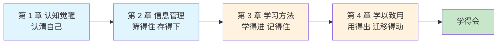

# 卷一 · 自我精进 · 学习

> **学得会的认知、信息与学习方法**

---

## 1. 本卷定位

系列贯穿语是"**学得会，做得到，说得清**"，本卷负责第一环：**学得会**。

这不是一本讲"学习很重要"的书，而是一套**让你真的能学会**的可操作系统。全卷以开篇立起的"**存不下、记不住、用不出**"三断点为主框架：先认清自己（认知觉醒），再在信息洪流里筛选出有用的部分（信息管理），然后用对方法把知识真正内化（学习方法），最后让知识产生价值（学以致用）。

**一句话定位：让"学得会"成为你的底层能力。**



**目标读者**：在校学生、应届生；职场 0 到 3 年、感觉"学不动了"的新人；想重建学习体系的终身学习者。

---

## 2. 这卷怎么用：断在哪，读哪章

开篇把最常见的学习失败归纳成三断点，四章各自挂在一个断点上，每篇开头的"断点自测三问"30 秒就能判断这一篇是不是你此刻需要的。

**收藏一堆，用时找不到**：断点一，翻第 2 章，信息筛选、优质信息源、卡片笔记四篇把"存不下"补齐。**学得慢、看了就忘**：断点二，翻第 3 章，从宏观框架到记忆法的八篇把"记不住"补齐。**学了很多却用不出来**：断点三，翻第 4 章，知识迁移与输出倒逼两篇把"用不出"补齐。**不确定自己断在哪**：从第 1 章读起，认清自己是所有改变的起点。

每一篇的结构是固定的：真实事故开场（有时间、有地点、有数字的亲历案例）、断点自测三问、方法拆解、踩坑清单，结尾配"今天起改变三点"和课后作业。学的是方法，看的是教训。

---

## 3. 本卷目录

> 全卷共 **21 篇**（开篇 + 4 章 19 篇 + 结语）。

### 开篇

| 序号 | 标题 |
|------|------|
| 00 | [为什么你学了很多，却依然过不好这一生](./00.开篇.md) |

### 第 1 章　认知觉醒：所有改变的起点

| 序号 | 标题 |
|------|------|
| 01 | [学习的七大原则](./01.学习的七大原则.md) |
| 02 | [需求层次的模型](./02.需求层次的模型.md) |
| 03 | [一起来做个练习](./03.一起来做个练习.md) |
| 04 | [要带上技能地图](./04.要带上技能地图.md) |
| 05 | [经营好自我公司](./05.经营好自我公司.md) |

### 第 2 章　信息管理：在噪音中建立知识资产

| 序号 | 标题 |
|------|------|
| 06 | [信息过载怎么办](./06.信息过载怎么办.md) |
| 07 | [体系思维很重要](./07.体系思维很重要.md) |
| 08 | [建立优质信息源](./08.建立优质信息源.md) |
| 09 | [卡片笔记写作法](./09.卡片笔记写作法.md) |

### 第 3 章　学习方法：从输入到内化的完整闭环

| 序号 | 标题 |
|------|------|
| 10 | [宏观学习的方法](./10.宏观学习的方法.md) |
| 11 | [用海绵法找时间](./11.用海绵法找时间.md) |
| 12 | [三段分解学什么](./12.三段分解学什么.md) |
| 13 | [链式和环式思考](./13.链式和环式思考.md) |
| 14 | [玩和教保证效果](./14.玩和教保证效果.md) |
| 15 | [学习方法论沉淀](./15.学习方法论沉淀.md) |
| 16 | [对抗遗忘记忆法](./16.对抗遗忘记忆法.md) |
| 17 | [主题式阅读方法](./17.主题式阅读方法.md) |

### 第 4 章　学以致用：让知识真正产生价值

| 序号 | 标题 |
|------|------|
| 18 | [知识迁移与运用](./18.知识迁移与运用.md) |
| 19 | [输出倒逼着输入](./19.输出倒逼着输入.md) |

### 结语

| 序号 | 标题 |
|------|------|
| 20 | [让学习成为你一辈子的复利](./20.结语.md) |

---

## 4. 阅读建议

两种读法。**诊断式**：带着问题来，对照第 2 节的"三断点定位"直接翻到对应章节，读完就用，用完就走，这是本卷设计的主读法。**系统式**：按目录顺序通读，19 篇沿"认清自己、管好信息、用对方法、学以致用"推进，读完后你对"怎么学会一样东西"会有完整的流程感。

**建议边读边练**：每读完一篇，当天就做"今天起改变三点"，比连读十篇更有效。本卷与卷二的"断点自测三问"体例一致，两卷可以互相穿插使用。

---

## 5. 与另两卷的关系

三卷是"**输入、输出、放大**"的能力闭环。本卷解决"学得会"，卷二解决"做得到"，卷三解决"说得清"。本卷**可以独立阅读**：你不需要先读卷二、卷三，也不需要先读完本卷才能读它们。

```text
卷一 学习（修己）  →  卷二 成事（立功）  →  卷三 立言（传世）
     学得会                做得到                说得清
```

---

## 6. 待补计划

阶段三合稿夯实进行中：与卷二卷三合计补齐总字数，同步准备可先行投稿的样章与作者简介物料。
