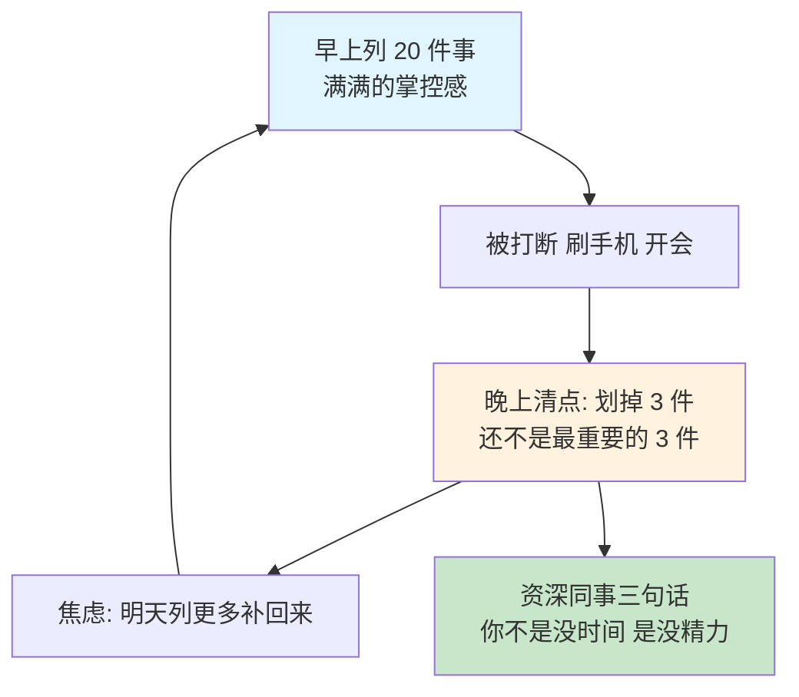
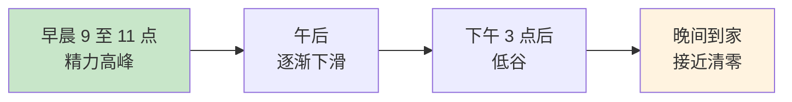
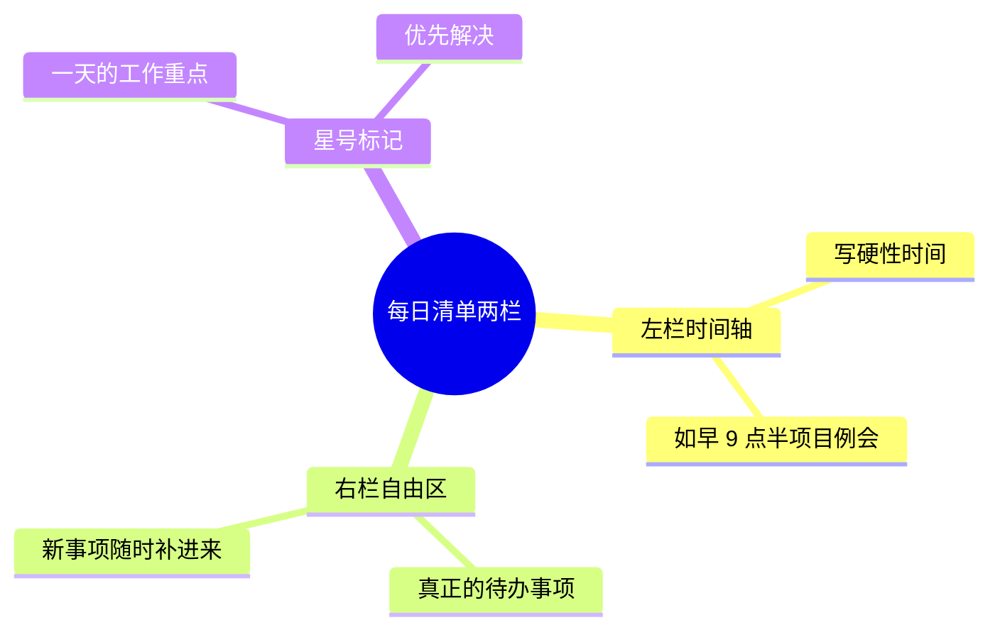
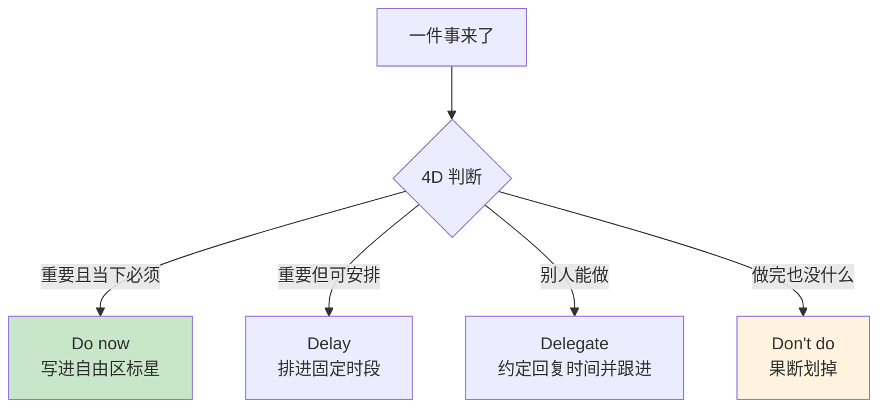
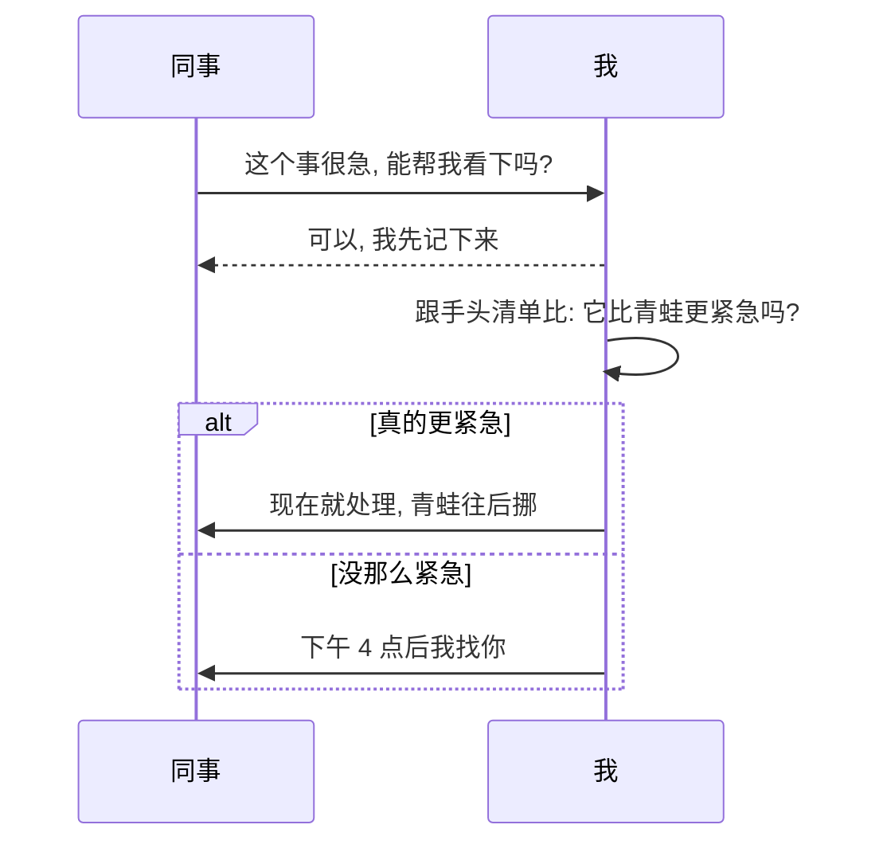
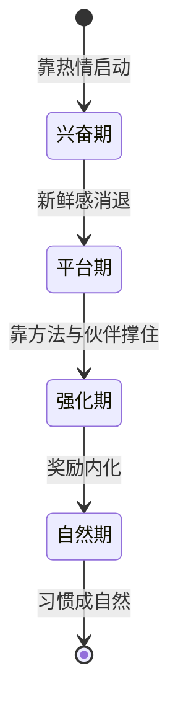
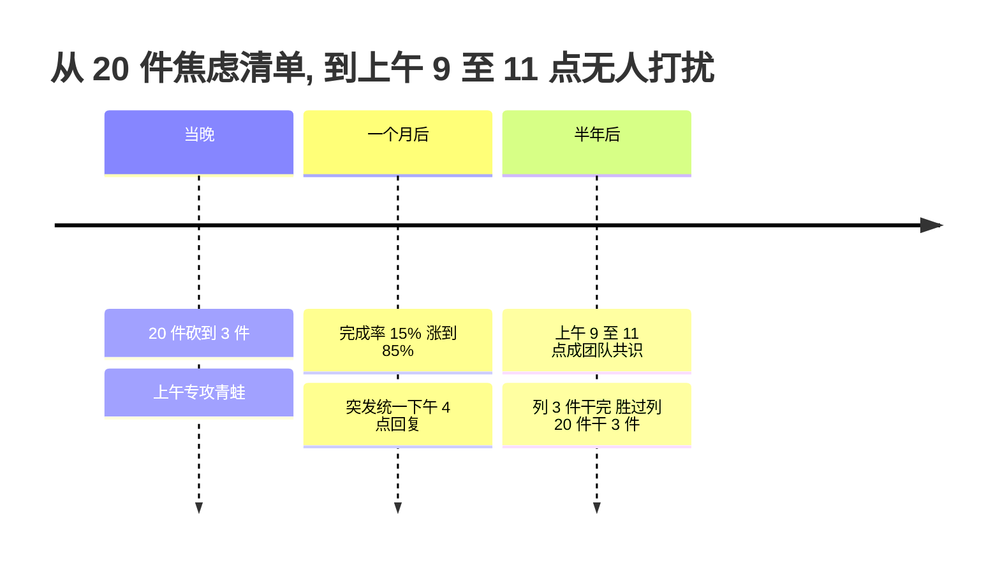

# 1.4 计划的落地策略

- [01.看一个真实案例](#01看一个真实案例)
- [02.断点自测三问](#02断点自测三问)
- [03.没有时间的误区](#03没有时间的误区)
- [04.每日清单任务项](#04每日清单任务项)
- [05.做小巧的周计划](#05做小巧的周计划)
- [06.4D 工作法实践](#064d-工作法实践)
- [07.解决突发的事件](#07解决突发的事件)
- [08.培养一个好习惯](#08培养一个好习惯)
- [09.这几个坑我踩过](#09这几个坑我踩过)
- [10.总结回顾本章节](#10总结回顾本章节)
- [11.后来发生的改变](#11后来发生的改变)
- [12.今天起改变三点](#12今天起改变三点)
- [13.课后作业思考下](#13课后作业思考下)

## 01.看一个真实案例

有段时间我特别迷"清单"：每天早上先用 20 分钟列 TODO，密密麻麻列 20 件事，看着满满当当的清单很有掌控感，仿佛自己已经赢了一半。

然后开始干第一件事，干到一半微信弹一个消息，回完消息顺手刷了下朋友圈；翻回来干第二件事，同事过来找我聊一个紧急 bug，干了 40 分钟；回到工位准备干第三件事的时候，已经 11 点半了，先去吃饭吧。下午茶之后还有两个会，散会之后人累得只想躺。

晚上回家看那张早上的清单：**20 件事，划掉了 3 件，还都不是最重要的那 3 件**。

这种状态持续了两周。我每天列得越多，完成得越少；完成得越少，第二天为了"补回来"列得就越多，形成一个完美的恶性循环：

直到有一天，组里的资深同事看了我那张密密麻麻的清单，跟我说了三句话，我现在还记得："**你不是没时间，你是没精力**。""**你这清单不是计划，是焦虑清单：把焦虑写下来不会让事情变少**。""**先吃掉那只青蛙，剩下的都是赚的**。"

那时候我才意识到：**我以为自己缺时间，其实我缺的是一套真正能把计划落到地上的策略**。

## 02.断点自测三问

在往下读之前，先做三道判断题，任意一题命中，这一节就值得你认真读完。**第一问，清单变焦虑墙**：你的日清单上是不是常常有 10 件以上任务，每晚划掉不到一半？命中，说明你已经在列得多、做得少的死循环里。**第二问，精力错配**：你有没有把最难的事留到下午 3 点之后做？有，你是在精力低谷期硬啃青蛙。**第三问，被打扰即接单**：别人一说"紧急"你就立刻停下手头事？是，你永远在追别人的优先级。

三问依次对应本节的三条主线：**每天只盯 3 件事、把青蛙放在精力最高峰、立即回应但不立即去做**。你在哪一条上薄，就重点看那一段。

## 03.没有时间的误区

有了计划，接下来就是每天去做了：**这才是难度最大的地方**。以为自己"没时间"，其实是掉进了三大误区：

**误区一：不是没时间，是没精力**。一天的精力曲线长这样：早晨刚上班时精力最旺盛，效率高；随着时间推移和事项难度增加，精力一路递减；等到下班挤地铁回家，只想瘫在沙发上。**时间还在，但精力已经清零**。

**误区二：碎片化时代注意力被切割**。微信、朋友圈、电话、工作交流把时间切得支离破碎，想找 15 分钟完全不被打扰的时间都很难。你去书房拿书，进门就开始刷手机、顺手收拾桌子、又发现维生素 C 该放到厨房，半小时后你还没拿到那本书。

**误区三：把突发事件想得太可怕**。遇到挫折不要急着全盘放弃，突发事件通常并没有你想象中严重：**我们完全可以把变化也当作计划的一部分**。

## 04.每日清单任务项

要罗列每日清单。不知你是否有这种感觉：每天都被工作填满了，下班回家虽然还剩一两个小时才睡觉，但上了一天班后除了躺着玩手机，什么也不想干，更别提什么计划了。

事实确实如此，每天的时间精力是有限的。如果想安排所谓的"业余时间"来完成非工作的年度计划，那就永远也不可能完成。**因此实现计划的关键，在于把年度计划拆解到每天的待办事项中**，这样既能穿插在忙碌的工作中让你不至于太累，还能提高工作效率。

用一张每日计划清单解决：

**左栏比较窄，带时间刻度**，这是一天的时间轴，让我们掌握一天到底有多少时间资源可以用，写的是固定时间要做的事，比如早晨 9 点至 9 点 30 分的项目进度会，这 30 分钟在一天开始时就预支出去了。**右栏比较宽，叫自由区**，这里写的才是真正的待办事项，有新事项随时补进来。**标了星号的事项表示当天的工作重点，要优先解决**。

**如何解决没有精力**？把每天要做的年度计划中的事情也列到待办事项清单中。不要等到完成所有工作才关注年度计划，工作是永远做不完的。工作、生活、年度计划它们是平等的，所有今天要做的事情都列到同一张清单上。这个可以用来破解"不是没时间，是没精力"：**把年度计划当成"和工作同等重要的事"，而不是"等我有空再做的事"**。

**如何解决无法立刻执行**？对相对复杂的事项梳理大概思路。大部分人写待办清单的时候只把要做的事情写下来，而我会把做这件事大概的思路也简单记录一下。写清单的目的之一是让我们忘掉它，这样才会更专注手头的事情，效率才高。**一项任务卡住，往往不是难，而是"不知道下一步从哪伸手"**。

这套做法的原典是大卫·艾伦的《搞定》（GTD）：前文的两分钟法则是它的招牌，而"把思路简单记录一下"背后是它更核心的动作，**下一步行动**。把任务写成动词开头的具体动作："处理季度报告"永远会拖延，"打开模板填好前三行数据"随手就能开始；**一项任务一旦被定义到"下一步动作"的颗粒度，它就从焦虑变成了选项**。这一招和卷三第 9 篇的"清空大脑"是一对：收集清空解决"别忘了"，下一步行动解决"怎么开始"。

## 05.做小巧的周计划

我以前列周计划也犯过和列日清单一样的毛病：一口气塞 30 件事，一周下来完成 10 件，剩下 20 件挪到下周。挪着挪着，就再也不看那张清单了。

后来我学会一个原则：**一周只列 5 至 7 件真正重要的事**，其余的全部进"备选区"。每周最重要的 5 至 7 件事完成了，就是高效的一周；如果还有余力再去清备选区。

周计划的四条落地规则：**先写核心事项**（周日晚上花 15 分钟列出下周 5 至 7 件必须完成的事）；**补充备选池**（想到的其他事全部放备选区，不占主战场）；**固定整理时间**（每周同一时刻整理，比如周日晚 9 点雷打不动）；**周计划与日计划打通**（每天早上从周清单挑当天的 3 件事，不做二次头脑风暴）。

**清单的目的不是"显得自己很忙"，而是"确保最重要的事被做掉"**。

## 06.4D 工作法实践

每天遇到的所有事情，都可以用 4D 工作法决定下一步行动：

**Do it now，立即去做**：写进自由区并标星，上班时优先完成。**Delay it，计划去做**：安排在固定时间段，把弹性时间刚性化。**Delegate it，授权去做**：授权不等于放权，必须约定回复时间并跟进。**Don't do it，尽量别做**：果断划掉不重要事项。

**为什么 4D 这么关键**？大多数事情之所以没完成，是因为完不成也没什么，没有任何影响。假如没有完成，你一百万没有了，你会完成吗？肯定会。**你嘴上觉得重要，行动出卖了你；如果真的超级重要，就一定会完成**。

**给自己配一套奖励机制**。小时候爸爸常说："只要这次你考全班前 3 名，我就奖励你去游乐场玩一次"。奖励对完成计划非常有用。比如一直懒得跑步，现在要求自己一周跑步 3 次，完成后奖励自己一顿大餐。我一般是先做计划、把计划写在小本本上，并把完成计划后的奖励列出来，做完一件事一定要在计划本上用力地把这件事情划掉，并在奖励后面画个小星星。**这种成就感绝对可以推着你马不停蹄地做事**。

## 07.解决突发的事件

每个人对事情排序的结果都不同（老板优先、同事优先、紧急优先、自己优先），价值观没有对错之分，但**要承担排序造成的后果**。

**总在被事情推着走的核心根因**：同事说急事你就立刻帮，客户说重要你就立刻办，总在被事情推着走，而不是推着事情走。领导让你"第一时间"去汇报，他其实并不知道你手头都有什么事，只是在表达急切心情。**所有人交代事情时都会说自己的事情很重要，事实真的如此吗？不一定**。

**更好的做法：立即回应，但不是立即去做**。一次典型的处置长这样：

不管别人怎么说，都把临时任务和手头清单做比较：如果手头有更重要更紧急的事，立即拒绝或协商回应；只有当它真比手头一切都紧急，才是去解决它的时机。

优先级安排的实操：**先预览一遍今天所有的事（只看不处理），不清楚的花几分钟弄清具体情况再排序**。此外准备一个 TODO 笔记本，把日常遇到的关键词（微信文章、搜索问题、书上不清晰的点）随手记下，工作之后再回来学习。

## 08.培养一个好习惯

好习惯让我们受益终生（早晚刷牙、每日运动、健康饮食），但培养习惯不易，年龄越大越难。**习惯养成要走四个阶段**：

兴奋期靠热情轻松坚持，平台期需要伙伴或方法约束自己，强化期依靠奖励刺激维持，自然期习惯成自然，除非用新习惯替代否则不会消失。知道自己在哪个阶段，就知道该用什么力：兴奋期别加码，平台期找同伴，强化期设奖励。

**行为转变四大定律**（《掌控习惯》）：让它**显而易见、有吸引力、简便易行、令人愉悦**。每当想改变行为，就问自己四个问题：怎样才能让它变得明显？有吸引力？变得容易？令人愉悦？

执行阶段有两把利器。**第一把，番茄工作法**："工作 25 分钟加休息 5 分钟"为一个循环，四个循环后再来一次半小时大休息，25 分钟内不做任何与任务无关的事（完整做法详见本册 3.2）。**第二把，吃掉那只青蛙**：**每天早晨先做最有挑战性的事**，之后一整天的琐事就都显得轻松无比。当你把最难的"青蛙"吃掉，即便其他任务没做完，今天也已经完成了最重要的事：**成就感会推着你完成剩下的工作**。

## 09.这几个坑我踩过

**坑一：清单写完就放抽屉**。有半年时间，我每天早上认真列 3 件事，然后关掉笔记本开始工作，晚上下班前才想起翻一下。**清单不打开等于没写**。后来我把日清单钉在显示器右上角贴纸位，从物理上强制自己每隔 1 小时抬头看一眼。

**坑二：把"紧急"当"重要"**。同事一说"急"我就立刻停下手头事去救火，一天下来清单一项没动。后来我给自己定了一条规则：**任何被打断的紧急事，先问一句"能等到下午 4 点吗"**。80% 的"紧急"在这个问题面前就自然消散了。

**坑三：把青蛙拖到下午吃**。我曾把最难的技术方案安排在下午 2 点写，理由是"饭后清醒"。结果每次都是拖到 4 点还在磨。**下午 2 点是消化系统的高峰，不是大脑的高峰**。上午 9 至 11 点是脑力黄金 2 小时，青蛙必须放这里。

## 10.总结回顾本章节

**计划落不落得了地，不取决于你列了多少件事，而取决于你每天最难的那只青蛙吃没吃掉**。

你应该带走三件事。**第一，每天只盯 3 件事加先吃青蛙**：清单不是"焦虑墙"，把最难最重要的那件放在精力最高峰先干掉。**第二，用 4D 处置一切任务**：立即做、计划做、授权做、尽量别做，敢于划掉、敢于授权，焦虑量立刻下降一半。**第三，把变化纳入计划本身**：突发事件不是"破坏计划"，先回应再判优先级，不立刻接是一种能力。

## 11.后来发生的改变

**20 件砍到 3 件，青蛙先吃**。资深同事点醒我那天晚上，我做了一件很难受的事：把第二天的清单从 20 件砍到了 3 件，并把那 3 件重新做了排序：**第 1 件是当天最难、最重要、我最不想干的"青蛙"**。第二天早上 9 点到 11 点，我什么都没干就在干那只"青蛙"：一个我已经拖了三天的技术方案。11 点钟方案出炉的那一刻，我整个人忽然轻了：剩下一整天，无论再发生什么我都赚了。

**完成率从 15% 涨到 85%**。之后一个月我严格执行"每日 3 件事加先吃青蛙加 4D 处置剩余任务"。每天早 9 点用 5 分钟列 3 件事，9 点到 11 点专攻青蛙，下午用番茄钟做剩下 2 件，其他所有突发事件统一回应"我下午 4 点之后回复你"。月底统计：**清单完成率从过去的不到 15%（20 件完成 3 件）涨到 85% 以上（3 件完成 2.5 件以上）**。而我反而比之前更不焦虑了，因为我知道每天那 3 件事一定能完成。

**半年后，团队默认"上午 9 至 11 点不打扰"**。半年之后，我已经把"每天上午 9 至 11 点不接受任何打扰"变成了团队默认共识：同事、领导都知道这两个小时找我没用，要么提前预约下午时段，要么自行推进。更重要的是，那些过去让我焦虑的"突发事件"，大部分根本就不是真正的紧急事件。**它们之所以显得紧急，只是因为我每次都立刻回应**。当我开始用"立即回应、不立即去做"之后，绝大多数所谓的紧急都自动消失了。那张曾经写满 20 件事的旧清单我留了下来，现在贴在工位边，它每天提醒我：**列得多不等于做得多，列 3 件干完比列 20 件干 3 件强 100 倍**。

## 12.今天起改变三点

**第一，建立每日 3 件事清单**。从明天早上开始，每天上班前花 5 分钟写下今天最重要的 3 件事。不是 3 件以上，就是 3 件。这 3 件事完成了，今天就是高效的一天。如果 3 件都完不成，说明目标太大需要继续分解。每天晚上回顾：3 件事完成了几件？未完成的原因是什么？

**第二，用 4D 处理堆积任务**。面对堆积的任务不要焦虑，把每个任务归入四类：立即做（重要且当下必须）、计划做（重要但可安排时段）、授权做（别人能做，约定回复时间）、尽量别做（做完也没什么影响）。果断划掉那些不必要的任务，**你会发现真正需要做的并没有那么多**。

**第三，先吃最难的青蛙**。把一天中最有挑战性、最重要的任务放在精力最充沛的时候做（通常是上午 9 至 11 点）。先攻克最难的事情，剩下的一切都会轻松得多。不要把难事拖到下午精力低谷期，那样只会越拖越焦虑。**记住：吃完青蛙之后，一天都是赚的**。

## 13.课后作业思考下

1. 详细记录你明天一天的时间使用情况（每 30 分钟记一次）。一天结束后分析：有多少时间花在了真正重要的事上？有多少时间被琐事和突发事件消耗了？你的"有效工作时间"比例是多少？

2. 把你当前待办清单上的所有任务，用 4D 工作法进行分类：划掉（Don't do）至少 3 个不必要的任务、授权（Delegate）至少 1 个可以委派的任务。看看精简后你的任务清单是否更聚焦了。

3. 用文中的方法制定一份下周的周计划，包含：本周最重要的 3 个目标、每天的核心任务、预留的弹性时间（应对突发事件）。一周后复盘：计划完成率是多少？哪些安排需要调整？

4. 选择一个你想养成的好习惯（比如早起、运动、阅读），用"降低启动成本"的方法来设计：提前准备好所有需要的东西，设定一个最小行动（比如"先做 2 分钟"），坚持 21 天。记录每天的完成情况和感受，21 天后评估这个习惯是否已经初步形成。

---

> **📎 下一站** ｜ 计划落地之后，还差最后一步：结果拿到手之后怎么检查、怎么改进。下一节讲**结果的检查改进**，让每一次执行都能反哺下一次。
