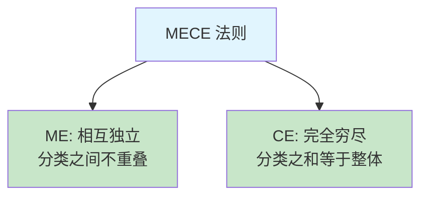
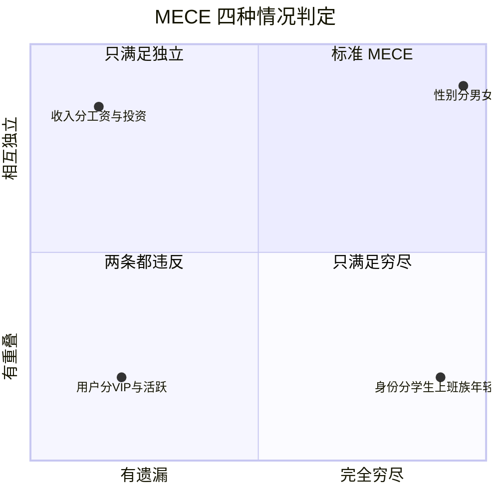
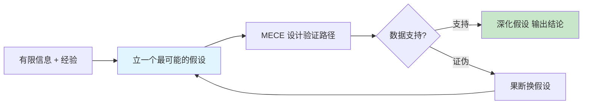
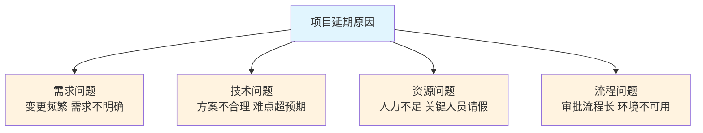
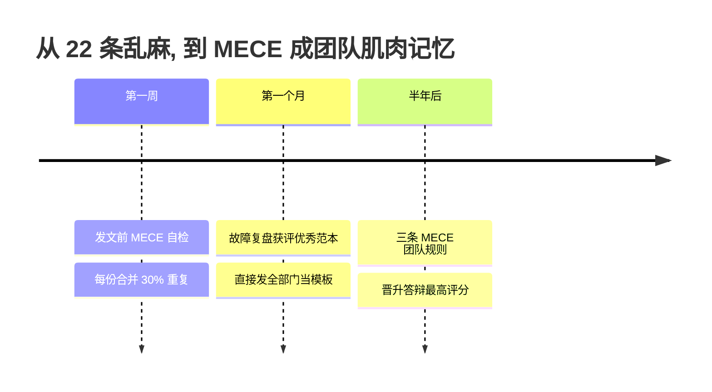

# 2.6 MECE 分析的方法

- [01.看一个真实案例](#01看一个真实案例)
- [02.断点自测三问](#02断点自测三问)
- [03.MECE 法则背景介绍](#03mece-法则背景介绍)
- [04.MECE 核心含义解读](#04mece-核心含义解读)
- [05.MECE 拆解四大方法](#05mece-拆解四大方法)
- [06.假设驱动与金字塔](#06假设驱动与金字塔)
- [07.MECE 案例实战演练](#07mece-案例实战演练)
- [08.MECE 常见三大误区](#08mece-常见三大误区)
- [09.这几个坑我踩过](#09这几个坑我踩过)
- [10.总结回顾本章节](#10总结回顾本章节)
- [11.后来发生的改变](#11后来发生的改变)
- [12.今天起改变三点](#12今天起改变三点)
- [13.课后作业思考下](#13课后作业思考下)

## 01.看一个真实案例

那次故障是我职业生涯永远忘不了的：**我们的核心服务在凌晨 3 点宕机了 47 分钟，影响了 30 万用户**。我作为责任人，第二天上午要给整个部门做故障复盘。

我熬了一整夜，写了一份 8 页的复盘报告。我以为自己写得很全面，原因列了整整 22 条，包括："代码 Bug、SQL 慢查询、缓存穿透、新人不熟悉、流量突增、监控告警延迟、服务器配置不够、数据库连接池小、运维不到位、压测不充分、code review 走过场、文档不完善"，等等。

报告发出去的一瞬间，我以为自己已经覆盖了所有可能的角度。结果会议上，部门 Leader 看了 30 秒，把电脑一合，说了一句让我面红耳赤的话："**你这个东西乱七八糟的：'代码 Bug'和'新人不熟悉'到底算一类还是两类？'压测不充分'和'监控告警延迟'是同一层级的吗？你这 22 条里，至少有 8 条是重复的，又至少漏了 4 个关键维度。**"

我当场无语：**我以为列得越多越全，没想到反而暴露了我的混乱**。

会后一位前辈把我拉到楼下咖啡厅。他在我对面坐下，掏出一张餐巾纸说："让我教你一个东西。"他在餐巾纸上画了一个矩形，分成 4 个格子，写上：**人、系统、流程、外部**。

然后说："你那 22 条，全部能塞到这 4 个格子里，而且**每条只能进一个格子，不能重复**；同时**这 4 个格子加起来，要能覆盖所有可能的故障原因**。这就是 MECE。"

我当场用他的框架重新整理我的 22 条原因。**人**：新人不熟悉、code review 走过场、运维不到位，合并为"人员能力与流程不足"；**系统**：代码 Bug、SQL 慢查询、缓存穿透、连接池小，合并为"代码与配置缺陷"；**流程**：压测不充分、监控告警延迟、文档不完善，合并为"质量保障流程缺失"；**外部**：流量突增，归为不可控外部因素。

**22 条压缩成 4 大类，没有任何重复，且我突然发现还漏了"灾备能力"和"应急预案"两个关键维度**。这 4 大类一目了然，每一类下挂 3 至 5 条具体原因：这就是真正的复盘报告。那张餐巾纸我至今还留着。

## 02.断点自测三问

在往下读之前，先做三道判断题，任意一题命中，这一节就值得你认真读完。**第一问，列得越多越乱**：你上一份复盘、方案是不是"原因列一堆"但读起来抓不住重点？是，项多层薄，重复又遗漏。**第二问，没有拆分维度**：你分析问题时是先想"拆分维度"，还是直接开始列原因？后者，无框架等于想到哪写到哪。**第三问，拆完不检查**：你拆完后有没有回头问"两两不重叠加起来覆盖"？没有，拆完就走，坑等在半路。

三问依次对应本节的三条主线：**先定维度再列条目、两两互斥、加起来穷尽**。你在哪一条上薄，就重点看那一段。

## 03.MECE 法则背景介绍

你有没有分析问题时遇到过这样的困境：**列了一堆原因，但总觉得不全面，可能遗漏了什么；又或者列出的原因之间有重叠，讨论时把同一个问题翻来覆去说了好几遍**。问题的根源在于：你的分析框架不够严谨。MECE 法则就是帮你建立严谨分析框架的工具。

MECE（Mutually Exclusive, Collectively Exhaustive，相互独立、完全穷尽）由全球顶级咨询公司麦肯锡提出，是麦肯锡方法论的核心基石。**几乎所有的咨询师在入职第一周就会学习 MECE 原则**。

## 04.MECE 核心含义解读

**ME 相互独立**。"相互独立"意味着你拆分出来的各个部分之间不能有重叠。比如把人按年龄分为"18 岁以下""18 至 35 岁""35 岁以上"就是相互独立的；但如果分为"学生""上班族""年轻人"就不是相互独立的，因为"年轻人"和"学生""上班族"有重叠。

**CE 完全穷尽**。"完全穷尽"意味着你拆分出来的各个部分加在一起必须覆盖全部情况，不能遗漏。比如把性别分为"男""女"是完全穷尽的；但如果只分为"男""女""儿童"就不是 MECE 的，**因为"儿童"和前两类重叠（ME 违反），而且这种分法的逻辑也不自洽**。

两个标准交叉，所有拆分落进四种情况，一张图判定：

右上角"性别分男女"是标准 MECE；左上角"收入分工资、投资"相互独立但漏了经营收入等其他来源（违反 CE）；右下角"身份分学生、上班族、年轻人"覆盖了所有人但相互重叠（违反 ME）；左下角"用户分 VIP、活跃用户"两条都违反。**拆完任何一组分类，把自己的四条要素往这张图上一放，立刻知道改哪**。

## 05.MECE 拆解四大方法

**按流程拆解**。把一件事按照时间顺序或流程步骤来拆分，天然就是 MECE 的。比如分析"用户流失"问题，可以按流程拆解为：注册阶段流失、首次使用流失、持续使用阶段流失、付费阶段流失。**每个阶段互不重叠，加在一起覆盖了用户的全生命周期**。适合过程类问题。

**按结构拆解**。把一个整体按组成部分来拆。比如分析公司收入构成：A 业务加 B 业务加 C 业务；分析研发成本：人力成本加基础设施成本加外部采购成本。**适合"这个东西由什么组成"的组成类问题**，只要组成部分边界清晰，拆出来就是 MECE 的。

**按公式拆解**。利用已有的公式来拆分。比如：**收入 = 用户数 × 客单价 × 购买频率**；**利润 = 收入减去成本**；**转化率 = 转化人数除以访问人数**。**公式中的每个因子天然就是 MECE 的**，因为它们数学上互不重叠且组合完整，适合指标类问题。

**按二分法拆解**。快速粗分时最好用：付费与非付费、线上与线下、新用户与老用户。**二分法未必深刻，但永远不重叠**，是时间紧张时最稳妥的起手式。

四种方法的选择原则只有一条：**看问题的性质**。过程类问题用流程，组成类问题用结构，指标类问题用公式，时间不够用二分。

## 06.假设驱动与金字塔

MECE 拆解是麦肯锡方法的一只手，另一只手叫**假设驱动**（hypothesis-driven）。两者的差别用一个问题就能说明白：拿到"为什么用户流失"的分析任务，你是花两周把所有可能的原因调研一遍，还是先根据经验立一个最可能的假设，再用一天时间重点验证它？**前者叫穷举式拆解，求全但慢；后者叫假设驱动，求快但可能错**。麦肯锡顾问面对客户只给一周的项目，从来都是先立假设。

假设驱动三步。**第一步，立假设**：基于有限信息和经验，给出一个"最可能的答案"，比如"流失主要发生在注册后 48 小时内的新手引导环节"。**第二步，MECE 设计验证**：围绕假设设计验证路径，要证伪的是哪些环节、要找的是哪些数据，这里的拆解依然必须 MECE，否则验证会漏。**第三步，快速证伪与修正**：数据不支持就果断换假设，而不是为旧假设找证据，确认偏误会让验证变成自欺。

很多人只知道 MECE 不知道假设驱动，结果把拆解做成了"全面但低效"的资料汇编。**两句话记住分工：MECE 管拆得全，假设驱动管跑得快；先假设定方向，再 MECE 保周全**。时间充裕用穷举，火烧眉毛用假设，两套节奏都要会。

最后把 MECE 放回它的母体：**金字塔原理**。芭芭拉·明托的金字塔原理有两个核心动作，结论先行和归类分组，而"归类分组"的分组标准就是 MECE：**同一层的要素相互独立、完全穷尽，金字塔才立得住**。可以说 MECE 是砖，金字塔是楼。本册 3.4 的金字塔汇报方法会专门讲怎么用金字塔向上汇报，那里见。

## 07.MECE 案例实战演练

**分析 App 留存率下降**。第一层拆分按用户类型：新用户留存下降加老用户留存下降，等于全部用户留存下降，这是 MECE 的。第二层分别再拆：针对新用户，按流程拆解为"获客阶段"和"激活阶段"的问题；针对老用户，按因素拆解为"内部原因"（核心功能体验、需求变化）和"外部原因"（竞品替代）。两层各自 MECE，互相不交叉。

**分析项目延期原因**。一级分类四个，二级原因和真实案例各挂一条：

每个一级分类下挂一个真实案例：需求问题，如产品经理频繁修改 PRD；技术问题，如未预估到第三方接口限制；资源问题，如核心开发生病请假一周；流程问题，如测试环境被其他项目占用。

**检验 MECE**：四个一级分类之间是否重叠？需求、技术、资源、流程，基本不重叠。是否穷尽？加上"其他因素"兜底，可以认为是穷尽的。

## 08.MECE 常见三大误区

**误区一：过度追求完美 MECE**。在实际工作中，100% 完美的 MECE 往往很难做到。**不要为了追求完美而花太多时间纠结分类**：做到 80% 的 MECE 就已经比没有框架好得多了。

**误区二：层次太多太复杂**。MECE 拆分通常 2 至 3 层就够了。**层次太多会导致分析框架过于复杂，反而降低了分析效率**。

**误区三：忘记了分析的目的**。MECE 是工具，不是目的。拆分完之后的关键是：**通过拆分发现问题的关键所在，找到解决方案**。如果拆分得很漂亮但最后没有得出有价值的结论，那就是为了 MECE 而 MECE。

## 09.这几个坑我踩过

**坑一：MECE 层数堆到 4 层以上**。我曾经用 MECE 拆产品问题，一路拆到第 4 层，结果反而看不清主要矛盾。**MECE 是望远镜不是显微镜**：3 层就足够，再多就是自我陶醉。

**坑二：把 MECE 当结论**。我曾经交出过一份"特别 MECE"的市场分析，逻辑漂亮到无懈可击，**但整份文档没有提出任何一个可执行的动作**。Leader 看完只说了三个字："所以呢？"MECE 只是拆解，不是结论：**拆完之后必须回答"所以我要做什么"**。

**坑三：一级分类之间悄悄重叠**。做需求分析时我列了"新用户、高频用户、付费用户"三类，看着挺全面，其实**"付费用户"和"新用户、高频用户"有大量交集**。检验 ME 的技巧：**任取两个分类问一句"有没有一个用户同时属于两个"，答"有"就不是 MECE**。

## 10.总结回顾本章节

**MECE 不是让你看起来更专业，它真的能让一份文档的价值翻几倍**。

你应该带走三件事。**第一，先定维度再列条目，赶时间时先立假设再验证**：MECE 的核心不是"列"，而是"先想清楚从哪个维度去列"；假设驱动则让你先有方向，再拆得全。**第二，两两互斥加起来穷尽才叫 MECE**：拆完必须做这两项自检，任何一项不过就要重来。**第三，拆完之后必须回答"所以我要做什么"**：MECE 是工具不是结论，不能只交拆解不交行动。

## 11.后来发生的改变

**第一周所有文档过 MECE**。我做的第一件事是给自己定了一条铁律：**任何要发出去的文档、汇报、方案，提交前必须用 MECE 自检一次**。具体动作只有两个问题："我列的这些点，两两之间有重叠吗？"有就合并；"这些点加起来，覆盖了所有情况吗？"没覆盖就补。第一周内我自检了 5 份文档，**平均每份能合并 30% 的重复内容、补上 1 至 2 个漏掉的维度**。

**第一个月故障复盘获评优秀范本**。一个月后，又出了一次（小）故障，又是我做复盘。这次我严格用 MECE 框架：一级 4 类（人、系统、流程、外部）、二级各拆 3 至 5 条具体原因、配套行动项。部门 Leader 看完只说了一句话：**"这才叫复盘报告。这份直接当模板，发到全部门。"**那一刻我才真正理解：**MECE 不是让你看起来更专业，它真的能让一份文档的价值翻几倍**。

**半年后 MECE 成团队肌肉记忆**。半年后我开始带 6 人小组，我做的第一件事就是给团队全员普及 MECE，并定下三条规则：**所有文档"目录"必须 MECE**（一级标题之间不许重叠）；**所有问题分析必须先列 MECE 框架**（再往下填具体原因）；**所有方案设计必须用 MECE 检查覆盖度**（避免漏关键场景）。效果非常明显：**跨部门评审通过率显著提升**（评委一眼看清结构，不再追问"你是不是漏了 XX"）；**新人成长速度翻倍**（新人有了 MECE 这个万能脚手架，写文档不再"想到哪写哪"）；**我自己晋升答辩获最高评分**（因为整份述职用的就是 MECE 结构，评委非常容易理解）。

## 12.今天起改变三点

**第一，分析问题时先做 MECE 拆分**。下次分析问题时，**先做 MECE 拆分**。不要一上来就列原因，先想清楚用什么维度来拆分（流程？结构？公式？），确保拆分出来的部分不重叠、不遗漏。这个简单的步骤能大幅提升你分析问题的系统性。我自己每次写文档前都会先在草稿纸上画出 MECE 框架，再往下填内容。

**第二，用公式法拆解业务指标**。找一个你关心的业务指标，用公式法做 MECE 拆解。比如 **GMV = 用户数 × 转化率 × 客单价**。拆解后，你就能清楚地知道要提升 GMV 应该从哪个因子入手。**这种"指标拆解能力"是高级别工程师、产品经理的必备技能**。

**第三，检查你的汇报是否 MECE**。检查你最近的汇报或方案，看看分组是否符合 MECE。如果有重叠或遗漏，重新调整分组。一份 MECE 的汇报，逻辑清晰度会提升一个档次。**特别提醒：先看一级目录之间有没有重叠，这是最容易被忽视的地方**。

## 13.课后作业思考下

1. 选一个你正在面对的工作问题，用 MECE 法则做一次完整的拆解（至少 2 层），检查每一层是否满足"不重叠加不遗漏"。

2. 找一个业务指标（如日活、转化率、客单价等），用公式法拆解为若干因子，分析哪个因子是当前最值得优化的。

3. 回顾你最近写的一份汇报或方案，检查其中的分类框架是否 MECE。如果不是，重新组织一下结构。

4. 思考 MECE 和金字塔原理的关系：金字塔原理中的"归类分组"和 MECE 有什么联系？

---

> **📎 下一站** ｜ 拆干净之后，接下来要解决一个更实际的问题：**面对一大堆事，我该先做哪个**。下一节讲**二八法则**：找到那 20% 决定 80% 结果的关键。
