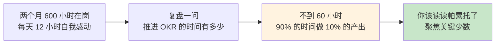
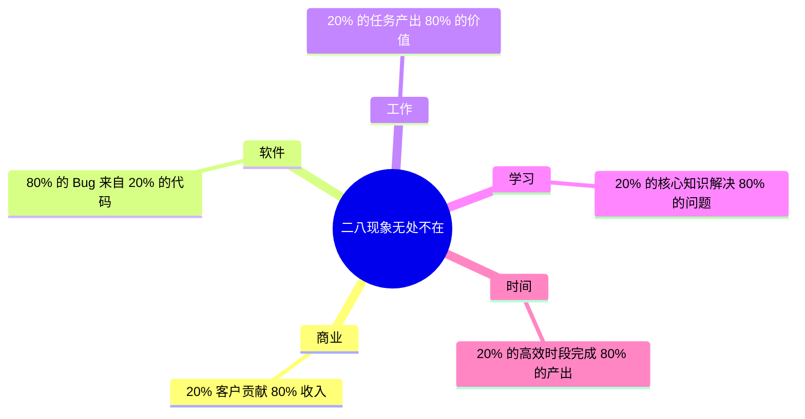
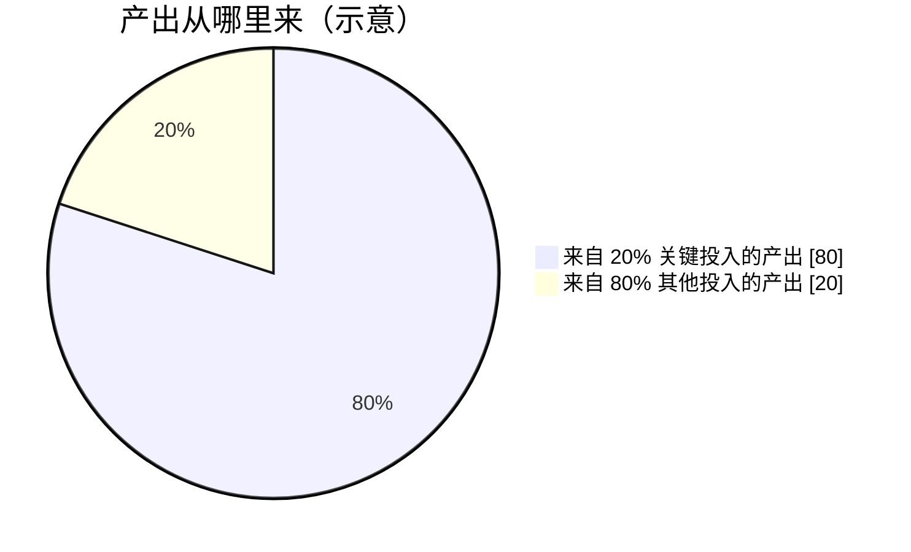
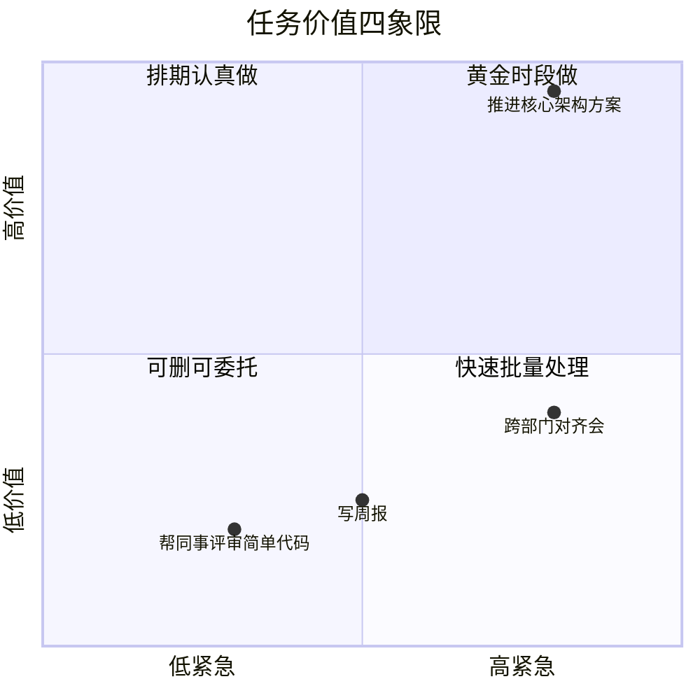
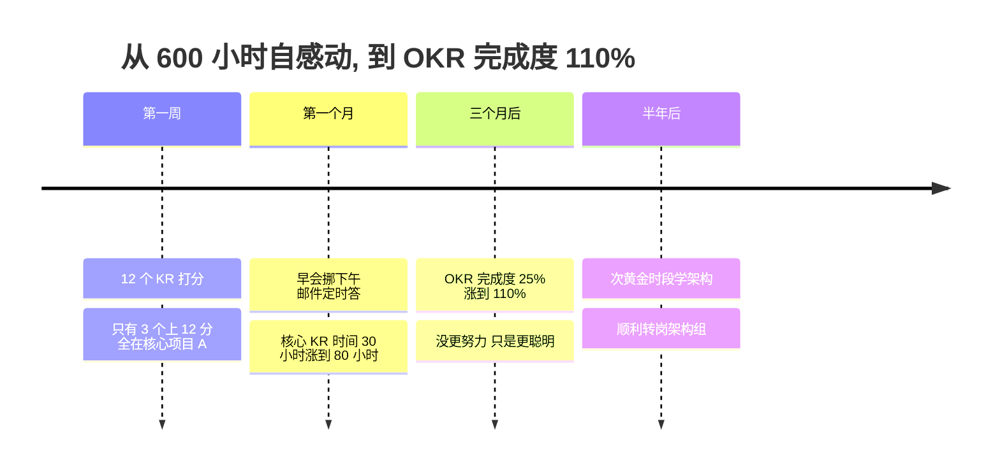

# 12.二八法则的运用

- [01.看一个真实案例](#01看一个真实案例)
- [02.断点自测三问](#02断点自测三问)
- [03.二八法则的背景](#03二八法则的背景)
- [04.二八法则的原理](#04二八法则的原理)
- [05.工作中的二八法则](#05工作中的二八法则)
- [06.如何找到关键少数](#06如何找到关键少数)
- [07.二八法则的局限性](#07二八法则的局限性)
- [08.这几个坑我踩过](#08这几个坑我踩过)
- [09.总结回顾本章节](#09总结回顾本章节)
- [10.后来发生的改变](#10后来发生的改变)
- [11.今天起改变三点](#11今天起改变三点)
- [12.课后作业思考下](#12课后作业思考下)

## 01.看一个真实案例

那是我入行第三年，刚被提拔为小组的技术骨干，手上同时跟着 4 个项目。每天我的状态大概是这样的：早上 9 点到公司，第一件事打开邮箱，回邮件回两个小时；11 点到 12 点开早会对齐进度；下午 2 点到 5 点排满了各种评审会、需求会、跨部门对齐会；5 点到 7 点处理同事的紧急求助，帮人 review 代码、答疑；7 点之后才开始写自己的核心需求，经常加班到晚上 11 点。

我每天工作 12 小时以上，自我感觉非常努力。直到双月复盘的前一天晚上，我打开自己的 OKR 文档，**整个人都麻了**：四个 KO（Key Objective）里，只有一个推进得勉强过半，另外三个几乎纹丝未动。

我盯着文档发呆了半小时：**我明明这么忙，为什么核心结果几乎全部没产出？**

第二天复盘会上，我硬着头皮汇报。我以为会被 Leader 痛批，没想到他只问了我一句话：**"你过去两个月里，真正在推进 OKR 的时间，加起来有多少？"**

我老老实实回看了日历：除去会议、邮件、答疑、临时救火，真正花在 KO 上的时间，**两个月加起来不到 60 小时**。而我每天在公司待的时间，加起来超过 600 小时。

也就是说，**我用了 90% 的时间，去做产出占 10% 的事**。

Leader 笑了笑，扔给我一句话："你该读读帕累托了"。那一晚我回家翻出二八法则相关的书和文章，第一次真正理解了**为什么有人轻松超额完成 OKR，而我这种"看起来很努力"的人，反而结果惨淡**。下面我就把这套救了我职业生涯的方法论，完整讲给你。

## 02.断点自测三问

在往下读之前，先做三道判断题，任意一题命中，这一节就值得你认真读完。**第一问，忙不等于有产出**：你上一个月花在核心 OKR 上的时间，占总工作时间的多少？说不清，说明你在用忙碌掩盖低产出。**第二问，黄金时段被侵占**：你精力最好的 2 小时，是花在核心目标上，还是在回邮件、开会？后者，黄金时段被低价值事务占据了。**第三问，全都要等于全都轻**：你手上正在推进的重要事项超过 5 件吗？超过，精力分散，无法聚焦关键少数。

三问依次对应本节的三条主线：**关注产出而非忙碌、把黄金时段留给 20%、聚焦关键少数**。你在哪一条上薄，就重点看那一段。

## 03.二八法则的背景

1897 年，意大利经济学家维尔弗雷多·帕累托（Vilfredo Pareto）在研究英国的财富分布时发现了一个惊人的规律：**社会上 20% 的人占有 80% 的社会财富**。他后来发现这个规律在很多领域都普遍存在。这就是著名的"二八法则"（也叫帕累托法则或 80/20 法则）。

二八现象在工作中无处不在：

认识到这个规律后，你就知道了一个提升效率的关键：**找到你的 20%，把大部分精力投入到那 20% 上去**。

一百多年后，英国作家理查德·科克把这个规律写成了全球畅销书《80/20 法则》，并把它从商业工具升级为一套思考方式，他称之为 **80/20 思考法**：不只是用二八法则安排任务清单，而是定期用它审问自己的人生。三个问题值得每个季度问一遍：**过去几年，哪 20% 的投入造就了我 80% 的成就？哪 80% 的投入只产出了 20% 的结果？下个季度，我该砍掉哪一类、加倍哪一类？**前两问帮你认清现实，第三问逼你做取舍。这一问就把二八法则从"排任务"提升到了"排人生"，也正好接上了 2.2 那条输入、转化、输出的成长公式。

## 04.二八法则的原理

**不对等分布**。二八法则的核心是：**投入和产出之间的关系不是线性的**。不是你投入 100% 的精力就能得到 100% 的回报，实际上少数关键的投入往往产生大部分的回报：

**不是精确的 80 和 20**。"80/20"只是一个近似比例，实际可能是 70/30 或 90/10。它传递的核心思想是：**关键少数决定了大部分结果**。所以二八法则的精髓不是追求精确的比例，而是帮你识别出那些"关键少数"。

**为什么会出现这种不对等**。很多人会问：为什么世界这么不公平，少数事物就能决定大部分结果？背后其实有三层原因：**正反馈效应**（好的越来越好，比如核心客户的口碑会带来更多优质客户，核心代码的复用会带来更多收益）；**杠杆效应**（少数关键节点占据了系统的关键位置，撬动效果远高于普通节点，比如团队里一个核心架构师的决策，会影响整个团队几十个人的产出方向）；**复杂系统的自然规律**（从星系分布、城市规模到企业收入，幂律分布是复杂系统普遍的统计规律，并不只发生在工作中）。

理解这一点你就不会奇怪：**与其抱怨不公平，不如顺应规律，把自己变成那个关键的 20%**。

## 05.工作中的二八法则

工作中的五个应用场景，各配一个核心动作。**时间管理中的二八**：你一天工作 8 小时，但真正高效产出的时间可能只有 2 至 3 小时。问题是：**这 2 至 3 小时你用来做了什么**？如果你把最高效的时段用来回复邮件和参加冗余会议，那就是把 20% 的黄金时间浪费在了 80% 的低价值事务上。核心动作：关键任务放黄金时段。

**任务管理中的二八**。每天列出的 10 件待办事项中，真正对你的 KPI、OKR 有重大影响的可能只有 2 件。其余 8 件虽然也要做，但对最终结果的影响很小。**核心动作：优先安排在黄金时段做那 2 件，其余的放在低效时段、委托他人或简化处理**。

**技术学习中的二八**。学一门新技术，你不需要把文档从头到尾看完。**先掌握 20% 的核心概念和 API，就能应对 80% 的开发场景**。剩下的 20% 的罕见场景，遇到时再查文档就好。核心动作：先掌握核心再补边缘。

**Bug 修复中的二八**。80% 的线上问题往往出自 20% 的高危代码。核心动作：重点 review 和测试高危模块，而不是把测试资源平均撒给全部代码。

**团队管理中的二八**。20% 的核心成员贡献了团队大部分的关键产出。核心动作：给核心成员足够的资源与空间，别用行政性事务淹没他们。

## 06.如何找到关键少数

**三个问题帮你定位**：**如果今天只能做一件事，你会做什么**？这就是你的 TOP 1 优先级。**哪些任务完成后，对结果的影响最大**？这些就是你的关键少数。**哪些事情只有你能做，别人做不了**？这些就是你的独特价值。

**用数据来验证**。不要凭感觉判断什么是 20%，用数据来验证。四个维度分别看：**时间分配**（记录一周的时间日志，看哪些时段产出最高）；**任务价值**（回顾过去的 KPI、OKR，看哪些任务对结果贡献最大）；**客户价值**（分析客户数据，看哪些客户贡献最多收入）；**技能价值**（回顾项目经历，看哪些技能被用得最多）。

**任务价值打分模板**。给你一套可以直接套用的打分法，每周花 10 分钟把当周任务过一遍。三个维度各打 1 至 5 分：**对 OKR 的影响**、**必须我做吗**、**是否紧急**。拿我当周的四个真实任务打一遍分，画到价值象限里：

四个任务的总分：推进核心架构方案 5 加 5 加 4 等于 14，黄金时段做；跨部门对齐会 2 加 2 加 4 等于 8，只参加关键议题；写周报 1 加 3 加 3 等于 7，模板化 15 分钟解决；帮同事评审简单代码 1 加 2 加 2 等于 5，可委托或集中处理。

**打分超过 12 的就是你的 20%，6 分以下的就是要砍、委托、批量处理的**。这套打分的妙处在于：**它强迫你用数字说话，而不是凭感觉**。我自己就是用这套方法，在三周内把无效会议砍掉了一半。

**8 到 12 分之间的灰色地带怎么办？用《精要主义》的"90 分法则"做最终裁决**：格雷戈·麦吉沃恩的标准是——**对一个机会，如果不是明确的 90 分以上，答案就是 0**。落到打分表上：13 分以上的果断全押，8 分以下直接砍，中间那一档"好像也不错"的任务，默认答案是"不做"，除非你能说出一个它不可替代的理由，否则别给它黄金时段。**"还不错"是"特别好"最大的敌人**。

## 07.二八法则的局限性

**不能忽略那 80%**。二八法则不是说那 80% 的事情可以不做。**很多基础性的工作虽然不直接产生高价值，但如果不做，整个系统就会崩溃**。比如代码 review、写文档、做测试：这些"低价值"任务其实是保障质量的基石。

**80% 中可能藏着未来的 20%**。今天看起来价值不大的事情，可能在未来变得非常重要。比如你花时间学习的一门冷门技术，可能在两年后变成行业热点。**所以二八法则应该指导你的当前优先级，但不应该让你完全放弃探索**。

**警惕三种"伪二八"陷阱**。**伪 20%**：花两周打磨炫技但用户不需要的功能，判断标准是"它能不能落到 OKR 的 KR 上"。**伪 80%**：线上监控告警看似不重要，但一旦砍掉可能引发大事故。**静态二八**：业务变化后仍守着旧的优先级，对策是每季度重新盘点。

**记住一句话：二八法则是动态的，不是一劳永逸的**。每个季度都应该重新审视你的"关键少数"。

## 08.这几个坑我踩过

**坑一：把"效率"搞成"速度"**。以为二八法则是让我"更快地做完 100 件事"，结果我把回邮件、写日报这些低价值事务的速度提上去了，**却没解决"本来就不该我做"的问题**。真正的二八不是让你更快，而是让你选对做哪些。

**坑二：一次性砍太多**。学会二八法则的第一周我一口气砍掉了 12 个会议，结果第二周就被两个跨部门老板同时找上门，说我"消失了"。**砍事情要循序渐进**：每周砍 2 至 3 件，并且提前跟利益相关方沟通，比一夜之间大清洗要稳得多。

**坑三：把"20% 高价值"误当成"不用做低价值"**。有段时间我以为二八法则允许我完全不做代码 Review、不写测试用例，结果一个月后线上出了一次事故，正是因为我砍掉了这些"80%"的基础工作。**80% 不是"可以不做"，而是"不要用黄金时段做"**。

## 09.总结回顾本章节

**二八法则的终极启示是：做少、做精、做对的事**。

你应该带走三件事。**第一，效率不等于忙碌**：别再用"我每天加班到 11 点"安慰自己，问问自己这 12 小时里有几小时真正在推进 OKR。**第二，聚焦才是顶级生产力**：把 80% 的精力压到那 20% 关键事项上，比把 20% 精力分给 100% 事项高效得多。**第三，定期重新盘点**：你的 20% 不是固定的，至少每季度用打分模板重新过一遍清单。

## 10.后来发生的改变

**第一周把 20% 标出来**。我做的第一件事很简单：把当前 OKR 的 4 个 KO 拆成 12 个 KR，对每个 KR 用打分表打分。结果出乎意料：**真正得分 12 以上的 KR 只有 3 个，全部集中在核心项目 A 上**；我之前花了大量时间的项目 B、C、D，对应 KR 的得分都不超过 8。**那一刻我意识到：我不是不努力，我是在错误的方向上拼命**。我把这 3 个 KR 用红色标在 Notion 看板最上面，每天早上第一眼就看到它们。

**第一个月把黄金时段还给核心 KR**。我做了三个具体动作：**早会从 11 点改到下午 4 点**，把上午 9 至 12 点完整空出来留给核心 KR；**邮件改成下午 1 至 2 点和下班前各处理一次**，不再让邮件随时打断我；**同事的非紧急答疑统一到下午 5 至 6 点**，并且建了一个常见问题文档，让重复性问题自助解决。一个月后我看自己的日历：**真正花在核心 KR 上的时间，从每月不到 30 小时涨到了 80 小时以上**，而我每天在公司的时间反而从 12 小时降到了 9 小时。

**三个月后 OKR 完成度从 25% 涨到 110%**。下一次双月复盘，我的 OKR 完成度从上次的 25% 涨到了 110%（核心 KR 超额完成）。Leader 在会上当着全组人的面说：**"你看，他没变得更努力，他只是变得更聪明了。"**更让我意外的是，**我多出来的时间和精力，让我有余力去做未来储备**。我利用每天下午 2 至 4 点这段次黄金时段，开始系统学习架构设计，半年后我顺利转岗到了架构组。回头看，那次双月复盘的"惨败"反而是我职业生涯的转折点：**它逼我从"忙碌的执行者"变成了"聚焦的决策者"**。

## 11.今天起改变三点

**第一，识别你的 20% 任务**。今天就审视你的任务清单，找出真正的 20%。你今天、本周、本月的任务中，哪 2 至 3 件事对最终结果的影响最大？把它们标记出来，确保你每天都在推进这些关键任务。**可以直接套用第 06 节的打分模板，10 分钟就能跑完一遍**。

**第二，把黄金时段留给 20%**。把你效率最高的时段留给那 20% 的关键任务。如果你上午 10 点最清醒，那就把最重要的任务安排在上午 10 点。**不要把黄金时段浪费在回复邮件和参加低效会议上**。我自己的做法是把所有会议尽量挪到下午 4 点之后，给上午留出 2 至 3 小时的"勿扰深度时段"。

**第三，对 80% 做减法**。对那 80% 的低价值事务做减法。有些事情可以简化处理，有些可以委托给别人，有些甚至可以不做。**每砍掉一件低价值的事，你就多了一份精力投入到高价值的事上**。一个非常实用的小技巧是：**每周五花 15 分钟回顾本周日历，圈出"如果不做也不会有事"的事项，下周直接砍掉**。

## 12.课后作业思考下

1. 记录你这周做的所有事情，然后标注哪些对结果产生了实质性影响、哪些只是"忙碌但无价值"。你的 20% 是什么？

2. 用第 06 节的打分模板把你当前的 OKR、KPI 全部打一遍分，看看你正在花最多时间的事，是不是最高分的事。

3. 分析你团队的客户、项目、需求，哪 20% 贡献了 80% 的业务价值？团队的资源分配是否和这个比例匹配？

4. 回顾你过去一年学习的技术知识，哪 20% 的知识是你最常用的？这个发现对你未来的学习方向有什么指导？

5. 思考二八法则在你的生活中的体现：你 80% 的快乐来自哪 20% 的人或事？你能否在这些方面投入更多时间？

---

> **📎 下一站** ｜ 找到关键少数之后，接下来要做的是**给出合适的方案**。下一节讲 **3C 方案设计法**：任何选择都必须有备选，才叫"设计"。
