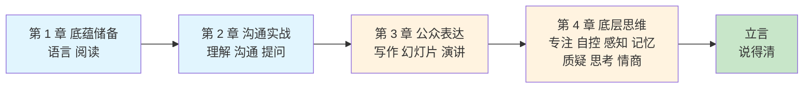

# 卷三 · 自我精进 · 立言

> **说得清的表达力与思维力修炼**

---

## 1. 本卷定位

全系列的贯穿语是"**学得会，做得到，说得清**"，本卷负责最后一环：**说得清**，并把能力放大出去。

"立言"等于"**内在思想 + 外在言说**"：立，是思想那一半，专注、自控、感知、记忆、质疑、思考、情商；言，是言说那一半，底蕴、沟通、写作、演示、演讲。这正是本卷区别于市面话术类表达书的关键：**只教话术的书，读者学完依然说不出有内容的话**。所以本卷先用第 4 章补"立"，再用第 1-3 章练"言"，两条线在结语处合拢。

**一句话定位：让"说得清"成为你的能力放大器。**



---

## 2. 为什么叫"立言"

"立言"出自传统"三不朽"：立德、立功、立言。三卷正好对应这条进阶路：

```text
卷一 学习（修己）  →  卷二 成事（立功）  →  卷三 立言（传世）
     学得会                做得到                说得清
```

所以第 4 章的七节思维内容**不是跑题，而是"立"的那半边**：思想不立，言说只是空转。

---

## 3. 解决什么问题

**肚里有货倒不出**：解法在第 1-3 章的完整表达链条，从语言底蕴、阅读理解，一路练到写作、演示、演讲。

**会做不会写，述职汇报吃亏**：解法在第 6 篇写作能力，中心句加三支撑、复盘四段式、述职三段骨架，都是可直接套用的模板。

**一上台就紧张、讲了没人记住**：解法在第 7、8 篇，幻灯片做减法、演讲控场与怯场管理，让表达从"很努力"变成"有结论"。

**说话没内容、没观点**：解法在第 4 章的思维地基，思考、质疑、专注这些"立"的能力，决定你说出来的话有没有分量。

**表达不得体、接不住话**：解法在第 2 章沟通实战，理解、沟通、提问三篇，把"会听、会问、会说"一次补齐。

---

## 4. 本卷目录

### 开篇

| 序号 | 标题 |
|------|------|
| — | [为什么你的能力，总是不被看见](./00.开篇.md) |

### 第 1 章　底蕴储备：表达的底层弹药库

| 序号 | 标题 |
|------|------|
| 01 | [语言底蕴的提升](./01.语言底蕴的提升.md) |
| 02 | [阅读的持续提升](./02.阅读的持续提升.md) |

### 第 2 章　沟通实战：会听、会问、会说

| 序号 | 标题 |
|------|------|
| 03 | [理解能力的锻炼](./03.理解能力的锻炼.md) |
| 04 | [沟通能力的演进](./04.沟通能力的演进.md) |
| 05 | [学会高效地提问](./05.学会高效地提问.md) |

### 第 3 章　公众表达：从写作到演讲

| 序号 | 标题 |
|------|------|
| 06 | [写作能力的提升](./06.写作能力的提升.md) |
| 07 | [演示幻灯片提升](./07.演示幻灯片提升.md) |
| 08 | [公众演讲的提升](./08.公众演讲的提升.md) |

### 第 4 章　底层思维：思考的深度决定表达的高度

| 序号 | 标题 |
|------|------|
| 09 | [专注能力的提升](./09.专注能力的提升.md) |
| 10 | [自我自控的调节](./10.自我自控的调节.md) |
| 11 | [感知能力的提升](./11.感知能力的提升.md) |
| 12 | [记忆能力的训练](./12.记忆能力的训练.md) |
| 13 | [质疑精神的分析](./13.质疑精神的分析.md) |
| 14 | [思考能力的提升](./14.思考能力的提升.md) |
| 15 | [情商能力的学习](./15.情商能力的学习.md) |

### 结语

| 序号 | 标题 |
|------|------|
| — | [想清楚，才能说明白](./16.结语.md) |

---

## 5. 与另两卷的关系

本卷是三卷能力闭环的最后一环：把内在的能力外化，让价值被看见。

```text
卷一 学习（修己）  →  卷二 成事（立功）  →  卷三 立言（传世）
```

三卷按卷序读收获最完整，但**本卷可独立阅读**。

---

## 6. 阅读建议

按目录顺序读收获最完整：先补底蕴，再练沟通，然后上台表达，最后沉到底层思维。赶时间的读者，可以从自己的痛点直接切入：想学写作读第 6 篇，怕演讲读第 7、8 篇，管不住情绪读第 15 篇。

每一篇的结构是固定的：真实案例开场、方法论拆解、踩坑清单，结尾配"今天起改变三点"和课后作业。**建议边读边练：每读完一篇，当天就做那三件事，比连读十篇更有效**。

---

## 7. 待补计划

第 1 章计划新增"素材库的积累"一节；附录计划新增"全书金句索引"。
