## 5.学会高效地提问

- [5.学会高效地提问](#5学会高效地提问)
- [01.被关掉的对话框](#01被关掉的对话框)
- [02.先来看两个案例](#02先来看两个案例)
- [03.看几个提问案例](#03看几个提问案例)
- [04.先尝试自己解决](#04先尝试自己解决)
- [05.学会向自己提问](#05学会向自己提问)
- [06.提问前要做什么](#06提问前要做什么)
- [07.如何问有效问题](#07如何问有效问题)
- [08.一句话概括问题](#08一句话概括问题)
- [09.较为详细的描述](#09较为详细的描述)
- [10.不排斥不同观点](#10不排斥不同观点)
- [11.批判性追问答案](#11批判性追问答案)
- [12.有效提问四步骤](#12有效提问四步骤)
- [13.提问高手的特点](#13提问高手的特点)
- [14.场景化提问训练](#14场景化提问训练)
- [15.总结回顾本章节](#15总结回顾本章节)
- [16.后来发生的改变](#16后来发生的改变)
- [17.今天起改变三点](#17今天起改变三点)
- [18.课后作业思考下](#18课后作业思考下)

## 01.被关掉的对话框

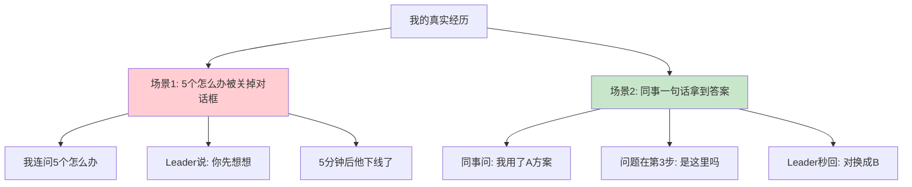

去年我接手一个新模块，遇到一个奇怪的报错。我直接在企业微信上找技术 Leader："这个怎么办？"他没回。我又问："那个怎么解决？""有没有思路？""能帮我看看吗？""老大你在吗？"——5 个"怎么办"发出去。

5 分钟后，我看到他的状态变成了"离线"。后来组长悄悄告诉我：**"Leader 不是没空，是被你的提问劝退了。你一句背景没讲，他怎么帮你？"**

同一周，组里另一个同事也找这位 Leader 求助，他是这样写的：**"老大，我在做 XX 模块，调用 API 时第 3 步报 500，环境是 macOS+Node 18，我已经检查了参数和权限都没问题，怀疑是 X 配置问题，是不是这里需要改 B？"**

Leader 30 秒回复："对，换成 B，再看下日志里 trace_id。"问题解决。

同样一位 Leader，我连问 5 个问题没人理，他一句话拿到答案。差距不在 Leader 的态度，而在**我把"提问"当成了"求救"，他把"提问"当成了"协作"**。从那以后，我开始系统学习如何提问，下面是我整理的方法论。

## 02.先来看两个案例

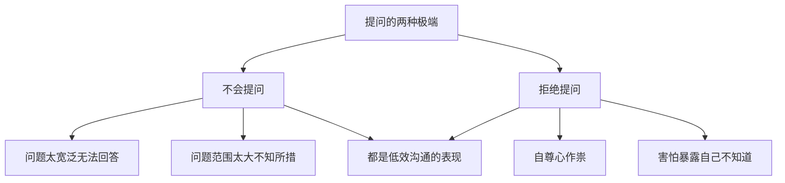

第一个案例：**不知道怎么问**。问问题前没有好好思考，问的问题要么很宽泛让人无法回答，要么范围很大让人不知所措。比如问一个前辈"怎么才能做好工作？"这个问题范围太大了，前辈只能给出大众化的建议，对你没有针对性的帮助。

第二个案例：**万事不求人，拒绝寻求帮助**。这在学习和工作场景中都很常见。我们很多人不愿意主动寻求帮助，主要原因是自尊心作祟，害怕别人知道自己不知道。这其实是一种认知误区——**提问不是暴露无知，而是展示学习意愿。真正让人看不起的不是"不知道"，而是"不知道还不愿意学"。**

提问能力是一项被严重低估的核心能力。好的提问能够：节省大量试错时间、快速获取关键信息、展示你的思考深度、建立与他人的信任关系。爱因斯坦说过："如果我有一个小时来解决一个问题，我会花 55 分钟来想这个问题，花 5 分钟来想解决方案。"**问对问题，往往比找到答案更重要。**

## 03.看几个提问案例

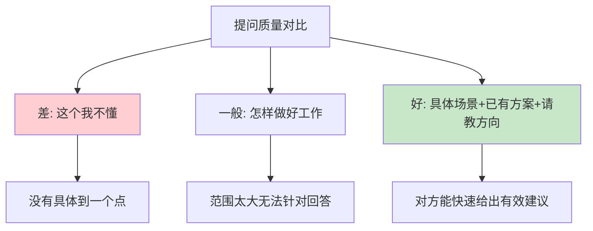

先想一想：如果你是被问的那个人，你希望听到怎样的问题？对某个事物的认识，总是"由浅到深"。虽然同样是由浅到深，但每个人思考的深度却千差万别。

**案例一**：在培训学习技术的时候，有学生遇到不懂的章节，想请教老师，于是便对老师说，"这个我不懂"。老师听了很诧异，问他究竟哪里不懂，要具体到一个点。这个学生最后说，"我也不知道我哪里不懂，反正我就是不懂。"

**案例二**：有人希望前辈在工作上给点建议，于是问前辈"我怎样才能做好工作"。由于范围太大，最后只能得到大众式的建议，对自己没有太大的作用。

**案例三**：有人问大牛"运营怎么做？"这是一种问法。还有另外一种问法："我们这个投资界 App 资讯平台目前大概有 10 万用户，我们想提高用户的活跃度，想做一个激励体系，现在我们考虑了 A、B、C 等几个方案，不知道您觉得这方面是否有遗漏。"

对比这几种问法，差别体现在四个要素上：**背景信息**，差的提问完全没有，好的提问会交代"10 万用户的资讯平台"这样的关键背景；**具体目标**，差的提问只有"运营怎么做"这种大而空的诉求，好的提问会锁定到"提高用户活跃度"；**已有思考**，差的提问是空白，好的提问会说明"已考虑 A、B、C 方案"；**精准问题**，差的提问抛出一片模糊，好的提问则明确请教"方案是否有遗漏"。

以前我也不会提问，现在想想，那不是提问，而是希望别人直接帮我把问题解决。一个简单的检验方法：问题发出去之前换位想一想，**如果你是回答的人，看到这个问题，知道从哪里下手吗？**

## 04.先尝试自己解决

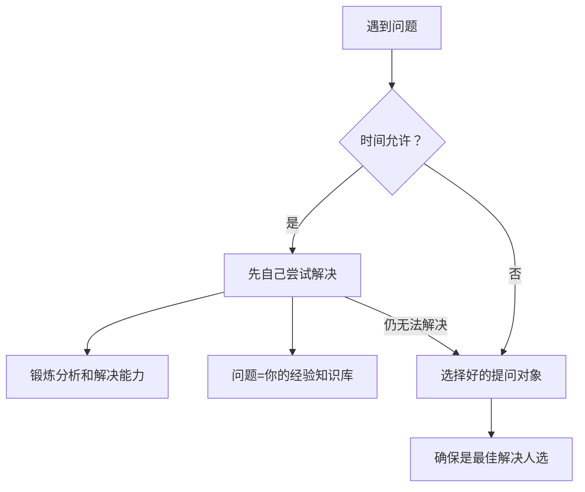

遇到问题不要急着问别人，时间允许的情况下，先看看靠自己是否能解决。这样一方面能锻炼自己分析问题和解决问题的能力；另一方面，一旦问题解决了，这个问题就成了你的经验和知识库。

现在互联网上有海量的技术资料和问答社区，你遇到的问题，绝大多数都有人踩过坑。先在搜索引擎上定位问题的点，再对得到的信息进行分析、过滤和取舍。

如果做了努力依然不能解决，或者客观条件不允许自己解决，那么要做的就是选择一个好的提问对象。不管是现实中的前辈，还是网络上的大牛，确保他是你所知道的最佳解决人选。

不要随便找人问。找一个领域不对口的人问，既浪费对方的时间，你也得不到有效答案。

## 05.学会向自己提问

前面讲的都是"向别人提问"，但高手和普通人的差距，往往在"向自己提问"。《绝佳提问》的作者沃伦·伯格研究了大量创新者后发现：**很多突破，不是先找到答案，而是先问出一个更好的问题**。他给出了一个向自己提问的三段阶梯：

**第一阶，Why：为什么现状是这样？**面对一个问题，先别急着问"怎么办"，先问"为什么"。比如看到活动页转化率低，普通人直接问"怎么提高转化率"，高手会先问"**为什么用户偏偏在这一步离开？**"——前者急着要答案，后者在找真问题。Why 这一问，是把你从"接受现状"切换到"审视现状"。

**第二阶，What If：如果……会怎样？**沿着真问题放开想象，暂时不管可行性："如果把注册流程砍到只剩一步，会怎样？""如果这个需求交给我从头设计，我会怎么做？"这一问的价值在于**跳出既有约束**——很多"不可能"，只是"一直这么做"的惯性。

**第三阶，How：如何实现？**把想象落成行动："要砍到一步，第一步可以改哪里？哪个环节能用最小成本先试一次？"How 把问题从脑子里搬到手上，哪怕只是一个小实验。

举个例子。团队周报没人看，普通思路是"怎么让大家愿意看周报"；用三段阶梯来问，Why：为什么大家不看？因为周报是写给领导看的，不是写给读者看的。What If：如果周报只有三句话会怎样？如果只写"踩了什么坑、发现了什么"会怎样？How：下周先在自己的周报里试一次，看有没有人来讨论。

**向自己提问，问对了问题，答案往往会自己长出来。好问题不是要答案，是开新路。**

## 06.提问前要做什么

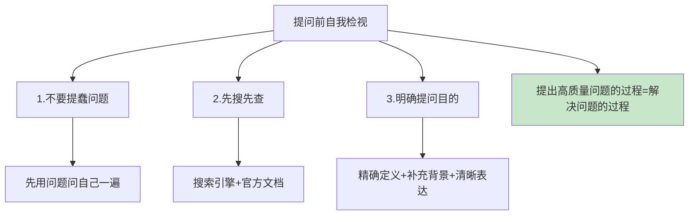

在提问之前，先做好三重自我检视，任何一点没做到，都极有可能招来被提问者的不满。

**第一，不要提"蠢问题"。**问问题前，先用这个问题问自己一遍——很多时候，你在自问的过程中就找到了答案。草率的发问，最终只能得到草率的回答，或者根本得不到任何回答。

**第二，先搜先查。**凡是搜索引擎和官方文档能回答的，就别问别人。自己去翻资料虽然慢一点，但远比被直接灌输答案学到的多。

**第三，明确提问目的。**对问题的定义要足够精确，要让别人有足够的着力点来回答。拿出现阶段你能组织出的最好表述：补充背景，清晰准确地表达诉求。

记住这一点：**提出高质量问题的过程，其实就是解决问题的过程**。很多时候，发现和定义问题的能力，比解决问题的能力更重要。

## 07.如何问有效问题

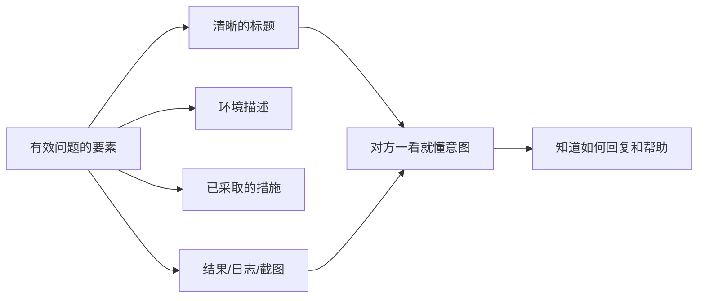

如何问一个有效的问题？这里面是有技巧的。提问和回答是交流中最重要的部分，一个好的问题能够让提问者和回答者同时获益。

举一个例子。同事 A 提问题或报 bug 都非常规范：每个 bug 都有清晰的标题，正文是环境描述、已经采取了什么措施、结果、日志、截图等等。读完邮件，你就能很清楚对方想要表达的意图和希望你能提供的帮助，而且你也知道该做什么、如何回复。

一个有效问题应该包含：**问题概述（一句话）+ 背景信息 + 已尝试的方案 + 期望的帮助**。问题概述让对方 3 秒判断这是不是他擅长的领域；背景信息帮他快速定位现场；已尝试的方案避免他让你重走弯路；期望的帮助则明确你要的是答案、是排查思路，还是只要一个方向。四样齐了，对方才知道该做什么、如何回复。

## 08.一句话概括问题

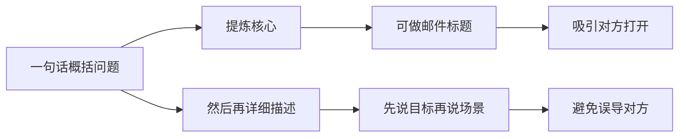

用一句话准确概括你遇到的问题，提炼出问题的核心。如果是邮件沟通，你可以把它作为标题，更能吸引你的求助对象打开你的邮件。

然后，用清晰的语言描述你遇到的问题。注意要先在开头说明你想达到的目标，再去详细描述问题的具体场景、阻碍你的特定步骤等等。因为很有可能你之前的思路和过程走了弯路，先说目标能避免误导其他人。

## 09.较为详细的描述

在描述具体问题的时候，要注意提供相关场景和信息，比如所用的操作系统、数据库等相关软件及其版本号；同时尽可能提供问题相关的可分析文件，包括日志、截图等。

另外，也要说明自己已经尝试采用了什么措施来解决问题，最终结果是什么样的，问题是否可以重现，采用什么方式重现。

信息看起来很多，但注意不要长篇大论，尽量简明扼要，描述主要问题。一个实用的描述结构包含五个要素：**环境信息**，写清系统、版本、配置，比如"macOS 14.0，Node.js 18.0"；**问题描述**，说明发生了什么，比如"运行 XX 命令后报 XX 错误"；**复现步骤**，交代怎么触发的，比如"步骤 1→步骤 2→步骤 3"；**已尝试方案**，列出你做了什么，比如"尝试了 A 方法无效、B 方法无效"；**期望结果**，写下你想达到什么，比如"期望 XX 正常运行"。

## 10.不排斥不同观点

对不同的观点，不要排斥。站在不同的角度去思考问题，自然会有不同见解，要慢慢学会理解。如果尚未思考就直接排斥，很有可能会走偏。

当你提出一个问题后，得到的回答可能不是你期望的——对方可能指出你的前提假设就有问题，或者建议你换一个完全不同的方向。这时候不要急着反驳，先想想：他为什么这么说？他看到了什么我没看到的？

很多时候，最有价值的回答恰恰是那些"打破你固有思维"的回答。如果你只接受符合自己预期的答案，那你的提问就失去了意义。

具体可以这样做：**先记录**，把不同的观点都记下来，不急于判断对错；**再追问**，问一句"你为什么这么认为？"往往能获得更深层的见解；**后综合**，把多个观点放在一起对比分析，形成更全面的认知。

## 11.批判性追问答案

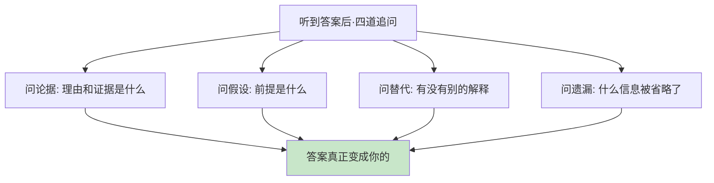

提问的下半场，是接住答案。《学会提问》的作者尼尔·布朗把这种能力称为"淘金式思维"：**面对一个答案，不当搬运工，而当淘金者——过一遍沙子，留下金子**。具体是对每个答案做四道追问：

**第一道，问论据。**"这个结论背后的理由和证据是什么？"没有论据支撑的结论，和观点没有区别——听听就好，别急着执行。

**第二道，问假设。**"这个结论成立的前提是什么？换个前提还成立吗？"很多答案只在自己的前提下是对的，前提一变，结论就塌。

**第三道，问替代。**"有没有别的解释？是不是把相关当成了因果？"两件事先后发生，不代表前者导致后者；同一个现象，往往有不止一种成因。

**第四道，问遗漏。**"有什么重要信息被省略了？反方的说法是什么？"任何答案都是选择性陈述，听到的不等于全部。

拿一个真实的场景走一遍。同事信誓旦旦地告诉你："性能问题好办，加两台服务器就行。"四道追问下去：问论据——压测数据在哪？瓶颈验证过吗？问假设——这个结论默认瓶颈在算力，如果实际是锁竞争或慢查询，加机器只是烧钱；问替代——有没有可能是某条 SQL 拖慢了整体？问遗漏——机器加完，成本和容量预估谁来做？四个问题问完，你可能会发现，真正的答案和"加服务器"完全不同。

**追问不是抬杠，而是把答案真正变成自己的过程。**直接采纳一个没追问过的答案，你只是多了一条信息；追问过的答案，才是你的判断。

## 12.有效提问四步骤

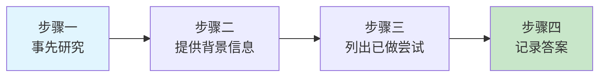

**步骤一：事先研究。**在寻求他人帮助之前，先自己尝试寻找解决方案。不是要你花数小时或数天去研究，而是给自己一个限定的研究时间，比如 30 分钟左右。

**步骤二：提供背景信息。**当你决定要向他人提问后，要尽可能多地向请教的人提供背景信息，让对方能迅速了解背景，快速给予帮助。

**步骤三：列出目前所做的尝试。**告诉对方自己已经做了哪些尝试，帮对方省去一些重复尝试。这样可以让对方迅速排除无效方法，把精力投入到寻找其他有效方法上。

**步骤四：记录答案。**当你得到答案后，一定要迅速把答案记下来，形成方法论。以后再遇到同一个问题，也可以从中做下参考。

## 13.提问高手的特点

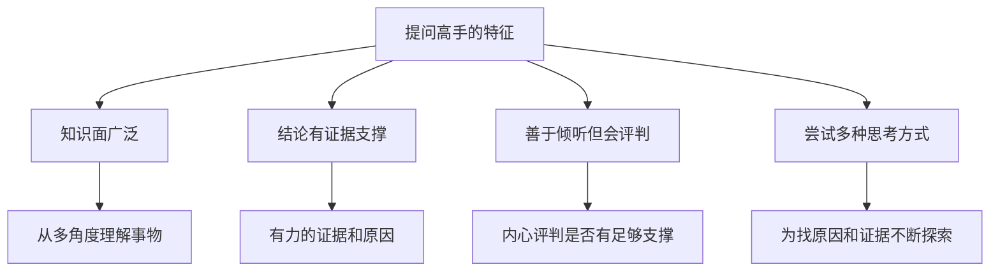

真正的提问高手，都是批判性思维的集大成者。《提问的艺术》一书中提到，一个优秀的批判性思维者必备四个特征。

**一是知识面广泛**，能够从多个角度去理解事物。知识面越广，提问的角度就越多，问题的质量就越高。

**二是任何结论都有强有力的证据和原因**。好的提问者不会问"这对不对"，而是问"你有什么证据支撑这个结论"。

**三是善于倾听他人的想法，但会从内心评判该想法是否有足够的支撑**。他们不会盲目接受，也不会盲目否定。

**四是为了找到原因和证据，会尝试多种思考方式**。当一条路走不通时，他们会换角度、换方法继续探索。

## 14.场景化提问训练

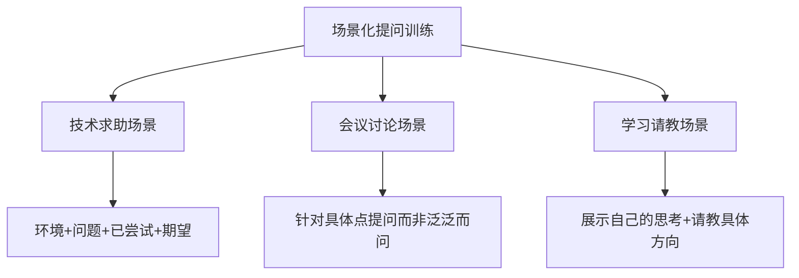

**技术求助：用模板提问。**向同事请教技术问题时，用这个模板："我在做 XX 的时候遇到了 XX 问题（简述），环境是 XX（关键信息），我已经尝试了 XX 和 XX 但没有解决（已做尝试），你能帮我看看是什么原因吗？"

**会议讨论：针对具体点提问。**在会议中提问时，避免"我有个问题"然后抛出一个大而泛的问题。好的做法是："关于刚才提到的 XX 方案，我有一个疑问——如果在 XX 场景下，是否会出现 XX 问题？"针对具体的点提问，而非泛泛而问。

**学习请教：展示思考再提问。**向前辈请教时，展示你的思考过程："关于 XX 问题，我目前的理解是 XX，我也查了 XX 资料，但是在 XX 这个点上还不太确定，您能给些指导吗？"这种提问方式既展示了你的努力，又精准定位了困惑点。

## 15.总结回顾本章节

**好的提问 = 自己先查 30 分钟 + 一句话目标 + 背景信息 + 已尝试方案 + 期望帮助；对答案做四道追问，对自己走 Why→What If→How 的阶梯。提问的过程，本身就是解决问题的过程。**

1. **30 分钟原则**：提问前先自己研究 30 分钟，能解决一半的问题。
2. **四要素结构**：背景 + 问题 + 已尝试 + 期望，缺一不可。
3. **答案沉淀**：每次得到答案要记录下来，形成自己的知识库。
4. **追问与自问**：接答案时过四道追问，找问题时先走三段阶梯。

## 16.后来发生的改变

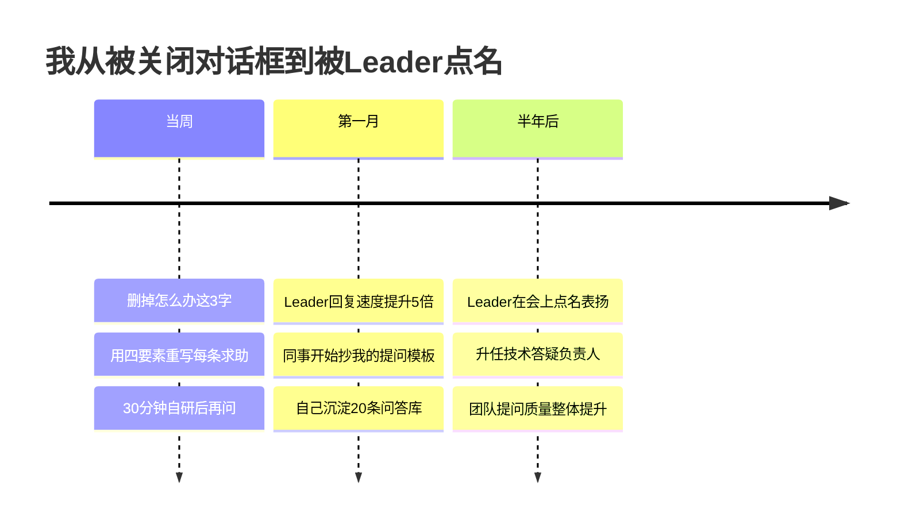

第二天我做的第一件事，就是把企业微信输入法里的"怎么办"这个词删掉。之后每次提问前，我强制自己先做 30 分钟自研：搜索、查文档、看源码。然后用"我做 XX 遇到 XX 问题，环境是 XX，已尝试 A/B，怀疑是 XX，是否方向对？"的模板来写。

一个月后效果非常明显，Leader 的平均回复时间从"不回"变成"3 分钟内"。组里几个新同事开始私聊我："你怎么写求助信息这么有效？"我把模板共享给了他们。同时我建了一个"问答库.md"，每解决一个问题就记一条，一个月攒了 20 多条。

半年后的部门月会上，Leader 公开表扬："**XX 同学的提问质量是组里最高的，每次问问题都让人想立刻帮他。**"后来我被任命为组里的技术答疑负责人，负责整理团队的常见问题文档。**那个曾经被关掉对话框的人，现在成了"提问范本"。**

## 17.今天起改变三点

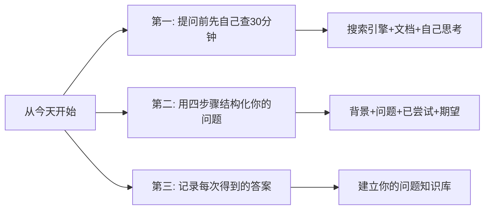

**第一，提问前先自己查 30 分钟。**遇到问题不要第一时间就问别人，先自己搜索、查文档、思考一下。这 30 分钟的投入，一方面可能直接解决问题；另一方面即使没解决，你也对问题有了更深的理解，提出的问题质量会更高。

**第二，用四要素结构化你的问题。**不要再说"这个我不懂"或"怎么才能做好 XX"这种无效问题。每次提问前，用 30 秒时间在心里过一遍"背景+问题+已尝试+期望"这个结构，你会发现问题的质量立刻提升一个档次。

**第三，记录每次得到的答案。**每次得到有价值的回答后，立刻记录下来——问题是什么、答案是什么、关键点是什么。用笔记软件或文档管理，按主题分类。日积月累，这个知识库会成为你最宝贵的资产。

## 18.课后作业思考下

1.回顾你最近一次向别人提问的经历，用本章的标准评估一下：你的问题质量如何？有没有提供足够的背景信息？有没有说明已做的尝试？

2.选一个你感兴趣的领域，尝试列出 5 个高质量的问题。好的问题应该是具体的、有深度的、能引发思考的。

3.把你最近遇到的一个问题，用"有效提问四步骤"重新组织一遍，看看和你最初的问法有什么区别。

4.在接下来一周内，每次提问前都用"背景+问题+已尝试+期望"的结构来准备，记录下对方的反馈质量是否有提升。

5.找一条你最近采纳的建议或结论，用"问论据、问假设、问替代、问遗漏"四道追问检验一遍，看看它是否还站得住。

6.选一个你工作或生活中的"老问题"，用 Why→What If→How 三段阶梯向自己提一轮问，把想到的新路径写下来。

---

> **📎 下一站** ｜ 会提问之后，表达能力的主战场就要切换了，第 3 章我们把你的思考搬上更大的舞台：先从最基础的写作练起，再上幻灯片和演讲的舞台。
