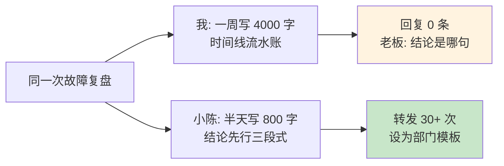
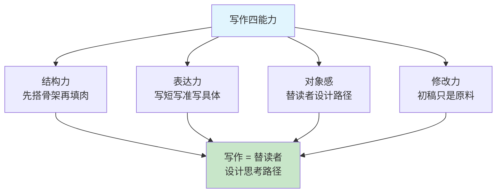
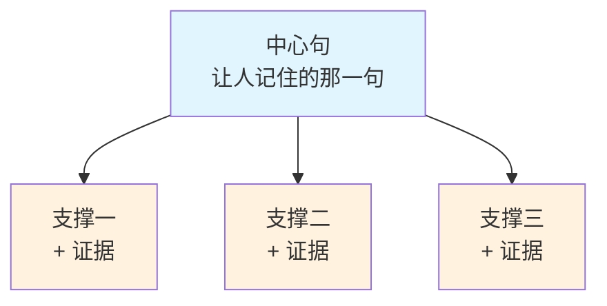
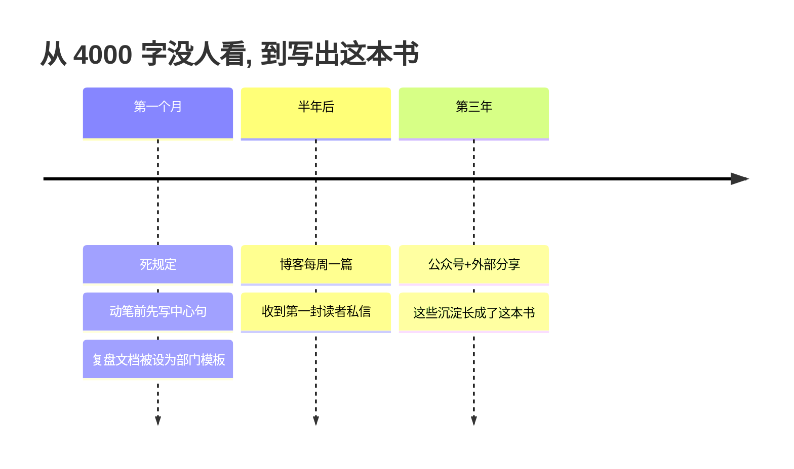

# 6. 写作能力的提升

- [01.4000字复盘没人看完](#014000字复盘没人看完)
- [02.断点自测三问](#02断点自测三问)
- [03.写作到底是什么](#03写作到底是什么)
- [04.素材是攒出来的](#04素材是攒出来的)
- [05.先搭骨架再填肉](#05先搭骨架再填肉)
- [06.开头结尾定生死](#06开头结尾定生死)
- [07.修改才是写作](#07修改才是写作)
- [08.把句子写短写实](#08把句子写短写实)
- [09.说人话少黑话](#09说人话少黑话)
- [10.用故事装道理](#10用故事装道理)
- [11.技术写作三场景](#11技术写作三场景)
- [12.场景化写作训练](#12场景化写作训练)
- [13.公开写作的复利](#13公开写作的复利)
- [14.这几个坑我踩过](#14这几个坑我踩过)
- [15.总结回顾本章节](#15总结回顾本章节)
- [16.后来发生的改变](#16后来发生的改变)
- [17.今天起改变三点](#17今天起改变三点)
- [18.课后作业思考下](#18课后作业思考下)

## 01.4000字复盘没人看完

那是我第一次独立负责模块的第一年，线上出了一次缓存故障，服务中断 40 分钟。部门要求每人提交一份故障复盘文档，我和同组的小陈同时写。

**我的做法**：花了一个星期，写了 4000 字。按时间线从凌晨 0 点一路记到晚上 24 点，每一条告警、每一次沟通、每一个中间判断都原样搬进去，事无巨细，连"当时我心想可能要完"都写了。发出去三天，回复 0 条。老板私信问我："**结论是哪一句？我看完了，没找到。**"

**小陈的做法**：花了半天，写了 800 字，三段。第一段一句话结论："根因是缓存集中过期引发雪崩，兜底策略的过期时间与主缓存一致，导致兜底同时失效。"第二段影响面：多少单冻结、损失多少、多久恢复。第三段三条改进，每条配上 owner 和 deadline。发出去当天，**全部门转发 30 多次**，后来 CTO 把它设为部门复盘模板。

那天晚上我把两篇文档放在一起看了很久，发现差距根本不在文笔：小陈的文字比我朴素得多，没有一句"漂亮话"。**差距在写法：我把写作当"存档"，把想到的都倒出来；他把写作当"设计"，替读者省时间**。他动笔之前先想清楚了"谁看、看什么、看完做什么"，我动笔之后才开始想"我到底要说什么"。

后来我靠写作开博客、做公众号、写述职材料，一路写出了这本书，才越来越确认一件事：**写作不是文采的事，是替读者设计一段思考路径的事**。这一章就是我从小陈那 800 字开始，重学写作的完整总结。

## 02.断点自测三问

写作欠账最典型的表现，不是"我不会写"，是"我写的是给自己看的流水账"。用三问自测：**你写的文档，读者 30 秒内能找到结论吗？**找不到，说明你结论没先行；**你动笔前能说出"这篇文章要让人记住哪一句"吗？**说不出，说明你还没想清楚就开写了；**你上一次主动修改超过一遍是什么时候？**想不起来，说明你一直把初稿当终稿。

三问里有一个"否"，你的写作就还在"记录"而不是"表达"的阶段。**自己看懂和让人看懂，中间隔着整个写作这门手艺**，这一章要教的就是跨过这段距离的方法。

## 03.写作到底是什么

先说透一个底层认知：**写作不是把想清楚的东西写下来，写作本身是想清楚的方式**。第 4 章讲过"写作等于强制结构化、强制证据化、强制逻辑化"，很多事在脑子里觉得"想清楚了"，一下笔就发现到处是窟窿。**写不出来，多数时候不是表达问题，是没想清楚**，这句话是写作的第一性原理，也是写作反哺思考的原理。

把写作能力拆开，其实是四种能力：**结构力**，把一团乱麻组织成清晰的路径，骨架稳不稳决定读者迷不迷路；**表达力**，把话写准写短写具体，一个字不多一个字不少；**对象感**，时刻知道写给谁看、他关心什么、他的理解成本有多高；**修改力**，把 80 分的初稿改到 95 分，这是多数人最缺的一环。

很多人怕写作，是把它想象成"才华型活动"，觉得靠灵感。**写作是手艺型活动**：有流程、有模板、有工序，练一块就强一块。手艺的好处是可复制，坏处是没法偷懒，**灵感靠不住，工序靠得住**。

## 04.素材是攒出来的

写作最大的拦路虎不是不会写，是"没东西可写"。德国社会学家卢曼一生写了 70 多本书、400 多篇论文，秘密是一盒子卡片：想到什么、读到什么，随手写成一张卡片存进卡片盒，写书时不从头写，只从几万张卡片里挑出相关的连起来。申克·阿伦斯把这套方法写成《卡片笔记写作法》，核心就一句话：**不是从零开始写，是把攒了一辈子的卡片连起来**。

落到日常，就三步。**第一步，一事一卡**：遇到一个坑、想通一个道理、看到一句好话，立刻记下来，一张卡片只记一件事，两三行就够。**第二步，用自己的话**：禁止复制粘贴原文，必须转述，因为转述的过程就是在逼自己理解，抄下来的是别人的，写出来的是自己的。**第三步，定期连接**：每周花 20 分钟翻一遍卡片，把相关的连在一起，新卡片和旧卡片挂上钩，观点就是这样长出来的。

我自己深度受益于这套方法。这本书里的多数案例，都来自我备忘录里攒了几年的一张张小卡片：某次事故的根因、某次谈话的转机、某句被老板点醒的话。**动笔时不是在回忆，是在取货**。没有素材库的写作，每一篇都是从零开始；有素材库的写作，每一篇都是攒了很久的自然生长。

## 05.先搭骨架再填肉

拿到写作任务，多数人的第一反应是打开文档从第一句开始写，这是流水账的根源。正确的顺序是反过来的：**先搭骨架，再填肉**。芭芭拉·明托在《金字塔原理》里给了一条铁律：**结论先行，以上统下，归类分组，逻辑递进**。读者最想要的永远是结论，理由和证据都是给结论服务的，所以结论要放在最上面。

实操就是三步。**第一步，写中心句**：动笔前先逼自己写一句话，"这篇文章要让人记住什么"，写不出来就还没资格动笔。**第二步，列三个支撑**：围绕中心句列三个理由，问自己"读者凭什么信这句话"，三个不多，两个太少。**第三步，每个支撑挂证据**：数据、案例、对比，挂在对应的理由下面。这三步画出来就是一棵树，写文章只是把这棵树从上往下翻译成文字。

拿开篇那个复盘文档套一遍：中心句是"根因是缓存集中过期且兜底同时失效"；三个支撑是"结论、影响面、改进项"；证据是过期时间的配置对比、单量损失数字、三条改进的 owner。**800 字的骨架立住了，填肉只是体力活**。我那 4000 字流水账，就是没有树干，把一堆叶子直接摔在了读者脸上。

## 06.开头结尾定生死

读者决定"要不要读下去"，只需要 30 秒，所以开头三句话定生死。一个可靠的开头结构是 SCQA：**情境**，先说对方熟悉的背景；**冲突**，说哪里出了问题；**疑问**，抛出"怎么办"；**答案**，亮出你的中心句。比如"线上服务一直很稳（情境），上周却中断了 40 分钟（冲突），问题出在哪、以后怎么防（疑问）？结论：缓存集中过期且兜底失效（答案）"。四句话，读者就知道值不值得往下读。

结尾同样有铁律：**只做两件事，重申结论、给出行动，绝不引入新信息**。读者读完最后一行，脑子里应该只有一句话在回响，那就是你的中心句；如果还有精力，就再给一个"回去可以做什么"。**结尾是送给读者的最后一份礼物：让他知道这篇文章改变了他什么**。最怕的结尾是"以上就是我的全部内容，谢谢大家"，等于告诉读者：前面 4000 字，你自己看着办。

一个自检方法：把你写好的开头结尾单独抽出来读，**如果只有这两段，读者能不能说清"这篇文章讲了什么、对他有什么用"？能，开头结尾就合格了**。

## 07.修改才是写作

海明威有句名言："**一切初稿都是臭狗屎。**"这不是自谦，是行业常识：你读到的所有好文章，没有一篇是初稿。史蒂芬·金在《写作这回事》里给了个具体的刻度：**第二稿等于第一稿减去 10%**。他的流程是"关门写作，开门修改"：写初稿时关起门来不管好坏一气写完；修改时打开门，站到读者那边，用读者的眼光挑毛病。

我的修改固定走三轮，顺序不能乱。**第一轮改结构**：只看骨架，中心句立不立得住，三个支撑有没有跑偏，段落顺序要不要换，这一轮删掉的是"和中心句无关的整段"，往往一刀下去砍掉三分之一。**第二轮改段落**：看逻辑衔接，每段的第一句是不是这一段的中心，段与段之间读者会不会跳戏。**第三轮改句子**：删赘词、改被动、换具体，这是最细的一轮。**顺序乱了效率极低：还没确认骨架，就纠结一个标点**。

两个配套动作：**隔夜冷却**，写完至少放一晚再改，离稿子越远，看得越清；**读出声**，耳朵比眼睛诚实，读不顺的地方一定是逻辑或句子有问题，卡壳的地方就是修改点。**写完就交，等于把初稿当终稿；而初稿的功能，只是让你有东西可改**。

## 08.把句子写短写实

《风格的要素》是英语写作的圣经，核心建议翻译过来就两条：**删掉不必要的词，多用主动语态**。落成中文写作，我提炼成三个动作。

**第一个动作，删**。把"进行了一个优化"改成"优化了"，把"在很大程度上"删掉，把"我个人认为"删掉。**每一个不必要的词，都在稀释读者对你必要内容的注意力**。判断标准很简单：删掉这个词，意思变吗？不变，就删。

**第二个动作，换具体**。"性能很差"是废话，"P99 从 80 毫秒涨到 900 毫秒"是信息；"很多人反馈"是模糊，"3 天内收到 17 个工单"是证据。**抽象词让读者点头，具体数字让读者相信**。第 8 篇讲量化成果的原则，在写作里同样成立：能写数字，绝不写形容词。

**第三个动作，一句一个主张**。长句套长句，读者读到句尾已经忘了句首。超过 40 字的句子，拆成两句。**短句不是能力弱，是替读者着想**；写作高手和新手的差别，新手怕写短了显得单薄，高手知道短才是力量。

## 09.说人话少黑话

技术写作有个职业病：满篇黑话和缩写，写的人省事，读的人遭罪。自检方法叫"媳妇测试"：把你的文档读给完全外行的人听，**她卡壳的地方，就是你该改的地方**。不是让外行看懂所有技术细节，而是让她跟得上你的叙述逻辑；她能听懂"为什么出事、影响多大、打算怎么防"，就说明你的逻辑是通的。

三个去黑话的动作。**第一次出现就解释**：缩写、内部代号、领域术语，第一次出现时用一句话说明白，别赌读者都懂。**善用类比**：缓存雪崩讲给产品听，可以说"就像超市收银台同时坏掉，所有人都挤到唯一能用的那一个窗口"；**类比是把读者从陌生拉到熟悉的桥**，第 1 篇讲的抽象阶梯，向下落地时靠的就是它。**名词优先于形容词**："体验不佳"不如"下单按钮平均要点三次才成功"。

**说人话不是降级，是功力**。能把复杂的事讲到外行听得懂，恰恰说明你真懂了；讲不清的地方，多半自己也是半懂。第 4 章的费曼技巧说的就是这件事：**写作是最好的检验，黑话是最好的遮羞布**。

## 10.用故事装道理

同样的内容，干巴巴地讲和用一个故事装起来，读者的记住率差一个量级。对比两段写法。第一段："缓存过期策略配置不一致会导致雪崩，兜底机制必须独立设计，避免单点失效。"道理全对，三秒就忘。第二段："凌晨 2 点 17 分，告警群炸了。值班同学以为只是普通的超时抖动，重启了节点，5 分钟后 CPU 飙到 100%，他才发现兜底缓存的过期时间和主缓存是同一个数，雪崩没有刹车。"同一个道理，有了时间、人物、动作、转折，读者看完就忘不掉。

不是让技术文档写成小说，而是**在关键处给读者一个可进入的画面**。三个够用的技巧：**给数据一个现场**，"损失 40 分钟"不如"2 点 17 分到 2 点 57 分，值班同学盯着 CPU 曲线从 30% 冲到 100%"；**给转折一个位置**，"我们都以为是 A，查到最后发现是 B"，读者对转折的记忆远强于对平铺的记忆；**让改动有主角**，改进项配上具体的人和 deadline，方案才不是飘在空中。

第 1 篇讲过学会讲故事，第 4 篇讲过金句背后是长期思考，写作里的故事是同一件事的落地：**道理负责正确，故事负责记住**。一篇只有道理的文章是教科书，一篇有现场感的文章才有人传阅，小陈那 800 字能成为部门模板，三段结论之外，开头那句"凌晨 2 点 17 分"功不可没。

## 11.技术写作三场景

把前面的方法装进技术人最常见的三个写作场景。

**场景一：故障复盘**。骨架固定四段：**一句话结论、影响面、根因分析、改进项**。结论先行，让老板 30 秒了解全局；影响面用数字说话；根因追到流程和机制层，不停在"某个人操作失误"，第 4 篇的 5 Why 在这里兑现：**复盘文档写的是"怎么让下次不再发生"，不是"这次发生了什么"**；改进项必须有 owner 和 deadline，没有主的改进项等于没有改进。

**场景二：技术博客**。写给谁？**写给三个月前的自己**。三个月前的自己会在这里踩坑、会在那里犯迷糊，就把坑和迷糊写清楚。这个定位能同时解决两个问题：不用纠结"这个主题是不是太简单"，对三个月前的自己永远不简单；也不用担心"读者会不会觉得浅"，同路人要的就是踩坑实录而不是教科书。每篇博客一个主题，讲透一个点，比大而全的综述价值高十倍。

**场景三：述职材料**。本质是说服文，骨架是"**成果、挑战、成长**"：先说做成了什么，全部量化，用第 8 篇的量化三原则；再说最难的地方和你的解法，评委要看的不是顺顺利利，是你怎么解决问题；最后说沉淀了什么能力、能带来什么。**述职的大忌是罗列做了什么，评委关心的是"你"而不是"事"：你在事里体现出的判断力和沉淀**。

## 12.场景化写作训练

四个日常训练，每个都能独立成习惯。

**每日 200 字卡片**：下班前花 5 分钟，把今天的一个收获写成一张卡片，用自己的话，两三行即可。坚持一个月，你会攒下 20 多张卡片；坚持一年，你会拥有一个私人素材库，写任何东西都不再从零开始。

**模仿拆写**：找一篇你佩服的文章，先做拆解，中心句是什么、三个支撑是什么、开头怎么钩人、结尾怎么收；然后合上原文，只看拆解提纲，自己重写一遍，再对比差距。**拆解让你看见骨架，仿写让你长出肌肉**，这是学写作最快的路。

**限时写作**：定 25 分钟，只写不回头改，写完为止。专治"开头完美主义"和"等灵感再写"：**限时逼你接受初稿的粗糙，而接受粗糙，恰恰是写出好文章的第一步**。

**读出声改稿**：每次交稿前把稿子出声读一遍，卡壳的地方做标记，读完全部回头修。这个动作能抓住 80% 的语病、赘词和逻辑跳跃，成本只有十分钟。

## 13.公开写作的复利

写给自己看是练习，公开写出来是修行。**公开写作自带三重压力**：读者不知道你的背景，逼你把对象感练出来；读者会挑错，逼你把证据做实；读者会用完就忘，逼你把结构做狠。这三重压力，关起门来永远练不出来。

我的亲身体验是，公开写作是职业杠杆率最高的动作。博客写了几年，先是同事转发，然后有陌生人留言讨论，再后来收到外部分享的邀请，每次分享又逼出新的沉淀，最后这些沉淀长成了这本书。**一个人的成长，从此有了账本和见证**：写作让思考可见，公开让可见的东西被放大，被放大的反馈又反过来逼你更好地思考，这就是复利。

公开还有一层好处：**逼你从"消费者"变成"生产者"**。只读不写，知识永远停在收藏夹；写出来一篇，胜过收藏一百篇。起点不用高，一篇 500 字的踩坑记录就可以：**持续比完美重要，频率比篇幅重要，公开比私密重要**。

## 14.这几个坑我踩过

练写作这些年踩过的坑，逐条对照。**等灵感再写**：灵感是写的过程中冒出来的，不是写的前提，用 25 分钟限时逼自己动笔；**开头完美主义**：第一句改了十遍，后面一个字没写，先允许自己写烂，写完再改；**把初稿当终稿**：写完就交，强制三轮修改加隔夜冷却；**自嗨不管读者**：满篇"我我我"，动笔前先写清楚"谁看、他关心什么、看完做什么"；**堆砌辞藻**：形容词越多信息越少，删到不能删为止；**收藏代替写作**：收藏夹越来越厚，输出为零，记住"写一篇胜过藏一百篇"；**贪多求全**：一篇想讲三个主题，结果一个都没讲透，一篇只讲一件事。

其中最坑的是"把初稿当终稿"和"自嗨不管读者"。前者让文章永远停在 80 分，后者让文章根本到不了读者心里。**写作的所有技巧，本质上都是在做同一件事：从"我要表达"切换到"帮读者理解"**。

## 15.总结回顾本章节

写作不是把想清楚的东西写下来，写作本身是想清楚的方式；**写作能力的全部秘密，是从"我要表达"切换到"替读者设计思考路径"**。

四条最关键的实操：**动笔前先写中心句加三个支撑**，骨架立住再填肉，结论先行不让读者猜；**初稿只是原料**，隔夜冷却，三轮修改，第二稿减去 10%；**句子能删就删、能具体就具体**，说人话少黑话，数字优于形容词；**公开写、持续写**，卡片攒素材，博客攒复利，一篇 500 字的踩坑记录就是起点。

## 16.后来发生的改变

那次复盘事件后，我给自己定了死规定：**任何文档动笔前，先写一句话中心句，写不出来就不动笔**。第一个月极不适应，总觉得"还没想全"；第二个月开始尝到甜头，文档长度普遍砍半，回复率肉眼可见地涨。我顺手把"结论先行四段式"整理成部门复盘模板，那个曾经写出 4000 字没人看的人，模板被全部门用了两年。

半年后我开始公开写博客，每周一篇，写给自己看是记录，写出去是修行。收到第一封读者私信时，那人说"你写的这个坑我上周刚踩过，谢谢"，那一刻我确认了这件事值得长期做。博客带来外部分享，分享逼出新的沉淀，几年后回头看：**这本书不是一次写作的产物，是几百张卡片、几十篇博客、十几场分享连起来的自然生长**。

回头看小陈那 800 字，它改变的不止是一份文档。**它让我第一次明白：文字是程序员最被低估的杠杆，代码影响机器，文字影响人，而机器只替你干活，文字替你放大价值**。

## 17.今天起改变三点

**第一，动笔前先写中心句**。任何文档、邮件、周报，落笔前先写一句话："我要让人记住什么。"写不出来就继续想，想出来再动笔。这一句话会替你省掉一半的废话。

**第二，每天写一张 200 字卡片**。下班前 5 分钟，把今天的一个收获用自己的话写下来，存进备忘录。一个月 20 张，一年 200 多张，你会拥有一个随取随用的私人素材库，从此写作不再从零开始。

**第三，给每篇稿子做一次三轮修改**。写完放一晚，第一轮只看结构删整段，第二轮只看段落逻辑，第三轮删词换具体、读出声。**接受初稿很烂，才能让终稿很好**。

## 18.课后作业思考下

1. 翻出你最近写的一份文档或周报，用 30 秒测试检查：读者能找到结论吗？中心句是哪一句？如果不修改直接重发，你敢吗？

2. 用"中心句加三个支撑"的骨架，把你最近一次故障或项目的复盘重写一遍，对比原稿的字数和可读性，写下三点差距。

3. 从今天开始连写 7 天卡片，每天 200 字用自己的话记录一个收获。7 天后做一次连接：哪几张卡片可以合成一篇文章？

4. 找一篇你佩服的文章做拆解：中心句、三个支撑、开头用的什么钩子、结尾怎么收。拆完合上原文，只看提纲仿写一遍，对比差距。

5. 把你工作里最常写的一类文档（复盘、方案、周报任选）做一个模板，固定出骨架和每段的必答题，下一次写时直接套用，记录节省的时间和反馈变化。

6. 挑一个你最近踩的技术坑，写一篇 500 字的踩坑记录公开出去：现象、原因、解法。写给三个月前的自己，发完记录第一条反馈。

---

> **📎 下一站** ｜ 能把事写清楚了，就该把内容搬上更大的舞台。下一节讲演示幻灯片：怎么让 80 页 PPT 砍到 15 页，让每页 30 秒被看懂，让你的汇报从"很努力"变成"有结论"。
