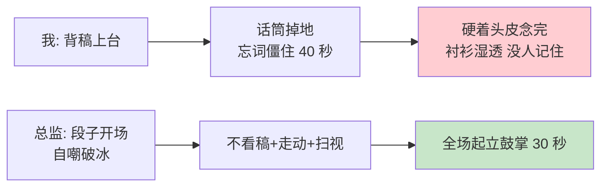
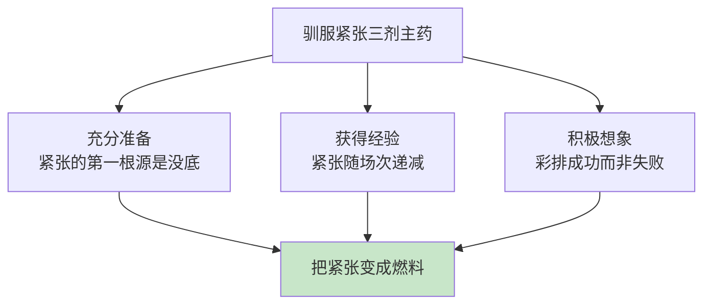
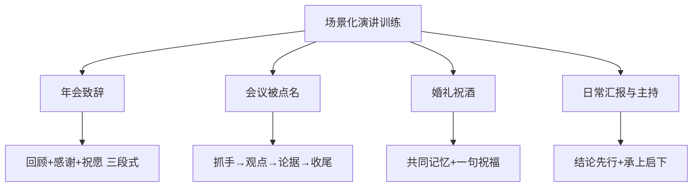
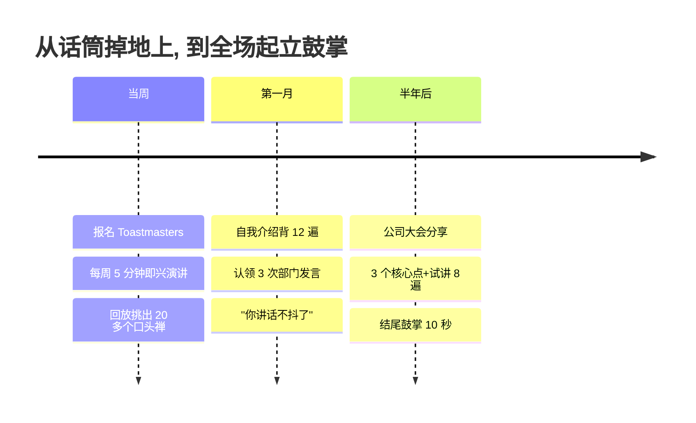
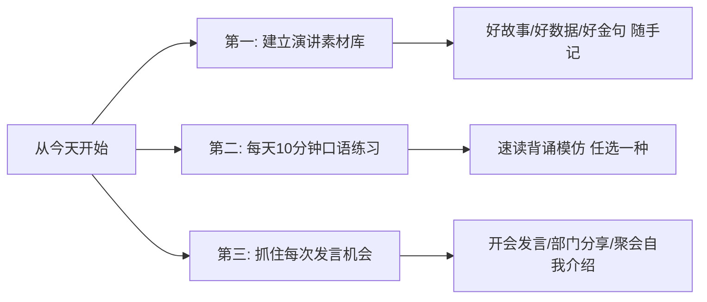

## 7. 公众演讲的提升

- [7. 公众演讲的提升](#7-公众演讲的提升)
- [01.会场话筒掉地上](#01会场话筒掉地上)
- [02.断点自测的三问](#02断点自测的三问)
- [03.演讲的基本问题](#03演讲的基本问题)
- [04.演讲目的与方式](#04演讲目的与方式)
- [05.演讲内容的准备](#05演讲内容的准备)
- [06.收集资料写大纲](#06收集资料写大纲)
- [07.驯服演讲的紧张](#07驯服演讲的紧张)
- [08.演讲的技巧训练](#08演讲的技巧训练)
- [09.演讲开场白设计](#09演讲开场白设计)
- [10.讲稿的准备使用](#10讲稿的准备使用)
- [11.大量练习与反馈](#11大量练习与反馈)
- [12.肢体语言与台风](#12肢体语言与台风)
- [13.场景化演讲训练](#13场景化演讲训练)
- [14.演讲的结尾收束](#14演讲的结尾收束)
- [15.这几个坑我踩过](#15这几个坑我踩过)
- [16.总结回顾本章节](#16总结回顾本章节)
- [17.后来发生的改变](#17后来发生的改变)
- [18.今天起改变三点](#18今天起改变三点)
- [19.课后作业思考下](#19课后作业思考下)

## 01.会场话筒掉地上

去年公司年度大会，我被指定做一个 20 分钟分享。听众 500 多人。

那是我第一次在这种规模的场合演讲。上台前在后台我反复背稿，自以为准备充分。一上台看到台下 500 双眼睛盯着我，**我大脑突然一片空白**。手抖得厉害，话筒"啪"地掉到地上。我弯腰捡起来，想接着讲，**结果忘词，僵在台上整整 40 秒**。

那 40 秒比 40 分钟还长。我能听见台下窃窃私语的声音，能看见前排同事尴尬的眼神。我硬着头皮把后面的内容像背课文一样念完，下台时衬衫已经全湿透了。

我下台后，下一位是公司的一位资深总监。他上台后开场用了一个段子："刚才小同学手抖，我手不抖，但我心抖"，全场大笑，气氛瞬间松弛。接下来 30 分钟，他全程不看稿、自然走动、目光扫视全场，**结尾时全场起立鼓掌长达 30 秒**。

我躲在后台看完全程，第一次明白：**演讲不是"上去把话讲完"，而是"上去把人抓住"**。下面这一篇，是我从那次崩溃后认真补课的全部心得。

## 02.断点自测的三问

演讲力是"立言"里最容易翻车的能力。因为其他能力可以修改重来，演讲一次翻车全场都在看。用三问自测你最近一次演讲：**你能不看稿讲完开场 3 分钟吗？**不能的话，说明你一紧张就崩；**你的核心观点能控制在 3 条以内吗？**不能的话，听众什么都记不住；**你上台前有没有出声试讲 3 遍？**没有的话，台上翻车概率 90%。

三问里有一个"否"，你上大场必翻车。**演讲是可以训练的技能，不是天赋**，这一章要教的就是最实用的一套训练法。

## 03.演讲的基本问题

有位演讲家说过：如果你要我说五分钟，那我需要两星期的时间准备；如果你要我说一小时，那我需要一星期的时间准备；**如果你不在意我要说多久，那我现在就可以开始**。

演讲前必须搞清五个问题：**日期和时间**，确保有足够的准备时间；**演讲时长**，时长越短越要仔细准备；**演讲地点**，提前考察场地、音响和灯光；**听众分析**，摸清人数、年龄、教育程度和态度；**为什么找我讲**，想明白你有什么特别的知识和经验。

**听众分析可以从四个维度切入**：人数规模（20 人/200 人/2000 人，决定互动方式和肢体幅度）、专业程度（外行/入门/专家，决定内容深度和术语使用）、参会目的（学习/社交/评估，决定内容侧重）、对你的期望（分享经验/传授方法/启发思考，决定风格和案例）。

如果公司请你以新员工的身份分享印象，那没有人会期望你表现得像个有三十年工作经验的总经理。**先搞清"他们为什么坐在这里"，你才知道"你该讲什么"**。

## 04.演讲目的与方式

演讲的目的决定演讲的方式。四种典型目的，各有各的组织手法。

**叙述观察结果**：了解听众对主题的了解程度，采用演绎法或时间顺序来组织，采用恰当的语言，插入趣闻轶事、实例、图解等，使演讲内容更生动有趣。

**说明操作方法**：重点放在展示上，用图解、图片的方式。让听众能够"看到"而不只是"听到"你在讲什么。

**说服或鼓励**：走"抓注意力→满足需求→寻求赞同"的路子，靠情感调动，抓住听众的注意力，找出听众的需求与兴趣，证明你能够满足这些需求，寻求观众的反应或赞同。

**致谢或致辞**：简短亲切，控制笑点的量或引用别人的笑话也很有用。把演讲的内容与听众的兴趣及当时的场合贯穿起来，要既亲切又特别。

## 05.演讲内容的准备

先列出你想传达的 **3 个核心信息**，围绕这 3 个核心点展开内容组织。**为什么是 3 个？心理学研究表明，听众最多能记住 3-4 个要点**，超过这个数量记忆效果会急剧下降。

**凡事归纳在三条以内，直奔主题、直奔结果**。这就是在商界流传甚广的"30 秒电梯理论"。它来源于麦肯锡公司的一次沉痛教训：项目负责人在电梯间遇到大客户董事长被问到"结果"，由于没有准备，无法在电梯从 30 层到 1 层的 30 秒内把结果说清楚，最终失去了这个客户。从此麦肯锡要求员工凡事要在最短的时间内把结果表达清楚。

每一个核心信息都要有支撑材料，四种材料各管一摊：**数据**给说服力，**案例**给画面感，**故事**给共鸣感，**引用**给权威感。**一个核心信息配 1-2 个有力的支撑材料就够了，不贪多**。

## 06.收集资料写大纲

只要时间允许，尽量多阅读。不要只搜集演讲时会用到的信息，也不要只搜集跟主题有关的信息。在网络上找到的资料，一定要确认其正确性。建立一个资料文件夹，按照主题分类存放搜集到的材料。注意收集与听众直接相关的数据和案例，这样更容易引起共鸣。好的素材来源包括专业书籍、行业报告、TED 演讲、新闻事件和个人经历。

大纲的基本结构按时间比例切：**引入**占 10%，负责吸引注意力；**核心内容**占 80%，装下 3 个核心点和各自的支撑材料；**总结收尾**占 10%，强调结论，附上行动号召。

每个核心要点之间要有自然的过渡和衔接，避免突兀的跳转。可以把每个重点和其发展思路写在一张卡片上，看看什么样的顺序最合适。**照顾好开头和结尾的部分，中间的部分就会自动出现**。

## 07.驯服演讲的紧张

先正面回答开篇遗留的问题：那次 40 秒的僵住，到底能不能避免？能。《演讲的艺术》的作者斯蒂芬·卢卡斯在书里用整整一章研究怯场，结论先给你：**紧张不是敌人，是燃料**。心跳加速、手心出汗，是身体在调动能量迎接挑战。顶级演讲家上台前一样紧张，区别只在于，他们把这套信号解读为"我准备好了"，而不是"我要完了"。

三剂主药，缺一不可。**第一剂，充分准备**：紧张的第一根源是没底，内容不熟、开场没背、时间没算。**练到开场 3 分钟能倒着讲**，紧张至少消一半，这也是为什么第 11 节把试讲看得那么重。**第二剂，获得经验**：紧张感随场次递减，这是规律不是鸡汤。从部门例会发言，到 20 人分享，再到 500 人大场，**阶梯式暴露**，每一级都把上一级的成果变成底气。**第三剂，积极想象**：上台前大脑彩排什么，身体就执行什么。反复想象"讲砸"的画面，等于给身体下了失败的指令；上台前在脑中过一遍流畅的全程，让身体先跑一遍成功。

三剂主药之外，还有两个即时可用的技巧。**上台前 5 分钟**：深呼吸三轮（吸气 4 秒、屏住 7 秒、缓缓呼气 8 秒），提前到场走一遍舞台，和前排观众聊两句，陌生人变成熟人，敌意就消失了。**台上出错的急救**：忘词时，**停住，别慌**，听众不知道你的原稿，你停 3 秒，在台上只是"深情停顿"；实在接不上，学那位总监来一句自嘲，把脆弱亮出来的那一刻，听众反而站到了你这边。

回看开篇那 40 秒：话筒掉了其实没人在意，真正毁掉全场的是"忘了词还硬撑着背"，把停顿当敌人，把紧张当敌人，两个敌人一起上，谁都得崩。**紧张拆不掉，但可以驯服：备到有底，练到有数，忘词就停顿，出错就自嘲。**

## 08.演讲的技巧训练

演讲技巧的三种训练方法：

**速读法**。找一篇演讲稿，读的过程中不要有停顿，发音要准确，吐字要清晰，要尽量达到发声完整。**速读法不仅训练口齿清晰度，还训练大脑在高速输出状态下的思维连贯性**。

**背诵法**。先把文章背下来，在背的基础上大声朗读，最后用饱满的情感、准确的语言、语调进行背诵。**背诵的目的不是为了在演讲时照搬，而是让那些精妙的表达方式内化为你自己的语言习惯**。

**模仿法**。三种模仿：**专人模仿**选择一个口语表达能力强的人，录下录音进行模仿；**专题模仿**一个人讲一个故事大家轮流模仿看谁最像；**随时模仿**跟着播音员、演播员、演员模仿声音、语调、神态、动作。天长日久，你的口语能力就得到了提高。

## 09.演讲开场白设计

演讲一开始，你的"表演"就开始了。因此正式开始前，先安排下你的舞台：把笔记和视觉辅助工具等摆好，方便之后使用。

开场白的五条铁律。**第一，不要犹豫**：听众就位后就开始，但先用几秒钟浏览一下台下听众，让他们也打量一下你。**第二，不要用陈腔滥调开场**："今天很荣幸"这类话可以晚一点说，甚至放到结尾。**第三，不要道歉**：也许你觉得自己的知识、主题、能力不行，但只要你充满自信地登场，听众也会对你有信心。**第四，要有趣有创意**：让听众想继续听你之后要说的内容，但不要太早引入高潮。**第五，控制比例**：开场白只是开场白，长度要跟整个演讲的比例适当。

六种常见开场方式各有适用场合：**说明主题**最稳妥，适合正式场合；**问问题**几乎任何场合都好用，一个好问题能瞬间抓住注意力，让听众从"被动听"变成"主动思考"；**讲故事**任何场合都好用；**统计数据**适合专业场合建立权威感；**逸闻趣事**适合非正式场合，难度较高；**名言佳句**任何场合都能用，难度最低。

**每个人都喜欢听故事，但是你的故事要选得好、讲得好**。怎么讲？第 01 篇"学会讲故事"的五步结构可以直接拿来用：背景、冲突、转折、结果、意义。

## 10.讲稿的准备使用

人的记忆会出错，有了讲稿就不会有遗漏的地方，在讲稿上还可以发展出复杂的论点，有了讲稿就不会搞错顺序。

**讲稿不是用来念的，而是用来记忆和提示的**。一份好的讲稿应该包含关键词和提示语，而不是一字不差的原文。如果你对自己的演讲内容非常熟悉，在卡片或白纸上按顺序写下重点、主要的论点和例子，这是最好的做法。

建议在讲稿中用不同颜色标注：**红色**标必须讲的核心要点，**蓝色**标可选的补充材料，**绿色**标过渡衔接的话术。这样在演讲时一目了然，即使紧张也不会遗漏核心内容。

## 11.大量练习与反馈

充分的准备、大量的练习是好演讲的根基。建议至少练习 3 次以上，每次侧重点不同：**第 1 次**练内容完整性，问自己有没有遗漏、逻辑通不通；**第 2 次**练时间分配，每部分花了多长时间、总时长是否合适；**第 3 次**练语气和互动，表达是否自然、有没有口头禅。

如果可能，找 2-3 个朋友做模拟听众，让他们提出问题和反馈。这比自己对着墙练习效果好得多。**真实的听众会让你提前适应"被注视"的感觉**，他们的反馈也能帮你发现自己注意不到的问题。

还有一种更简单的方式：用手机架好录像，自己面对镜头讲一遍，然后回放观看。第一次看自己的表现通常会很崩溃，因为自我感觉和实际表现之间往往差距巨大。**但挺过这一关，你的演讲水平就会有显著提高**。

## 12.肢体语言与台风

第 06 篇说过，片子只解决 40%，剩下 60% 全靠人。这个"人"，一大半体现在台风上。回看开篇那位总监：全程不看稿、自然走动、目光扫视全场，**同样的内容，台风不同，效果天差地别**。台风可以拆成五件小事：

**站姿**：双脚与肩同宽，重心落在两腿之间。晃动和抖腿是最诚实的紧张泄露，固定住下半身，上半身才稳得住。**手势**：在腰部以上、手掌打开地比划，**双手展开的姿势让人觉得你开放可信**；收起所有小动作，摸头发、转笔、搓手、揣兜，录像回放时你会被自己吓到。**走位**：有目的地移动，讲到新板块时跨两三步，暗示"进入下一部分"；讲重点时站定不动，让全场注意力收拢到你身上。忌来回踱步，那是紧张的钟摆。

**目光**：用**分区扫视法**，把台下分成左中右三区，每区停留 3-5 秒，像在和某一个具体的人说话，全场都会觉得"他在看我"。不敢对视的，看后排观众的头顶，效果一样。**停顿**：最被低估的武器。金句前停 1 秒，吊起注意力；重点说完停 2 秒，留出消化时间。**紧张的人语速越来越快，自信的人敢于停顿**，慢下来，是台风里最便宜也最贵气的一招。

五件事的练法只有一个：录像回放（第 11 节练内容时顺便练台风），回放时专挑两样，小动作和"嗯啊"口头禅，每轮消灭一个。**台风不是演出来的，是把泄露紧张的破绽一个个补掉之后，剩下的样子。**

## 13.场景化演讲训练

前面练的都是"一场准备好的演讲"，但现实中大部分发言没有彩排的机会：年会致辞、会议被点名、婚礼祝酒、临时救场。四个高频场景，各给一个落地打法：

**年会致辞**，用"回顾+感谢+祝愿"三段式就不会错：回顾这一年的一两件具体的事，记得第 01 篇说的"下梯子"，要细节，不要形容词；感谢具体的人，点名感谢比"感谢所有人"有力一百倍；祝愿来年，一句就好。三段加起来两分钟，比十分钟的空话得体。

**会议被点名**，是最高频的即兴场面。用即兴表达四步脚本：**抓手**接住当下（"刚才 XX 说的数据我特别有共鸣"），**观点**一句话亮立场（"我补充一个角度"），**两三个论据**展开（万能三点结构），**收尾**交回话语权（"我就补充这些，谢谢"）。30 秒在心里跑完这个脚本，开口就不会乱。

**婚礼祝酒**，核心是与对方的共同记忆：讲一个只属于你们俩的小故事，背景、冲突、转折就够了，不用五步走完，最后落一句祝福。记住铁律：**说新人的故事，别说自己**。

**日常汇报与主持串场**：汇报用结论先行（第 06 篇讲过），主持串场用"承上+启下"一句话模板："感谢 XX 的分享，他提到的 XX 正好引出接下来这位要讲的 XX"。一句话把两个人连起来，就是合格的串场。

这四个场景的共同点：**没有舞台，只有对话**。把听众当成坐在对面的一个人，而不是一屋子人，紧张会小一半，话也会更像"人话"。

## 14.演讲的结尾收束

用一个有力的总结结束。如果你突然想到新的东西，务必克制冲动。不要重复，不要看着演讲稿念结尾词。**把结尾词背下来，这样你就可以在达到结尾高潮时看着观众**。

四种常见结尾方式各有适用场景：**提出问题**，引发听众思考、离场后继续琢磨；**行动号召**，希望听众立即采取行动；**回顾呼应**，回到开场故事、首尾闭环；**金句收尾**，让听众记住核心信息。

**好的金句应该简短、有力、容易记忆**。金句不是文采，是长期思考的压缩，靠平常积累"素材本"。

到这里，从听清需求、准备内容、驯服紧张，到打磨台风、玩转四大场景、有力收尾，一整条演讲的链路就走通了。但知道方法是一回事，避开坑是另一回事，最后把我这些年亲自踩过的坑列出来，帮你绕开。

## 15.这几个坑我踩过

练演讲这些年踩过的坑，逐条对照。**上台才发现忘词**："反正内容我很熟"，开场 3 分钟必须背到能倒着讲；**讲稿全文照念**：眼睛只在稿子上，用关键词加提示语，不用全稿；**核心点超过 3 个**：讲 5-7 个观点听众什么都记不住，死守 3 条铁律；**不看录像不改**：觉得"自我感觉良好"，用录像回放挑口头禅和小动作；**一次都不试讲**：相信"临场发挥"，至少 3 遍加 1 次面对朋友；**结尾念稿子**：高潮时低头看稿，结尾背下来，直视观众。

其中最坑的是"一次都不试讲"和"上台才发现忘词"。**试讲成本低到不值一提，翻车成本高到能毁掉一整年**。这两条不改，其他技巧都是花架子。

## 16.总结回顾本章节

演讲是后天习得的技巧，公式 = 听众分析 + 3 个核心点 + 驯服的紧张 + 抓人的开场 + 得体的台风 + 多图少字的提词器 + 反复练习 + 有力收尾。

**3 不超原则**：核心观点不超过 3 条，听众最多记 3-4 点。

**演讲者是主角**：PPT 是配角不是讲话稿，多图少字。

**紧张是燃料**：备到有底、练到有数，忘词就停顿、出错就自嘲。

**5 分钟魔咒**：背下开场前 5 分钟，过了就会越讲越自如。

**台风靠补漏**：站姿、手势、走位、目光、停顿，录像回放逐个消灭破绽。

## 17.后来发生的改变

那次崩溃后第二天我就报名了公司内部的 Toastmasters 演讲俱乐部，每周一次的 5 分钟即兴演讲训练。第一次去我又紧张到说话颤抖，但好在每次都录像，回放看自己，一周内挑出来 20 多个"嗯""对""那个"等口头禅。

我把"5 分钟开场必背"这个原则用到极致。一份 1 分 30 秒的自我介绍我背了 12 遍，背到能在任何状态下倒着说出来。同时主动在部门月会上认领 3 次发言机会，强迫自己上场。一个月后同事悄悄说："你最近讲话不抖了，气场都不一样了。"

半年后，公司大会再次邀请我做分享。这次我准备了 3 周：3 个核心点、12 张多图少字的 PPT、试讲 8 遍、录像 5 次。**上台时我能笑着扫视全场，结尾时全场鼓掌持续了 10 秒**。散场后有 3 家外部公司联系我去做分享。**那个曾经话筒掉地上的人，现在成了别人请的演讲嘉宾**。

## 18.今天起改变三点

**第一，开始积累演讲素材**。在手机备忘录中建一个"演讲素材"文件夹，随时记录你看到的好故事、好数据、好金句。**当你需要做演讲时，打开这个文件夹就有现成的素材可用**。

**第二，每天练习 10 分钟口语**。速读法、背诵法、模仿法任选一种，坚持练习。演讲是后天习得的技巧，每个人都有能力习得这份技巧。**所有伟大的演讲家最初都是最差劲的演讲者，技巧和自信来自努力和练习**。

**第三，抓住每次发言机会**。开会时主动发言、部门分享时主动报名、聚会时主动做自我介绍，这些都是低风险的演讲训练场。**不要等到站在大舞台上才开始练，从小场景开始积累经验和信心**。

## 19.课后作业思考下

1. 选一个 TED 演讲（15 分钟左右），分析它的开场方式、内容结构和结尾方式，看看和本章讲的方法有哪些对应。

2. 用手机录一段 2 分钟的自我介绍，然后回放看看，你的表情自然吗？有口头禅吗？语速合适吗？

3. 如果下周让你做一场 10 分钟的分享，你会选择什么主题？用本章的方法写出大纲：引入（1 分钟）→ 3 个核心点（各 2.5 分钟）→ 总结（1.5 分钟）。

4. 开始你的"演讲素材库"：本周收集 3 个好故事、3 个有冲击力的数据、3 句好金句，分类记录下来。

5. 找一次发言机会全程录像，回放时专挑小动作和口头禅，列出清单；下次发言前，消灭清单上的第一个。

6. 下次上台前做一轮"临场三件套"：深呼吸三轮、提前到场走一遍舞台、脑中过一遍成功的全程，记录自己紧张度的变化。

---

> **📎 下一站** ｜ 讲得漂亮的前提，是脑子稳得住。下一章开始进入"底层思维"板块：从最稀缺的"专注"开始，一路走到情商。
