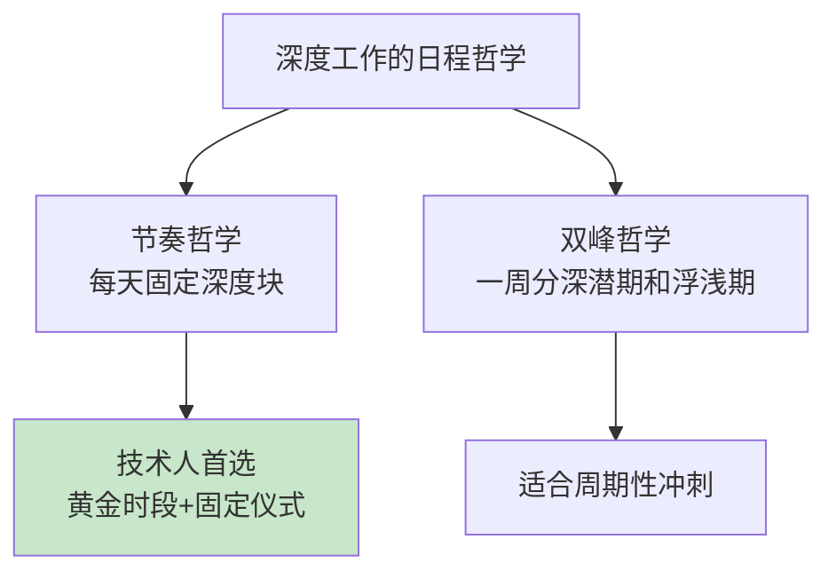

## 9. 专注能力的提升

- [9. 专注能力的提升](#9-专注能力的提升)
- [01.低质量干着工作](#01低质量干着工作)
- [02.断点自测三问](#02断点自测三问)
- [03.什么是真正专注](#03什么是真正专注)
- [04.越来越难专注了](#04越来越难专注了)
- [05.提升专注三件套](#05提升专注三件套)
- [06.专注环境如何搭](#06专注环境如何搭)
- [07.深度工作的哲学](#07深度工作的哲学)
- [08.长期训练三方法](#08长期训练三方法)
- [09.拥抱无聊的训练](#09拥抱无聊的训练)
- [10.场景化专注训练](#10场景化专注训练)
- [11.专注力三段里程碑](#11专注力三段里程碑)
- [12.用专注撑起表达](#12用专注撑起表达)
- [13.这几个坑我踩过](#13这几个坑我踩过)
- [14.总结回顾这一节](#14总结回顾这一节)
- [15.后来发生的改变](#15后来发生的改变)
- [16.今天起改变三点](#16今天起改变三点)
- [17.课后作业思考下](#17课后作业思考下)
- [18.下一站过渡到自控](#18下一站过渡到自控)

## 01.低质量干着工作

那天上午 9 点，我打开 Word 准备写一份方案，预估两小时能交。

实际过程是这样的：先去查个竞品资料，开了 3 个标签页；查到一半微信弹了同事的群消息，回了几句；想起昨天的一封邮件没回，切到邮箱写了 10 分钟；写完想喝水，路过茶水间和人聊了 5 分钟；回到工位发现刚才那 3 个标签页忘了为啥要开，重新搜了一遍；中途又点开了知乎一条推送……

12 点钟，我看了一眼 Word：**标题 + 三个一级标题 + 200 字开头**。整整 3 小时，输出的有效内容不到 5 分钟手速能打出来的量。下午继续，结果还是这样，明明坐在电脑前 8 小时，到下班只完成了应该 2 小时搞定的活。

那天加班到 9 点交了草稿后，我坐在空荡荡的工位上做了一次反思。得出的结论让我很难受：**我不是没时间，而是我的大脑根本没在这件事上停留过 5 分钟以上**。

每隔 90 秒就被新通知、新念头、新标签页拉走一次。看似很忙，其实是大脑在不停地做"上下文切换"，每切换一次，重新进入状态都要 5 到 15 分钟。一天下来，真正深度专注的时间可能不到 30 分钟。

这一节就是我认真补"专注力"这门课之后的总结，分享给同样焦虑"为啥时间总不够用"的你。

## 02.断点自测三问

事后不复盘是"立言"的第一层欠账；说话没内容是"立言"的第二层欠账；而**思考不成型**是最深的第三层欠账，也是本章七节要解决的核心问题。而所有思考能力的地基，是"专注"。

用三问自测：**你能不看手机做完一件事 25 分钟吗？**不能，说明大脑已被短视频节奏训坏；**你能说出昨天哪个时段思路最清吗？**说不出，说明你从没识别过黄金时段；**回想今天，你是否被切换打断超过 20 次？**是的，说明你一整天在做"假忙"。

三问里有一个"否"，你的思考深度就撑不起任何有分量的表达。**专注力不是"安静地坐着"，是"大脑真正停留在一件事上的时间总量"**。这一章要做的，就是把这份"时间总量"重新还给你。

## 03.什么是真正专注

专注不是"努力盯着看"那么简单，它由三个子能力组成：**选择性注意力**，在多信号中锁定一个，比如在咖啡馆的嘈杂里能盯着笔记本；**持续性注意力**，长时间维持注意状态，比如 45 分钟不溜号读完同一份文档；**抗干扰能力**，被打断后能快速回到原任务，比如消息响过之后 1 分钟内回到代码。

很多人以为"我坐了一下午没动"就是专注。其实不是，专注有三种状态需要区分：**真专注**是心、眼、手都在同一件事上，1 小时顶 3 小时；**假专注**是屁股没动但脑子飘了，8 小时顶 1 小时；**碎片专注**是每件事 5 分钟就切换，看似很忙实则什么都没做完。

真专注的第一个标志，是任务结束时你能立刻说出"我这段时间产出了什么"。假专注的第一个标志，是任务结束时你只能说出"我坐了多久"。**只讲时长不讲产出的，都是假专注**。

## 04.越来越难专注了

专注力下降不是你一个人的问题，是整整一代人都在经历的"注意力通胀"。可以拆成三类干扰源：**外部干扰**，消息推送、社交媒体、他人打断，每次打断消耗 5-15 分钟切回成本；**内部干扰**，焦虑、杂念、未完成事项，像后台进程一样持续占用心智带宽；**习惯性切换**，15 秒切一次的"大脑舒适区"，短视频把耐受度训练到极短。

手机平均每天解锁 80-150 次，每次解锁背后都是一次注意力被打断。短视频把"15 秒切一次"训练成了大脑的舒适区，一旦做的事情超过 15 秒还没有反馈，大脑就开始烦躁、寻找新刺激。

很多时候打断你的不是外界，而是大脑里突然冒出的念头："待会儿要回那条消息""下个月房租还没交""今天午饭吃啥"。这些杂念是"未完成事项"在大脑后台占用资源。写下来清空后台，专注力立刻回来一半。

写下来之所以有效，有扎实的心理学依据。心理学家蔡格尼克发现，人对未完成的任务会念念不忘，它们像后台进程一样持续消耗算力；鲍迈斯特的后续实验进一步证明，**只要给未完成事项写下一个具体计划，后台占用就会基本释放**，注意，不需要完成它，写下"几点、做什么"就够。

基于这个原理，有一套极简的清空系统，三步就够。**收集**：随身一个收件箱，手机备忘录即可，任何冒出来的杂念，5 秒内丢进去，不处理、只收集。**厘清**：每天固定一个时间处理收件箱，两分钟能做的立刻做掉，做不了的写成"下一步动作"，不是"搞季度方案"，而是"给 XX 发消息约对齐时间"。**回顾**：每周五花 20 分钟清空收件箱，顺便扫一眼下周。这套系统的全部价值在于一句话：**大脑负责产生想法，不负责保存想法**。把记的任务交给收件箱，大脑的带宽才能全部留给眼前这一件事。

当代人引以为傲的"多任务能力"其实是个伪命题。**大脑本质上一次只能聚焦一件事，所谓多任务只是快速切换**。每切换一次就消耗一次注意力资源，一天下来你的能量被切割得粉碎。

## 05.提升专注三件套

我练专注这些年最有效的三件套是番茄工作法、单任务原则、心流训练。

**1.番茄工作法**：选定一个任务，设定 25 分钟倒计时，期间不看手机、不切窗口、不接话；25 分钟到立刻休息 5 分钟；4 个番茄后休息 15 到 30 分钟。刚开始可能 25 分钟都坐不住，可以从 15 分钟起步，逐步延长。番茄工作法的价值不在"25 分钟"这个数字，而在于**用一个刚性的截止时间，逼你的大脑放弃"多任务幻觉"，一次只做一件事**。

**2.单任务原则**：每天上班第一件事，挑出"今天必须完成的一件事"，写在便利贴上贴在屏幕边，其他事情都是"次要"的。做这件事时，关闭所有不相关的窗口、退出所有 IM、把手机放抽屉。**单任务不是"不做别的事"，是"不做别的事直到这件事完成"**。

**3.心流训练**：心流是专注的天花板。心理学家米哈里·契克森米哈赖研究发现，心流有五个要素：**明确的目标、即时的反馈、挑战与技能匹配、全神贯注、时间感消失**。前三个是可以主动设计的，后两个是进入后才出现的体验。其中"挑战与技能匹配"最关键：挑战太高会焦虑，技能太高会无聊，只有"踮脚够得着"的难度才让人忘记时间地投入。心流不是等来的状态，是被设计出来的，三个主动触发器：**拆出今天够得着的下一步**（明确目标），**给任务加一个即时可看的结果**（即时反馈，比如"跑通这个用例就提交"），**屏蔽一切进度竞争**（全神贯注）。心流状态下 1 小时的产出可以顶一天，所以真正拉开产能差距的从来不是勤奋，而是每天能进入多少次心流。

三件套之间是有顺序的：**先用番茄工作法把"不看手机 25 分钟"练下来，再用单任务原则把"一次一件事"变成默认状态，最后才有资格谈心流**。心流是训练的结果，不是意志的结果，跳过前两步直接追心流，只会一次次挫败。

## 06.专注环境如何搭

**桌面只放当前任务相关物品**：水杯、笔记本、当前在用的资料，其他全部收进抽屉。视野里多一样东西，就多一个干扰源。**背景声音也要选对**：有些人需要绝对安静，有些人需要白噪音、雨声、咖啡馆背景音，找到适合自己的就好。

数字环境同样要清理。电脑只开当前任务需要的标签页和窗口，手机调成"勿扰模式"或飞行模式，关闭所有非必要的应用通知（特别是邮件、IM），浏览器装个网站屏蔽插件，工作时段屏蔽刷网站。**能靠环境屏蔽的，永远不要靠意志力屏蔽**，意志力是会耗光的电池，环境是永不掉电的护栏。

每个人都有专注力的"黄金时段"，大多数人是上午 9 到 11 点，少数人是深夜或清晨。记录一周自己的状态，找到那个**思路最清楚、最容易进入状态**的时段，把最重要、最需要专注的事情都安排在这个时段。**很多人拿黄金时段开会、回邮件、刷 IM，把最贵的时段用来做最便宜的事，这是职业生涯里最亏的一笔账**。

**专注的另一端是恢复**。注意力是消耗品，科学恢复才能持续训练。三条：**番茄休息的正确姿势**，5 分钟离开屏幕、远眺、喝水、走动，刷手机不是休息，是换一种消耗；**顺应午后节律**，下午 1 到 3 点是昼夜节律低谷，10-20 分钟小睡或离屏散步，胜过硬扛；**每周几次自然环境散步**（不掏手机），注意力恢复理论证实它对注意力有实证修复效果。**睡眠则是这一切的地基**：睡眠不足时任何专注训练都是无效透支，先补觉，再谈训练。

## 07.深度工作的哲学

练到这一步，单次的专注已经不成问题，新的问题是：**专注怎么嵌进一周的日程？**《深度工作》的作者卡尔·纽波特给了一对关键概念，先分账，再排期。

**深度工作**，是在无干扰状态下进行的认知挑战性劳动：写方案、做设计、排查疑难问题。**浮浅工作**，是事务性、可复制的杂务：回消息、对齐会、填表、刷流程。两者的产出差一个数量级，但浮浅工作有个阴险的特点，**它永远做不完，而且每件都显得很急**。不信给上周的工作记个账，大多数人会惊觉：浮浅占比超过了七成。

分完账，就该选自己的日程哲学。纽波特总结了四种，上班族适用前两种：**节奏哲学**，每天固定一个深度块，比如每天 9 点半到 11 点半绝对深度，规律到不需要意志力参与，你上一节找到的黄金时段，正是它的雏形；**双峰哲学**，适合有周期性冲刺的人，一周划出"深潜期"和"浮浅期"，比如周四周五闭门写方案，其余时间敞开沟通。另外两种，修道院哲学的彻底隔绝、记者哲学的见缝插针，要么门槛太高，要么太吃天赋，不建议起步者模仿。

选定哲学后，还要配一套**深度工作仪式**，四件套：固定地点（同一间会议室或同一个工位角落）、固定时长（90 分钟起步）、铁规则（期间不联网、不切窗口）、支撑物（咖啡、白噪音、提前备好的资料）。仪式的作用是把"要不要专注"的每次决策，变成"按流程执行"，省下的选择消耗非常可观。

最后一道保险：**给浮浅工作设预算**。不是拼命挤深度时间，而是反过来限定浮浅时间，每天最多 2 小时额度，超了就砍会议、砍消息，而不是砍深度块。再配一个简单的度量：**每天睡前记一笔"深度分钟数"**，一周连成一条曲线。产出是深度时间的函数，这根曲线，比任何待办清单都诚实。

## 08.长期训练三方法

前面讲的是短期战术，接下来是长期训练。三条主线：

**冥想练习**。冥想不是清空大脑，而是**练习把走神的注意力拉回来**。每天 10 分钟，找个安静地方坐下，闭眼，把注意力放在呼吸上。一定会走神，走神不是失败，"发现走神并把注意力拉回来"这一动作本身就是训练。坚持一个月，你会发现日常工作中"走神再拉回"的速度也变快了。

**深度阅读**。短视频、碎片文章会把大脑的"耐受度"训练得越来越短。反过来，**每天读 30 分钟纸质书或长文章**可以重塑你的注意力系统。挑选有一定深度的内容，强迫自己读完一个完整章节再休息。阅读之所以是最好的专注训练，是因为它同时训练了"持续注意 + 抗干扰 + 主动加工"三样能力。

**正念生活**。把"一次只做一件事"变成生活态度。吃饭就吃饭，不看手机；走路就走路，不戴耳机；和人说话就好好看着对方眼睛。这些日常小事其实都在训练你的专注力。**你无法在生活中三心二意、却在工作中一心一意，专注是一以贯之的能力**。

## 09.拥抱无聊的训练

练到这里，番茄钟和深度块都有了，但还有一个隐蔽的漏斗：**专注之外的时间**。排队 30 秒、电梯 1 分钟、红灯 20 秒、等餐的间隙——这些碎片时间你都在干什么？几乎所有人的答案都一样：掏出手机。卡尔·纽波特在《深度工作》里敲过警钟：**专注力差的人，不是败在深工作的 90 分钟里，而是败在深工作之外的每一分钟**。排队掏一次手机看似无害，实际是在给大脑做"无聊不可忍受"的训练，耐受度越来越短，回到深工作时，第一个念头就是逃。

所以这一节练的是反向动作：**拥抱无聊**。三个练习：

**碎片时间不掏手机**。等电梯、等红灯、等餐、结账排队，把这段时间"空着"，允许大脑无聊。刚开始会非常难受，手会不自觉摸口袋，这种难受恰恰证明训练有效：**你在重建"无聊不可怕"的耐受度**。一周之后你会发现，深工作开始前那种"想先刷一下"的冲动明显变弱。

**生产性冥想**。通勤、散步、洗澡这些身体在动、脑子空闲的时段，给大脑一道具体的思考题："明天方案的开头怎么写？""这个 bug 的三种可能原因？"边走边想，想岔了就拉回来。这是把碎片时间升级为浅思考的训练，也是冥想"拉回注意力"在移动场景中的应用。

**给用手机的时段提前规划**。想刷就光明正大地刷，但要提前定好："午休刷 15 分钟视频，定闹钟"。**"计划内刷 15 分钟"是休息，"随手刷 2 小时"是失控**，区别不在刷不刷，在有没有预设边界。

再进一步，可以每年做一次《数字极简》的 30 天实验：**停用 1-2 个最上瘾的 App**，期中写下"它到底给了我什么？我的替代活动是什么？"，30 天后按价值决定去留。大多数人实验完的结论是：删掉的近半，留下的用得更心安。

**专注力是肌肉，无聊是杠铃**——不碰杠铃，深工作时练的一切都会漏掉。

## 10.场景化专注训练

四个高频场景，各给一套落地打法：

**深度写作或开发日**：按节奏哲学排一天。9:30-11:30 深度块，手机进抽屉、IM 全关、只做核心任务；11:30-12:00 集中处理消息；下午再排一个 90 分钟深度块。**深度块开始前 10 分钟，把"接下来 2 小时产出什么"写下来**，有明确产出目标的深度块，效率高出一倍。

**开放办公自救**：工位被环境绑架时，三层退路依次上：第一层，降噪耳机，播放白噪音的同时也是"请勿打扰"的物理信号；第二层，工位迁移，把深度任务搬到会议室、楼梯间、无人角落完成；第三层，预约制，在日历上把黄金时段标成"忙碌"，谁的任务都往后排。**环境绑不了架，就换环境，永远别硬扛**。

**会议间隙的 15 分钟**：两个会之间的碎片时间，最忌讳"开个视频刷一下"，15 分钟的短视频会把下一个会议的注意力也拖垮。正确用法是清收件箱（处理第 04 节收集的杂念），或给下一个深工作块热身（默想开头三句话）。**碎片时间用来清浅工作，整块时间留给深工作，不要反过来**。

**居家办公**：家里的诱惑是工位的十倍。两道防线：**物理分区**，工作区与休息区严格分开，书桌只干工作，床只睡觉；**仪式切换**，换掉睡衣就是开工信号，合上电脑就是下班信号。大脑对"场合"的敏感度远超你想象，同一个位置既刷剧又干活，两边都干不好。

## 11.专注力三段里程碑

专注力的成长是分段的，一共三级。**L1 起步期**（前 2 周）：能坐 15 分钟，但仍频繁想摸手机，判断标准是能不能连续跑通 1 个番茄。**L2 稳态期**（2-8 周）：25 分钟不看手机，日跑 4 番茄，判断标准是上午能否稳定完成 2 小时核心工作。**L3 心流期**（2-6 月）：上午 2 小时完全沉浸在核心任务，判断标准是抬头一看时间已经过去两小时。

不要跳级。很多人 L1 都没走稳就想"我要做深度工作 4 小时"，一定会崩。**看清自己在哪一级，做那一级该做的事，比抄别人的日程表可靠得多**。

再讲个组里的场景。有位同事加班加得比谁都晚，绩效却总在中游。有一次我坐他斜对面观察了半天，发现他一个下午切了 47 次窗口，邮箱、企业微信、代码、需求文档、知乎、B 站、外卖 App、又回到代码……真正写代码的时间加起来不到 40 分钟。他不是不努力，他是**把"忙"错认成了"产出"**。后来他跟我一起试了两周番茄钟加通知全关，同样的加班时长，产出直接翻倍。他跟我说的一句话我记到现在："原来我以前不是在工作，我只是坐在工位上。"

## 12.用专注撑起表达

这里要接住卷三的立言主题：**专注力，直接决定你能不能讲出有分量的话**。

三个场景说透这件事：

**述职汇报的信息密度**。为什么有的人 15 分钟能讲清楚一年的工作，有的人 40 分钟还在念 PPT？根本差距不在演讲技巧，在于"他一整年有多少个真正专注的两小时"。这些两小时里想清楚的事情，才是述职时脱口而出的观点。碎片专注一年的人，述职时只能念数据。

**技术分享的深度**。分享技术方案时，评委问到细节能不能接住？接不住不是嘴笨，是当初做方案时你没在这件事上专注地待过 4 小时以上。**深度是专注时间的函数**，专注时间不够，分享就没有深度。

**一对一沟通的临场应对**。和老板一对一时，老板问"你怎么看这件事"，你能不能立刻组织出结构化的三点？能不能做到，取决于你平常有没有专注地思考过这件事。**表达是思考的输出，思考是专注的产物，专注不足的人，表达永远浮在表面**。

这就是本章各节都在铺垫的东西：**专注、自控、感知、记忆、质疑、思考、情商，这七项能力的产出物才是你在卷三前三章要讲出去的话**。前三章教你"怎么说"，第四章教你"说什么"。

## 13.这几个坑我踩过

练专注这几年踩过的坑，逐条对照。**假专注**：屁股坐三小时脑子飞了，番茄结束问一句"产出了什么"；**起点太高**：一上来就想连做 8 番茄，从 15 分钟起步，每周加 5 分钟；**通知只关一半**：App 内红点关了、系统横幅照弹，打开系统级"勿扰模式"全局屏蔽；**冥想想"清空大脑"**：越想清空越乱，允许走神，重点是察觉与拉回；**用刷手机当奖励**：一番茄结束刷 20 分钟抖音，奖励改成起身走一圈、喝水；**长期熬夜**：睡眠不足白天怎么练都不行，先补觉再谈训练。

其中最坑的是"假专注"和"用刷手机当奖励"。假专注让你以为在努力，实际在空转；用刷手机当奖励等于用毒药解渴，短视频节奏一激活，接下来两个番茄都废掉。**专注训练的关键，不是坚持得多狠，而是奖励得对不对**。

再补一份**每日 10 分钟专注热身清单**：起床后不看手机 30 分钟；出门通勤听一段无背景音的音频；上午黄金时段第一件事关闭 IM；中午强制离屏 15 分钟散步；下班前 10 分钟做"明天最重要那件事"的定桩。坚持两周，你会明显感觉到"启动成本"在下降。

## 14.总结回顾这一节

专注力不是天赋，是每天选择"只做一件事"训练出来的肌肉。真专注等于心、眼、手都在一件事上，假专注只是屁股没挪动。

四条最关键的实操：**番茄工作法 + 单任务原则 + 心流训练**，专注三件套，一辈子够用；**能靠环境屏蔽的，永远不要靠意志力屏蔽**，意志力是会耗光的电池；**用日程保护专注**，节奏哲学定深度块、浮浅工作设预算、深度分钟数每周复盘；**专注时间决定表达深度**，一年里有多少个专注的两小时，就有多少个能讲出去的观点。

## 15.后来发生的改变

第一周我什么也没"修炼"，只做了两件事：关掉电脑右下角所有通知、把手机放进抽屉里写代码。就这两件事，那一周下班时间提前了 1 小时。

我开始用番茄钟，每天给自己排 4 个上午番茄。前两周经常熬不到 25 分钟就想刷一下手机，逼着自己撑过去后，第三周开始能坐稳 30 分钟以上。那个月写方案的速度变成了原来的 1.5 倍。同事偶尔看我干活时的状态，说"你现在盯屏幕的眼神都不一样了"。这句话让我第一次意识到，专注是一种可以被别人看见的东西。

半年后我能在上午 9 到 11 点稳定进入心流，抬头一看 11 点了，方案已经写完一大半，自己都没意识到时间过去了。更意外的是**我重新捡起了读书的习惯**，一本 300 页的技术书，半个月读完，做了 20 页笔记。这在以前是不敢想的事。**这些沉下来的思考，后来全部变成了我做技术分享时讲得出的东西**。

## 16.今天起改变三点

**第一，关掉一切非必要通知**。打开手机和电脑设置，把邮件、社交、新闻、购物 App 的通知全部关掉，只留电话和真正紧急的 IM。这是投入产出比最高的一次操作，一分钟设置换 30 天效率提升。

**第二，试完一个完整番茄钟**。挑一件你拖延了很久的事，定 25 分钟倒计时，期间手不碰手机。坚持完一次，你会有信心做第二次。**先用一个成功案例证明"25 分钟不看手机是可能的"，剩下的都是复制**。

**第三，找到并保护你的黄金时段**。记录一周自己的状态，找到那个"思维最清晰"的时段。这个时段不开会、不接 IM、不看邮件，只做最重要的一件事。这一条能兑现，全年产能翻一倍不是难事。

## 17.课后作业思考下

1. 回想昨天工作的 8 小时，你估算自己真正"心眼手在同一件事上"的时间有多少？是 30 分钟、1 小时、还是 3 小时？和你以为的差多少？

2. 数一下你的手机通知数量、电脑通知数量、浏览器开着的标签页数量。哪些是可以今天就关掉的？

3. 给上周的工作记一次"深度/浮浅分账"：翻翻日历和聊天记录，估算深度工作和浮浅工作各占多少小时。浮浅占比超过七成的话，挑出两件可以砍掉或压缩的事。

4. 选定明天的一件最重要的事，安排在你的黄金时段，完整跑 4 个番茄钟。结束后写一段 100 字的复盘：完成度如何？被打断了几次？干扰来自哪里？

5. 连续 7 天每天 10 分钟冥想，记录每天"走神后多久能拉回来"的变化。

6. 做一次 24 小时"不掏手机"挑战：排队、电梯、红灯全部空着，记录难受出现的次数和持续时长，以及当晚深工作开始前的冲动变化。

## 18.下一站过渡到自控

专注解决的是"大脑能不能在一件事上停下来"。但停下来之后，还有一个更难的问题：**如何让这个"停下来"持续 21 天、90 天、一整年？** 这就是自控力要回答的问题。

专注是单次的胜利，自控是持续的胜利。下一节讲自控力的调节，教你如何把"今天专注了一天"变成"一年 300 天都能专注"。
