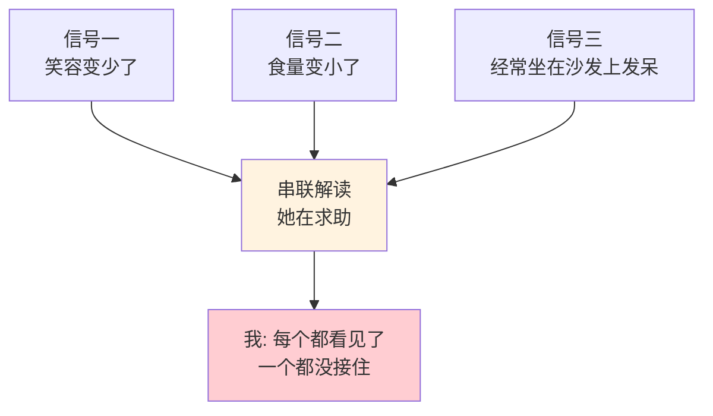
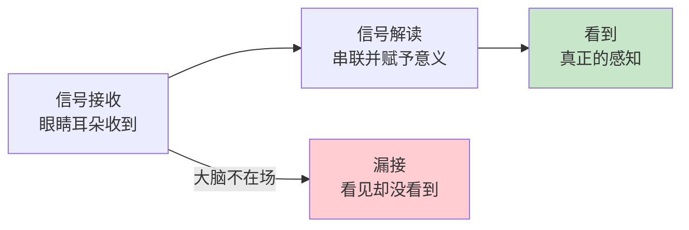
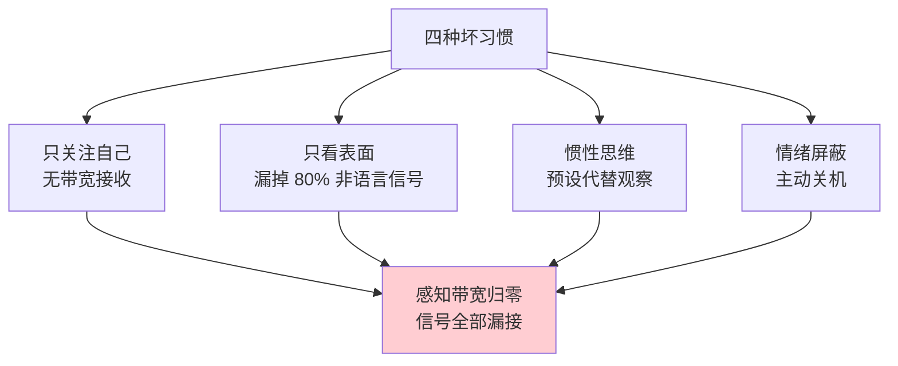
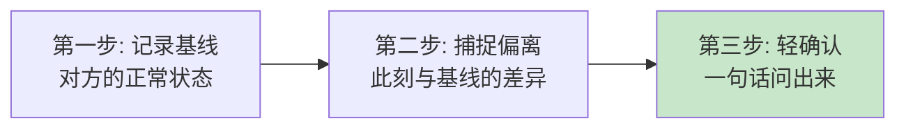
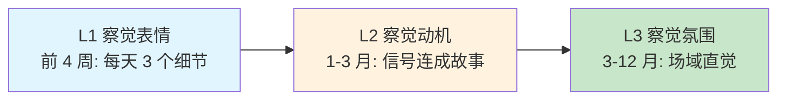
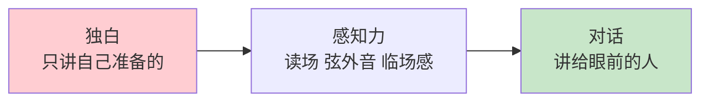
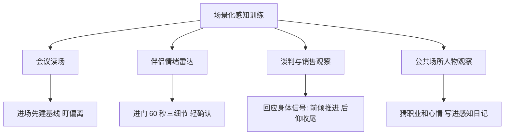
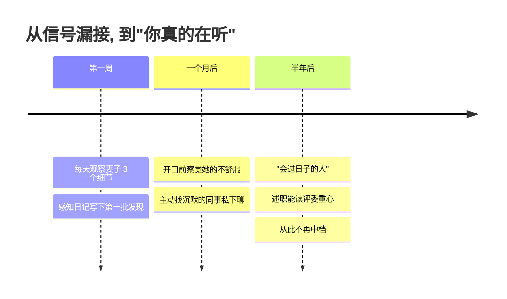

## 11.感知能力的提升

- [11.感知能力的提升](#11感知能力的提升)
- [01.她怀孕一个月我没看到](#01她怀孕一个月我没看到)
- [02.断点自测三问](#02断点自测三问)
- [03.什么是感知能力](#03什么是感知能力)
- [04.感知力差的表现](#04感知力差的表现)
- [05.提升感知四方法](#05提升感知四方法)
- [06.四个感知的维度](#06四个感知的维度)
- [07.把感知变成习惯](#07把感知变成习惯)
- [08.感知力三段里程碑](#08感知力三段里程碑)
- [09.感知怎样撑起表达](#09感知怎样撑起表达)
- [10.场景化感知训练](#10场景化感知训练)
- [11.这几个坑我踩过](#11这几个坑我踩过)
- [12.总结回顾这一节](#12总结回顾这一节)
- [13.后来发生的改变](#13后来发生的改变)
- [14.今天起改变三点](#14今天起改变三点)
- [15.课后作业思考下](#15课后作业思考下)
- [16.下一站过渡到记忆](#16下一站过渡到记忆)

## 01.她怀孕一个月我没看到

那是个普通的周末晚上，我刷着手机吃饭，媳妇突然把筷子放下，眼眶红着说："你能不能稍微看我一眼？"

我愣住了："咋了？" 她哭着说："我已经孕吐了一个月，每天早上 6 点跑去厕所吐，体重掉了 4 斤，胸口涨得要命睡不着。**你居然一次都没问过我**。"

那一刻我整个人僵在那。我开始往回想，这一个月里，她确实变得不爱笑了，吃饭吃几口就放下，晚上经常坐在沙发上发呆。我都看见了，但**我什么都没"看到"**。

后来我才明白：眼睛接收信号叫"看见"，大脑做出解读叫"看到"。**我每天和她在一起，但我的感知系统是关闭的**。她笑容变少我没察觉，她食量变小我以为天热没胃口，她经常发呆我以为工作累了。每一个信号单独看都不重要，**串起来就是一个非常明显的求助信号**，而我整整一个月没接收到。

那天之后我下决心补这门课：感知力。它影响的不只是工作效率，更影响**最亲近的人能不能被你看见**。

## 02.断点自测三问

感知力欠账最典型的症状是"你没恶意，但没人愿意跟你说心里话"。因为跟你说等于对空气说，你接不到。用三问自测：**你能说出配偶今天穿了什么衣服吗？**说不出，说明家里已进入"自动驾驶盲区"；**会议中你能说出谁全程没说话吗？**说不出，说明你只看内容不看人；**有人"嘴上说没事"，你能识别真假吗？**不能，说明你只接收表层信号。

三问里有一个"否"，感知力就是你的短板。**感知不好，说得再多也是自说自话**，这一章要教你把"看见"升级成"看到"。

## 03.什么是感知能力

感知能力可以拆解为四个维度：**对人的感知**，察觉他人情绪和需求，比如配偶今天笑容变少；**对事的感知**，捕捉事情的关键变化，比如项目周报指标连续 3 周下滑；**对环境的感知**，感知氛围、趋势、危机，比如走进会议室就知气氛紧张；**对自己的感知**，了解自己状态和情绪，比如今天为什么烦，是饿还是压力。

感知力还可以分为两个层次。**信号接收**是信号物理上进入你的眼睛、耳朵，这是大多数人都能做到的"看见"。**信号解读**是大脑把信号串联、理解、赋予意义，这才是"看到"，区分高低感知力的关键。

我那一个月没"看到"老婆的求助信号，本质就是：信号接收 100%，信号解读 0%。**眼睛在场、大脑不在场**，是所有感知失败的共同根源。

为什么会这样？心理学有一个著名的"看不见的大猩猩"实验：让受试者数视频中传球的次数，一个穿大猩猩服装的人从镜头前慢悠悠走过，超过一半的人完全没看见。**不是眼睛有问题，是注意力没分配**——人在专注于某件事时，会对自己没关注的东西"选择性失明"。这就是感知力的第一定律：**你只会看到你准备看的东西**。想看到更多，先得把注意力主动分出去。

## 04.感知力差的表现

感知力差不是天生的，是四种坏习惯堆出来的：**只关注自己**，聊天时只想自己下句要说什么，大脑忙于组织语言，没有带宽接收；**只看表面**，别人说"挺好的"就信，忽略语气、表情、肢体信号；**惯性思维**，"他一向都不在乎"，用预设代替观察，失去当下；**情绪屏蔽**，自己情绪差时对外全屏蔽，心情不好的时候最容易出事。

**注意力全在自己身上**。聊天时只想着自己接下来要说什么，没在听对方说什么；走路时只想着自己的烦恼，没注意路边发生了什么。研究表明，人在说话时基本不在听；只有当你停止"准备说话"时，才能真正接收到对方的信号。

**只看表面，不看深层**。老板说"挺好的"就以为真的挺好；同事说"没事"就以为真没事。**忽略了语气、表情、肢体语言这些更真实的信号**。语言只是信号的表层，剩下 80% 都在非语言里。

**用惯性思维替代观察**。"他每次开会都不说话，肯定不在乎"，这是预设。其实他可能是不敢说，可能是没准备好，可能是有更深的想法。**预设让你失去了真正观察的机会**。这里要接住第 04 篇非暴力沟通的提醒：观察不等于评论——"他今天开会三次都没发言"是观察，"他这人没有团队感"是评论。带着评论去观察，你只会看到你想看到的。

**情绪屏蔽了感知**。当你自己情绪很差时，会下意识屏蔽周围一切信号，别人的求助、危险的信号、变化的趋势，你都接收不到。这是为什么"心情不好的时候容易出事"，也是为什么高手会在做重要判断前先处理自己的情绪。

## 05.提升感知四方法

我这些年练感知力的四条主线：

**刻意观察**。每天给自己定一个观察小目标：今天注意 1 个同事情绪的细微变化；今天观察 1 个家人今天和昨天有什么不同；今天观察 1 个商场或地铁里的有趣场景。刚开始可能完全观察不到，**但坚持 21 天后你会变成另一个人**，同样的环境，看到的信息密度会翻好几倍。

**5W1H 追问**。看到一个现象后，习惯性地追问 What 发生了什么、Who 涉及到谁、When 什么时候开始的、Where 发生在什么场景、Why 为什么会这样、How 怎么发生的。不停地追问，会让你看穿表面，触及本质。

**换位思考**。任何场景都问自己一句："如果我是他，我现在在想什么？感受什么？需要什么？"换位思考是同理心的核心训练。**同理心不是天赋，是每天问三遍"如果我是他"练出来的肌肉**。

**感知日记**。每天睡前花 5 分钟，记录三个问题：今天我观察到了什么有意思的事？今天身边的人有什么状态变化？今天我自己的情绪走向是怎样的？坚持一个月，你的感知带宽会明显扩大。

四方法之间有一条隐线：**刻意观察是"看到更多信号"，5W1H 是"解读更深"，换位思考是"看到别人视角的信号"，感知日记是"让信号沉淀成经验"**。四条一起用，感知力才能真的长出来。

## 06.四个感知的维度

日常里最常用的四个感知维度，逐一展开。

**对人的感知**可以从三个信号通道入手。**表情通道**：眼神是否回避？嘴角是上扬还是下撇？眉头有没有紧锁？**语气通道**：语速是变快了还是变慢了？声调是平的还是上扬的？停顿是不是变多了？**肢体通道**：是不是双手交叉抱在胸前（防御）？身体是前倾还是后仰？手指有没有不停敲桌子（焦躁）？这些信号比"嘴上说的话"更真实。

不过，信号要读得准，还差一个关键动作：**先建基线，再抓偏离**。FBI 行为分析专家乔·纳瓦罗在《FBI 教你读心术》里反复强调：单看一个动作就下结论，误判率极高，有人紧张时就爱敲桌子，敲桌子本来就是他的基线。正确的读法分两步：先在对方放松时观察他的"正常状态"（语速、手势习惯、坐姿），再捕捉此刻的言行与基线的**偏离**。偏离才是信号，基线之上的差异才有意义。

基线法之外，再补两件武器。**第一件：七种通用情绪表情**。心理学家保罗·埃克曼（《说谎》的作者，美剧《别对我说谎》的原型）的跨文化研究发现：喜、怒、哀、惧、厌、惊、蔑七种基本情绪的表情是全人类通用的，连天生的盲人都会做出同样的表情，这一小部分信号，不需要基线就能读。**第二件：语言与表情的不一致**。真实情绪被压制时，脸上会闪过不到 0.1 秒的"微表情"，普通人捕捉不到那么快，但可以练一个更实用的版本：**盯"不一致"**。嘴上说"没问题"但嘴角是撇的，说"很高兴认识你"但眼睛没有动，说"随便提意见"但身体往后仰，语言和身体不一致的瞬间，就是最响亮的信号。切记：**不一致是需要核实的线索，不是定罪的证据**。表情可以伪装、可以因场合被掩饰，看到不一致，正确动作就是基线法的第三步：问出来。

**对事的感知**是捕捉关键变化。每件事都有"正常状态"和"异常状态"，感知力强的人能在异常变化的早期就察觉到：项目周报里某个指标连续 3 周下滑；客户回复邮件的速度变慢了；团队里有人最近开会越来越少发言。**异常等于信号**，越早察觉越能主动应对。

**对氛围的感知**是场域能量。走进一个会议室，能不能立刻感觉到"今天气氛很紧张"？走进一个家庭，能不能立刻感觉到"今天大家都在闹别扭"？这种"场域能量"的感知是最高级的感知力，需要长期训练才能获得。**很多资深管理者最值钱的直觉，就是这一层**。

**对自己的感知**常常是最弱的一环，因为自己看不见自己。心理学家塔莎·欧里希在《洞察力》里发现：95% 的人自认为有自知之明，真正有自知之明的不足 15%——**每个人都有大片"自我盲区"**，也就是乔哈里视窗里"他人知道、自己不知道"的那一格。补法只有一个：定期向信任的人要反馈，问一句"你最近观察到我有什么状态变化？"。自己的感知加上他人的镜子，自我认知才是完整的。

## 07.把感知变成习惯

前面讲的是短期战术，接下来是长期习惯化。三条主线：

**少说多听**。聊天时，把"准备下一句要说什么"的精力，**转移到观察对方上**。你会惊讶于对方比你原本以为的更立体、更有故事。少说多听的另一个好处是：**你少说，对方就多说，多说就多暴露信号，信号越多你越懂他**。

**关掉自动驾驶**。在熟悉的场景里，人最容易开自动驾驶，每天回家走的那条路、每天吃饭的那家店、每天聊天的那几个人，你都没在"看"。博物学家亚历山德拉·霍洛维茨在《观察的力量》里说，专家和普通人的差距不在视力，而在**对熟悉世界的重新观察**。刻意练习：今天家里的灯光是不是不一样？老婆今天的发型有变化吗？同事今天穿的衣服你以前见过吗？

**扩大体验**。经常去陌生场景、和陌生人接触，你的感知系统会被迫激活。旅行、参加陌生圈子的聚会、读不熟悉领域的书，都是在扩大感知带宽。**陌生场景是感知力的健身房**，只有不断遇见新的信号，你才不会退化成"只看得懂熟悉世界"的人。

最后，把感知从"视觉独奏"扩展成"五感合奏"——**耳朵和鼻子是被荒废的带宽**。三个练习：**闭眼一分钟听分层**，远处的车流、近处的人声、最细的风声，你会听到三层从未注意的声音；**气味挂钩记忆**，闻到某种味道立刻记下联想到的场景，嗅觉是与记忆中枢最直连的感官；**触觉钝感自查**，回想一天里你的皮肤感受到过几次衣服、椅子、空气的温度。**写作和表达的场景感，一半来自视觉之外的感官记忆**。

## 08.感知力三段里程碑

感知力的成长分三段。**L1 察觉表情**（前 4 周）：能看到"她今天不太开心"，判断标准是每天能挑出 3 个身边人的细节。**L2 察觉动机**（1-3 月）：能推断"不开心是因为工作还是家里"，判断标准是能把信号连成故事。**L3 察觉氛围**（3-12 月）：走进会议室就知气场对不对，这一层是场域感知，很多管理者的直觉就停在这里。

不要急着追 L3。先把 L1 做扎实，**大部分感情、职场问题栽的都是 L1 层的信号被漏接**，而不是 L3 层的高深洞察。感知力是最"日拱一卒"的能力，练到 L2 就已经甩开身边大多数人。

L3 的"场域直觉"听起来玄，其实有科学解释。格拉德威尔在《决断 2 秒间》里提出"薄片摘录"：婚姻研究专家看夫妻对话 3 分钟，就能高精度预测他们会不会离婚。**直觉不是神秘天赋，是被压缩的经验**——L1、L2 阶段成千上万次"观察 + 验证"，到 L3 被压缩成一瞬间的"感觉"。但直觉有适用边界：它只在"有规律可循、且有即时反馈"的领域可靠（读人、读场、下棋），在纯随机的领域（彩票、短线）它就是错觉。**先攒够 L1 和 L2 的汗水，你的直觉才配被信任**。

## 09.感知怎样撑起表达

感知力是"立言"里最容易被低估的一块，但它决定了你的表达是"独白"还是"对话"。

**汇报中的实时调整**。同样的 PPT 讲给两个不同的评委，能不能读懂对方今天在乎哪一块，直接决定成绩。感知力强的人开口 30 秒内就能读到评委的重心，接下来的内容会自动向那个重心倾斜。**不会读场的人在做"讲"，会读场的人在做"谈"**。

**沟通中的听懂弦外音**。老板说"这个方案再看看"，是"有信心加分"还是"有意见没说"？同事说"随便你决定"，是真的放手还是不满的伏笔？感知力强的人能透过语言读到情绪、透过情绪读到需求。**弦外音接得住的人，永远比只听字面的人快一步做出正确反应**。

**演讲现场的临场感**。舞台上讲得好的人有一个共同点：**眼睛是活的**。他会真的看向台下，会因为某一排人的表情临时切一个话题，会在感觉到冷场时立刻抛出一个笑点。这不是排练能来的，这是感知力在临场兑现。**没有感知的演讲是背稿，有感知的演讲是交流**。

**在这一章其他几节的位置里，感知是"输入端"的能力**：专注让你不被打断，感知让你接收到该接收的信号，然后思考才有原料，最后才能有得说。这就是"立言"两个字的次序，先立后言。

## 10.场景化感知训练

四个高频场景，各给一套落地打法：

**会议读场**：进场 5 分钟先建基线，谁的常态是话少、谁的常态是爱表态；会议中只盯"偏离"：突然不说话的人、被点名后开始搓手的人、看手机频率变高的人。这些偏离就是会议的暗流，会后挑一个人私聊确认。

**伴侣情绪雷达**：进门 60 秒观察三个细节——表情、脚步、开口第一句话的语气。语气与基线有偏离，就用一句话轻确认："今天是不是有点累？"**先确认，再解释，别猜完就当真**。

**谈判与销售观察**：对方身体前倾、开始翻你的材料，是兴趣信号，可以推进；身体后仰、开始看表、回应变短，是该收的信号，及时给台阶："要不您先看看材料，我周三再来对一次？"**会读身体信号的人，永远比只顾自己讲的人快一步**。

**公共场所人物观察**：地铁、咖啡馆里，选一个人猜职业、猜心情，再找细节支持你的判断。这是感知力的"健身房"，也是最好的写作素材库，**你观察到的人越多，笔下的角色就越真实**。

这些场景练熟后，最后看一眼我踩过的坑，帮你少绕弯路。

## 11.这几个坑我踩过

练感知力这些年踩过的坑，逐条对照。**只"看见"不"看到"**：眼睛在、大脑没解读，每天写 3 条感知日记并做一句话解读；**用预设代替观察**："他一向都不在乎"，换成"这次和上次比有什么不同"；**只看陌生人不看家人**：家里成了自动驾驶盲区，每晚回家先花 60 秒观察最亲近的人；**察觉了却不表达**：看到了但憋着，感知到就用一句话轻确认；**越观察越焦虑**：感知变成过度解读和内耗，记住"信号不等于结论"，问出来；**情绪盖过感知**：自己烦躁时对外全屏蔽，先处理自己 5 分钟，再回身观察。

其中最坑的是"察觉了却不表达"。你终于看到了老婆今天不对劲，但你什么也没说，等她主动开口时已经晚了。**感知力的完整闭环是"察觉 + 确认"**，只察觉不确认，等于没察觉。"你今天好像有点累，是不是哪里不舒服？"这一句话，比你脑子里的所有解读都更值钱。

再给一份**7 天启动清单**：Day 1 观察家人 3 个细节并写下；Day 2 在会议中当 15 分钟观察者；Day 3 聊天时刻意把自己说话比例压到 30%；Day 4 走一条陌生的路回家；Day 5 找一个团队成员做 5 分钟"确认式追问"；Day 6 睡前写今日感知日记；Day 7 回看一周记录，圈出 3 个"以前会漏掉"的信号。

## 12.总结回顾这一节

感知力等于信号接收乘以信号解读，眼睛在不代表大脑在。感知力差不是天生的，是四种坏习惯堆出来的。

三条最关键的实操：**看见不等于看到**，大多数人输在"信号解读"这一步；**先建基线再抓偏离**，人要读准，先知道他的"正常"长什么样；**每天观察 3 个细节 + 感知日记**，21 天后你会变成另一个人。

## 13.后来发生的改变

第一周我做了一件特别"刻意"的事：每天回家强迫自己观察老婆 3 个细节，今天她穿了什么、做了什么、说话语气是什么样的。写在感知日记里。一开始觉得别扭，第三天就开始有发现了："她今天笑容多了一点""她今天提到妈妈时语气有点重"。

一个月后，我能在老婆开口前察觉她不舒服了。看她皱眉的样子，我会主动问"你是不是哪里疼？"，会主动倒一杯热水。工作上也开始受益：开会时我能感觉到哪个同事其实有不同意见但没说出口，会私下主动找他聊。**同事私下反馈说"跟你聊天感觉你真的在听"，这句话比任何绩效评语都让我在意**。

半年后，老婆说："你变得像个会过日子的人了"，这句话比涨工资还让我开心。孩子出生后，我发现感知力强的爸爸是真的不一样：婴儿哭声不同代表不同需求，我能很快分辨出"这是饿了不是困了"，老婆经常被我惊到。**更意外的是这份能力反哺了我在工作汇报里的表现**，我开始能读到评委的关注点，讲的时候有针对性地调整，述职从此再没落到过中档。

## 14.今天起改变三点

**第一，每天观察身边人 3 个细节**。挑一个你最在乎的人，配偶、孩子、父母、好朋友。每天观察 ta 的 3 个细节：表情、语气、行为。写下来。**21 天后回看，你会震惊于自己之前漏掉了多少东西**。

**第二，聊天时少说多听**。下次聊天时，刻意把"自己说话的比例"降到 30%，70% 的时间用来听、观察、追问。你会发现对方比你以为的"有趣得多"。

**第三，写感知日记**。睡前 5 分钟，写下今天 3 件你"观察到的"事情，可以是别人的情绪、事情的变化、环境的氛围。**坚持一个月，你会发现自己看世界的"分辨率"变高了**。

## 15.课后作业思考下

1. 回想最近一周，你最在乎的人有没有什么"求助信号"被你忽略了？回头去问问 ta，验证你的感知准不准。

2. 你和别人聊天时，自己说话的比例大概是多少？是不是经常没听完对方的话就开始准备自己要说什么？

3. 选定一个你最在乎的人，先花两天记录 ta 的"基线状态"（放松时的语速、表情、习惯动作），之后连续 5 天只记录"偏离基线"的变化，一周后拿这份记录去和 ta 聊，看看你的解读准不准。

4. 在下一次会议中，刻意当 30 分钟的"观察者"，别只听内容，还要观察每个人的表情、坐姿、参与度变化，写一段会后复盘。

5. 找一位了解你的朋友或家人，问一句"你最近观察到我有什么状态变化？"，把答案记进感知日记，这就是你的"自我盲区"清单。

## 16.下一站过渡到记忆

感知让你接收到该接收的信号。但信号接收到之后，如果 24 小时后就忘了，等于没接收到。**感知的下游是记忆，记不住的感知等于零**。

下一节讲记忆能力的训练，教你把"今天感知到的信号"变成"三年后还能调用的经验"。感知负责宽度，记忆负责厚度，一宽一厚，你的经验才能真正堆起来。
