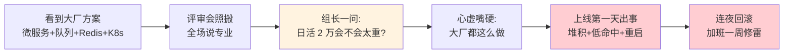
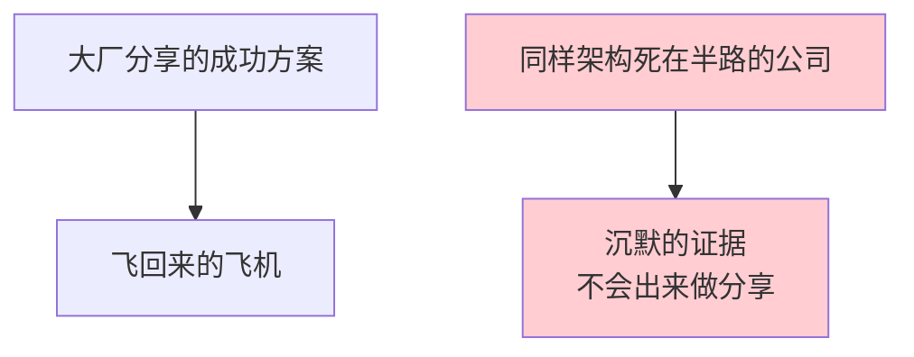
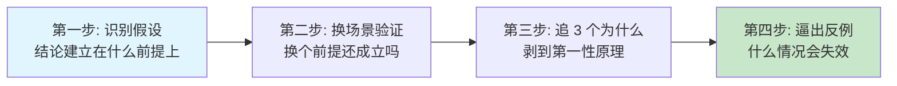
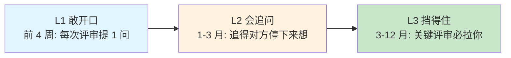
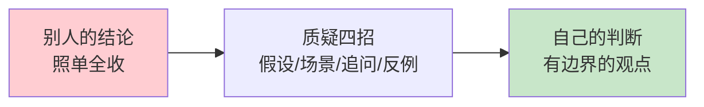
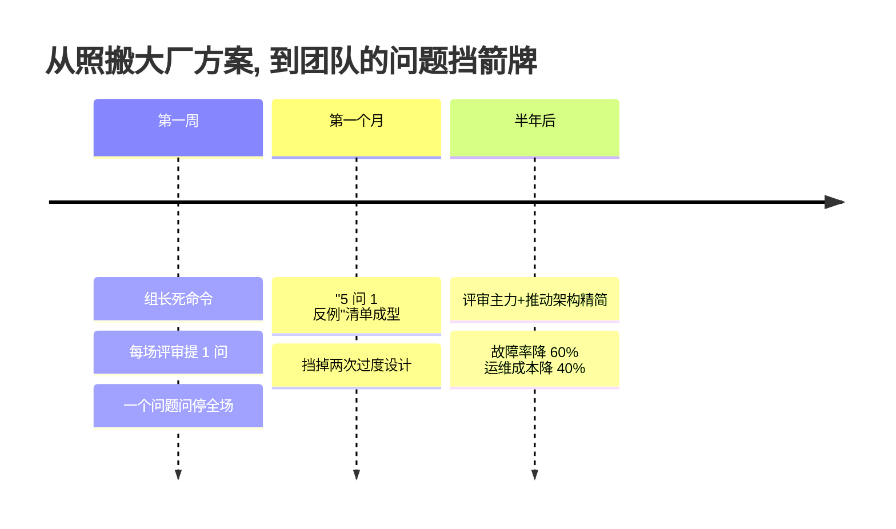

## 13. 质疑精神的分析

- [01.照搬大厂方案的翻车](#01照搬大厂方案的翻车)
- [02.断点自测三问](#02断点自测三问)
- [03.什么是质疑精神](#03什么是质疑精神)
- [04.为何不敢去质疑](#04为何不敢去质疑)
- [05.提升质疑力四招](#05提升质疑力四招)
- [06.建设性质疑表达](#06建设性质疑表达)
- [07.质疑的边界分寸](#07质疑的边界分寸)
- [08.质疑力三段里程碑](#08质疑力三段里程碑)
- [09.质疑怎样撑起表达](#09质疑怎样撑起表达)
- [10.场景化质疑训练](#10场景化质疑训练)
- [11.这几个坑我踩过](#11这几个坑我踩过)
- [12.总结回顾这一节](#12总结回顾这一节)
- [13.后来发生的改变](#13后来发生的改变)
- [14.今天起改变三点](#14今天起改变三点)
- [15.课后作业思考下](#15课后作业思考下)
- [16.下一站过渡到思考](#16下一站过渡到思考)

## 01.照搬大厂方案的翻车

去年我们要做一个新功能模块。我看到行业某大厂分享的架构方案：拆分微服务、引入消息队列、用 Redis 缓存、走 K8s 部署。

我在评审会上把这套方案完整搬了过来，全场没人反对，都说"听起来很专业"。只有组长问了一句："**我们日活才 2 万，这套方案是不是太重了？**"

我当时心虚但嘴硬："大厂都这么做的，肯定没错。"

结果**上线第一天就出事**：消息队列消息堆积、Redis 命中率不到 30%、K8s pod 来回重启。因为日活太低，根本撑不起异步链路所需的吞吐量。大厂的方案是为千万 DAU 设计的，照搬到 2 万 DAU 的场景就是负担。

我连夜回滚成单体应用加 MySQL，接下来一周加班修这个雷。



复盘的时候，组长说了一句让我刻骨铭心的话："你不是不会做技术选型，你是不敢质疑大厂方案。**"权威说的就一定对"是工程师最危险的习惯**。"

那一刻我突然明白：质疑不是抬杠、不是不尊重，**质疑是把信息从"别人的"变成"自己的"必经之路**。这一章就是我从那次惨痛事故后，重新认识"质疑"这件事的全部总结。

## 02.断点自测三问

质疑力欠账的典型症状不是"我不敢反驳"，是"你听到什么就信什么"，脑子里没有一台过滤机器。用三问自测：**听到"大厂都这么做"时，你会追问一句为什么吗？**不会，说明权威已经替你思考；**你能说出最近一次自己修正过的错误看法吗？**不能，说明你一直在"输入"，从没"更新"；**你敢在会议上提一个和多数人不一样的问题吗？**不敢，说明群体压力已让你丧失独立判断。

三问里有一个"否"，你就还在做"二传手"而非"独立判断者"。**质疑不是让你变刺头，是让你在信息进来时先过一道筛子**，这一章要教的就是这道筛子怎么装。

## 03.什么是质疑精神

质疑精神可以拆成四个维度：**不预设权威**，谁说的不重要，对不对才重要，大牛也会错、新人也会对；**追问背后逻辑**，为什么、凭什么、适用边界，追 3 层为什么；**基于证据判断**，拿出数据和事实，不靠"我觉得"；**保持开放修正**，质疑后愿意接受新答案，有新证据就改判断。

```mermaid
graph TD
    A[质疑精神四维度] --> B[不预设权威<br/>对不对才重要]
    A --> C[追问背后逻辑<br/>追 3 层为什么]
    A --> D[基于证据判断<br/>不靠"我觉得"]
    A --> E[保持开放修正<br/>有新证据就改]
    B --> F[独立判断者]
    C --> F
    D --> F
    E --> F
    style A fill:#e1f5fe
    style F fill:#c8e6c9
```

**不预设权威**：信息是不是对的，跟说的人是谁没关系。哪怕是诺贝尔奖得主，说错了也是错的。**追问背后逻辑**：不停问"为什么"，为什么这么设计？基于什么假设？适用什么边界？**基于证据判断**：不靠"我觉得"，而是靠"数据显示"。天文学家卡尔·萨根给过一条证据标准：**非凡的主张，需要非凡的证据**。日常结论用日常证据就够，越惊人的结论，越要追问证据的等级。**保持开放修正**：质疑不是为了证明自己对、对方错，而是为了找到真相。哲学家罗素说过一句极清醒的话："我不会为我的信念去死，因为我可能是错的。"质疑的最高境界不是怀疑别人，是保留怀疑自己的权利。

质疑练到头，枪口最后要对准自己。汉斯·罗斯林在《事实》里列了十种系统性直觉偏差，职场最常见的三种：**二分直觉**，把世界分成非黑即白的两类，实际多数人和事都在中间地带；**负面直觉**，坏消息传播远快于好消息，让你系统性高估风险、低估进步；**单一视角**，手里只有一把锤子，看什么都像钉子（芒格的格栅正是它的解药）。每次下判断前过一遍偏差清单，是质疑力的毕业考试：**发现自己的直觉也在给结论灌水，才算真正学会了开放修正**。

质疑和抬杠完全不是一回事：**目的**不同，质疑寻找真相，抬杠证明自己对；**态度**不同，质疑开放好奇，抬杠防御攻击；**逻辑**不同，质疑基于证据，抬杠基于情绪；**结果**不同，质疑让双方都长进，抬杠让双方都恼火。

很多人不愿意质疑别人，是因为分不清这两者，以为质疑就是不尊重、就是冒犯。**能分清质疑和抬杠，是走出"乖乖听话"和"逢事必怼"两个极端的分水岭**。

## 04.为何不敢去质疑

不敢质疑通常有四个原因。**权威崇拜**，"大牛、大厂、老板说的"，破解思路是追问背后逻辑；**害怕冲突**，"说了会得罪人"，破解思路是换成建设性提问；**认知偷懒**，"接受结论比思考轻松"，破解思路是强制自己复述并追问；**群体压力**，"大家都同意就跟着同意"，破解思路是会前先独立想一遍。

**权威崇拜**是最常见的。"他是大牛，他说的肯定对""这是大厂方案，肯定没问题""老板说的，照办就行"。《思考，快与慢》解释了根因：系统 1 天生爱走捷径，"权威说的"等于"不用我再想"，把判断权外包出去，大脑立刻轻松。**但省下来的思考成本，迟早连本带利还回去**，开篇那场事故就是账单。

**害怕冲突**是最主观的。质疑别人就是在说"你可能错了"，很多人怕引起反感、怕被报复、怕影响关系，所以宁可吞下疑问也不开口。

**认知偷懒**是最隐蔽的。质疑需要消耗大量脑力：要弄清楚原方案的逻辑、要找证据、要构建反例。直接接受现成结论显然轻松得多。

**群体压力**是最难摆脱的。会议上 9 个人都同意，你那 1 个人的疑问就很难说出口。勒庞在《乌合之众》里写得更狠：**人在群体中智商会下降**，群体不需要逻辑，只需要情绪和一致。那 1 个疑问就是对抗群体惯性的唯一解药：会前先独立想一遍，把答案写在纸上再进会议室。

## 05.提升质疑力四招

质疑力提升靠四招：3 个为什么、寻找反例、识别假设、换场景验证。

**追问 3 个为什么**。听到任何结论，强迫自己问 3 层：为什么是这样？这个理由背后又为什么？这个更深的原因又为什么？3 层挖下去，往往就能找到根本逻辑，或者发现根本没有逻辑。追问的尽头是马斯克说的"第一性原理"：把结论一层层剥掉，剥到不可再分的事实基石，再从基石重新往上推。大厂方案剥到底就是"日活大，所以异步链路划算"——日活换成 2 万，基石就塌了。

**主动寻找反例**。任何观点听起来再正确，都试着想："有没有什么情况下它会不成立？"比如"敏捷开发提升效率"在合规要求很高的场景里成立吗？"学历不重要"在选拔 1000 人岗位时还不重要吗？"年轻人要敢冒险"上有老下有小的人也要冒险吗？**反例是检验观点最好的方法**。

反例有两种找法。第一种是想"什么情况会失效"；第二种更狠，问"**谁没有说话**"。二战时统计学家沃德面对"给返航轰炸机加装甲"的任务，发现弹孔集中在机翼和机身，军方要加固这些部位，沃德却建议加固**没有弹孔的引擎和油箱**：因为弹孔数据只来自飞回来的飞机，引擎中弹的根本没机会返航。开篇的大厂方案就是同一课：**所有成功案例都是飞回来的飞机**，用同样架构死在半路的公司，不会出来做分享。找反例时记得多问一句："用这个方法失败的人，在哪里？"



**识别背后的假设**。任何观点都建立在一系列假设之上。把假设找出来，就能判断观点的边界。比如"这个方案能让我们 QPS 提升 10 倍"，假设是什么硬件配置、多大数据量、什么业务场景？"我应该跳槽"，假设是新公司更好、老公司不变、市场不变？**假设不成立，结论就不成立**。

**换场景验证**。把同一个观点放到不同场景里检验：这个方案在 100 人公司可行，在 1 万人公司可行吗？这个方法对单身的人有用，对有孩子的人有用吗？这个理论在中国成立，在美国成立吗？**换场景就是最快的祛魅工具**。



四招用起来有个先后顺序：**先识别假设、再换场景验证、然后追 3 个为什么，最后逼出反例**。这条链走完，任何看似坚固的结论都会露出真实的边界。

这四招和第 05 篇"批判性追问"的四道问题（论据、假设、替代、遗漏）是一体两面：那一篇用在接住别人的答案时，这一篇用在信息进入自己脑子前。一个管出口，一个管入口，合起来才是完整的过滤系统。

## 06.建设性质疑表达

质疑要建设性表达，四个原则：

**先肯定再质疑**。不要上来就"我不同意"，先认真总结对方的观点，让对方知道你听懂了。"您的方案我理解是这样：A → B → C，这个逻辑很清晰。我有一个疑问想请教，关于 B 这一步……"让对方感到被尊重，他才会真的听你说什么。

**用问题代替结论**。不要说"你这个方案不行"，而是说"我有个问题想确认一下，在 XX 场景下这个方案会怎么处理？"**问题比结论更容易被接受**，而且常常逼对方自己发现问题。

**基于事实而非猜测**。不说"我觉得不行"，而说"根据上周的压测数据，QPS 5000 时延迟已经到 800ms，这个方案能扛住目标的 2 万 QPS 吗？"事实有力量，猜测没有。

**提供替代方案**。最好的质疑不是"否定"，而是"提出更好的"。"方案 A 我担心 XX 问题，能不能考虑方案 B？方案 B 在 XX 方面可能更适合我们的场景。"**只否定不建议的质疑，在职场里没有正向价值**。

## 07.质疑的边界分寸

质疑有四条边界。**场合**，公开场合留面子，反例是会上直接怼老板；**对象**，对事不对人，把"你错了"换成"这方案有个点我担心"；**准备度**，质疑前先做功课，张嘴就质疑就是抬杠；**频率**，不为质疑而质疑，逢提议必反对是另一种偏执。

**公开场合质疑老板**会让对方下不来台。私下沟通可以更尖锐，公开场合留余地。正式评审是质疑的好场合，大家都在准备应对疑问；茶水间闲聊不是，会显得突兀。

**对事不对人**。质疑方案不等于否定提出方案的人。把"你错了"换成"这个方案有个点我担心"。

**质疑前要做功课**。不要张嘴就质疑，先把对方的观点完整理解了、把背景资料看了、把数据查了，再去质疑才有分量。**不做功课的质疑就是抬杠**。

**不要为质疑而质疑**。有些人养成了"逢提议必反对"的习惯，把质疑变成人设，这反而是另一种偏执。真正的质疑精神是开放的，质疑后如果对方给出充分理由，你应该愿意改变看法。

## 08.质疑力三段里程碑

质疑力的成长分三段。**L1 敢开口**（前 4 周）：至少能提出 1 个问题，判断标准是每次评审都提问一次。**L2 会追问**（1-3 月）：3 层为什么加反例加假设，追问追得让对方停下来想。**L3 挡得住**（3-12 月）：关键时刻挡下过度设计，团队重要评审必拉你参加。



不要跳级。**先做到"每次评审都能开口问一个问题"再谈追问、再谈挡雷**。质疑力和演讲力一样，都是次数堆出来的肌肉。

**"5 问 1 反例"评审清单**（可直接抄到便利贴上带进会议室）：

1. 核心假设是什么？在我们场景下成立吗？
2. 适用边界在哪里？数据量、用户量、时段、地域？
3. 失败时的回滚 / 兜底方案是什么？
4. 数据、成本、人力估算的依据是什么？
5. 跟现有系统 / 流程怎么衔接？迁移成本谁承担？
6. **反例**：什么场景下这个方案会失效？

这份清单是评审专用的"战术卡"。再给一张全场景通用的"元框架"：**苏格拉底式提问六类**。**澄清**（"你说的 X 具体指什么？"）、**探究假设**（"成立的前提是什么？"）、**探究证据**（"依据是什么，够不够硬？"）、**换个视角**（"反对的人会怎么说？"）、**探究影响**（"如果成立，会推演出什么？"）、**对问题本身的质疑**（"我们为什么要问这个问题？"）。四招武器管拆解，六类谱系管导航：遇到不同场合，知道该抽哪一类问题，提问就不会没有章法。

带着这份清单去每一场评审、每一次决策会议，你会发现自己从"随声附和"变成"能挡雷的人"，而这正是团队最稀缺的角色。

## 09.质疑怎样撑起表达

质疑力对表达的兜底作用，藏在四个场景里：

**评审会的一针见血**。别人讲了 40 分钟，你能不能用一个问题问到点子上？这份能力不是靠聪明，是靠平常质疑训练下来的"假设敏感度"。**别人在讲结论，你能听出结论背后的假设**，这就是拉开专业感差距的关键。

**汇报被追问时的接得住**。汇报台下的评委问"你这个数据的边界是什么？"，你能不能立刻回答？能不能取决于你写方案时有没有先自我质疑一遍。**先自己问过一百遍，别人问的时候才不会慌**。

**长文写作的深度**。写一篇有分量的深度文章，靠的不是文笔，是每一句结论都经过反问、验证、找反例。**质疑是深度写作的第一道工序**，没这道工序，写出来的东西就是"转述别人"。

**日常沟通中的判断力**。同事、客户、老板讲的话，你能不能不照单全收？能不能识别里面的假设、找出反例、看到边界？这份判断力，是所有高段位表达者的共同特征。**质疑是"独立思考"的操作层，思考的深度取决于你敢不敢质疑**。



## 10.场景化质疑训练

四个高频战场，各给一套打法：

```mermaid
graph TD
    A[场景化质疑训练] --> B[评审会]
    A --> C[听讲座 读文章]
    A --> D[刷热点新闻]
    A --> E[家庭与教育决策]
    B --> B1[5 问 1 反例清单进站]
    C --> C1[证据等级+幸存者偏差+换场景]
    D --> D1[来源可核实吗 谁受益于我信它]
    E --> E1[这个"都"里有多少幸存者偏差]
```

**评审会**：带"5 问 1 反例"清单进站（第 08 节），开场先听完整、记下假设，提问时按建设性四原则走。这是质疑最正式的战场，也是训练量最大的地方。

**听讲座、读文章**：问三件事。证据是什么等级（个例还是数据？样本多大？）；有没有幸存者偏差（讲成功的人里，失败的人在哪）；换个场景还成立吗。三问过完，再决定"要不要信、要不要用"。

**刷热点新闻**：三问更短：来源可核实吗？统计口径是什么（"增长 50%"的基数到底是几）？谁受益于我信它？**热点情绪越浓，三问越要问**。

**家庭与教育决策**："别人家孩子都在学"是最常见的群体压力。拆一句问："都"是谁统计的？学了的孩子里真受益的比例有多少？这里面有没有幸存者偏差（没学成的不发声）？**质疑力在家庭里的应用，是不让焦虑替你做决策**。

## 11.这几个坑我踩过

练质疑这些年踩过的坑，逐条对照。**质疑变抬杠**：逢提议必反对、情绪先行，先复述对方观点再开口；**不做功课就开口**：只凭"感觉不对"冲上去，读材料、查数据、想反例三条准入；**公开场合下重手**：会上直接怼老板，公开留面子，私下尖锐；**只否定不提替代**："这不行"三个字就完，每次质疑带一个备选方案；**只质疑别人**：从不质疑自己，每周挑一个旧决策自我复审；**质疑后拒不修正**：变成表演和人设，终点是找到真相不是证明我对。

其中最坑的是"质疑变抬杠"和"只否定不提替代"。前者让你在团队里变成"反对派"的人设，后者让你变成"只会挑刺不会做事"的形象。**质疑力的价值在于"让方案变得更好"，不在于"让方案通不过"**，这个底层动机不对，其他技巧全白搭。

## 12.总结回顾这一节

质疑不是抬杠，是把别人的结论变成自己的判断的必经之路。不预设权威、追问背后逻辑、基于证据判断、保持开放修正，这是质疑的四条腿。

三条最关键的实操：**不预设权威**，大牛说的、大厂做的、老板说的，都要追问"为什么"；**追问 3 个为什么 + 找反例 + 识别假设**，质疑的三大武器，剥到第一性原理为止；**建设性表达**，先肯定再质疑、用问题代替结论、提供替代方案。

## 13.后来发生的改变



事故后的第一周，组长让我参加 3 个方案评审。**他给我下了死命令：每场至少提 1 个问题**。我特别紧张，每次都提前两小时把方案翻熟、把假设列出来。第一场我憋出了一个问题"这个 QPS 假设的依据是什么？"，提问完全场安静，结果方案作者自己也没想清楚。

一个月后我整理出"5 问 1 反例"清单，带着这张清单参加每场评审。一个月内帮组里挡掉两次过度设计：一次是不必要的微服务化，一次是不必要的多机房部署。**同事开始把我叫做"问题挡箭牌"**，评审前会主动找我先过一遍方案。

半年后组长把我列为"方案评审主力人员"，重要方案都要拉我把关。我自己也推动了一次架构精简方案，把组里 3 个微服务合并成 1 个，去掉了 2 个中间件。**上线后整体故障率下降 60%，运维成本下降 40%**。更重要的是，我变得更"敢说话"了，不只是技术评审，连和老板沟通战略时我也能基于事实提出不同看法。**这份"敢说"在几次年度述职里，直接把我从执行者变成了决策者**。

## 14.今天起改变三点

**第一，听到结论先追 3 个为什么**。不管是新闻、领导讲话、同事方案，都强迫自己问 3 层为什么，问到自己满意为止。**"大厂都这么做"这种话听到就要警觉**，这是大脑关闭独立思考的开关。

**第二，评审会强迫自己提 1 个问题**。不管是技术评审、产品评审、还是部门会议，强制自己至少提 1 个有质量的问题。可以用模板："这个方案在 XX 场景下会怎么处理？""这个数据的依据是什么？""失败的兜底方案是什么？"

**第三，不照搬任何"现成方案"**。下次想用一个"大厂方案 / 最佳实践 / 行业标杆"时，先问自己 3 个问题：它的适用场景和我一样吗？它的假设条件在我这里成立吗？我的成本能撑起这个方案吗？**先理解，再借鉴，永不照搬**。

## 15.课后作业思考下

1. 回想你最近一次"完全相信权威"导致的失败经历，为什么当时你不敢质疑？背后的真实原因是什么？

2. 在你的日常工作中，有哪些"大家都这么做"的事其实从来没人深究过逻辑？挑一件出来追问 3 个为什么，一直问到第一性原理。

3. 在下一次评审会或团队会议上，强迫自己提出至少 1 个有质量的问题（基于事实、不预设结论），记录现场反应和自己的感受。

4. 挑一篇你最近读到的"权威观点"文章，写一段 300 字的反思：它的假设是什么？适用边界在哪里？反例是什么？如果萨根来审，"非凡的证据"够格吗？

## 16.下一站过渡到思考

质疑是"过滤"，把不成立的结论挡在外面。但过滤只是第一步，**真正决定你能不能形成自己观点的，是"思考"**。感知让你收得到，记忆让你留得住，质疑让你筛得掉，思考让你"组合成新的东西"。

下一节讲思考能力的提升，教你把"筛过之后剩下的原料"组合成属于你自己的观点和判断。质疑是拆，思考是搭，缺哪一样表达都长不大。
