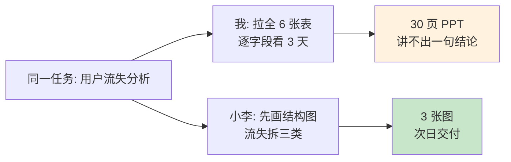
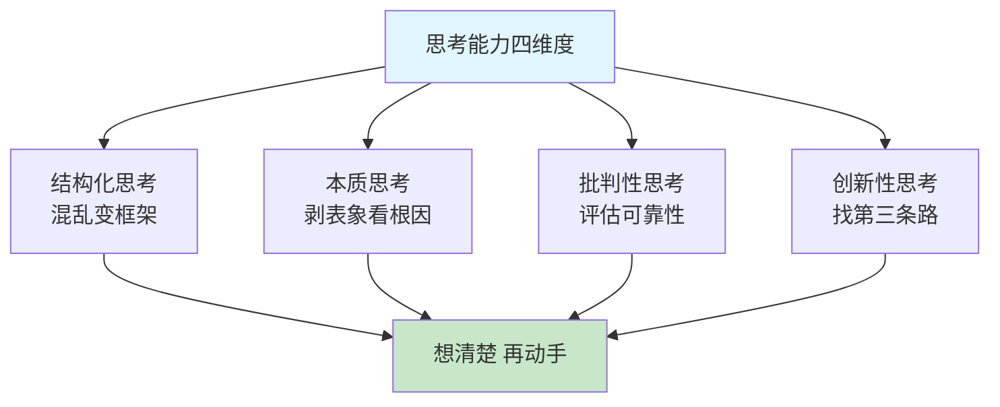
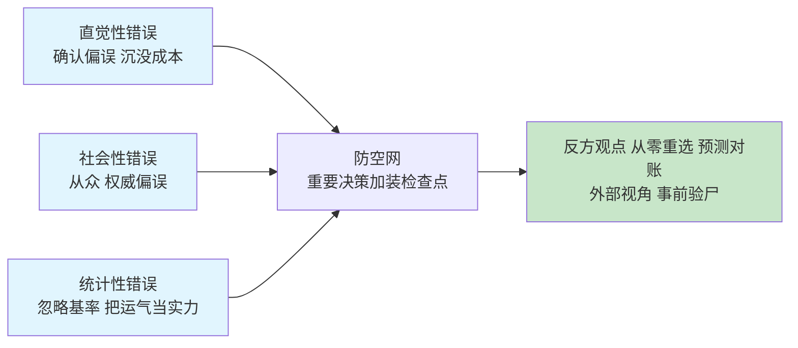
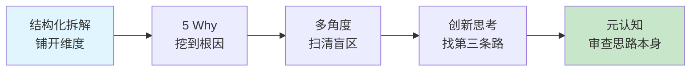
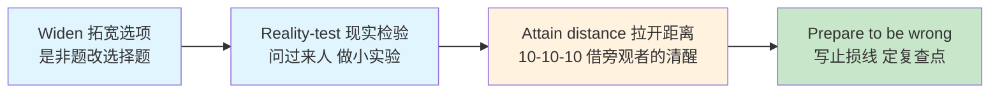
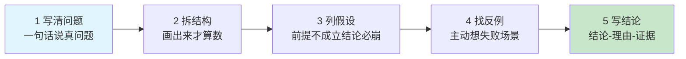
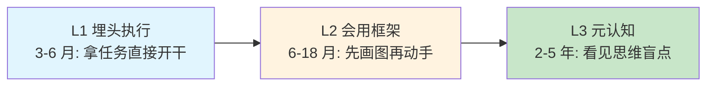
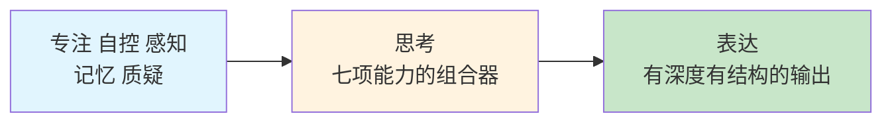
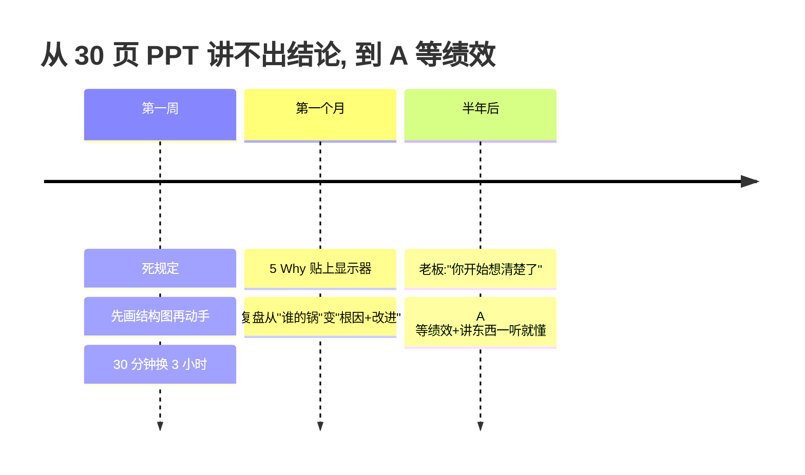

## 14.思考能力的提升

- [14.思考能力的提升](#14思考能力的提升)
- [01.30页PPT讲不出一句结论](#0130页ppt讲不出一句结论)
- [02.断点自测三问](#02断点自测三问)
- [03.什么是思考能力](#03什么是思考能力)
- [04.低质量思考的表现](#04低质量思考的表现)
- [05.思考错误的防空网](#05思考错误的防空网)
- [06.提升思考五方法](#06提升思考五方法)
- [07.结构化思考工具](#07结构化思考工具)
- [08.WRAP决策四步](#08wrap决策四步)
- [09.5步想清楚再动手](#095步想清楚再动手)
- [10.思考力三段里程碑](#10思考力三段里程碑)
- [11.思考怎样撑起表达](#11思考怎样撑起表达)
- [12.这几个坑我踩过](#12这几个坑我踩过)
- [13.总结回顾这一节](#13总结回顾这一节)
- [14.后来发生的改变](#14后来发生的改变)
- [15.今天起改变三点](#15今天起改变三点)
- [16.课后作业思考下](#16课后作业思考下)
- [17.下一站过渡到情商](#17下一站过渡到情商)

## 01.30页PPT讲不出一句结论

那是我入职第二年，组长安排了一个"做一份用户流失分析"的任务。我和同事小李同时领到。

**我的做法**：打开数据库，把 6 张表的数据全拉出来，开始一个字段一个字段看，今天看注册时间、明天看活跃天数、后天看付费数据……做了 3 天，写了 30 页 PPT，**核心结论一句也总结不出来**。

**小李的做法**：拿到任务先花 2 小时画了一张图：流失 = 短期流失 + 中期流失 + 长期流失。每一类找 3 到 5 个核心指标，每个指标对应 1 个 SQL。**第二天上午就交了报告**，3 张图说清楚了流失的核心原因。

组长看完小李的报告，对我说了一句让我蒙了三天的话："**你不是数据不够，你是思考没结构。你在做"累活"，他在做"巧活"**。"

我那时候才意识到：我的执行力可能比小李强（更勤奋、加班更多），但**我的思考能力差他一个量级**。他先想清楚再做，我先做了再想；他用框架去切问题，我用力气去硬抗问题；他每一步都有"为什么"，我每一步都是"先做再说"。

工作 5 年后我深刻体会：**1 个想清楚的人，能顶 5 个埋头干的人**。这一节就是我从那次打击后，重学"思考"的完整总结。

## 02.断点自测三问

思考力欠账的最典型表现，不是"我不会思考"，是"我用力气代替了思考"。用三问自测：**拿到任务能不能先花 30 分钟画结构再动手？**不能，说明你在"先开枪再瞄准"；**你能说出昨天最重要的一次思考是什么吗？**说不出，说明你从没做过元认知；**你能用一张图讲清最近的项目吗？**画不出，说明结构还没在你脑子里长出来。

三问里有一个"否"，你就还在用"勤奋"补"思考"的坑。**勤奋能带你到 60 分，思考才能带你到 90 分**，这一章要给你的就是从 60 到 90 的通道。

## 03.什么是思考能力

思考能力可以拆为四个维度：**结构化思考**，把混乱信息整理成清晰框架，工具是 MECE、金字塔、思维导图；**本质思考**，剥开表象看根因，比如用户流失背后的真原因；**批判性思考**，评估观点可靠性，找证据、识别假设、看漏洞；**创新性思考**，突破既有找新路，别人都说"只能这样"时找第三条路（这一维最容易被忽略，第 06 节专门为它配了训练法）。

**很多人把思考能力等同于智商，其实不是**。智商是天生的，思考能力是后天训练的。很多智商一般的人通过刻意训练，思考能力远超天才，因为他们掌握了思考的方法论，而不只是依赖直觉。

思考的深度取决于两个乘数：**框架的清晰度 × 追问的深度**。框架决定你能看到多少维度，追问决定你能挖到多深的一层。二者只要有一个是零，思考就退化成"情绪化反应"。

## 04.低质量思考的表现

低质量思考通常有四种表现：**凭直觉**，"我感觉这样行"，破解思路是用结构和数据验证；**找经验**，"以前就是这么做的"，破解思路是检查上下文是否变化；**抓表象**，加 try-catch 修完就走，破解思路是 5 Why 追到根因；**一根筋**，只想一个方案就动手，破解思路是强制想出 3 个备选。

**凭直觉不验证**是最常见的。"我感觉这样行""我觉得不行"，所有判断都基于第一反应，不去验证、不去推演。直觉不是坏东西，它是第 03 篇说的系统 1 在工作，日常 80% 的小决策靠它又快又准。问题出在**重要决策也交给直觉**：系统 1 的快，是以深度为代价的，越重要的判断，越要把系统 2 请回来。而且直觉还有一个隐形推手：**确认偏误**，一旦形成第一反应，你会不自觉地只搜集支持它的证据、无视反对它的信号（偏差清单详见第 03 篇，破解动作见下一节的防空网）。

**找经验不思考**。遇到新问题，第一反应是"以前怎么做的就怎么做"。经验在新场景下未必适用，这就是"成功者陷阱"。

**抓表象不挖本质**。用户流失了就增加促销活动，代码出错了就加几个 try-catch，关系紧张了就一起吃顿饭。这些都是表象处理，没有挖本质：用户为什么流失？代码为什么出错？关系为什么紧张？

**一根筋无对比**。只想到一个方案就开始做，从不想"还有没有别的方案？哪个更好？"这就是"先开枪再瞄准"。

## 05.思考错误的防空网

第 04 节讲了低质量思考的四种症状，这一节往下挖一层：**为什么聪明人也会系统性地想错**。答案藏在罗尔夫·多贝里的《清醒思考的艺术》里。他把人类最常见的 52 种思考错误做了一次大清点，结论让人松了口气又出了一身冷汗：**想错不是智商问题，是大脑的出厂设置问题**。系统 1 为了让远古的我们在草原上活下来，宁可错杀不可放过，这套默认设置搬进现代决策场景，就变成了一个个系统性偏差。

多贝里把 52 种错误归成三大类：**直觉性错误**，系统 1 的快捷方式在关键时刻失灵，确认偏误、锚定效应、沉没成本都在此列；**社会性错误**，从众效应、权威偏误，别人都这么说我就信了；**统计性错误**，忽略基础概率、忘记回归均值，把运气当实力。错误不怕多，怕的是没有防空网。防空网的思路不是"消灭错误"，是**在重要决策的关键位置，强制加装检查点**。

三个最高频的错误，各配一个破解动作。**确认偏误**，一旦有了第一反应，眼睛就只搜支持它的证据，破解动作是**下结论前先写反方观点**，逼自己用一段话把"我可能是错的"写具体，写不出来才说明你真想清了。**沉没成本**，"都投入这么多了不能停"，破解动作是**问一句"如果今天从零开始，还选它吗"**，把过去的投入从天平上拿掉，只看未来的收益和代价。**过度自信**，人人都觉得自己是例外，破解动作是**做预测对账**，把判断写下来，三个月后回来对答案，偏差会教你对自己的校准能力保持健康的怀疑。

防空网里还有两件重武器。**第一件，外部视角**。规划项目排期时，我们都爱用内部视角：我的项目有什么特别、我的团队多靠谱，于是估工期永远偏乐观。外部视角的问法相反：**先问"和这个同类的事，历史上的结果分布是什么"**，再回头修正自己的预期。别人家的项目平均超期四成，你的项目大概率也是，"我这不一样"恰恰是偏差发作的声音。**第二件，事前验尸**，心理学家加里·克莱因的发明。项目动手前开一场会，假设"现在是一年后，这个项目已经失败了"，每个人写下失败的原因。**事前验尸把唱反调变成了流程要求，反对意见不再是拆台，而是环节之一**。

回看开篇那个案例：如果我当年做流失分析之前，先花半小时做一次事前验尸，"假设这份报告失败了，原因会是什么"，我写下的第一条就会是"没有结构，全是数据的堆砌"。**错误消灭不掉，但可以预警**，这就是防空网的全部意义。

## 06.提升思考五方法

我这些年练思考的五条主线：

**结构化拆解**。任何复杂问题，先用框架拆成小块。**MECE 原则（相互独立、完全穷尽）**：把"用户为什么流失"拆成"产品原因 / 用户原因 / 竞品原因 / 外部原因"四个互不重叠又覆盖全部的类别。**金字塔结构**：结论在最上，理由在中间，证据在最下，汇报必备。**思维导图**：把一个中心议题向外发散，每条分支再向下展开。

**5 Why 追问本质**。遇到问题，连续问 5 次"为什么"：

> 工厂的设备坏了。
> 为什么？因为电路烧了。
> 为什么？因为电流过载。
> 为什么？因为没装保险丝。
> 为什么？因为采购时没要求。
> 为什么？因为采购清单没列保险丝。
> **根本原因：采购清单不完善**。

如果只解决"换电路"，下次还会坏。**每一层的答案都要"具体到动作、责任、系统"，抽象概念不算答案**。

挖到根因之后，还有一层更高的视野：系统思考。《第五项修炼》把问题分成三层，**事件**（设备今天坏了）、**模式**（这个月已经坏了三次）、**结构**（采购和巡检流程有漏洞）。5 Why 解决"这次为什么坏"，系统思考回答"为什么总是坏"。**停留在事件层的人救火，看到模式层的人预防，改到结构层的人除根**。

**多角度思考**。任何决策，至少从 3 个角度看一遍：自己的角度、对方的角度、第三方旁观者的角度。或者短期视角、中期视角、长期视角。或者技术视角、商业视角、用户视角。**换角度不是走过场，是逼自己看到自己岗位视角之外的信号**。查理·芒格那句"拿着锤子的人，看什么都像钉子"，说的是"一根筋"的病根：你只有一把锤子，因为你只有一种思维模型。他的解法是"多元思维格栅"：跨学科储备几十个基础模型，遇到问题时多个模型一起上。多角度思考，就是格栅的入门训练。

**创新思考**。结构化、5 Why、多角度解决的都是"想得对"，创新思考解决"想得新"。三个启动工具：**反向思考**，把问题反过来问："怎么做会让流失更严重？"把所有答案列出来，再逐条反着做，反例的镜像往往就是方案；**随机联想**，随手翻词典抓一个不相干的词，强制它与问题建立联系，德博诺证实"不相干的刺激"是打破思维定式的最快方式；**头脑风暴四规则**：延迟评判、追求数量、欢迎搭便车、允许狂野。**评判是创意的第一杀手，先生产后过滤**：创新不是灵感，是方法，先放开产量，再收网筛选。

创新还有后半程。文森特·拉吉罗在《思考的艺术》里把创造拆成四个阶段：**准备、孵化、顿悟、验证**。头脑风暴解决的是准备阶段的产量问题，而"洗澡时来灵感"的秘密藏在孵化阶段：难题想不通时主动放下，大脑的后台并不会下班，放松状态下它还在默默重组素材，所以顿悟总在散步和淋浴时降临。孵化不是躺平，是**把问题写下来交给后台，睡前放一放，清晨回收**，顿悟不是天降，是准备给足素材后的后台结算。顿悟来了还要走验证：它真的是好答案吗？放到现实的约束里过一遍再说。

**元认知反思**。定期反问自己：我刚才是怎么得出这个结论的？我用了哪些信息？哪些信息我忽略了？我的判断是基于事实还是基于情绪？如果换个人在我位置，他会怎么想？**思考自己的思考过程，是高手最重要的功夫**。《原则》的作者瑞·达利欧把它写成一个公式：**痛苦 + 反思 = 进步**。犯错不可怕，犯错后不反思才是真的浪费，每一次疼痛都是思考素材的富矿。反思时还要小心**归因偏差**：评别人看人品（"他就是不行"），评自己看环境（"形势所迫"），两套标准会让反思失真，两套都摆出来，才看得到全貌。

五方法之间是有顺序的：**结构化拆解"铺开维度"，5 Why"挖到根因"，多角度"扫盲区"，创新思考"找新路"，元认知"审思路本身"**。做一次高质量思考，五步都要走一遍。

## 07.结构化思考工具

结构化思考的五个基础工具：

**SWOT 分析**四个维度各有用途：S 优势用来放大利用，W 劣势用来弥补改进，O 机会用来抢先抓住，T 威胁用来提前防范。**大项目、跳槽、创业选择时最好用**。

**5W2H** 适合定义任何任务时使用：What 做什么、Why 为什么做、Who 谁来做、When 什么时候做完、Where 在哪做、How 怎么做、How much 花多少成本。回答完这 7 个问题，任务就被定义清楚了。

**鱼骨图（因果分析）** 适合分析问题原因时使用：把问题写在鱼头，从鱼骨向外发散，人、机、料、法、环、测 6 个大类下面再细分。

**决策矩阵**适合多个方案选择时使用。用一张表打分示例：从成本、收益、风险、时间四个维度各打 1-5 分，再汇总为综合得分。假设有三个方案：**方案 A** 成本 3、收益 5、风险 3、时间 4，综合 15 分；**方案 B** 成本 5、收益 4、风险 4、时间 3，综合 16 分；**方案 C** 成本 4、收益 3、风险 5、时间 5，综合 17 分。得分最高的方案 C 就是最优选择。**比"我感觉 B 好"科学得多**。

**六顶思考帽**（爱德华·德博诺）适合团队讨论互相拉扯时：白帽只摆事实、红帽只说直觉、黑帽只挑风险、黄帽只找价值、绿帽只想替代方案、蓝帽管流程。它让每个人在同一时刻戴同一顶帽子，把"各说各话的争吵"变成"轮流入场的合唱"。个人思考时同样好用：一个决策按顺序自己戴六轮，六个面全部照到。

## 08.WRAP决策四步

思考的终点是决策。上一节的工具箱给你零件，这一节给你装配线。希思兄弟在《决断力》里点破了坏决策的四大拦路虎：**视野狭窄**，只在"要不要"里二选一；**证实倾向**，只找支持自己的证据；**短期情绪**，被当下的愤怒或兴奋推着走；**过度自信**，以为自己这次是例外。WRAP 四步，就是给每个拦路虎配一个检查点。

**第一步 Widen，拓宽选项**。人在决策时最容易掉进"要不要"的窄框：这个 offer 要不要接，这个方案要不要批。破框的动作是**把是非题改写成选择题**：除了接受和拒绝，还有没有第三条路？决策学里有个"消失选项测试"，把眼前的两个备选项都藏起来，问自己"如果都不能选，我会做什么"，答案往往就是被窄框遮住的第三个选项。我当年纠结"要不要做技术公众号"，用这个测试逼出了第三条路：先在公司内部分享试水三个月，再决定要不要对外写。后来那份内部分享的讲稿，就是这本书最早的样子。

**第二步 Reality-test，现实检验**。选项拓宽了，接下来别急着相信自己的推演。两个动作：**找已经走过这条路的人问**，问到的真实经历比任何推演都值钱；**用最小的成本做实验**，想转管理，先带一个实习生；想创业，先接一单私活。**推演是想象，实验是证据**，能实验的别推演。

**第三步 Attain distance，拉开距离**。短期情绪是决策最大的染色剂。两个降温动作：**10-10-10 法**，问自己这个选择 10 分钟后会怎么看、10 个月后怎么看、10 年后怎么看，让时间把情绪稀释掉；**旁观者视角**，问一句"如果最好的朋友遇到这件事，我会建议他怎么选"。**给别人的建议总是清醒的，因为那里没有你的情绪**，把这个清醒借用给自己。

**第四步 Prepare to be wrong，准备出错**。决策做完不是结束，还要假设自己可能是错的。落笔写下两条：**止损线**，出现什么信号就退出；**复查点**，三个月后的哪一天回来看。写下来这一步不能省，**没写下来的止损线，在情绪上头的那一刻一定守不住**。

WRAP 管的是重大决策，一年用不上几次；日常工作的高频思考，走下一节的五步流程。**五步管稳，WRAP 管重；五步求全，WRAP 求破框**，两套流程各守一个场景，思考的闭环就齐了。

## 09.5步想清楚再动手

"想清楚再动手"的 5 步流程（可直接抄进项目模板）。**第 1 步，写清楚问题**：一句话说出真正要解的问题，不是"老板让我做的"。**第 2 步，拆结构**：MECE、金字塔、鱼骨图任选一，画出来才算数。**第 3 步，列假设**：明确指出方案的成立前提，假设不成立结论必然崩。**第 4 步，找反例**：想 1-2 个"什么情况会失败"，主动找漏洞。**第 5 步，写结论**：先结论、再理由、最后证据，金字塔顺序。

把这 5 步做完再动手，短期看"慢了"，长期看你会比同事快 3 倍，因为**你在做正确的事，他们在正确地做错的事**。

这套 5 步是"穷举式思考"：想全了再动手，求稳。时间火烧眉毛时，换大前研一的**假设思考**：先基于经验给出一个假设结论，立刻用最小的验证去证实或证伪，边验证边修正。**假设思考管快，穷举思考管稳**，时间充裕走五步，火烧眉毛走假设，两套都要会。

除了上面 5 步，还有三种日常思考训练值得长期做：**每日 10 分钟反思**，睡前问自己"今天最重要的一次决策是什么？我是怎么想的？有没有凭直觉的时刻？"；**读书做思维导图**，每读完一本书强制做一张图，画图的过程就是结构化思考的训练；**写作输出**，把想法写成一篇 800 字，会发现很多原本"想清楚了"的东西根本没想清楚，**写作等于强制结构化 + 强制证据化 + 强制逻辑化**。

## 10.思考力三段里程碑

思考力的成长分三段。**L1 埋头执行**（前 3-6 月）：拿任务直接开干、边做边想，从没画过结构图。**L2 会用框架**（6-18 月）：拿任务先画结构、拆模块，讲得清"为什么这么做"。**L3 元认知**（2-5 年）：反思自己怎么想到这个结论，能看到自己的思维盲点。

从 L1 到 L2 的关键是**养成"先画图再动手"的肌肉记忆**；从 L2 到 L3 的关键是**每天 10 分钟反思自己的思考过程**。这两步跨过去，你会发现工作里的很多"卡点"其实不是能力问题，是思考路径问题，**换一条路，问题就解开了**。

再讲一个组里的场景。有个应届生入职半年，写代码速度是全组最慢的，但每周复盘会他讲的东西质量最高。有一次我问他为什么，他说："我每写一段代码前会先在纸上画一遍逻辑，写代码的时候只是把纸上的东西翻译过去。你们是边写边想，我是想完再写。"半年后他晋升 P6，比同期的应届生快了整整 6 个月。**"想完再写"和"边想边写"看似只差一个字，做出来的产品是两个层级**。

## 11.思考怎样撑起表达

思考力对表达的兜底作用，藏在四个场景里：

**汇报的信息密度**。为什么有人 10 分钟能讲清一个复杂项目？因为他脑子里已经有一张结构图，讲的时候只是把图翻译成语言。**思考清楚的人，表达就是"翻译"**；思考不清楚的人，表达就是"拼凑"，同样 10 分钟，一个能装 5 个观点，一个只能装 1 个观点。

**评审的接得住**。评委问"你这个方案假设是什么？"，你能不能立刻答上来？答得上是因为你做方案时已经用"想清楚 5 步"走过一遍。**思考过的人在等被问，没思考过的人在怕被问**。

**演讲的高密度金句**。一场 40 分钟的演讲，能留下 3 句让听众记住的金句，就是成功。金句不是文采，是**长期思考沉淀出的短句**。所有金句背后都是一段长期的结构化思考，只不过被压缩成了一句话。

**长文写作的骨架**。写一篇 3000 字的深度文章，先决条件不是文笔，是骨架。骨架就是结构化思考的产物。**先有骨、再有肉、最后有皮**，缺骨架的文章都是"散"的。

**贯穿一句话：思考是表达的深度决定项**。这一章前五节讲的专注、自控、感知、记忆、质疑，都是为思考做铺垫；本节的思考是"组合器"，下一节的情商是"输出滤镜"。**7 项能力串起来，就是你"立言"的全部底盘**。

## 12.这几个坑我踩过

练思考这些年踩过的坑，逐条对照。**先做再说**：拿到任务立刻动手，强制 30 分钟画结构图；**5 Why 变 5 问**：机械问 5 次"为什么"，每层落到具体动作、责任、系统；**只用一个视角**：只从自己岗位角度看，强制切当事人、旁观者、老板 3 个视角；**用经验代替思考**："以前就这么做的"，追问"当年前提今天还成立吗"；**框架依赖症**：拿 SWOT 硬套一通，填完再问一句"关键洞察是什么"；**结论无证据**：满篇"我觉得""我认为"，每个结论强制补"依据是"；**防空网只挂不查**：反方观点、预测对账背得很熟，决策时一次没用，把检查点绑进决策流程，决策完强制核一遍。

其中最坑的是"框架依赖症"和"结论无证据"。**填完框架不等于想清楚，摆结论没有证据等于没说话**。这两条如果不改，你会给别人"什么方法论都会但都用不好"的印象，比不会用方法论还糟糕。

再给一份**思考质量的自检清单**：这个结论我用了什么框架？我列了几条假设？我找过几个反例？我看过几个视角？我的证据是什么？如果这是重大决策，我走没走 WRAP、止损线和复查点写下来了吗？六个问题都能答上来才叫"想过了"，答不上来就还是在"先做再说"的旧模式里。

## 13.总结回顾这一节

思考能力是后天训练的肌肉：结构化拆、5 Why 挖、多角度看、创新找新路、元认知反思，五招贯穿一生；防空网拦错误，WRAP 管决策。

五条最关键的实操：**想清楚再做**比"先做了再说"快 5 倍，短期慢，长期赢；**思考五件套**，结构化、5 Why、多角度、创新思考、元认知，外加"痛苦 + 反思 = 进步"的日常引擎；**重要决策加装防空网**，反方观点、从零重选、预测对账、外部视角、事前验尸，错误消灭不掉，但可以预警；**重大选择走 WRAP 四步**，拓宽选项、现实检验、拉开距离、准备出错，不把人生大事交给"要不要"的窄框和当下的情绪；**写作和画图**是最好的思考训练，不是产物，是训练本身。

## 14.后来发生的改变

第一周开始，我给自己定了一条死规定：**任何任务拿到后，先花 30 分钟画结构图，再动手**。刚开始觉得"耽误时间"，但执行了 5 天后我发现：画图花的 30 分钟，节省了后面 3 小时的弯路。同事看我画的图，都说"思路清晰"。

我把 5 Why 写在显示器边上的便利贴上，提醒自己每次遇到问题先问。线上 bug、客户投诉、团队冲突，任何场景我都连续问 5 次"为什么"。**有时候问到第 4 次才发现真正的根本原因和最初想的完全不一样**。复盘从原来"什么时候出问题、谁的锅"，变成了"根本原因 + 系统性改进措施"。

半年后，组里同事经常拿方案来找我："你帮我看看这个结构对不对"。我变成了"看方案"的人。述职的时候，老板对我说："**你今年最大的进步不是做了多少事，而是开始'想清楚'了。一个'想清楚的人'比一个'做了很多事的人'更值钱**。"那次我第一次拿到了 A 等绩效。**更让我意外的是，这份"想清楚"的能力反哺到了写作和演讲上**：我开始能把复杂技术讲得很简单，同事说"你现在讲东西一听就懂"，这份能力后来支撑了我做技术公众号、外部分享，以及最终写出这本书。

## 15.今天起改变三点

**第一，任务前先画结构图**。不要急着开干。打开白纸或思维导图工具，把任务拆成 3 到 5 个模块，每个模块再拆 3 到 5 个子项。**先把骨架想清楚，再去填血肉**。刚开始会觉得"浪费时间"，一周后你就再也回不去了。

**第二，遇到问题问 5 个为什么**。线上 bug、关系冲突、自己情绪，任何问题都强迫自己问 5 次"为什么"。一定要追到**根本原因**，而不是停在表象。**表象修一次坏一次，根因修一次不再犯**，这是复盘和写代码的通用规律。

**第三，每读一本书做一张思维导图**。读完后合上书，凭记忆画一张图：作者讲了什么核心论点？有哪些支撑证据？逻辑关系如何？**画不出来的，就是没真的读懂**。这一条能改变你的读书 ROI 十倍以上。

## 16.课后作业思考下

1. 回想最近一周你做的最重要的 3 个决策，它们是凭直觉做的，还是经过结构化思考的？事后看哪些做对了？哪些做错了？

2. 你和身边那个"想得清楚"的人，最大的差距是什么？是知识量、是经验、还是思考方法？

3. 挑一件你最近的工作任务，用 5W2H 方法重新定义一遍，看看是否能发现之前没想清楚的点。

4. 用 5 Why 法分析最近一个让你头疼的问题（线上 bug、关系冲突、自己的情绪），追到根本原因，再往上一层问"为什么总是发生"，写一段 300 字总结。

5. 回想一个你正在犹豫的重大选择（跳槽、转方向、大额消费），用 WRAP 四步完整走一遍，重点写出"消失选项测试"之后有没有逼出第三个选项，以及你的止损线和复查点分别是什么。

6. 挑一个你最近深信不疑的观点，用防空网三招各演练一遍：先写一段反方观点，再问"如果今天从零开始还信吗"，最后把它记进对账清单，三个月后回来对答案。写 200 字记录哪一招最让你不舒服，不舒服的地方往往就是偏差藏身处。

## 17.下一站过渡到情商

到这里，本章前六节讲的都是"向内"的思维能力：专注让你能停下来，自控让你能坚持，感知让你接收信号，记忆让你留住信号，质疑让你筛掉噪音，思考让你组合成观点。

但观点想清楚了，还有最后一道关：**你能不能让别人愿意听你说**？再对的观点，如果情绪不对、表达不当、时机不对，别人也接不住。下一节讲情商能力，教你把"想清楚的东西"用"让人愿意接住的方式"讲出来。**思考决定说什么，情商决定怎么说，本章的最后一节把这条链闭上**。
