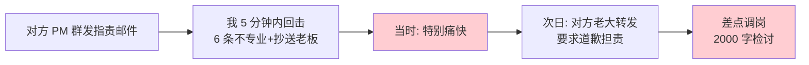
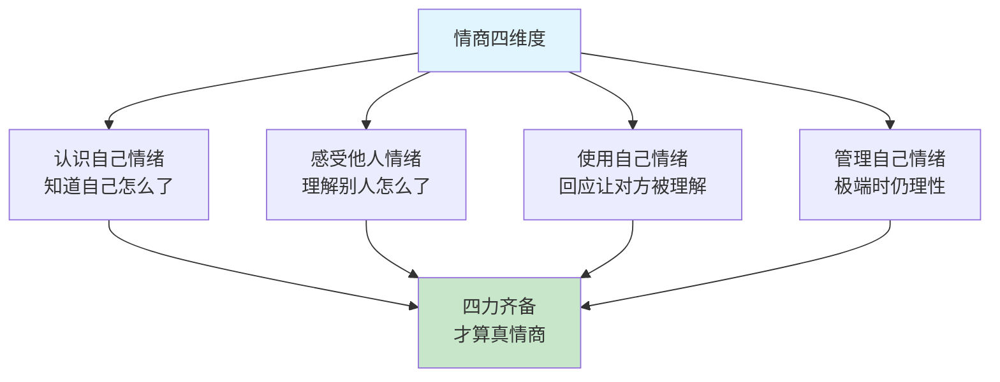
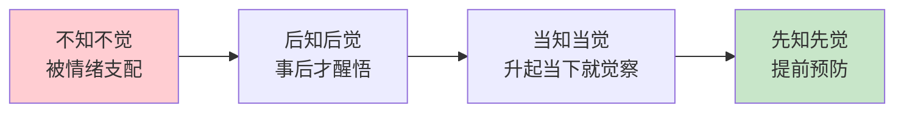
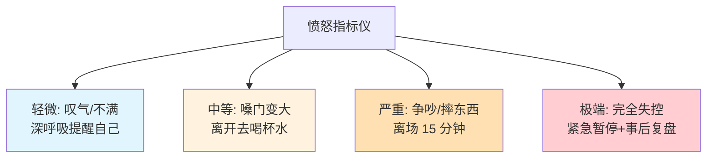
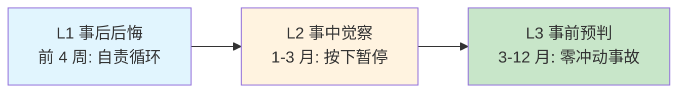
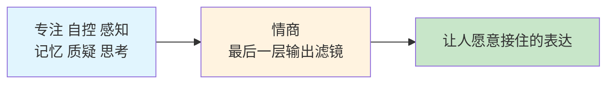
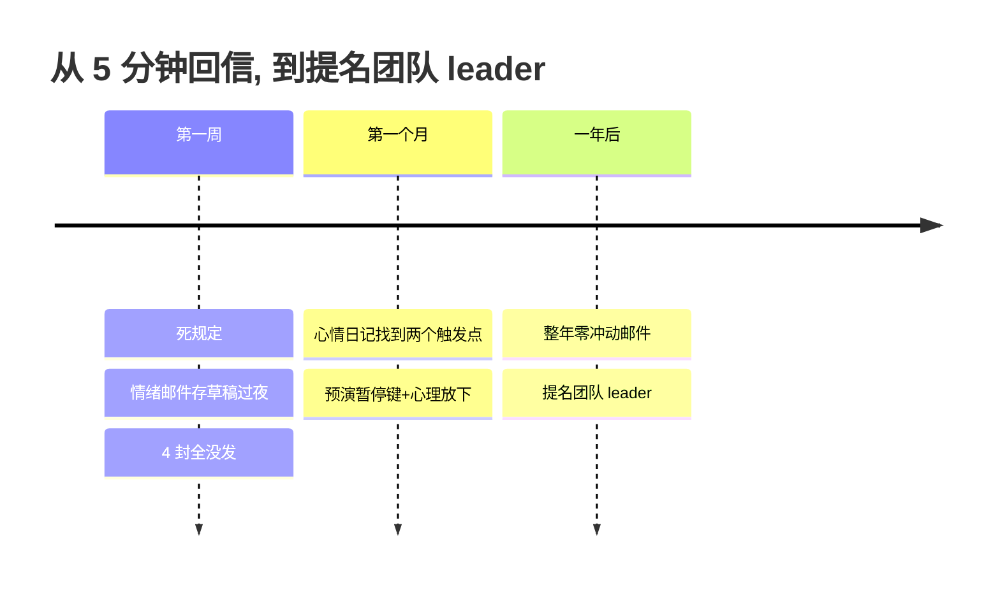

## 15. 情商能力的学习

- [01.5分钟回信毁了整个项目](#015分钟回信毁了整个项目)
- [02.断点自测三问](#02断点自测三问)
- [03.情商到底是什么](#03情商到底是什么)
- [04.情绪管理四阶段](#04情绪管理四阶段)
- [05.认识自己的情绪](#05认识自己的情绪)
- [06.感受他人的情绪](#06感受他人的情绪)
- [07.使用和管理情绪](#07使用和管理情绪)
- [08.提前预演暂停键](#08提前预演暂停键)
- [09.情绪共情三部曲](#09情绪共情三部曲)
- [10.情商三段里程碑](#10情商三段里程碑)
- [11.情商怎样撑起表达](#11情商怎样撑起表达)
- [12.这几个坑我踩过](#12这几个坑我踩过)
- [13.总结回顾本章节](#13总结回顾本章节)
- [14.后来发生的改变](#14后来发生的改变)
- [15.今天起改变三点](#15今天起改变三点)
- [16.课后作业思考下](#16课后作业思考下)
- [17.下一站过渡到结语](#17下一站过渡到结语)

## 01.5分钟回信毁了整个项目

那是我入职第三年，跨部门合作一个项目。对方部门的 PM 发了一封邮件抄送了我们老板，措辞是"贵团队的接口质量太差，导致我们项目延期"。

我看完气得不行，**5 分钟内回复了一封邮件**，列了对方 6 条不专业的地方，最后一句"请下次提需求前先把你们自己的事做明白"，**也抄送了老板**。

发完那一刻特别痛快。**第二天痛快变成灾难**：对方部门老大直接把邮件转给我们老板，要求我"道歉并承担项目延期责任"。我们老板找我谈话，第一句话："**你的技术没问题，但你的情商让你成了团队的炸弹**。"

那次我差点被调岗，最后写了 2000 字检讨才平息。回家路上我盯着地铁玻璃里的自己，想了很久：**我比同龄人技术好，为什么职业天花板这么低？**

复盘后我发现答案：我每个月都因为情绪问题制造一次冲突。老婆说"今晚加班别忘了吃饭"，我回"知道了别管"，吵架；同事邀请我帮忙，我回"我自己事都做不完"，关系裂；老板批评我"这部分思考浅了"，我立刻反驳，被记仇。**所有这些场景里，我不是没察觉情绪，而是完全不会管理情绪**。情绪一来理性立刻下线，事后又后悔到睡不着。

这一节是我从那次邮件事故后，认真补"情商"这门课的总结。它救了我的婚姻、我的职场，也救了我自己。

## 02.断点自测三问

情商欠账是"立言"思想地基里最靠输出端的一层。前六节讲的都是"说什么"，本节讲"怎么说别人才愿意接"。用三问自测：**你能说出上次让你失控的具体触发点吗？**说不出，说明情绪对你是一团黑箱；**你有没有在愤怒时先按住了 24 小时？**没有，说明冲动型决策仍是常态；**别人不开心时你能先共情再讲道理吗？**不能，说明你只在说话，没在对话。

三问里有一个"否"，你的表达就还在"靠内容硬扛"的阶段。**内容再好，情商掉链子，一次邮件、一句话、一个瞬间，就能把之前的努力全部清零**。这一章要教的，就是给内容配一层"让人愿意接住"的输出滤镜。

## 03.情商到底是什么

情商不是"会说话"或"八面玲珑"那么简单。心理学家丹尼尔·戈尔曼在《情商》里把它拆成四个维度：**认识自己情绪**，知道自己怎么了，能说"我现在焦虑"而不是只说"我烦"；**感受他人情绪**，理解别人怎么了，比如察觉配偶今天不开心；**使用自己情绪**，用表情语气回应他人，让对方感到被理解；**管理自己情绪**，极端时仍能理性选择，比如不发那封冲动邮件。

高情商和低情商的差别，四个维度一比就懂：**认识情绪**上，低情商说"不知道，就是烦"，高情商说"我现在焦虑，因为 XX"；**感受他人**上，低情商在别人低落时还讲自己的事，高情商能察觉对方情绪并恰当回应；**使用情绪**上，低情商永远板着脸，高情商能用表情语气让对方感到被理解；**管理情绪**上，低情商顺时狂躁逆时崩溃，高情商顺逆都能保持稳定。

## 04.情绪管理四阶段

情绪管理有四个成长阶段：

**第一层不知不觉**。完全被情绪支配，对谁都没好脾气。**自己都不知道怎么了，怎么管理情绪？**

**第二层后知后觉**。事后才意识到情绪问题。"我真的不想这样，我当时就是控制不住"。停留太久会陷入自责死循环。

**第三层当知当觉**。突破口是**写心情日记**。每天睡前回顾，记录三件事：之前发生了什么？心理变化怎样？最终爆发时如何？不断积累后，对情绪起伏会越来越敏锐，在情绪升起的当下就能觉察。

**第四层先知先觉**。进一步思考"如何提前预防"。在心情日记里追加："如果同样情况再次发生，我哪里可以做得更好？"复盘时要落实到**具体动作可以怎么做、话应该怎么说**，这就是"情绪管理复盘"。

大多数人一辈子都在第一层和第二层之间摇摆。**跨到第三层需要 21 天心情日记，跨到第四层需要 3 个月的复盘习惯**。跨过去，你才算是自己的主人。

## 05.认识自己的情绪

认识自己情绪的三个要素：

**场景铺陈**。理解"为什么会有这样的情绪"。情绪由特定场景触发。比如"我难过"，什么时候难过？被排除在讨论外时？分享没人听时？

**认可情绪**。情绪没有好坏之分。所有情绪都是正常反应，是信号灯告诉你内心正在发生什么。**认可它才能管理它**。

**寻找方案**。知道情绪后如何应对。比如"难过时我可以告诉身边人，他们会陪伴我"。

情绪命名训练也很重要。很多人只会说"烦""不爽"，太笼统。试着用更精准的词汇：**愤怒系**有生气、恼火、愤怒、不满、被冒犯；**悲伤系**有难过、失落、沮丧、心酸、惆怅；**焦虑系**有担忧、紧张、不安、恐惧、慌张；**愉悦系**有开心、满足、感动、自豪、平静；**复合系**有尴尬、委屈、嫉妒、内疚、迷茫。

命名时还有一个关键区分，来自第 04 篇的非暴力沟通：**感受和想法要分开**。"我觉得被冒犯了"其实是一个想法（判断对方冒犯了你），真正的感受是"我觉得很生气"。想法指向别人的错，感受指向自己的内心，**只有说感受，对方才不会防御；一说想法，对话立刻变成辩论**。

**颗粒度越细，对自己了解越深**。"我生气了"和"我觉得被冒犯"需要不同应对策略。身体语言觉察同样关键：心跳加速、拳头握紧、肩膀耸起是愤怒或紧张；浑身无力、呼吸变慢是悲伤或沮丧。**通过身体信号识别情绪，比等到爆发时反应要好得多**。

## 06.感受他人的情绪

培养对他人情绪的敏感度有两个关键：

**观察力**。通过表情、语气、语速、肢体语言捕捉信号。声音变小可能是沮丧，语速加快可能是焦虑，眼神回避可能是尴尬。

**同理心**。不仅看到"他生气了"，还要进一步理解"他为什么生气"。同理心不是天赋，是每天问三遍"如果我是他"练出来的肌肉。

顺便分清一对概念：**同情是居高临下的怜悯**（"你好惨"），**共情是平等的陪伴**（"我懂，我也经历过"）。布琳·布朗的研究说得很透：共情让人感到连接，同情让人感到距离。我们要练的从来是共情。

要注意几个常见错误：**急于给建议**，"你应该怎么做"，正确做法是"我理解你的感受"；**否定对方情绪**，"你有什么好难过的"，正确做法是"难受就说出来，我陪你"；**只关注自己**，"我比你更惨"，正确做法是让对方多讲、多问"后来呢"。

**共情的核心是"先接住情绪、再谈解决方案"**。顺序反了，再对的建议也讲不进去。这也是本章第三节感知力的直接兑现：感知力接收信号，情商决定接住之后怎么处理。

## 07.使用和管理情绪

情绪管理的五条底层原则：

**给情绪一个出口，不要压抑**。千万不要脱口而出"不许伤心""振作起来"。负面情绪不被疏导只会越积越多，最终以更严重形式爆发。正确做法是允许自己伤心、哭、暂时低落，再在情绪平复后理性分析问题。

**不要用分散注意力来逃避**。一有情绪就吃东西、刷手机、看剧，短期止痛但长期是逃避。需要直面情绪问题，先搞清"我怎么了""为什么"，再寻找方案。

**不要乱贴标签**。情绪不好不意味着人不好。承认"我这次情绪管理做得不好"和否定"我是个情绪化的人"完全不同，前者建设性，后者破坏性。

**写日记记录心情**。简单却最有效。书写中思绪慢慢理清，很多想不通的事在写的过程中就想通了，达到自我和解。

**通过兴趣爱好释放**。户外活动带来平静，冥想放松减轻焦虑，跑步游泳释放内啡肽，写作音乐绘画既宣泄又有产出。**运动是情绪管理里投入产出比最高的一项**。

## 08.提前预演暂停键

每个人都有特别容易失控的"触发点"，别人无所谓你却一触即发。这是因为记忆中有"隐性记忆"：过去不愉快的经历在类似情境下被激活。

脑科学给这个现象起了个名字：**杏仁核劫持**。情绪脑（杏仁核）比理性脑（前额叶）快得多，强烈的情绪刺激会绕过理性直接接管身体，戈尔曼称之为"劫持"，开篇那封 5 分钟回信，就是一次教科书级的劫持。好消息是，**情绪的化学成分在大脑里大约 6 秒就会消散一轮**，你只要撑过最开始的 6 秒，理性就能重新上线。所有"暂停键"技巧的共同原理都一样：不为别的，就为熬过这 6 秒。

**追根溯源**：我刚才怎么了？什么事让我这么难受？为什么到了临界点就爆发？曾经发生过什么类似的事？感知触发点后才能有的放矢，不是针对这件事，而是某种感受触动了内心深处的经历。

暂停的方式有两种。**学会放下**：闭眼想象当年那个受伤害的自己，对他说"我已经长大了，我现在选择放下"。**提前预演"暂停键"**：每个人方式不同，离开现场、深呼吸、心里默数 10 秒、捏一下手指。**关键是平静时提前预演**，想象失控情景，练习暂停动作和应对话术。

你可以给自己配一个"愤怒指标仪"，按等级预设应对动作：**轻微**（叹气、内心不满），深呼吸并提醒自己冷静；**中等**（嗓门变大、语气变冲），暂时离开去喝杯水；**严重**（大声争吵、想摔东西），立刻停止并离开现场 15 分钟；**极端**（完全失控、说出伤人话），紧急暂停并在事后复盘。

**高情商其实就是内在觉察力特别高**，清楚知道自己情绪到了什么程度，并知道该怎么应对。

## 09.情绪共情三部曲

千万不要把共情变成套路。人很敏感，能分辨真心理解还是话术应付：**真接纳**是"你真的很难过，如果是我也会特别难受。你想聊聊吗？"，真诚发自内心；**假接纳**是"你好生气，因为你的方案被否定了"，机械、背台词、没情感。

共情的三部曲：

**第一步情绪命名，直面情绪**。先温柔陪伴，给一个缓冲时间，用心去感受对方处境。

**第二步平抚情绪，自我管理**。先看是什么事刺激了自己，产生什么情绪，多强烈；再思考自己对这件事的判断和态度是否有问题；如果改变态度还不能稳定，就考虑深层认知模式是否需要调整。**情绪是认知评价的反映，改变认知能间接改变情绪**。

**第三步回顾总结，提炼经验**。情绪平复后趁热打铁复盘，以后类似事情怎么做？这一步是把情绪管理从"偶然做到"变成"稳定能力"的关键。

## 10.情商三段里程碑

情商成长分三段。**L1 事后后悔**（前 4 周）：冲动过后总是自责，一年发过 10 封冲动邮件。**L2 事中觉察**（1-3 月）：火气升起时能按下暂停，关键场合能收得住。**L3 事前预判**（3-12 月）：提前识别触发点主动规避，全年零冲动事故。

跨过 L2 是分水岭，**从"后悔的人"变成"稳得住的人"，这一步比升职都重要**。

## 11.情商怎样撑起表达

情商是本章 7 项能力的"最后一层输出滤镜"，直接决定你说的话能不能被接住：

**跨部门沟通中的话术分量**。同样一句"这个方案有问题"，情商高的人说出口对方会认真听，情商低的人说出口对方立刻防御。**同样的内容，情商不同，接收方的反应可以差 5 倍**。这就是我那封 5 分钟回信毁了整个项目的教训。

**汇报被质疑时的第一反应**。老板说"这部分你思考浅了"，情商低的立刻反驳，情商高的先接住"您指的是哪个部分？我想理解一下"。**先接情绪、再谈内容**，这一顺序对了，天大的批评都能变成加分机会。

**演讲现场的临场共情**。你在台上讲一个观点，看到台下有人皱眉，情商高的人会立刻停下来说"我看到有些同学可能有不同看法，让我先补充一下……"。这份"读到情绪并主动回应"的能力，是让演讲从"独白"变成"对话"的唯一路径。

**长期人际中的信任积累**。一个人被人记住多年不是因为他说过什么，而是因为他让别人"感觉良好"的次数够多。**情商是长期信任的复利机**，一次一次的小共情，攒成十年后依然愿意帮你的人脉。

这一节到这里，本章 7 项能力全部串完：**专注让你能停、自控让你能坚持、感知让你收得到、记忆让你留得住、质疑让你筛得掉、思考让你组合成、情商让你输出得漂亮**。这七项一齐练熟，"立言"两个字才算真正立住。

## 12.这几个坑我踩过

练情商这些年踩过的坑，逐条对照。**愤怒时立刻回信**：5 分钟回一封"痛快邮件"，存草稿、过夜、再看；**愤怒时做重大决定**："我明天就辞职"，24 小时冷静期；**共情变套路**："我理解你"机械背，真的看见对方、真的多问一句；**建议在情绪前**："你应该怎么怎么做"，先接情绪、再谈方案；**只处理事不处理情绪**："事情不就是这样"，情绪不处理，事情永远处理不完；**只贴人格标签**："我就是情绪化"，承认"这次没管好"，不否定人格。

其中最坑的是"愤怒时立刻回信"和"建议在情绪前"。前者一封邮件毁一个项目，后者一句话破一段关系。**这两条不改，其他所有情商技巧都是花拳绣腿**。

## 13.总结回顾本章节

情商不是会说话，是"觉察 + 暂停 + 共情"：能在情绪上头时把理性请回来。

四条最关键的实操：**认识 / 感受 / 使用 / 管理**是情商的四件套，缺一项都会崩；**写心情日记 + 找到触发点 + 预演暂停键**是最实用的三个工具；**杏仁核劫持只持续 6 秒**，所有暂停技巧都是为了熬过这 6 秒；**不在愤怒时发邮件，不在激动时做决定**，能避开 80% 的人生大坑。

## 14.后来发生的改变

事故后我给自己定了一条死规定：**任何情绪化的邮件、消息，一律先存草稿，过夜再看**。第一周我存了 4 封"想骂回去"的邮件。第二天早上看，4 封全没发，我自己都觉得当时太冲动。

我开始写心情日记。一个月后我发现自己有两个核心触发点：第一是**被否定专业能力**，别人说我技术不行或思考不深时我会立刻爆炸；第二是**被忽视存在感**，别人开会不点我名或邮件不抄我时我会闷火好几天。知道触发点后我做了两件事：提前预演，下次再遇到时先深呼吸 5 秒，然后说"我想理解一下你的意思……"；心理放下，告诉过去那个一直被否定的自己"那已经过去了"。

半年后整整一年我没发过一封冲动邮件。**职场关系变好到我自己都意外**，以前那些和我有过节的同事开始主动找我合作。老婆有一天说："你最近变得**不一样了**，遇到不顺心的事不再发火，会先问我'你刚才那句话是什么意思'。我感觉嫁了一个新老公。"更意外的是，去年年底**我被提名为团队 leader**。老板说理由是："你的技术能力一直都在，但今年我看到的是一个'稳得住的人'，这才是带团队的关键。"**技术让我能坐上牌桌，情商让我坐得住**。

## 15.今天起改变三点

**第一，写心情日记**。睡前 5 分钟记录：今天最强烈的情绪、触发因素、我的反应、如果重来怎么做。坚持一个月，对自己情绪模式会有全新认识。

**第二，找到触发点**。回忆最近一次失控经历：什么事触发的？为什么偏偏这件事？深层原因是什么？找到触发点后**提前预演一个暂停键**，下次遇到时第一反应是什么。

**第三，邮件过夜规则**。任何在情绪激动时想发的邮件、消息、朋友圈，**全部先存草稿过夜**。第二天再看你会感谢自己。

## 16.课后作业思考下

1. 对照情绪管理四阶段（不知不觉/后知后觉/当知当觉/先知先觉），判断你目前在哪个阶段？下一步目标是什么？

2. 回顾你生活和工作中最容易让你失控的"触发点"是什么？背后的深层原因是什么？

3. 从明天开始连续写 7 天心情日记，记录最强烈的情绪、触发因素、反应、如果重来怎么做。7 天后回顾找出你的情绪模式。

4. 回忆一次面对别人负面情绪的经历，对照"共情三部曲"，你做得好的和不够好的环节分别是什么？下次如何改进？

## 17.下一站过渡到结语

到这里，第 4 章 7 项底层思维能力全部讲完了，本卷四章的完整链路也走完了。

回过头再看这条链：**第 1 章 底蕴储备（价值观和知识管理）→ 第 2 章 沟通实战（一对一/一对多）→ 第 3 章 公众表达（演讲/写作/PPT）→ 第 4 章 底层思维（专注/自控/感知/记忆/质疑/思考/情商）**。第 1 章是燃料，第 2、3 章是发动机，第 4 章是发动机的原理和维护手册。

第 4 章之所以放在最后，是因为它**回答的是所有前三章的"为什么"**：为什么你要练专注？因为没有专注的深度就没有第 3 章演讲的分量；为什么你要练情商？因为再对的观点没有情商的输出滤镜就传不到听众心里。**七项能力真正的价值，是让前三章的"说得清"有源头活水**。

合上这一章，先读一读本册的结语。再往后，是写给你的两篇附录：《写给平凡人的话》和《十年回望的后记》，那是我写给十年前那个不知天高地厚的自己的两封信。
